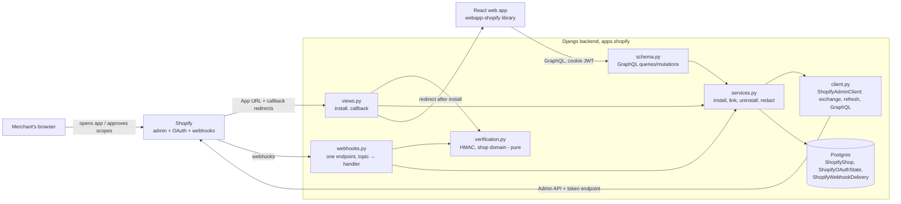
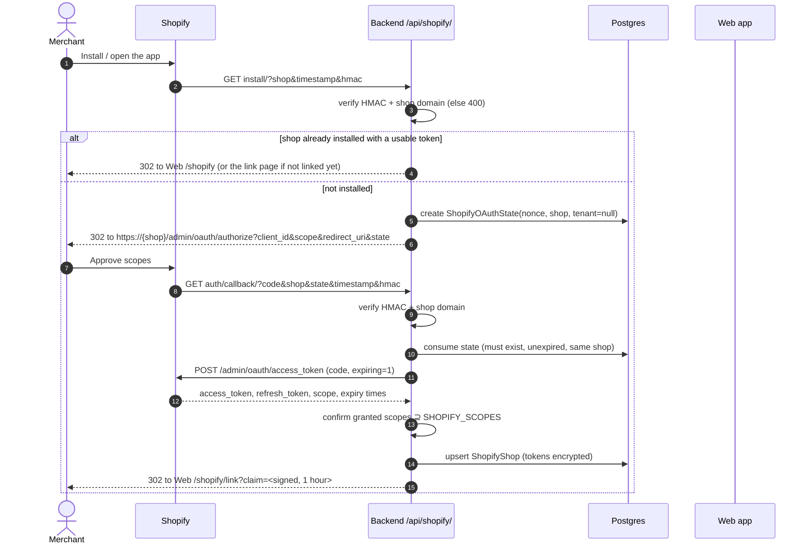
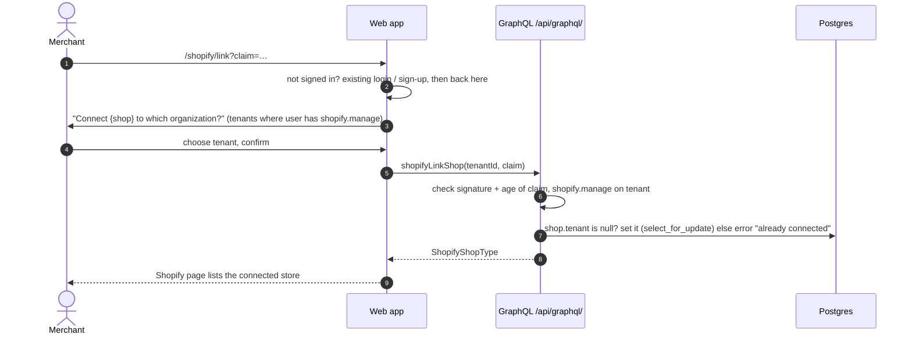
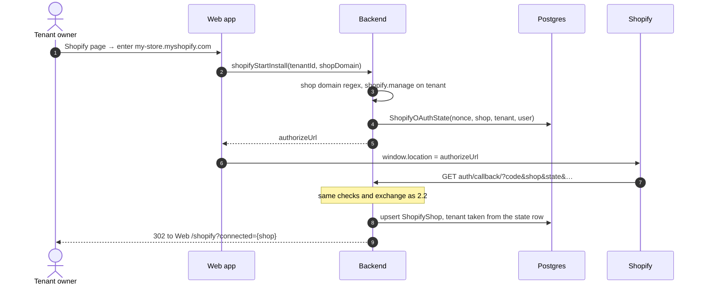
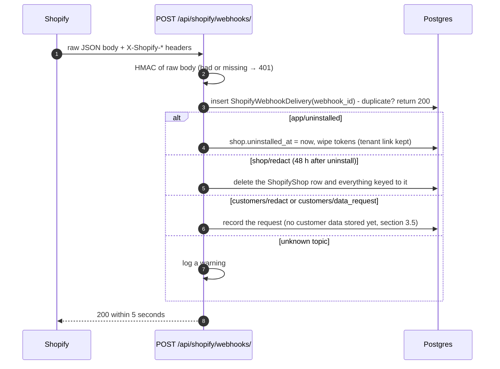
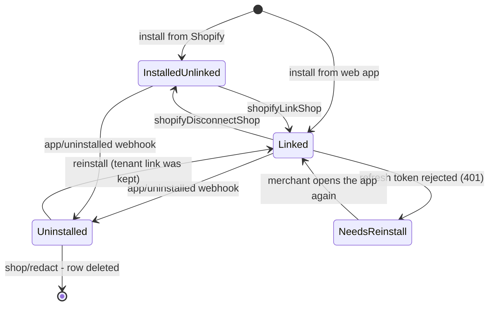

# Shopify App Installation — Implementation Plan

**Date:** 2026-10-03
**Updated:** 2026-10-03 after the human maintainer's first review; 2026-10-07 after the live install
(step 10), which found and fixed the bugs listed in section 5.1, and adding the products page (step 11)
**Status:** Steps 1 to 8 done; step 9 done except its component tests; step 10 done; step 11 (products
page) not started; step 12 (release) not started
**Goal:** Make this SaaS installable as a Shopify app. A merchant installs it on their store, the backend
receives and safely keeps an Admin API access token for that store, the store is linked to one of our
tenants (organizations), and the backend handles the webhooks Shopify requires (uninstall and the three
mandatory privacy compliance topics). Step 11 adds a read-only "Shopify products" page, the first use of
the stored token, to prove the connection works end to end. Other features (orders, product sync,
messaging channels) build on this slice; none of them is in this plan.

---

## 0. Feasibility and approach

**Yes, this is possible, and nothing existing has to be rewritten.** Shopify only needs three things
from us: a URL it opens when a merchant installs or launches the app, a redirect URL that receives the
OAuth code, and HTTPS webhook endpoints. All three are ordinary Django views.

**Approach: one new, self-contained Django app, `apps.shopify`,** built like `apps.payfast`
([`apps/payfast/`](../../../packages/backend/apps/payfast/)): its own settings block, system check,
models, migrations, pure verification functions, an API client, views, GraphQL schema and tests. The only
touches to upstream files are appended lines in the composition points (section 3.1 of
[`agents.md`](../agents.md)):

- [`config/settings.py`](../../../packages/backend/config/settings.py): `"apps.shopify"` in `LOCAL_APPS`, plus a `SHOPIFY_*` settings block
- [`config/urls_api.py`](../../../packages/backend/config/urls_api.py): `path("shopify/", include("apps.shopify.urls"))`
- [`config/schema.py`](../../../packages/backend/config/schema.py): `shopify_schema.Query` / `shopify_schema.Mutation` appended
- [`packages/webapp/src/app/app.component.tsx`](../../../packages/webapp/src/app/app.component.tsx): the new web app routes

The "feature delete" test holds: removing `apps/shopify`, the new web app library and those appended
lines restores the original composition.

### 0.1 What the working Flask app taught us, and what changes

The Flask app at `~/Documents/Projects/Personal/WhatsApp/python/shopify-whatsapp-flask-app` (files
`src/server.py`, `src/helpers.py`, `src/shopify_client.py`) proved the install round trip on a real dev
store. It is a secondary reference: every fact below was re-checked against Shopify's docs (section 1),
and that check found several things the port must do differently.

**Kept from the Flask app**

- The two-endpoint install flow: an "app launched" URL that checks the request and sends the merchant to
  Shopify's authorize page, and an "app installed" redirect URL that checks `state`, exchanges the
  `code` for a token and registers what it needs.
- Query-string HMAC check for Shopify's browser redirects (hex HMAC-SHA256 of the sorted parameters),
  and body HMAC check for webhooks (base64 HMAC-SHA256 of the raw body), both with constant-time compare.
- A plain `requests`-based GraphQL Admin API client instead of an SDK, so every call is visible and
  testable.

**Changed in the port**

1. **Tokens are kept in Postgres, encrypted,** not in an in-memory dict (lost on restart, not shared
   between web workers and Celery). We considered `django-encrypted-model-fields` and
   `django-fernet-fields`, but both are unmaintained (no updates for Django 5.x/6.x). The community
   consensus is to build a small custom wrapper over `cryptography.fernet`. Our `crypto.py` is two
   functions (`encrypt_token`, `decrypt_token`), fully tested, and doesn't add a dependency on an
   abandoned package.
2. **Expiring offline tokens** (`expiring=1`), with refresh. Shopify: "New public apps must use expiring
   offline access tokens", and all public apps must by 1 January 2027 (section 1.3). The Flask app gets a
   non-expiring token.
3. **The shop regex is anchored at both ends.** The Flask `is_valid_shop` uses `re.match` without `$`,
   so `evil.myshopify.com.attacker.example` passes. Shopify says: "Anchor the pattern at both ends."
4. **Granted scopes are confirmed** after the exchange, as Shopify asks.
5. **`state` lives in the database** (bound to a shop, and optionally to a tenant and user), not in a
   cross-site session cookie. The API and the web app are on different hosts here, and section 2's
   "connect from the web app" flow needs `state` tied to a tenant on the server.
6. **API version `2026-10`,** from a setting. The Flask app pins `2025-10`, which is no longer supported:
   Shopify falls forward to the oldest supported version (`2026-01`) for it (section 1.6).
7. **Webhooks come from the app configuration file** (`shopify.app.toml`), not from a per-shop
   `webhookSubscriptionCreate` call. Shopify recommends it, it is the only way to subscribe to the
   compliance topics, and failing app-level subscriptions are not deleted (section 1.5). See decision D3.
8. **Webhook processing is switchable** between synchronous (in the web request) and asynchronous (via
   Celery), controlled by `SHOPIFY_WEBHOOK_DISPATCH`. See section 3.6.
9. **The compliance webhooks are implemented,** not stubbed: wrong HMAC gives `401`, as Shopify requires.
10. **Not embedded (for now).** The Flask app renders a page inside the Shopify admin iframe. This plan
    lands the merchant in our existing React web app instead (decision D1, section 1.7).
11. **ScriptTag calls and `write_script_tags` are dropped.** They aren't needed to install or link a store.

### 0.2 The blog post

https://www.tigersandtacos.dev/posts/create-a-shopify-backend-service-in-python-flask/ (August 2021)
contributes structure rather than code (the post has none beyond configuration):

- **one webhook endpoint with a topic → handler dictionary** (its `webhooks.py`); this plan's
  `apps/shopify/webhooks.py` keeps that shape
- **scopes and webhook topics as named configuration** (its `common/const.py`)
- its own caveat that **slow synchronous webhook handling doesn't scale**, which section 1.5's five-second
  limit makes concrete: our handlers do only quick database work, and anything slow goes to a Celery task

Its env var names (`SHOPIFY_SHARED_SECRET`, `HOSTNAME_FOR_SHOPIFY`) are not reused; section 7 maps the
Flask app's names, which are the ones that actually worked.

---

## 1. Shopify facts we rely on (verified against the docs, 2026-10-03)

Nothing below is from memory. Where the docs are silent, the item says so and becomes a live check in
step 9.

### 1.1 Authorization code grant (install)

Docs: https://shopify.dev/docs/apps/build/authentication-authorization/access-tokens/authorization-code-grant

- Send the merchant to
  `https://{shop}/admin/oauth/authorize?client_id=…&scope=…&redirect_uri=…&state=…` (`grant_options[]=per-user`
  only for online tokens, which we don't use). `redirect_uri` "Must exactly match a redirect URI you've
  configured". `state` is "A randomly generated nonce unique to this request".
- The callback receives `code, hmac, shop, state, timestamp`. Three checks, all required:
  - **state:** "Compare the `state` parameter to the nonce you stored in step 1. If they don't match,
    reject the request."
  - **hmac:** "Remove the `hmac` parameter from the query string, sort the remaining parameters
    alphabetically, and compute an HMAC-SHA256 hash using your client secret", compared in constant time.
  - **shop:** "Confirm the `shop` parameter matches `^[a-zA-Z0-9][a-zA-Z0-9\-]*\.myshopify\.com$`. Anchor
    the pattern at both ends."
- Exchange: `POST https://{shop}/admin/oauth/access_token` with `client_id, client_secret, code` and
  `expiring: '1'`. Response: `access_token, scope, expires_in, refresh_token, refresh_token_expires_in`.
- "Check that `scope` in the response includes all the scopes your app requires." "A `write_*` grant
  includes its matching `read_*` scope."
- Calls carry the header `X-Shopify-Access-Token: {access_token}`.
- **Docs are silent on** the exact parameter encoding used for the hex HMAC when a value contains `&`
  or `%`. The Flask app's `urlencode(sorted(params))` worked on a real store; step 2's test vector and the
  live install (step 9) pin it.

### 1.2 Install also arrives at the App URL

When a merchant installs from the Shopify admin (or "Test on store" in the developer dashboard), Shopify
opens the configured App URL with signed query parameters, which the same HMAC check verifies. The Flask
app's `/app_launched` handled exactly this. Docs on managed installation vs the authorization code grant:
https://shopify.dev/docs/apps/build/authentication-authorization/app-installation. Shopify-managed
installation needs a Shopify CLI app and, for a custom frontend, token exchange (section 1.7), so it is
not used here.

### 1.3 Expiring offline tokens and refresh

Docs: https://shopify.dev/docs/apps/build/authentication-authorization/access-tokens/offline-access-tokens
and https://shopify.dev/docs/apps/build/authentication-authorization/implement-token-exchange#refresh-an-expiring-offline-token

- Lifetimes: access token "1 hour (`expires_in` is `3600`)", refresh token "90 days
  (`refresh_token_expires_in` is `7776000`) when issued".
- "Public apps must use expiring offline access tokens for GraphQL Admin API requests by January 1, 2027."
- Refresh: `POST https://{shop}.myshopify.com/admin/oauth/access_token` with `client_id, client_secret,
grant_type=refresh_token, refresh_token`.
- **Rotation:** "Every refresh returns a new access token and a new refresh token. Store both securely,
  and use the new refresh token in the next refresh request." "The previous access token stays valid
  until its `expires_in` duration ends."
- **Terminal failure:** `401` "This request requires an active refresh_token" covers "an unknown token, a
  token your app has already replaced, an expired token, and a revoked or uninstalled app". "Treat that
  `401` as final: stop retrying". Network errors, timeouts, `5xx` and `429` are "safe to retry with the
  same `refresh_token`".
- Consequence for us: two processes refreshing the same shop at once would race, and the loser's refresh
  token is "already replaced". The refresh therefore runs under a row lock (section 3.3).

### 1.4 Mandatory compliance webhooks

Docs: https://shopify.dev/docs/apps/build/privacy-law-compliance

- Every App Store app must subscribe to `customers/data_request`, `customers/redact` and `shop/redact`,
  in `shopify.app.toml` with `compliance_topics`.
- The app must "respond with a `200` series status code", and "if a mandatory compliance webhook sends a
  request with an invalid Shopify `HMAC` header, then the app must return a `401 Unauthorized` HTTP status."
- `shop/redact` is sent "48 hours after a store owner uninstalls your app". Actions must be completed
  "within 30 days of receiving the request".

### 1.5 Webhook delivery

Docs: https://shopify.dev/docs/apps/build/webhooks/subscribe/https and https://shopify.dev/docs/apps/build/webhooks/subscribe

- Headers: `X-Shopify-Topic`, `X-Shopify-Hmac-SHA256`, `X-Shopify-Shop-Domain`, `X-Shopify-API-Version`,
  `X-Shopify-Webhook-Id`, `X-Shopify-Event-Id`, `X-Shopify-Triggered-At`.
- HMAC: base64 HMAC-SHA256 of the **raw** request body with the client secret.
- "Shopify has a one-second connection timeout and a five-second timeout for the entire request."
  Anything outside 2xx is a failure.
- Retries: "Shopify retries 8 times over the next 4 hours." For subscriptions made through the Admin API,
  "After 8 consecutive failures, the subscription is automatically deleted". App-specific subscriptions
  (`shopify.app.toml`) "will **not** be deleted", and are the recommended way. Compliance topics "Cannot
  be subscribed to using the Admin API".
- Duplicates: "Use X-Shopify-Webhook-Id to deduplicate individual deliveries."

### 1.6 API versions

Docs: https://shopify.dev/docs/api/usage/versioning

- A new version every quarter (January, April, July, October), each "supported for a minimum of 12
  months". Asking for an unsupported version makes Shopify fall forward to "the oldest accessible stable
  version". On 2026-10-03 the supported versions are `2026-01`, `2026-04`, `2026-07` and `2026-10` (latest).

### 1.7 Embedded apps, ID tokens and iframe protection (not built in this plan)

- Embedded apps get a short-lived ID token (formerly "session token") from App Bridge: HS256 with the
  client secret, checks on `exp`, `nbf`, `aud`, `iss`/`dest`; tokens "expire one minute after they're
  issued", and "cannot be used directly with the Admin API"
  (https://shopify.dev/docs/apps/build/authentication-authorization/session-tokens).
- Token exchange trades that ID token for an access token, and needs "A Shopify-managed app installation",
  an embedded app and App Bridge
  (https://shopify.dev/docs/apps/build/authentication-authorization/access-tokens/token-exchange).
- Every embedded HTML response needs `Content-Security-Policy: frame-ancestors https://{shop}
https://admin.shopify.com;`, "different for every shop"
  (https://shopify.dev/docs/apps/build/security/set-up-iframe-protection).
- Why that's out of scope here: our web app signs users in with cookie JWTs, which a cross-site iframe
  can't rely on, and Django's `XFrameOptionsMiddleware` denies framing. Embedding means a second
  authentication path (ID token → our user), so it is a separate future plan (decision D1).
- **App Store listing and embedding (researched 2026-10-03):** Shopify does not strictly prohibit
  non-embedded apps from the App Store. Standalone apps are valid for tools that span multiple platforms
  or need more UI real estate than the admin-chrome width allows. Our app qualifies: it integrates
  Shopify with WhatsApp, making it a multi-platform tool. However, embedded apps get 70–85% higher
  conversion rates, and the "Built for Shopify" certification requires embedded + App Bridge for many
  categories. **Resolution (D1):** ship standalone in this plan to get listed and prove value; plan an
  embedded companion view as a follow-up for "Built for Shopify" certification. The standalone
  architecture doesn't block the listing. See section 9, D1.
  Sources:
  - https://shopify.dev/docs/apps/build/authentication-authorization/session-tokens
  - https://shopify.dev/docs/apps/build/authentication-authorization/access-tokens/token-exchange
  - https://shopify.dev/docs/apps/build/security/set-up-iframe-protection

---

## 2. How it works (diagrams)

The diagrams are Mermaid; GitHub renders them in the browser.

### 2.1 The pieces



### 2.2 Install started from Shopify (App Store, admin, or "Test on store")



### 2.3 Linking a freshly installed store to a tenant



### 2.4 Install started from our web app ("Connect a Shopify store")



### 2.5 Webhooks (uninstall and compliance)



### 2.6 Calling the Admin API with an expiring token

```mermaid
sequenceDiagram
    autonumber
    participant Caller as A service (later features)
    participant SV as services.admin_client_for(shop)
    participant DB as Postgres
    participant Shopify

    Caller->>SV: client for shop
    SV->>DB: read ShopifyShop
    alt access token expires in under 5 minutes
        SV->>DB: BEGIN; SELECT … FOR UPDATE (re-read: another worker may have refreshed)
        SV->>Shopify: POST access_token (grant_type=refresh_token)
        alt 200
            SV->>DB: store new access + refresh tokens and expiries; COMMIT
        else 401 "requires an active refresh_token"
            SV->>DB: mark needs_reinstall; COMMIT
            SV-->>Caller: raise ShopifyReauthorizationRequired
        end
    end
    SV-->>Caller: ShopifyAdminClient(shop, access_token)
    Caller->>Shopify: POST /admin/api/2026-10/graphql.json
```

### 2.7 Data model

```mermaid
erDiagram
    Tenant ||--o{ ShopifyShop : "connects (null until linked)"
    User ||--o{ ShopifyOAuthState : "started (connect-from-web-app only)"
    Tenant ||--o{ ShopifyOAuthState : "bound to (connect-from-web-app only)"
    ShopifyShop ||--o{ ShopifyWebhookDelivery : receives

    ShopifyShop {
        string shop_domain UK "my-store.myshopify.com"
        fk tenant "nullable"
        text access_token_encrypted
        datetime access_token_expires_at
        text refresh_token_encrypted
        datetime refresh_token_expires_at
        string scopes
        datetime installed_at
        datetime uninstalled_at "nullable"
        bool needs_reinstall
    }
    ShopifyOAuthState {
        string nonce UK
        string shop_domain
        fk tenant "nullable"
        fk created_by "nullable"
        datetime created
    }
    ShopifyWebhookDelivery {
        string webhook_id UK
        string topic
        string shop_domain
        json payload
        datetime created
    }
```

### 2.8 A store's lifecycle



---

## 3. Backend design

### 3.1 Settings ([`config/settings.py`](../../../packages/backend/config/settings.py)), additive only

```python
# Shopify app (https://shopify.dev/docs/apps/build). Always defined so apps.shopify imports safely;
# the apps.shopify system check reports missing values only when SHOPIFY_ENABLED.
SHOPIFY_API_KEY = env("SHOPIFY_API_KEY", default="")            # the app's client ID
SHOPIFY_API_SECRET = env("SHOPIFY_API_SECRET", default="")      # the app's client secret (HMAC key too)
SHOPIFY_SCOPES = env.list("SHOPIFY_SCOPES", default=["read_products"])
SHOPIFY_API_VERSION = env("SHOPIFY_API_VERSION", default="2026-10")
# Fernet key for access/refresh tokens at rest; generate like BACKUP_MASTER_KEY above.
SHOPIFY_TOKEN_ENCRYPTION_KEY = env("SHOPIFY_TOKEN_ENCRYPTION_KEY", default="")
# OAuth state nonce lifetime in seconds (how long a merchant has to complete the authorization flow).
SHOPIFY_AUTH_TIMEOUT = env.int("SHOPIFY_AUTH_TIMEOUT", default=600)  # 10 minutes
# Webhook processing dispatch: "sync" (handle in the web request) or "celery" (hand off to a Celery task).
# "sync" is the safe default: it needs no worker and is enough while all handlers are quick DB writes.
# Switch to "celery" when handlers start doing slow work (API calls, syncing products).
SHOPIFY_WEBHOOK_DISPATCH = env("SHOPIFY_WEBHOOK_DISPATCH", default="sync")
SHOPIFY_ENABLED = bool(SHOPIFY_API_KEY and SHOPIFY_API_SECRET)
```

- The OAuth `redirect_uri` is derived, not configured: `f"{API_URL}/api/shopify/auth/callback/"`, from
  the existing `API_URL` setting. After install the merchant is sent to the existing `WEB_APP_URL`. So the
  Flask app's `INSTALL_REDIRECT_URL`, `WEBHOOK_APP_UNINSTALL_URL`, `SERVER_*` and `APP_NAME` need no
  counterparts (section 7).
- **System check** ([`apps/shopify/checks.py`](../../../packages/backend/apps/shopify/checks.py)): when
  `SHOPIFY_ENABLED`, errors for an empty or invalid `SHOPIFY_TOKEN_ENCRYPTION_KEY`, an empty
  `SHOPIFY_SCOPES`, a `SHOPIFY_API_VERSION` not shaped `YYYY-MM` with month 01/04/07/10, and a
  `SHOPIFY_WEBHOOK_DISPATCH` not in `{"sync", "celery"}`. When disabled, every Shopify view returns 404
  and every mutation refuses, as PayFast does on Stripe.
- Each setting gets its `test_<name>_setting_reads_env_var` subprocess test (section 2.3 of
  [`agents.md`](../agents.md)).
- `cryptography` (for Fernet) is today only a transitive dependency. Add it to
  [`pyproject.toml`](../../../packages/backend/pyproject.toml) as a direct dependency pinned `==` to the
  version already in `uv.lock`, so the import doesn't depend on another package's choices.

### 3.2 New app [`packages/backend/apps/shopify/`](../../../packages/backend/apps/shopify/)

```
apps/shopify/
├── __init__.py
├── apps.py              # ShopifyConfig.ready(): register checks
├── checks.py
├── constants.py         # webhook topic names, refresh margin
├── permissions.py       # shopify.view / shopify.manage via register_app_permissions()
├── verification.py      # pure: is_valid_shop_domain, verify_query_hmac, verify_webhook_hmac
├── crypto.py            # pure: encrypt_token / decrypt_token (Fernet, custom, see section 0.1)
├── models.py            # ShopifyShop, ShopifyOAuthState, ShopifyWebhookDelivery
├── migrations/0001_initial.py (+ a data migration for the permissions if the registry needs one)
├── client.py            # ShopifyAdminClient: exchange_code, refresh, graphql
├── services.py          # start_install, complete_install, link_shop, disconnect, admin_client_for,
│                        # handle_uninstalled, handle_shop_redact, handle_customers_*
├── tasks.py             # Celery tasks: process_shopify_webhook (used when SHOPIFY_WEBHOOK_DISPATCH=celery)
├── views.py             # install_view (App URL), callback_view
├── webhooks.py          # webhook_view + TOPIC_HANDLERS dict (the blog's shape) + dispatch logic
├── urls.py              # install/, auth/callback/, webhooks/
├── schema.py            # GraphQL types, queries, mutations
├── admin.py             # read-only admin; never shows tokens
├── management/commands/shopify_seed_demo.py
├── management/commands/shopify_signed_query.py  # for human check 3 (not in production module)
└── tests/
```

Routes, under `/api/shopify/`:

- `GET install/`: the App URL. Rate-limited (section 3.7), HMAC + shop checks, then section 2.2.
- `GET auth/callback/`: the allowed redirect URL. Rate-limited. Sections 2.2 and 2.4.
- `POST webhooks/`: CSRF-exempt, the single webhook URL for every topic. Section 2.5.

### 3.3 Models

```python
class ShopifyShop(TimestampedMixin, models.Model):
    """A store that installed the app. One row per shop domain; tokens are encrypted at rest."""
    shop_domain = models.CharField(max_length=255, unique=True)       # my-store.myshopify.com
    tenant = models.ForeignKey("multitenancy.Tenant", null=True, blank=True,
                               on_delete=models.SET_NULL, related_name="shopify_shops")
    access_token_encrypted = models.TextField(blank=True)
    access_token_expires_at = models.DateTimeField(null=True)
    refresh_token_encrypted = models.TextField(blank=True)
    refresh_token_expires_at = models.DateTimeField(null=True)
    scopes = models.CharField(max_length=1024, blank=True)            # as granted, comma-separated
    installed_at = models.DateTimeField(null=True)
    uninstalled_at = models.DateTimeField(null=True)
    needs_reinstall = models.BooleanField(default=False)

class ShopifyOAuthState(TimestampedMixin, models.Model):
    """The single-use `state` nonce of one authorize redirect (section 1.1)."""
    nonce = models.CharField(max_length=64, unique=True)              # secrets.token_urlsafe(32)
    shop_domain = models.CharField(max_length=255)
    tenant = models.ForeignKey("multitenancy.Tenant", null=True, on_delete=models.CASCADE)
    created_by = models.ForeignKey(settings.AUTH_USER_MODEL, null=True, on_delete=models.CASCADE)

class ShopifyWebhookDelivery(TimestampedMixin, models.Model):
    """One received webhook, keyed by X-Shopify-Webhook-Id for deduplication (section 1.5)."""
    webhook_id = models.CharField(max_length=255, unique=True)
    topic = models.CharField(max_length=128)
    shop_domain = models.CharField(max_length=255, db_index=True)
    payload = models.JSONField()
```

- **State:** consumed with `select_for_update` and deleted on use. Its lifetime is controlled by
  `SHOPIFY_AUTH_TIMEOUT` (default 600 seconds / 10 minutes, configurable via environment variable if
  merchants need more time to review scopes). Must match the callback's `shop`. Expired rows are deleted
  whenever a new one is created, so no beat task is needed.
- **Reinstall** (section 2.8): `complete_install` updates the existing row, clears `uninstalled_at` and
  `needs_reinstall`, and keeps `tenant`, so a merchant who reinstalls finds their store still connected.
- **Refresh** (section 1.3): `admin_client_for(shop)` refreshes when the access token has under 5 minutes
  left, inside `transaction.atomic()` with `select_for_update`, re-reading the row first so two workers
  never spend the same refresh token. Unlike PayFast's case (issue 8 in the PayFast plan), Shopify's token
  endpoint makes no call back to us, so holding the lock during the request can't deadlock; a 10-second
  timeout bounds it.
- **Deleting a tenant** sets `tenant` to null (the store stays installed and can be relinked). Whether it
  should also revoke the install is decision D4.

### 3.4 GraphQL API

```graphql
type ShopifyShopType {
  shopDomain: String!
  scopes: [String!]!
  installedAt: DateTime
  uninstalledAt: DateTime
  needsReinstall: Boolean!
}
type ShopifyClaimType { shopDomain: String! }   # what the link page shows before confirming

type Query {
  shopifyConfig: ShopifyConfigType!                       # { enabled }, AnyoneFullAccess
  shopifyShops(tenantId: ID!): [ShopifyShopType!]!        # shopify.view
  shopifyClaim(claim: String!): ShopifyClaimType          # signed in; checks the claim only
}
type Mutation {
  shopifyStartInstall(input: { tenantId, shopDomain }): { authorizeUrl: String! }   # shopify.manage
  shopifyLinkShop(input: { tenantId, claim }): { shop: ShopifyShopType }           # shopify.manage
  shopifyDisconnectShop(input: { tenantId, shopDomain }): { ok: Boolean! }         # shopify.manage
}
```

- **Privilege (section 3.5 of [`agents.md`](../agents.md)):** a token never leaves the backend through any
  entrypoint. Connecting and disconnecting stores needs a new `shopify.manage` permission, viewing needs
  `shopify.view`, both registered from `apps/shopify/permissions.py` through the existing registry
  ([`apps/multitenancy/permissions.py`](../../../packages/backend/apps/multitenancy/permissions.py)) and
  given to the OWNER and ADMIN system roles. The MCP server gets no Shopify capability in this plan.
- **The claim** is `django.core.signing.TimestampSigner` over the shop's id, valid 1 hour, usable only
  while the shop has no tenant. Anyone holding a live claim could connect that store to their own tenant,
  so it's short-lived, single-effect, and only ever sent in a redirect to our own `WEB_APP_URL`.
- Use `log_action(...)` for link and disconnect, as the finance mutations do, with a new
  `ActionEntityType` value appended (`SHOPIFY_SHOP`), a touch to
  [`apps/multitenancy/constants.py`](../../../packages/backend/apps/multitenancy/constants.py) to flag.
- Regenerate the committed schema and types afterwards:
  `pnpm nx run webapp-api-client:graphql:download-schema`.

### 3.5 Webhook handlers ([`webhooks.py`](../../../packages/backend/apps/shopify/webhooks.py))

```python
TOPIC_HANDLERS = {
    "app/uninstalled": services.handle_uninstalled,
    "shop/redact": services.handle_shop_redact,
    "customers/redact": services.handle_customers_redact,
    "customers/data_request": services.handle_customers_data_request,
}
```

- Order inside the view: HMAC of `request.body` (missing or wrong → `401`, required for compliance
  topics), then insert `ShopifyWebhookDelivery` (an `IntegrityError` on `webhook_id` means a repeat →
  `200`), then dispatch the handler (section 3.6), then `200`. An unknown topic is logged and answered
  `200`, so Shopify doesn't retry something we'll never handle.
- **Customer data:** this slice stores no customer data, so the two `customers/*` handlers record the
  request and do nothing else. The first feature that stores customer data must make them real; a test
  asserts they exist so that's hard to forget.
- **`shop/redact` and the audit trail.** Shopify requires that a redact "remove all personal data" within
  30 days. We comply, but keep a tombstone: the `ShopifyShop` row is anonymized (`shop_domain` replaced
  with a hash, tokens wiped, tenant nulled) and `ShopifyWebhookDelivery` payloads for that shop are
  replaced with `{}`. The rows remain so we have a structural audit trail ("a redact happened for row N on
  date D") without keeping any personal or shop data. The delivery row the `shop/redact` handler itself
  wrote is also redacted in the same transaction.
- All handlers are quick single-row database writes, well inside the five-second limit (section 1.5).

### 3.6 Webhook dispatch ([`webhooks.py`](../../../packages/backend/apps/shopify/webhooks.py) and [`tasks.py`](../../../packages/backend/apps/shopify/tasks.py))

Controlled by `SHOPIFY_WEBHOOK_DISPATCH` (section 3.1):

| Value            | Behaviour                                                                                                                                                                                  | When to use                                                                                          |
| ---------------- | ------------------------------------------------------------------------------------------------------------------------------------------------------------------------------------------ | ---------------------------------------------------------------------------------------------------- |
| `sync` (default) | The handler runs inline in the web request, inside the 5-second window.                                                                                                                    | All current handlers are single-row DB writes; this is the simplest deployment (no worker required). |
| `celery`         | The view records the delivery, returns `200` immediately, and enqueues `process_shopify_webhook.delay(webhook_delivery_id)`. The Celery task loads the delivery row and calls the handler. | When later features add slow handlers (API calls, product sync). Requires a running Celery worker.   |

Both paths share the same `TOPIC_HANDLERS` dict and the same handler functions; only the call site
differs. This follows the existing `TASK_BACKEND` pattern
([`common/task_backends/`](../../../packages/backend/common/task_backends/__init__.py)) but is scoped
to Shopify webhooks. The system check (section 3.1) errors if the value is not `sync` or `celery`.

```python
# apps/shopify/tasks.py
from config.celery import app as celery_app

@celery_app.task(bind=True, max_retries=3, default_retry_delay=60)
def process_shopify_webhook(self, webhook_delivery_id: int) -> None:
    """Process a Shopify webhook asynchronously. Called when SHOPIFY_WEBHOOK_DISPATCH=celery."""
    delivery = ShopifyWebhookDelivery.objects.get(id=webhook_delivery_id)
    handler = TOPIC_HANDLERS.get(delivery.topic)
    if handler:
        handler(delivery.shop_domain, delivery.payload)
```

### 3.7 Rate limiting on install and callback views

The `install/` and `auth/callback/` views are public-facing and unauthenticated. An attacker can't forge
a valid HMAC, but can still hammer the endpoints with invalid signatures, creating CPU load from HMAC
computation and database lookups.

**Approach:** use `django-ratelimit` (decorator-based, works with standard Django views, backed by
Django's cache framework). The project already has Redis via `REDIS_CONNECTION`; we configure a Django
cache alias `"ratelimit"` pointing at it (or fall back to `LocMemCache` in tests).

```python
# apps/shopify/views.py
from django_ratelimit.decorators import ratelimit

@ratelimit(key='ip', rate='30/m', block=True)   # 30 requests per minute per IP
def install_view(request): ...

@ratelimit(key='ip', rate='30/m', block=True)
def callback_view(request): ...

# webhooks/ is NOT rate-limited: Shopify retries on failure and we must always accept valid deliveries.
```

- `django-ratelimit` is added to `pyproject.toml` pinned `==` to the resolved version.
- A `"ratelimit"` cache alias is added to `CACHES` in `config/settings.py`, using the existing
  `REDIS_CONNECTION`. Tests override it with `LocMemCache`.
- Rate-limited views return `429 Too Many Requests` when the limit is exceeded. The HMAC check still
  runs for requests that pass the rate limit.
- The webhook endpoint is NOT rate-limited: Shopify retries failed deliveries up to 8 times, and we
  must always accept valid ones.

### 3.8 Shopify app configuration ([`shopify.app.toml.example`](../../../packages/backend/apps/shopify/shopify.app.toml.example))

A committed template with placeholders only. The human maintainer copies it, fills `client_id` and the
public URLs, and pushes it with `shopify app deploy`. It holds:

```toml
client_id = "<SHOPIFY_API_KEY>"
name = "<app name>"
application_url = "https://<api-host>/api/shopify/install/"
embedded = false

[access_scopes]
scopes = "read_products"

[auth]
redirect_urls = ["https://<api-host>/api/shopify/auth/callback/"]

[webhooks]
api_version = "2026-10"

  [[webhooks.subscriptions]]
  topics = ["app/uninstalled"]
  uri = "https://<api-host>/api/shopify/webhooks/"

  [[webhooks.subscriptions]]
  compliance_topics = ["customers/data_request", "customers/redact", "shop/redact"]
  uri = "https://<api-host>/api/shopify/webhooks/"
```

The keys come from the docs' examples in section 1.4. The exact key set the current CLI accepts
(`embedded`, `[auth]`, `[access_scopes]`) is not quoted in section 1 and is checked in step 8 against
https://shopify.dev/docs/apps/build/cli-for-apps/app-configuration before the file is committed.

---

## 4. Frontend design (new library `packages/webapp-libs/webapp-shopify`)

A new Nx library, shaped like
[`webapp-crud-demo`](../../../packages/webapp-libs/webapp-crud-demo/), imported through its public entry
point:

```
webapp-shopify/src/
├── graphql/
│   ├── shopifyConfig.query.graphql.ts
│   ├── shopifyShops.query.graphql.ts
│   ├── shopifyClaim.query.graphql.ts
│   ├── shopifyStartInstall.mutation.graphql.ts
│   ├── shopifyLinkShop.mutation.graphql.ts
│   └── shopifyDisconnectShop.mutation.graphql.ts
├── routes/
│   ├── shopifyShops.component.tsx
│   ├── shopifyShops.component.test.tsx
│   ├── shopifyLink.component.tsx
│   └── shopifyLink.component.test.tsx
├── config/routes.ts                # shopify: 'shopify', shopifyLink: 'shopify/link'
└── index.ts                        # public entry point
```

- Routes are registered in [`app.component.tsx`](../../../packages/webapp/src/app/app.component.tsx)
  (append only). The link page sits behind the existing auth guard, so a signed-out merchant goes through
  the normal login or sign-up and returns to the same URL.
- A sidebar entry, shown only when `shopifyConfig.enabled` and the user has `shopify.view`.

### 4.1 GraphQL documents

Each document maps to one query or mutation from section 3.4:

```graphql
# shopifyConfig.query.graphql.ts
query shopifyConfigQuery {
  shopifyConfig {
    enabled
  }
}

# shopifyShops.query.graphql.ts
query shopifyShopsQuery($tenantId: ID!) {
  shopifyShops(tenantId: $tenantId) {
    shopDomain
    scopes
    installedAt
    uninstalledAt
    needsReinstall
  }
}

# shopifyClaim.query.graphql.ts
query shopifyClaimQuery($claim: String!) {
  shopifyClaim(claim: $claim) {
    shopDomain
  }
}

# shopifyStartInstall.mutation.graphql.ts
mutation shopifyStartInstallMutation($input: ShopifyStartInstallInput!) {
  shopifyStartInstall(input: $input) {
    authorizeUrl
  }
}

# shopifyLinkShop.mutation.graphql.ts
mutation shopifyLinkShopMutation($input: ShopifyLinkShopInput!) {
  shopifyLinkShop(input: $input) {
    shop {
      shopDomain
      scopes
      installedAt
    }
  }
}

# shopifyDisconnectShop.mutation.graphql.ts
mutation shopifyDisconnectShopMutation($input: ShopifyDisconnectShopInput!) {
  shopifyDisconnectShop(input: $input) {
    ok
  }
}
```

### 4.2 Component test scenarios (Jest / RTL with mocked Apollo)

**`shopifyShops.component.test.tsx`:**

| Scenario                 | Mock response                                                     | Expected behaviour                                                              |
| ------------------------ | ----------------------------------------------------------------- | ------------------------------------------------------------------------------- |
| Config disabled          | `shopifyConfig.enabled = false`                                   | "Shopify integration is not configured" message                                 |
| Empty state              | `shopifyShops = []`                                               | "No stores connected" + "Connect a store" form visible                          |
| Seeded data              | `shopifyShops` returns linked, uninstalled, needs-reinstall shops | Each row shows correct badge (active / uninstalled / needs reinstall)           |
| Start install happy path | User enters `my-store.myshopify.com`, submits                     | `shopifyStartInstall` mutation fires, `window.location` set to `authorizeUrl`   |
| Invalid domain           | User enters `not-a-shop.example`                                  | Client-side validation error, no mutation fired                                 |
| Disconnect               | User clicks Disconnect on a shop                                  | Confirmation dialog → `shopifyDisconnectShop` mutation → shop removed from list |
| Permission denied        | `shopifyShops` returns GraphQL permission error                   | Error banner, no data shown                                                     |

**`shopifyLink.component.test.tsx`:**

| Scenario                   | Mock response                                                    | Expected behaviour                                                |
| -------------------------- | ---------------------------------------------------------------- | ----------------------------------------------------------------- |
| Happy path                 | `shopifyClaim` returns `shopDomain`, user picks tenant, confirms | `shopifyLinkShop` fires → success banner → redirect to `/shopify` |
| Expired claim              | `shopifyClaim` returns null / error                              | "This link has expired" message, link to Shopify page             |
| Already connected          | `shopifyLinkShop` returns "already connected" error              | Error banner with shop domain                                     |
| No tenants with permission | User has no tenant where they have `shopify.manage`              | "You don't have permission" message                               |
| Not signed in              | No auth cookie                                                   | Redirect to login, then back to `/shopify/link?claim=...`         |

**Checked against the built pages on 2026-10-09** (step 9). Seven scenarios match the pages and are
tested as written: Shops page config disabled, empty state, badges, start install, invalid domain,
disconnect, and Link page expired claim (message only; the page has no link back to the Shopify page).
Five didn't match. The human maintainer's decisions, all as recommended:

- **A. Shops page, query error.** Users without `shopify.view` never reach the page (the route's
  `PermissionAuthRoute` sends them to "Access denied"), but any other failure of `shopifyShops` showed
  "No stores connected". → Add an error message for a failed load, with a test.
- **B. Link page, which organization.** The page links to the current organization without naming it.
  → Show the target organization's name, with a hint to switch organization first if it's wrong; no
  picker. Tested.
- **C. Link page, already connected.** → Test that the server's error message is shown (the page
  doesn't add the domain itself).
- **D. Link page, no permission.** The raw code `permission_denied` was shown. → Map it to a readable
  message ("You need permission to manage Shopify stores in this organization"), with a test.
- **E. Link page, not signed in: a bug in upstream code.** The login redirect
  ([`authRoute.hook.ts`](../../../packages/webapp/src/shared/components/routes/authRoute/authRoute.hook.ts),
  `useGenerateRedirectSearchParams`) keeps only the path, not the query, so `?claim=…` is lost and the
  merchant lands on "No link provided" after logging in. Affects every page, not just Shopify. → Keep
  the query in the redirect (one-line change to an upstream file under the exception agreed on
  2026-10-07), test first, and upstream's existing tests must still pass.

---

## 5. Proposed Changes (implementation steps)

Branch: `feat/shopify-app-installation` off `master`. Every step is strict TDD (section 2 of
[`agents.md`](../agents.md)): write the tests listed first, see RED, then write the production files.

1. ✅ **Settings, system check, app skeleton, and rate-limit infrastructure.**
   - Tests first: `apps/shopify/tests/test_settings.py` (one subprocess test per setting, including
     `SHOPIFY_AUTH_TIMEOUT` and `SHOPIFY_WEBHOOK_DISPATCH`),
     `test_checks.py` (enabled without key → error; bad version → error; bad dispatch value → error;
     disabled → no errors).
   - Then: the settings block, `apps.py`, `checks.py`, `LOCAL_APPS` entry, `cryptography` pin,
     `django-ratelimit` pin, `CACHES["ratelimit"]` alias in `config/settings.py`.
2. ✅ **Verification functions** (pure, no Django).
   - Tests first: `test_verification.py`. Known-good query HMAC (vector built in the test with `hmac` and
     a fixed secret, plus one real callback query captured during step 10 and added afterwards, with the
     secret replaced); tampered value; missing `hmac`; the anchored shop regex, including
     `evil.myshopify.com.attacker.example`, uppercase, a trailing slash; webhook HMAC on raw bytes,
     including a body whose JSON re-serialization would differ.
   - Then: `verification.py`.
3. ✅ **Token encryption and models.**
   - Tests first: `test_crypto.py` (round trip; wrong key fails loudly), `test_models.py` (unique domain,
     tenant nulled on tenant delete, token properties never return ciphertext).
   - Then: `crypto.py`, `models.py`, `0001_initial`.
4. ✅ **Admin API client.**
   - Tests first: `test_client.py` with `requests` mocked through pytest-mock: `exchange_code` sends
     `expiring=1` and returns the five fields; `refresh` sends `grant_type=refresh_token`; a `401`
     refresh raises `ShopifyRefreshTokenRejected`; a `5xx`/timeout raises a retryable error; `graphql`
     posts to `/admin/api/{SHOPIFY_API_VERSION}/graphql.json` with the token header and surfaces `errors`.
   - Then: `client.py`.
5. ✅ **Install and callback views (rate-limited), plus seed data.**
   - Tests first: `test_services_install.py` (state creation, single use, expiry via `SHOPIFY_AUTH_TIMEOUT`,
     shop mismatch; scope confirmation; reinstall keeps the tenant), `test_views.py` (bad HMAC → 400,
     bad shop → 400, new shop → 302 to Shopify authorize with every parameter, installed shop → 302 to
     web app, callback happy path → 302 to link page with a claim, web-app-started callback → linked to
     the state's tenant; disabled → 404; rate limit exceeded → 429).
   - Then: `services.py` (install part), `views.py` (with `@ratelimit` decorators), `urls.py`, the
     `config/urls_api.py` line, `shopify_signed_query` management command, and `shopify_seed_demo`
     (section 6), because the routes are now reachable.
6. ✅ **Linking, GraphQL and permissions.**
   - Tests first: `test_schema.py`: `shopifyShops` needs `shopify.view`; a MEMBER without
     `shopify.manage` can't start, link or disconnect; claim expired / tampered / already used;
     `authorizeUrl` content; no field exposes a token.
   - Then: `permissions.py`, `schema.py`, the `config/schema.py` lines, the `ActionEntityType` value,
     schema regeneration.
7. ✅ **Webhooks (sync and Celery dispatch).**
   - Tests first: `test_webhooks.py`: wrong/missing HMAC → 401 for every topic; duplicate
     `X-Shopify-Webhook-Id` → 200 and no second effect; `app/uninstalled` wipes tokens and keeps the
     tenant; `shop/redact` anonymizes the shop and redacts delivery payloads (tombstone, see section 3.5);
     both `customers/*` topics answer 200 and record; unknown topic → 200 plus a warning; GET → 405.
     `test_tasks.py`: `process_shopify_webhook` Celery task calls the handler; missing delivery → logged
     and no crash. `test_webhooks_dispatch.py`: with `SHOPIFY_WEBHOOK_DISPATCH=sync` handler runs inline;
     with `=celery` handler is enqueued as a Celery task.
   - Then: `webhooks.py`, `tasks.py`, the handler functions in `services.py`.
8. ✅ **Token refresh path and app configuration template.**
   - Tests first: `test_services_refresh.py` (frozen time): fresh token → no refresh; under 5 minutes →
     refresh and both tokens rotated; `401` → `needs_reinstall` and `ShopifyReauthorizationRequired`;
     transient error leaves the stored refresh token untouched.
   - Then: `admin_client_for`, `shopify.app.toml.example` (after checking the CLI reference, section 3.8).
9. ✅ **Frontend library.** Component tests written 2026-10-11 (13 tests, decisions A to E; details below).
   Originally: production code done; **the component tests were never written.**
   `webapp-shopify` has no test files, so nothing automated covers the two pages. That gap is how the
   blank screens in section 5.1 reached the browser.
   - Tests first: the scenarios in section 4.2, one test file per component. **Still to do**, before
     step 11's frontend work. Sub-steps (2026-10-09, branch `feature/shopify-component-tests`):
     1. Test setup for `webapp-shopify` (a `src/tests/setupTests.ts` like `webapp-backup`'s; Jest config
        checked).
     2. The seven scenarios that match the pages (section 4.2, "Checked against the built pages").
        These test code that already exists, so they're expected to pass at once; each is checked to be
        able to fail by breaking the behaviour it covers once, then restoring it.
     3. Decisions A to E (section 4.2), each test first (RED), then the change (GREEN).
     4. Rename the Nx project `webapp-libs-webapp-shopify` to `webapp-shopify`, add it to the `test-lib`
        matrix in `webapp.yml`, and remove its exception from `check-test-lib-matrix.js`.

     Results (logs in the gitignored `logs/` folder; counts read with
     `sed 's/\x1b\[[0-9;]*m//g' logs/<log> | grep -E "✓|✕|^Tests:"`):
     - **Sub-step 1, 2026-10-11.** `webapp-shopify` had no test setup: no `setupFilesAfterEnv`, no
       `react-markdown`/`remark-gfm` mocks, no `jsdom`. Mirrored `webapp-backup`:
       [`jest.config.ts`](../../../packages/webapp-libs/webapp-shopify/jest.config.ts), a new
       [`src/tests/setupTests.ts`](../../../packages/webapp-libs/webapp-shopify/src/tests/setupTests.ts),
       and `jsx` plus `src/tests/**` in `tsconfig.spec.json`.
     - **Sub-step 2, Shops page:** 6 tests in
       [`shopifyShops.component.spec.tsx`](../../../packages/webapp-libs/webapp-shopify/src/routes/shopifyShops/__tests__/shopifyShops.component.spec.tsx).
       - Run S1 (Node 20):
         `pnpm nx run webapp-libs-webapp-shopify:test --watchAll=false --skip-nx-cache > logs/shopify-test.log 2>&1; echo "shopify test exit code: $?"`
         → exit code 0, 6 passed.
       - Run S2, the "can it fail?" check: five temporary breakages in `shopifyShops.component.tsx`
         marked `MUTATION CHECK` (the not-configured text, the empty-state text, the "Active" badge label,
         the redirect to Shopify, the domain check). Same command with `logs/shopify-mutation.log` →
         exit code 1, 5 failed, but **the badge test still passed**: it matched "active" anywhere in the
         row, and the store is named `active.myshopify.com`. Fixed by matching each badge's exact label
         inside its row (`within(row).getByText(/^active$/i)`).
       - Run S3: only the badge breakage, `logs/shopify-mutation-badge.log` → exit code 1, only the badge
         test failed. The page was restored from a backup each time; `git status` showed it identical
         to the committed file.
       - Run S4, final GREEN: Run S1's command → exit code 0, 6 passed.
     - **Sub-step 3, decision A (Shops page, failed load):**
       - RED, Run S5:
         `pnpm nx run webapp-libs-webapp-shopify:test --watchAll=false --skip-nx-cache --testNamePattern="could not be loaded" > logs/shopify-red-a.log 2>&1; echo "decision A RED exit code: $?"`
         → exit code 1, `Unable to find an element by: [data-testid="shopify-shops-error"]`.
       - Change: `shopifyShops.component.tsx` reads the query's `error` and shows "Couldn't load your
         Shopify stores" (`shopify-shops-error`) instead of the empty state.
       - GREEN, Run S6: Run S1's command → exit code 0, 7 passed.
     - **Link page:** 6 tests in
       [`shopifyLink.component.spec.tsx`](../../../packages/webapp-libs/webapp-shopify/src/routes/shopifyLink/__tests__/shopifyLink.component.spec.tsx):
       no claim, expired claim, happy path, already connected (decision C: the server's message), and
       the tests for decisions B and D.
       - Run L1 (RED for B and D):
         `pnpm nx run webapp-libs-webapp-shopify:test --watchAll=false --skip-nx-cache --testPathPattern=shopifyLink > logs/shopify-link-red.log 2>&1; echo "link page RED exit code: $?"`
         → exit code 1; 4 passed, 2 failed: B (`Unable to find … [data-testid="shopify-link-target-organization"]`)
         and D (the error box lacked the readable message).
       - Changes: `shopifyLink.component.tsx` names the target organization
         (`shopify-link-target-organization`, with a hint to switch organization first), and maps an
         error containing `permission_denied` to "You need permission to manage Shopify stores in this
         organization."; other errors still show the server's message.
       - GREEN, Run L2:
         `pnpm nx run webapp-libs-webapp-shopify:test --watchAll=false --skip-nx-cache > logs/shopify-test.log 2>&1; echo "shopify all tests exit code: $?"`
         → exit code 0, 13 passed (both files).
       - Run L3, the "can it fail?" check for the four tests that passed at once: four breakages marked
         `MUTATION CHECK` in `shopifyLink.component.tsx` (the no-claim, expired and success texts, and
         an empty error box).
         `pnpm nx run webapp-libs-webapp-shopify:test --watchAll=false --skip-nx-cache --testPathPattern=shopifyLink > logs/shopify-link-mutation.log 2>&1; echo "link page mutation check exit code: $?"`
         → exit code 1, 5 failed and only B passed, as predicted (D also reads the error box). Restored
         from a backup and checked byte-identical with `cmp`.
     - **Decision E (login redirect loses the query):**
       - Test added to upstream's
         [`authRoute.component.spec.tsx`](../../../packages/webapp/src/shared/components/routes/authRoute/__tests__/authRoute.component.spec.tsx)
         (its 4 existing tests unchanged): logged out at `/en/shopify/link?claim=abc123`, the login page's
         `redirect` must be the full URL.
       - RED, Run E1:
         `pnpm nx run webapp:test --watchAll=false --skip-nx-cache --testPathPattern=authRoute > logs/authroute-red.log 2>&1; echo "decision E RED exit code: $?"`
         → exit code 1; 4 passed, the new one failed: expected `/en/shopify/link?claim=abc123`, received
         `/en/shopify/link`.
       - Change (upstream file, under the agreed exception):
         [`authRoute.hook.tsx`](../../../packages/webapp/src/shared/components/routes/authRoute/authRoute.hook.tsx)
         reads `search` from `useLocation()` and appends it to the redirect. Login (`loginForm.hooks.ts`)
         and `AnonymousRoute` pass `redirect` to `navigate`/`<Navigate>`, which accept a query string, so
         the claim reaches the link page.
       - GREEN: the whole `webapp` suite, because the helper runs for every protected page. Run E2:
         `pnpm nx run webapp:test --watchAll=false --maxWorkers=2 --skip-nx-cache > logs/webapp.log 2>&1; echo "decision E GREEN exit code: $?"`
         → exit code 0; 165 passed, 2 skipped (upstream's), 1 skipped file: the earlier 164 plus the
         new test.
     - **Sub-step 4, 2026-10-11:** Nx project renamed to `webapp-shopify` (`project.json`; the
       `jest.config.ts` and `vite.config.ts` labels; the library's README, which also wrongly said Vitest),
       added to the `test-lib` matrix in `webapp.yml`, and its exception removed from
       `check-test-lib-matrix.js`. Forward-looking commands updated (README Testing loop, section 8 of the
       green-suite plan, this plan's verification section); earlier run records keep the old name.
       GREEN, Run R1 (2026-10-11). Command:
       `for t in lint type-check; do pnpm nx run webapp-shopify:$t --skip-nx-cache > logs/webapp-shopify-$t.log 2>&1; echo "webapp-shopify $t exit code: $?"; done; pnpm nx run webapp-shopify:test --watchAll=false --skip-nx-cache > logs/webapp-shopify-test.log 2>&1; echo "webapp-shopify test exit code: $?"; for t in lint type-check; do pnpm nx run webapp:$t --skip-nx-cache > logs/webapp-$t.log 2>&1; echo "webapp $t exit code: $?"; done; node .github/workflows/scripts/check-test-lib-matrix.test.js; node .github/workflows/scripts/check-test-lib-matrix.js; echo "matrix check exit code: $?"`
       → read from the logs (each says "Successfully ran target"): `webapp-shopify` lint, type-check
       and test (13 passed) under the new name; `webapp` lint (0 errors, the 5 existing warnings) and
       type-check. Guard: `All 14 webapp libraries with a test target are in the test-lib matrix.`, exit
       code 0. **Step 9 complete.**
     - **Sub-step 5, 2026-10-12, after human checks 22 to 25:** the first frontend run below logged one
       React warning, "Each child in a list should have a unique key prop", from decision B's bold
       organization name (a `<strong>` passed in FormattedMessage `values`). Fixed with
       `key="organization"` in
       [`shopifyLink.component.tsx`](../../../packages/webapp-libs/webapp-shopify/src/routes/shopifyLink/shopifyLink.component.tsx);
       no visible change. Then all Shopify tests, GREEN:
       - Backend, run B1:
         `mkdir -p logs; docker compose run --rm -T -e DATABASE_URL= backend pytest apps/shopify/tests -v > logs/shopify-backend.log 2>&1; echo "shopify backend exit code: $?"; tail -n 20 logs/shopify-backend.log`
         → exit code 0; 88 passed (77 test functions, the parametrized ones counted once per case),
         45 warnings (upstream library deprecations: factory_boy, drf_yasg).
       - Frontend, run F1, after the key fix:
         `pnpm nx run webapp-shopify:test --watchAll=false --maxWorkers=2 --skip-nx-cache > logs/shopify-frontend.log 2>&1; echo "shopify frontend exit code: $?"; tail -n 20 logs/shopify-frontend.log`
         → exit code 0; 2 suites, 13 passed; 0 `console.error` lines in the log.
       - Login redirect (decision E), run F2:
         `pnpm nx run webapp:test --watchAll=false --maxWorkers=2 --skip-nx-cache --testPathPattern=authRoute > logs/shopify-authroute.log 2>&1; echo "authRoute exit code: $?"; tail -n 20 logs/shopify-authroute.log`
         → exit code 0; 1 suite, 5 passed, including "should keep the query string in the redirect back
         after login".
     - **Full suite before the 6.1.2 commit, 2026-10-12, backend first** (the human maintainer's order:
       the backend is the source of truth):
       - Backend and workers:
         `mkdir -p logs; pnpm nx run backend:test --skip-nx-cache > logs/backend-test.log 2>&1; echo "backend exit code: $?"; pnpm nx run workers:test --skip-nx-cache > logs/workers-test.log 2>&1; echo "workers exit code: $?"; tail -n 3 logs/backend-test.log; tail -n 3 logs/workers-test.log`
         → both exit code 0; backend 1007 passed, 1472 warnings, 11 min 53 s; workers 2 passed.
       - Lint and type-check, 15 projects (section 8 command 1 of the green-suite plan) → 30 of 30
         "Successfully ran"; lint 0 errors, the existing warnings only (`webapp` 5, `webapp-core` 2,
         `webapp-crud-demo` 1).
       - Tests, 15 projects:
         `for p in <the 15 projects>; do pnpm nx run $p:test --watchAll=false --maxWorkers=2 --skip-nx-cache --verbose 2>&1 | tee logs/$p.log; echo "$p test exit code: ${PIPESTATUS[0]}"; done`
         → 15 of 15 passed, 0 failed: 213 suites (212 passed, 1 skipped), 916 passed, 4 skipped
         (upstream's), 920 in all, `webapp-shopify` 13 of them. Nx kept `--verbose` for itself, so most logs lack the
         per-test lines; the command is now `... -- --verbose` (agents.md section 1.3).
       - Guard: `node .github/workflows/scripts/check-test-lib-matrix.test.js; node .github/workflows/scripts/check-test-lib-matrix.js; echo "check exit code: $?"`
         → `All 14 webapp libraries with a test target are in the test-lib matrix.`, exit code 0.
       - Two order-dependent upstream backend tests, found in later runs the same day; neither is in code
         this branch touches:
         - `apps/multitenancy/tests/test_schema.py::TestAllTenantsQuery::test_all_tenants_query`
           failed in a second full run (17:57, verbose:
           `pnpm nx run backend:test --skip-nx-cache 2>&1 | tee logs/backend-test.log`) → 1006 passed,
           1 failed. It expects tenants in creation order from a query that sets no order. It passed
           in the 17:31 run and in the per-module run below.
         - `apps/backup/tests/test_schema.py::TestDownloadBackupDecryptedMutation::test_download_backup_decrypted_success`
           errored at setup when `apps/backup` ran alone ("Tenant test_tenant not found for backup key
           lookup"), and passed in both full runs.
         - Per-module run (README Testing, backend summary):
           `mkdir -p logs; for a in apps/backup apps/demo apps/finances apps/integrations apps/multitenancy apps/notifications apps/payfast apps/shopify apps/sso apps/translations apps/users common; do f=logs/backend-$(basename $a).log; docker compose run --rm -T -e DATABASE_URL= backend pytest $a > $f 2>&1; n=$(sed 's/\x1b\[[0-9;]*m//g' $f | grep -oE "collected [0-9]+ items" | grep -oE "[0-9]+"); r=$(sed 's/\x1b\[[0-9;]*m//g' $f | grep -E "^=+ [0-9]+ (passed|failed|error|errors|skipped)" | tr -d '='); echo "$a: $n tests |$r"; done`
           → 12 modules, 1007 tests: all passed except `apps/backup`, 72 passed and 1 error (the test
           above); `apps/shopify` 88 of 88.
       - Console noise in the passing upstream tests (React `act(...)` and key warnings, MSW
         unhandled requests, Radix dialog accessibility notices): logged, not failures, none from
         `webapp-shopify`. Left as upstream's, like the backend's deprecation warnings.

   - Then: the GraphQL documents (section 4.1), the `shopifyShops` and `shopifyLink` components, routes,
     sidebar entry, and the `webapp-shopify` Nx library wiring (`project.json`, `tsconfig`, `index.ts`).

10. ✅ **Live install on a development store.** Done 2026-10-07: installed from Shopify, linked to an
    organization, store listed as Active (checks 9 and 14 to 16). Checks 10 to 13 not yet run. The two
    things section 1 leaves open (HMAC encoding of special characters; the CLI's accepted config keys)
    are still unrecorded. Bugs found on the way are in section 5.1.
11. **Products page** (added 2026-10-07; design in section 5.2).
    - Tests first: `apps/shopify/tests/test_products.py` (section 5.2 lists the cases), then
      `shopifyProducts.component.spec.tsx` with mocked Apollo.
    - Then: `products.py` (the Admin API query and mapping), the `shopifyProducts` field in `schema.py`,
      schema regeneration, the `shopifyProducts` GraphQL document, the page component, its route and the
      sidebar entry. Run the checks 17 to 21 after.
    - Branch `feature/shopify-products-page`, release 6.2.0 (decided 2026-10-12). The Shopify facts were
      checked first (section 5.2), which corrected backward paging and added `ShopifyThrottledError`.
    - **Cycle 1, `ShopifyThrottledError`** (2026-10-12). Two tests in
      [`test_client.py`](../../../packages/backend/apps/shopify/tests/test_client.py): a `THROTTLED`
      error raises `ShopifyThrottledError`, a subclass of `ShopifyAPIError`; any other GraphQL error
      stays a plain `ShopifyAPIError`. They read the class from the module, so a missing class fails
      only these two tests instead of stopping the file from loading.
      - RED:
        `mkdir -p logs; f=logs/shopify-throttled-red.log; docker compose run --rm -T -e DATABASE_URL= backend pytest apps/shopify/tests/test_client.py 2>&1 | tee $f; echo "exit code: ${PIPESTATUS[0]}"`
        → exit code 1; 15 tests, 2 failed, 13 passed. Both failures:
        `AttributeError: module 'apps.shopify.client' has no attribute 'ShopifyThrottledError'`.
      - Code: [`client.py`](../../../packages/backend/apps/shopify/client.py) gets
        `class ShopifyThrottledError(ShopifyAPIError)`; `graphql()` raises it when any error's
        `extensions.code` is `THROTTLED`, and `ShopifyAPIError` otherwise, with the same message.
      - GREEN, the whole Shopify module:
        `mkdir -p logs; f=logs/shopify-throttled-green.log; docker compose run --rm -T -e DATABASE_URL= backend pytest apps/shopify 2>&1 | tee $f; echo "exit code: ${PIPESTATUS[0]}"`
        → exit code 0; 90 tests, 90 passed.
    - **Cycle 2, reading products** (2026-10-12). New
      [`test_products.py`](../../../packages/backend/apps/shopify/tests/test_products.py), 9 tests (section
      5.2 cases 1 to 4): mapping to plain data with prices kept as strings, current fields only
      (`featuredMedia`, `priceRangeV2`), no image (no media, or preview not processed yet), first page,
      next page (`first` + `after`), previous page (`last` + `before`), `pageInfo` unchanged, page size
      capped at 50. `admin_client_for` is replaced by a fake client.
      - RED:
        `mkdir -p logs; f=logs/shopify-products-red.log; docker compose run --rm -T -e DATABASE_URL= backend pytest apps/shopify/tests/test_products.py 2>&1 | tee $f; echo "exit code: ${PIPESTATUS[0]}"`
        → exit code 1; 9 tests, 9 errors, each at setup of the `fake_client` fixture:
        `AttributeError: module 'apps.shopify' has no attribute 'products'`.
      - The README's summary command printed "no test results" for this run: pytest's last line was
        `4 warnings, 9 errors`, and the pattern only accepted lines starting with passed, failed,
        errors or skipped. The README pattern now also accepts warnings, deselected, xfailed and
        xpassed.
      - Code: new [`products.py`](../../../packages/backend/apps/shopify/products.py),
        `fetch_products(shop, first, after=None, before=None)` with the Admin API query and the
        mapping.
      - GREEN, the whole Shopify module:
        `mkdir -p logs; f=logs/shopify-products-green.log; docker compose run --rm -T -e DATABASE_URL= backend pytest apps/shopify 2>&1 | tee $f; echo "exit code: ${PIPESTATUS[0]}"`
        → exit code 0; 99 tests, 99 passed (the summary form, with the fixed pattern, printed
        `apps/shopify: 99 tests | 99 passed, 45 warnings in 37.62s`).
    - **Cycle 3, a store that can't be used** (2026-10-12; section 5.2 cases 7 to 10). Decided: the
      `needs_reinstall` flag is set in `admin_client_for`, so every Shopify caller gets it.
      - Tests: in `test_client.py`, a rejected refresh token flags the store (and still raises), and a
        temporary refresh failure (a 500) doesn't (a guard, passing from the start). In
        `test_products.py`, an uninstalled or flagged store raises `ShopifyReconnectRequired` without
        calling Shopify; a rejected refresh token raises `ShopifyReconnectRequired`; a throttle raises
        `ShopifyTryAgainLater`; both messages are fixed texts with no token or Shopify reply in them.
      - RED:
        `mkdir -p logs; f=logs/shopify-reconnect-red.log; docker compose run --rm -T -e DATABASE_URL= backend pytest apps/shopify/tests/test_client.py apps/shopify/tests/test_products.py 2>&1 | tee $f; echo "exit code: ${PIPESTATUS[0]}"`
        → exit code 1; 31 tests, 6 failed, 25 passed. The flag test: `assert False is True`; the five
        products tests:
        `AttributeError: module 'apps.shopify.products' has no attribute 'ShopifyReconnectRequired'`
        (or `'ShopifyTryAgainLater'`). The guard passed.
      - Code: `admin_client_for` catches `ShopifyRefreshTokenRejected`, saves `needs_reinstall=True`
        and re-raises. `products.py` gets the two error classes with fixed messages, refuses an
        uninstalled or flagged store before any call (a reinstall clears both fields in
        [`services.py`](../../../packages/backend/apps/shopify/services.py)), and turns a rejected
        refresh token and a throttle into them.
      - GREEN, the whole Shopify module:
        `mkdir -p logs; f=logs/shopify-reconnect-green.log; docker compose run --rm -T -e DATABASE_URL= backend pytest apps/shopify 2>&1 | tee $f; echo "exit code: ${PIPESTATUS[0]}"`
        → exit code 0; 106 tests, 106 passed.
    - **Cycle 4, the `shopifyProducts` GraphQL query** (2026-10-12; section 5.2 cases 5, 6 and 10). New
      [`test_schema_products.py`](../../../packages/backend/apps/shopify/tests/test_schema_products.py),
      with `fetch_products` replaced by a fake: a member gets a page in the browser's shape; page size
      and cursors reach `fetch_products` with the right store; no `shopify.view` is refused; a store of
      another organization gets the same "Store not found." as a missing one; the reconnect and
      try-again problems reach the browser with a code; they survive the production error sanitizer;
      no token in the response.
      - RED (7 tests at the time):
        `mkdir -p logs; f=logs/shopify-schema-products-red.log; docker compose run --rm -T -e DATABASE_URL= backend pytest apps/shopify/tests/test_schema_products.py 2>&1 | tee $f; echo "exit code: ${PIPESTATUS[0]}"`
        → exit code 1; 7 errors, each at setup of `fake_fetch`:
        `AttributeError: <module 'apps.shopify.schema' …> does not have the attribute 'fetch_products'`.
      - Found before GREEN: with `DEBUG` off, `SanitizeErrorsMiddleware`
        ([`common/graphql/security.py`](../../../packages/backend/common/graphql/security.py)) replaces
        any GraphQL error message with "An error occurred while processing your request.", unless the
        error type is on its safe list or the message starts with a safe prefix ("Invalid", "Not
        found", …). The tests run with `DEBUG` on and without that middleware, so they can't see it.
        Following the repo's convention, user-facing errors are
        `GraphQlValidationError(message, code=…)`: the GraphQL message is the class name, and the
        browser reads
        `extensions[0].message` and `extensions[0].code` (`store_not_found`, `reconnect_required`,
        `try_again_later`). The error tests were changed to read the code, and one test was added that
        turns `DEBUG` off and adds the middleware (8 tests now). The RED cause is unchanged: every test
        still stops at the `fake_fetch` fixture.
      - Same finding, not this step: the link page's "Store is already connected." (decision C) is a
        plain `GraphQLError` without a safe prefix, so in production the page shows the generic message
        instead. Fix later with the same convention.
      - Code: [`schema.py`](../../../packages/backend/apps/shopify/schema.py) gets
        `ShopifyProductType`, `ShopifyProductsPageInfoType`, `ShopifyProductsType` and
        `shopifyProducts(tenantId, shopDomain, first, after, before)`, guarded by `IsTenantMemberAccess`
        and `shopify.view`. It finds the store by domain and the request context's tenant (never
        matching unlinked stores) and turns the two store problems into coded errors.
      - GREEN, the whole Shopify module:
        `mkdir -p logs; f=logs/shopify-schema-products-green.log; docker compose run --rm -T -e DATABASE_URL= backend pytest apps/shopify 2>&1 | tee $f; echo "exit code: ${PIPESTATUS[0]}"`
        → exit code 0; 114 tests, 114 passed, including all 8 in `test_schema_products.py`.
    - **Full backend check, attempt 1** (2026-10-12):
      `mkdir -p logs; pnpm nx run backend:test --skip-nx-cache 2>&1 | tee logs/backend-test.log; echo "backend exit code: ${PIPESTATUS[0]}"`
      → exit code 1 before any test ran: `black` reported `would reformat /app/apps/shopify/products.py`
      (one blank line missing before the comment after `ShopifyTryAgainLater`). Fixed, then checked
      with the same version as the image, without writing:
      `uvx black==23.1.0 --config=pyproject.toml --check apps/ common/ config/` (in `packages/backend`)
      → "415 files would be left unchanged".
    - **Full backend check, attempt 2: GREEN** (2026-10-12). Verbose:
      `mkdir -p logs; pnpm nx run backend:test --skip-nx-cache 2>&1 | tee logs/backend-test.log; echo "backend exit code: ${PIPESTATUS[0]}"`
      → exit code 0; 1033 passed, 1505 warnings, 15 min 2 s. Summary, run again after it:
      `mkdir -p logs; f=logs/backend-test.log; pnpm nx run backend:test --skip-nx-cache > $f 2>&1; n=$(sed 's/\x1b\[[0-9;]*m//g' $f | grep -oE "collected [0-9]+ items" | grep -oE "[0-9]+"); r=$(sed 's/\x1b\[[0-9;]*m//g' $f | grep -E "^=+ [0-9]+ (passed|failed|errors?|skipped|warnings?|deselected|xfailed|xpassed)" | tr -d '='); echo "backend: $n tests |${r:- no test results, see $f}"`
      → `backend: 1033 tests | 1033 passed, 1505 warnings in 802.79s (0:13:22)`. That is 1007 before this
      step plus 26 new (4 in `test_client.py`, 14 in `test_products.py`, 8 in
      `test_schema_products.py`). `git status --short` afterwards listed only this step's files.
      **Backend for step 11 done.**
    - **Next (where work stopped, 2026-10-13), frontend:** start the stack (`pnpm saas up`, which also
      rebuilds the backend image with this step's code), then refresh the schema the web app uses:
      `mkdir -p logs; pnpm nx run webapp-api-client:graphql:download-schema > logs/schema-download.log 2>&1; echo "schema download exit code: $?"`
      and check that only `api.graphql` (plus generated files) changed, adding `shopifyProducts` and its
      three types. Then the RED component test for the products page (section 5.2, Frontend). Nothing
      is committed yet on `feature/shopify-products-page`; the README step 5 and 6 notes and the
      `agents.md` line are part of this branch, and the 6.2.0 CHANGELOG entry is still to write.
    - **Schema refresh** (2026-10-14), after `docker compose up -d backend` and waiting for it to answer:
      `mkdir -p logs; pnpm nx run webapp-api-client:graphql:download-schema > logs/schema-download.log 2>&1; echo "schema download exit code: $?"`
      → exit code 0. `api.graphql` gained `shopifyProducts(tenantId, shopDomain, first, after, before)`
      and its three types (22 lines); the generated `graphql.ts` gained their types and `gql.ts` kept
      the "GraphQL query not found" patch. A first try failed with "Connection reset by peer": the
      backend container had only just started.
    - **Cycle 5, the products page** (2026-10-14). New
      [`shopifyProducts.component.spec.tsx`](../../../packages/webapp-libs/webapp-shopify/src/routes/shopifyProducts/__tests__/shopifyProducts.component.spec.tsx),
      12 tests: a card per product (image with alt text, title, price as sent, status); one price when
      lowest and highest match; Previous disabled on the first page and Next on the last; Next asks
      for `after` the end cursor and Previous for `before` the start cursor; the page in the URL is
      the one opened; the empty, no-stores, reconnect and try-again states (the last two from the
      backend's coded `GraphQlValidationError`); the store picker hidden with one store, and switching
      stores.
      - RED:
        `mkdir -p logs; pnpm nx run webapp-shopify:test --watchAll=false --maxWorkers=2 --skip-nx-cache --testPathPattern=shopifyProducts -- --verbose 2>&1 | tee logs/shopify-products-page-red.log; echo "exit code: ${PIPESTATUS[0]}"`
        → exit code 1; the new suite failed to run:
        `Cannot find module '../shopifyProducts.component'`. The other two suites ran and passed
        (13 tests), which showed a fault in this command: with a bare `--`, Nx passes on only what
        follows it (the log's first line was `> nx run webapp-shopify:test --verbose`), so
        `--watchAll=false`, `--maxWorkers=2` and `--testPathPattern` were dropped. Every Jest flag now
        goes after `--` (README Testing and `agents.md` section 1.3 corrected).
      - Changed before GREEN, backend: the store-problem errors now send
        `extensions = {"non_field_errors": [{"message": …, "code": …}]}`, the shape the PayFast errors
        use (`apps/payfast/schema.py`, read by `payfastErrorMessage.ts`), instead of a bare list: the
        GraphQL spec requires `extensions` to be an object. `_user_error` in `schema.py` and the
        `problem` helper in `test_schema_products.py` changed to match. Re-run, verbose:
        `mkdir -p logs; f=logs/shopify-error-shape-green.log; docker compose run --rm -T -e DATABASE_URL= backend pytest apps/shopify 2>&1 | tee $f; echo "exit code: ${PIPESTATUS[0]}"`
        → exit code 0; 114 tests, 114 passed.
      - Code: `products` in [`routes.ts`](../../../packages/webapp-libs/webapp-shopify/src/config/routes.ts);
        `shopifyProductsQuery` in
        [`shopify.graphql.ts`](../../../packages/webapp-libs/webapp-shopify/src/graphql/shopify.graphql.ts);
        the page,
        [`shopifyProducts.component.tsx`](../../../packages/webapp-libs/webapp-shopify/src/routes/shopifyProducts/shopifyProducts.component.tsx)
        (store and cursor in the URL, store picker, product cards, Previous and Next, the empty,
        no-stores, reconnect, try-again and load-error states, the error code read as the PayFast
        pages do); its `index.ts`, and the lazy `ShopifyProducts` export in `routes/index.ts` and
        `src/index.ts`. Then the types regenerated so `gql.ts` knows the new document:
        `mkdir -p logs; pnpm nx run webapp-api-client:graphql:generate-types > logs/generate-types.log 2>&1; echo "generate types exit code: $?"`
        → exit code 0.
      - GREEN, verbose:
        `mkdir -p logs; pnpm nx run webapp-shopify:test --skip-nx-cache -- --watchAll=false --maxWorkers=2 --testPathPattern=shopifyProducts --verbose 2>&1 | tee logs/shopify-products-page-green.log; echo "exit code: ${PIPESTATUS[0]}"`
        → exit code 0; 1 suite, 12 passed (the first line, `> nx run webapp-shopify:test --watchAll=false --maxWorkers=2 --testPathPattern=shopifyProducts --verbose`,
        confirms Jest got every flag). One `console.error`: React's "unique key" warning for the
        Shopify page link passed into a translated message; fixed with `key="shopify-page-link"`.
      - GREEN after the fix, verbose:
        `mkdir -p logs; pnpm nx run webapp-shopify:test --skip-nx-cache -- --watchAll=false --maxWorkers=2 --testPathPattern=shopifyProducts --verbose 2>&1 | tee logs/shopify-products-page-green-2.log; echo "exit code: ${PIPESTATUS[0]}"; echo "React warnings: $(grep -c "console.error" logs/shopify-products-page-green-2.log)"`
        → exit code 0; 12 passed; `React warnings: 0`. Summary form →
        `webapp-shopify: Test Suites: 1 passed, 1 total` and `webapp-shopify: Tests: 12 passed, 12 total`.
        Lint and type-check:
        `for t in lint type-check; do pnpm nx run webapp-shopify:$t --skip-nx-cache > logs/webapp-shopify-$t.log 2>&1; echo "webapp-shopify $t exit code: $?"; done`
        → both exit code 0. **Cycle 5 GREEN.**
    - **Wiring the page into the web app** (2026-10-14): one `<Route>` in `app.component.tsx` and a
      "Shopify products" sidebar item (both upstream files, appended lines; section 10). Decided by the
      human maintainer: covered by the human checks, not by unit tests (`agents.md` section 2.1's
      exception). Neither upstream file has tests for individual routes or permission-gated menu items,
      and the page's own behaviour is covered by its 12 tests. Known cosmetic effect, left as is: the
      sidebar marks an item active when the path contains the item's path (`pathname.includes`), so on
      the products page "Shopify" is highlighted too.
      - Checks after wiring:
        `pnpm nx run webapp:lint --skip-nx-cache > logs/webapp-lint.log 2>&1; echo "webapp lint exit code: $?"`
        and
        `pnpm nx run webapp:type-check --skip-nx-cache > logs/webapp-type-check.log 2>&1; echo "webapp type-check exit code: $?"`
        → both exit code 0. Tests (a first try with `--testPathPattern="sidebar|app.component"` failed
        before running: Nx re-runs the command in a new shell without the quotes, so `|` became a pipe):
        `mkdir -p logs; pnpm nx run webapp:test --skip-nx-cache -- --watchAll=false --maxWorkers=2 --testPathPattern=sidebar --verbose 2>&1 | tee logs/webapp-sidebar-tests.log; echo "sidebar exit code: ${PIPESTATUS[0]}"`
        → exit code 0; 2 suites, 14 passed. And
        `pnpm nx run webapp:test --skip-nx-cache -- --watchAll=false --maxWorkers=2 --testPathPattern=app.component --verbose 2>&1 | tee logs/webapp-app-tests.log; echo "app exit code: ${PIPESTATUS[0]}"`
        → exit code 0; 2 suites, 6 passed. The `console.warn` lines (React Router's double slashes, MSW's
        unhandled request) are upstream's, also present in the full run of 2026-10-12.
    - **Cycle 6, a "products per page" picker** (asked for by the human maintainer, 2026-10-14). Five
      tests added to `shopifyProducts.component.spec.tsx`: 12 by default with 12, 24 and 48 offered (all
      under the backend's cap of 50); choosing 24 asks Shopify for 24; `?perPage=48` in the URL opens
      with 48; a number not offered (`?perPage=500`) falls back to 12; changing the number goes back to
      the first page and keeps the store.
      - RED, verbose:
        `mkdir -p logs; pnpm nx run webapp-shopify:test --skip-nx-cache -- --watchAll=false --maxWorkers=2 --testPathPattern=shopifyProducts --verbose 2>&1 | tee logs/shopify-per-page-red.log; echo "exit code: ${PIPESTATUS[0]}"`
        → exit code 1; 17 tests, 5 failed, 12 passed. Four:
        `Unable to find an element by: [data-testid="shopify-products-per-page"]`; the URL one:
        `Unable to find an element by: [data-testid="shopify-product-gid://shopify/Product/48"]`
        (the page still asked for 12 and showed "Couldn't load the products").
      - Code: `PAGE_SIZES = [12, 24, 48]` in the page; `perPage` read from the URL (anything else
        means 12) and sent as `first`; a "Products per page" dropdown beside the store picker, which
        drops the cursor and keeps the store; Next, Previous and the store picker keep `perPage` in the
        URL.
      - GREEN, verbose:
        `mkdir -p logs; pnpm nx run webapp-shopify:test --skip-nx-cache -- --watchAll=false --maxWorkers=2 --testPathPattern=shopifyProducts --verbose 2>&1 | tee logs/shopify-per-page-green.log; echo "exit code: ${PIPESTATUS[0]}"; echo "React warnings: $(grep -c "console.error" logs/shopify-per-page-green.log)"`
        → exit code 0; 17 passed; `React warnings: 0`. Summary form →
        `webapp-shopify: Test Suites: 1 passed, 1 total` and `webapp-shopify: Tests: 17 passed, 17 total`.
        Lint and type-check:
        `pnpm nx run webapp-shopify:lint --skip-nx-cache > logs/webapp-shopify-lint.log 2>&1; echo "webapp-shopify lint exit code: $?"`
        and
        `pnpm nx run webapp-shopify:type-check --skip-nx-cache > logs/webapp-shopify-type-check.log 2>&1; echo "webapp-shopify type-check exit code: $?"`
        → both exit code 0. **Cycle 6 GREEN; the automated part of step 11 is done.** Human checks 17
        to 21 passed on 2026-10-15 (results under "Human checks"). The full run before the commit
        followed (next item); left: the 6.2.0 Commit Protocol. Formatting prices as money was moved to the
        roadmap (`0-production-readiness-roadmap.md`, P1) by the human maintainer on 2026-10-15, rather
        than done in this release.
    - **Full run before the 6.2.0 commit** (2026-10-15), after `pnpm saas down`, which frees memory and
      keeps the test run from recreating the database container under a running app. Summary forms:
      - Backend and workers:
        `mkdir -p logs; pnpm nx run backend:test --skip-nx-cache > logs/backend-test.log 2>&1; pnpm nx run workers:test --skip-nx-cache > logs/workers-test.log 2>&1; for x in backend workers; do f=logs/$x-test.log; n=$(sed 's/\x1b[[0-9;]*m//g' $f | grep -oE "collected [0-9]+ items" | grep -oE "[0-9]+"); r=$(sed 's/\x1b[[0-9;]*m//g' $f | grep -E "^=+ [0-9]+ (passed|failed|errors?|skipped|warnings?|deselected|xfailed|xpassed)" | tr -d '='); echo "$x: $n tests |${r:- no test results, see $f}"; done`
        → `backend: 1033 tests | 1033 passed, 1505 warnings in 732.68s (0:12:12)` and
        `workers: 2 tests | 2 passed, 1 warning in 0.71s`.
      - Lint and type-check, all 15 frontend projects:
        `for p in webapp webapp-core webapp-tenants webapp-finances webapp-emails webapp-api-client webapp-contentful webapp-notifications webapp-crud-demo webapp-documents webapp-generative-ai webapp-sso webapp-ai-assistant webapp-backup webapp-shopify; do for t in lint type-check; do pnpm nx run $p:$t --skip-nx-cache > logs/$p-$t.log 2>&1; echo "$p $t exit code: $?"; done; done`
        → 30 lines, all `exit code: 0`.
      - Frontend tests, all 15 projects:
        `for p in webapp webapp-core webapp-tenants webapp-finances webapp-emails webapp-api-client webapp-contentful webapp-notifications webapp-crud-demo webapp-documents webapp-generative-ai webapp-sso webapp-ai-assistant webapp-backup webapp-shopify; do pnpm nx run $p:test --skip-nx-cache -- --watchAll=false --maxWorkers=2 > logs/$p.log 2>&1; s=$(sed 's/\x1b[[0-9;]*m//g' logs/$p.log | grep -E "(Test Suites|Tests):" | sed "s/^/$p: /"); echo "${s:-$p: no test results, see logs/$p.log}"; done`
        → every project passed: 937 tests, 933 passed and 4 skipped (upstream's, 2 in `webapp` and 2 in
        `webapp-tenants`). `webapp-shopify: Test Suites: 3 passed, 3 total` and
        `webapp-shopify: Tests: 30 passed, 30 total` (13 before this step, plus 17); the other 14
        projects match the run of 2026-10-12.
      - CI test-list guard:
        `node .github/workflows/scripts/check-test-lib-matrix.test.js; node .github/workflows/scripts/check-test-lib-matrix.js; echo "check exit code: $?"`
        → `check-test-lib-matrix.test.js: all assertions passed`, then
        `All 14 webapp libraries with a test target are in the test-lib matrix.` and `check exit code: 0`.
        `git status --short` afterwards listed only this step's files.
      - **`gql.ts` had lost the "GraphQL query not found" patch**, found after the run:
        `grep -c "GraphQL query not found" packages/webapp-libs/webapp-api-client/src/graphql/__generated/gql/gql.ts`
        → `0`. The type watcher started by `pnpm saas up` for human checks 17 to 21 had rewritten the
        file without the patch steps (roadmap, "To consider"). The usual workaround, `git restore`
        (`2026-10-07-restore-green-test-suite-plan.md`, section 9), couldn't be used: this commit adds
        the `shopifyProducts` types to the same two files, and restoring would drop them too. Fixed by
        re-running the full target with the app stopped:
        `mkdir -p logs; pnpm nx run webapp-api-client:graphql:generate-types > logs/generate-types.log 2>&1; echo "generate types exit code: $?"`
        → exit code 0. The same `grep -c` → `1`, and `grep "gql.ts" logs/generate-types.log` →
        `✓ Updated gql.ts to throw helpful errors for missing queries`. Against `master`:
        `git diff --stat -- packages/webapp-libs/webapp-api-client/src/graphql/__generated/gql/gql.ts packages/webapp-libs/webapp-api-client/src/graphql/__generated/gql/graphql.ts`
        → `gql.ts` 7 lines added and 1 removed, `graphql.ts` 50 added and 1 removed: only the
        `shopifyProducts` additions. Then `webapp-shopify` again with the patched file, verbose:
        `mkdir -p logs; pnpm nx run webapp-shopify:test --skip-nx-cache -- --watchAll=false --maxWorkers=2 --verbose 2>&1 | tee logs/webapp-shopify.log; echo "webapp-shopify test exit code: ${PIPESTATUS[0]}"`
        → exit code 0; 30 passed. Summary:
        `mkdir -p logs; pnpm nx run webapp-shopify:test --skip-nx-cache -- --watchAll=false --maxWorkers=2 > logs/webapp-shopify.log 2>&1; sed 's/\x1b[[0-9;]*m//g' logs/webapp-shopify.log | grep -E "(Test Suites|Tests):" | sed "s/^/webapp-shopify: /"`
        → `webapp-shopify: Test Suites: 3 passed, 3 total` and
        `webapp-shopify: Tests: 30 passed, 30 total`. **Full run GREEN; step 11 is ready to commit.**
    - **Seed command bug, found running it for check 20** (2026-10-14):
      `docker compose exec backend python manage.py shopify_seed_demo --email "$OWNER_EMAIL"` →
      `FieldError: Cannot resolve keyword 'memberships' into field`. The command filtered
      `Tenant` on `memberships__user`, but the membership model's link back to `Tenant` is named
      `user_memberships`, so it had never worked (setup step 4 was never run). Fixed in
      [`shopify_seed_demo.py`](../../../packages/backend/apps/shopify/management/commands/shopify_seed_demo.py),
      written directly as test-support code (`agents.md` section 2.1): `user_memberships__…` with
      `TenantUserRole.OWNER`, and a new optional `--organization "<name>"`, because a user owns several
      organizations (always their personal one) and `.first()` could pick the wrong one. Checked with
      `uvx black==23.1.0 --config=pyproject.toml --check apps/shopify/management/commands/shopify_seed_demo.py`
      → unchanged. The running backend container needs the new code: see the human-check setup.
    - **Found while writing the walkthrough (2026-10-12), affecting this step:**
      - Nothing calls `admin_client_for` yet; the products page is its first caller.
      - On a rejected refresh token, `admin_client_for` raises `ShopifyRefreshTokenRejected` but does
        **not** set `needs_reinstall`, and the refresh takes no row lock. Test case 8 in section 5.2
        assumed "the existing path in `admin_client_for`" marks the shop. So setting `needs_reinstall`
        is new work in this step: in `products.py` (catch, mark, raise the "reconnect" error) or in
        `admin_client_for` itself. To decide at that cycle.
      - Not this step, noted for later: `management/commands/shopify_signed_query.py` imports
        `_sign_query` from `verification.py`, which doesn't define it, so the command fails with an
        ImportError.
12. **Release bookkeeping.** `CHANGELOG.md` entry and version bump (section 10). Done for steps 1 to
    10 as 6.1.0 (2026-10-07); step 11 gets its own entry.
13. **Walkthrough** (added 2026-10-07, not started): `docs/superpowers/specs/<date>-shopify-walkthrough.md`,
    shaped like [`2026-10-01-payfast-walkthrough.md`](../specs/2026-10-01-payfast-walkthrough.md). How
    the install, link, token refresh and webhooks work, with the diagrams from section 2; setting up a
    Shopify app, a dev store, the tunnel and `shopify app deploy`; and the section 5.1 pitfalls.

### 5.1 Bugs found during the live install (2026-10-07), all fixed

Each one stopped the flow in the browser even though the backend tests passed. Listed so the same
mistakes aren't repeated in step 11.

| #   | Symptom                                                                | Cause                                                                                                                                                                                                         | Fix                                                                                                                                                                                                                                                                                                        |
| --- | ---------------------------------------------------------------------- | ------------------------------------------------------------------------------------------------------------------------------------------------------------------------------------------------------------- | ---------------------------------------------------------------------------------------------------------------------------------------------------------------------------------------------------------------------------------------------------------------------------------------------------------- |
| 1   | Blank page at `/shopify/link?claim=…`                                  | The optional `:lang` route read `shopify` as a locale, and the locale redirect dropped the query string                                                                                                       | [`validRoutesProviders.tsx`](../../../packages/webapp/src/app/providers/validRoutesProvider/validRoutesProviders.tsx) accepts only real locale codes; the redirect keeps the path and query ([`withLocale.ts`](../../../packages/webapp/src/app/providers/validRoutesProvider/withLocale.ts), with a test) |
| 2   | Blank page: `@apollo/client` has no export `useMutation`               | Apollo Client 4 moved the React hooks                                                                                                                                                                         | Import hooks from `@apollo/client/react` in both pages                                                                                                                                                                                                                                                     |
| 3   | Blank page after that                                                  | `asyncComponent` (`React.lazy`) needs a default export; the page folders had only named exports                                                                                                               | `export { X as default }` in each page's `index.ts`, like the other libraries                                                                                                                                                                                                                              |
| 4   | `lucide-react` not found; lint and type-check broken                   | `pnpm-lock.yaml` recorded the library at a non-existent nested path, so its dependencies were never installed; the lint config came from a different generator; `tsconfig.lib.json` left out `@types/gtag.js` | `pnpm install`; lint config reuses webapp-core's; `@types/gtag.js` added                                                                                                                                                                                                                                   |
| 5   | `permission_denied` on Connect                                         | `shopify.view` / `shopify.manage` were registered in code but never written to the database, which permission checks read. The tests hid it by inserting the permissions by hand                              | Data migration [`0003_seed_shopify_permissions`](../../../packages/backend/apps/shopify/migrations/0003_seed_shopify_permissions.py) creates the rows and backfills existing organizations' roles; `test_permissions.py`                                                                                   |
| 6   | (would have) blank page after linking, and on reopening a linked store | Redirects to `/shopify` without the tenant id; the tenant route read `shopify` as the tenant                                                                                                                  | Link page uses `useGenerateTenantPath`; backend redirects to `/<tenant global id>/shopify` (`_redirect_to_shops_list`, tested)                                                                                                                                                                             |
| 7   | Reopening the app landed on the dashboard, not the Shopify page        | The locale redirect rebuilt the path from route params; nested splat routes overwrite `params['*']`, so `shopify` was lost                                                                                    | Same fix as row 1: prefix the full `location.pathname`                                                                                                                                                                                                                                                     |
| 8   | Type errors for `shopify.view` in the web app                          | The frontend `PermissionCode` union didn't list the Shopify codes                                                                                                                                             | Added to [`usePermissionCheck.hook.ts`](../../../packages/webapp-libs/webapp-tenants/src/hooks/usePermissionCheck/usePermissionCheck.hook.ts)                                                                                                                                                              |

Lessons that apply to every later step:

- Write the component tests (step 9's gap): a render test per page would have caught rows 2, 3 and 6.
- A new permission needs a data migration, not just a `permissions.py` entry. The only command that helps
  is `makemigrations <app> --empty --name <name>`; the body follows
  [`apps/backup/migrations/0001_initial.py`](../../../packages/backend/apps/backup/migrations/0001_initial.py).
  Tests must not grant permissions by hand where the point is that the role has them.
- `graphql:download-schema` also refreshes the live Contentful schema. Keep only the `api.graphql`
  changes (restore `contentful.graphql`), then run `webapp-api-client:graphql:generate-types`.
- While `pnpm saas up` is running, use `docker compose exec backend …`; `docker compose run` recreates
  the `db` container, and a request that lands during the restart fails.
- Run `docker compose run` with `--user "$(id -u):$(id -g)"` when it writes files (migrations), or the
  files end up owned by root.

### 5.2 Products page (step 11)

A read-only list of a connected store's products, fetched live from the Admin API on each page view.
Nothing is stored; no sync, no webhooks. It exists to prove the stored token works, and to give later
features (WhatsApp product messages) a tested way to read products.

Shopify facts to check against the docs at the start of the step, as section 1 did (the API version is
`SHOPIFY_API_VERSION`):

- The Admin GraphQL `products(first:, after:, last:, before:)` connection, with `pageInfo { hasNextPage
hasPreviousPage startCursor endCursor }`. Cursor pagination only: there are no page numbers or totals.
- Which field holds the main image in this API version (`featuredMedia` with a preview image, or the
  older `featuredImage`), plus `title`, `status`, `handle` and the price range.
- Query cost limits and the `THROTTLED` error, so a throttled call shows a "try again" message instead of
  failing.

Checked 2026-10-12 against shopify.dev, API version 2026-10 (our `SHOPIFY_API_VERSION`):

- **Paging.** `products` takes `first`, `last`, `after`, `before`, `query`, `sortKey` (default `ID`) and
  `reverse`. `PageInfo` has `hasNextPage`, `hasPreviousPage`, `startCursor`, `endCursor`. Forward is
  `first` + `after: <endCursor>`; **backward is `last` + `before: <startCursor>`**, not `first` + `before`
  as the design below first said. `fetch_products` keeps the page size as one number and sends it as
  `last` when `before` is given. At most 250 per page (our cap of 50 is well inside), and at most 25,000
  objects can be paged through. Sources:
  [products](https://shopify.dev/docs/api/admin-graphql/latest/queries/products),
  [pagination](https://shopify.dev/docs/api/usage/pagination-graphql).
- **Image.** `featuredImage` is deprecated; use `featuredMedia { preview { image { url altText } } }`.
  `featuredMedia` is null for a product without media, and `preview.image` is null until the media's
  status is `READY`; both mean `imageUrl: null`. On `Image`, `url` and `altText` are current;
  `src`, `originalSrc` and `transformedSrc` are deprecated. Sources:
  [Product](https://shopify.dev/docs/api/admin-graphql/latest/objects/Product),
  [Media](https://shopify.dev/docs/api/admin-graphql/latest/interfaces/Media),
  [MediaPreviewImage](https://shopify.dev/docs/api/admin-graphql/latest/objects/MediaPreviewImage),
  [Image](https://shopify.dev/docs/api/admin-graphql/latest/objects/Image).
- **Price.** `priceRange` is deprecated; use `priceRangeV2 { minVariantPrice { amount currencyCode }
maxVariantPrice { amount currencyCode } }`. `amount` is a decimal string; keep it a string to the
  browser, so no rounding happens on the way.
- **Status.** `ProductStatus` is `ACTIVE`, `ARCHIVED`, `DRAFT` or `UNLISTED` (`UNLISTED` exists from
  2025-10). Source: [ProductStatus](https://shopify.dev/docs/api/admin-graphql/latest/enums/ProductStatus).
- **Cost and throttling.** Each query has a calculated cost; a single query may cost at most 1,000
  points, and a store's bucket refills at 100 points a second on the Standard plan. A throttled call
  returns an error with `extensions.code` `THROTTLED` (message "Throttled") and `data` missing; the docs
  don't say whether GraphQL also uses HTTP 429, so don't rely on it. Shopify advises waiting about a
  second before retrying. A page of 50 products with these fields costs far less than the limit.
  Sources: [rate limits](https://shopify.dev/docs/apps/build/apis/graphql-admin/rate-limits),
  [API limits](https://shopify.dev/docs/api/usage/rate-limits).
- **What this changes in our code.** `ShopifyAdminClient.graphql` raises one `ShopifyAPIError` with the
  errors as JSON text, so a throttle can't be told apart from other errors without parsing that text. It
  gets a `ShopifyThrottledError` (a subclass, so existing callers still catch it), raised when any error's
  `extensions.code` is `THROTTLED`, with its own case in `test_client.py`. `products.py` turns it into the
  "try again shortly" error.

Backend:

- `apps/shopify/products.py`: `fetch_products(shop, first, after=None, before=None)` builds the query,
  calls `admin_client_for(shop).graphql(...)` (which refreshes the token), and maps the result to plain
  dicts. No Shopify field names leak past this module.
- `schema.py`: `shopifyProducts(tenantId, shopDomain, first, after, before)` returning
  `{ products { id title imageUrl imageAlt status priceMin priceMax currencyCode } pageInfo { … } }`.
  Guarded by `IsTenantMemberAccess` and `shopify.view`. `first` is capped at 50.
- The shop must belong to the tenant in the request; anything else gives the same "not found" as a
  missing shop.

`test_products.py` cases (the Admin API mocked with pytest-mock, as `test_client.py` does):

1. A page of products is mapped to the GraphQL shape, image and price included.
2. A product without an image gives `imageUrl: null`, not an error.
3. `after` is sent with `first`, and `before` with `last` (backward paging, see the facts above);
   `pageInfo` comes back unchanged.
4. `first` above 50 is capped.
5. A member without `shopify.view` is refused.
6. A shop linked to another tenant is "not found" (cross-tenant isolation).
7. An uninstalled shop, or one with `needs_reinstall`, gives a clear "reconnect the store" error and
   makes no API call.
8. A refresh token Shopify rejects marks the shop `needs_reinstall` (the existing path in
   `admin_client_for`) and gives the same error.
9. A `THROTTLED` response gives a "try again shortly" error.
10. No token appears in the response or the error messages.

Frontend (`webapp-shopify`):

- Route `shopify/products` under the tenant prefix, with `shopify.view`, and a sidebar entry
  "Shopify products" next to "Shopify".
- A store picker when the organization has more than one active store; hidden when it has one; a "no
  stores connected" message with a link to the Shopify page when it has none.
- A grid of cards (image, title, price, status), 12 per page, with Previous and Next buttons driven by
  `pageInfo` (keep the current cursor in the URL query, so refresh and the back button work).
- Loading, empty ("this store has no products") and error states, the reconnect error linking to the
  Shopify page.
- `shopifyProducts.component.spec.tsx`: renders a page of products; Next requests the next cursor;
  Previous is disabled on the first page; the empty and reconnect states; the store picker switches
  stores.

Size: about the same as step 9, six to eight RED/GREEN cycles. Do step 9's missing component tests
first, so the products page follows a tested pattern.

---

## 6. Seed data (`shopify_seed_demo`)

Idempotent, refuses to run when `ENVIRONMENT_NAME=production`, fixed ids/domains so the human checks can
be pasted as written. Run it with the `--email` of a user and, optionally, `--organization` with the
exact name of an organization they own (otherwise the first one they own); the human checks' setup
step 4 shows the command, with both values read at run time. Fixed on 2026-10-14 (it never ran before:
a wrong relation name) and extended on 2026-10-15 with the Member.

- `linked-demo.myshopify.com`: linked to that tenant, valid (fake, encrypted) tokens
- `unlinked-demo.myshopify.com`: installed, no tenant; the command prints a fresh claim URL for it
- `uninstalled-demo.myshopify.com`: linked, `uninstalled_at` set, tokens wiped
- `reinstall-demo.myshopify.com`: linked, `needs_reinstall=True`
- `shopify-member@example.com` (password `ShopifyMember123!`): an accepted Member of that tenant, with
  the Member system role, so `shopify.view` but not `shopify.manage` (human check 25)

---

## 7. Environment variables

The Flask app's `.env` maps onto this app as follows (values are never copied into the repository;
they go in the untracked `packages/backend/.env`):

- `SHOPIFY_API_KEY` → `SHOPIFY_API_KEY` (same name)
- `SHOPIFY_SECRET` → `SHOPIFY_API_SECRET`
- `INSTALL_REDIRECT_URL` → not needed: derived from `API_URL` (section 3.1)
- `WEBHOOK_APP_UNINSTALL_URL` → not needed: set in `shopify.app.toml` (section 3.8)
- `SERVER_HOSTNAME`, `SERVER_BASE_URL` → the existing `API_URL`, set to the ngrok URL while testing
- `APP_NAME` → not needed: after install we redirect to `WEB_APP_URL`, not into the Shopify admin
- `FLASK_SECRET_KEY` → the existing `DJANGO_SECRET_KEY` (signs the link claim)
- new: `SHOPIFY_SCOPES`, `SHOPIFY_API_VERSION`, `SHOPIFY_TOKEN_ENCRYPTION_KEY`, `SHOPIFY_AUTH_TIMEOUT`,
  `SHOPIFY_WEBHOOK_DISPATCH`

```bash
# packages/backend/.env (untracked)
SHOPIFY_API_KEY=<client id from the app's dashboard>
SHOPIFY_API_SECRET=<client secret>
SHOPIFY_TOKEN_ENCRYPTION_KEY=<python -c "from cryptography.fernet import Fernet; print(Fernet.generate_key().decode())">
# Optional, code defaults shown
SHOPIFY_SCOPES=read_products
SHOPIFY_API_VERSION=2026-10
SHOPIFY_AUTH_TIMEOUT=600
SHOPIFY_WEBHOOK_DISPATCH=sync
# Existing settings that must point at the public tunnel while testing with a real store
API_URL=https://<your-tunnel>.ngrok-free.app
```

[`packages/backend/.env.shared`](../../../packages/backend/.env.shared) gets the same block commented
out with placeholders. [`.test.env`](../../../packages/backend/.test.env) needs nothing: tests use
`override_settings` (and `.test.env` must not gain comment lines, section 1.3 of
[`agents.md`](../agents.md)). The Flask app's ngrok domain can be reused, pointed at the backend's port
instead of 5000.

---

## 8. Risks

- **Leaked tokens.** Encrypted at rest with a key that's not in the database; never in GraphQL, the
  admin or logs. A test asserts the GraphQL schema has no token field.
- **Forged install or webhook.** HMAC on every Shopify request, anchored shop regex, single-use DB state.
- **Brute-force on install/callback.** Rate-limited to 30 req/min per IP (section 3.7).
- **Claim interception** (someone else connects a merchant's store). One-hour claim, only while
  unlinked, only redirected to our own web app, and disconnect is always possible.
- **Refresh race between workers.** Row lock plus re-read (section 3.3).
- **Webhook subscriptions silently deleted.** Avoided by app-level subscriptions in `shopify.app.toml`
  (section 1.5).
- **API version drift.** A setting with a system check; bump it each year when Shopify's support window
  moves (section 1.6).
- **Forgetting customer-data compliance later.** `customers/*` handlers exist from day one with a test.
- **Audit trail loss on shop/redact.** Tombstone approach preserves structural records while deleting
  all personal/shop data (section 3.5).

---

## 9. Decisions (resolved 2026-10-03)

- **D1. Embedded or standalone admin? → Standalone now, embedded later (hybrid).** The goal is to list
  on the Shopify App Store. Research (section 1.7) confirmed standalone apps are permitted, especially
  for multi-platform tools (ours integrates Shopify + WhatsApp). Embedded apps get higher conversion and
  are required for "Built for Shopify" certification in many categories, so a follow-up plan will add an
  embedded companion view with App Bridge + session tokens. This plan ships `embedded = false`.
- **D2. One store per tenant, or many? → Many** (a plain foreign key). It costs one list in the UI and
  suits agencies running several stores.
- **D3. Webhooks in `shopify.app.toml` or registered per shop on install? → The toml file.** Shopify's
  recommendation, required for compliance topics anyway, not auto-deleted. The cost is installing the
  Shopify CLI to deploy configuration changes.
- **D4. Deleting a tenant: just unlink, or also uninstall the app from the store? → Just unlink.** The
  store stays installed and can be relinked. Uninstalling a merchant's app on their behalf is a bigger
  privilege to grant.
- **D5. Ship the frontend library in the same PR, or backend first? → Same PR,** so the slice is usable
  end to end and the human checks run in the browser.
- **D6. Default scopes. → `read_products` only;** later features add scopes in their own plans
  (merchants approve new scopes on next open, per section 1.2's install doc).
- **D7. How do new permissions reach the database? → A hand-written data migration per app** (decided
  2026-10-07), the convention the backup and multitenancy apps already follow. Rejected: a `post_migrate`
  hook that syncs every registered permission, and a `sync_permissions` command. Both would remove the
  per-app migration, but they're a new mechanism next to upstream's RBAC code.
- **D8. Products page: live or synced? → Live, read-only** (2026-10-07). Each view calls the Admin API;
  nothing is stored. Syncing products into our database is a separate feature with its own plan.

---

## 10. File Summary

New:

- `packages/backend/apps/shopify/` (section 3.2), with its tests, `tasks.py` and `shopify.app.toml.example`
- `packages/webapp-libs/webapp-shopify/` (section 4)

Appended lines in existing files (flagged as touches to original files):

- [`config/settings.py`](../../../packages/backend/config/settings.py): `LOCAL_APPS` entry, `SHOPIFY_*` block, `CACHES["ratelimit"]` alias
- [`config/urls_api.py`](../../../packages/backend/config/urls_api.py): one `path`
- [`config/schema.py`](../../../packages/backend/config/schema.py): Query and Mutation entries
- [`apps/multitenancy/constants.py`](../../../packages/backend/apps/multitenancy/constants.py): `ActionEntityType.SHOPIFY_SHOP`
- [`pyproject.toml`](../../../packages/backend/pyproject.toml) and `uv.lock`: `cryptography==<locked version>`, `django-ratelimit==<version>`
- [`.env.shared`](../../../packages/backend/.env.shared): commented Shopify block
- [`app.component.tsx`](../../../packages/webapp/src/app/app.component.tsx): routes; the sidebar file: one entry
- [`api.graphql`](../../../packages/webapp-libs/webapp-api-client/graphql/schema/api.graphql) and generated types
- `CHANGELOG.md` and the `package.json` versions bumped by `standard-version`
- `pnpm-lock.yaml`, `nx.json`, `package.json` and `tsconfig.base.json`: the `webapp-shopify` library wiring

Changes to original files beyond appended lines, from the live-install fixes (section 5.1):

- [`usePermissionCheck.hook.ts`](../../../packages/webapp-libs/webapp-tenants/src/hooks/usePermissionCheck/usePermissionCheck.hook.ts):
  `'shopify.view' | 'shopify.manage'` added to `PermissionCode` (additive)
- [`validRoutesProviders.tsx`](../../../packages/webapp/src/app/providers/validRoutesProvider/validRoutesProviders.tsx):
  **rewritten locale redirect** (not additive). It now accepts only real locale codes and prefixes the
  full path through the new `withLocale.ts`. Upstream's `useLanguageFromParams()` call was removed, and
  that hook's folder is now unused: restore the call or delete the folder before committing. Expect a
  conflict here on the next `upstream/master` merge.
- [`apps/payfast/tests/test_admin.py`](../../../packages/backend/apps/payfast/tests/test_admin.py)
  (fork code): plain static storage for admin page tests, so they don't need `collectstatic`

From step 9 (2026-10-11), under the exception agreed on 2026-10-07:

- [`authRoute.hook.tsx`](../../../packages/webapp/src/shared/components/routes/authRoute/authRoute.hook.tsx):
  the login redirect keeps the query string (decision E). One line, plus a comment.
- [`authRoute.component.spec.tsx`](../../../packages/webapp/src/shared/components/routes/authRoute/__tests__/authRoute.component.spec.tsx):
  one test added; upstream's tests unchanged.

From step 11 (2026-10-14), appended lines only:

- [`app.component.tsx`](../../../packages/webapp/src/app/app.component.tsx): `ShopifyProducts` added to
  the Shopify import, and one `<Route>` for `shopify/products` inside the existing `shopify.view` group.
- [`sidebar.component.tsx`](../../../packages/webapp/src/shared/components/layout/sidebar/sidebar.component.tsx):
  the `Package` icon import, and a "Shopify products" item after "Shopify", with the same
  `shopify.view` permission.

Not part of this feature, so leave them out of the commit: the `black` quote rewrites the local test run
makes in `apps/backup`, `apps/sso`, `apps/users`, `common/` and `multitenancy/permissions.py`, and the
Contentful schema refresh.

Release: a new feature with no change to existing behaviour, so a **minor** bump is proposed: **6.1.0**,
under `### Features` (`feat(shopify): install the app on Shopify stores and link them to tenants`). The
human maintainer picks the number.

---

## 11. Verification Plan

### Automated

- RED per test file: `docker compose run --rm -T backend pytest apps/shopify/tests/<file> -v`
  (check `DATABASE_URL` first, section 1.3 of [`agents.md`](../agents.md)).
- GREEN: `pnpm nx run backend:test`; for the frontend `pnpm nx run webapp-shopify:lint`,
  `pnpm nx run webapp-shopify:type-check`, `pnpm nx run webapp-shopify:test --watchAll=false`, the same
  three for `webapp` because its routes change, and `lint` and `type-check` for `webapp-tenants`. (The Nx
  project was called `webapp-libs-webapp-shopify` until step 9 renamed it on 2026-10-11; run records
  above keep the old name.)
- After `pnpm nx run backend:test`, check `git status`: its `black` run rewrites quotes in upstream files.
  Don't commit those.
- Then `pnpm saas down` / `pnpm saas up` and the human checks.

### Kinds of test

The kinds are defined in agents.md section 2.5. Each file's docstring says why it's that kind and what's faked. All are in [`apps/shopify/tests/`](../../../packages/backend/apps/shopify/tests/).

- **Sanity:**
  - [`test_settings.py`](../../../packages/backend/apps/shopify/tests/test_settings.py): each setting reads its environment variable.
  - [`test_checks.py`](../../../packages/backend/apps/shopify/tests/test_checks.py): a broken configuration fails at startup.
- **Unit:**
  - [`test_crypto.py`](../../../packages/backend/apps/shopify/tests/test_crypto.py)
  - [`test_verification.py`](../../../packages/backend/apps/shopify/tests/test_verification.py)
  - [`test_client.py`](../../../packages/backend/apps/shopify/tests/test_client.py): Shopify's HTTP mocked. Its `admin_client_for` tests are integration.
- **Integration:**
  - The test database:
    - [`test_models.py`](../../../packages/backend/apps/shopify/tests/test_models.py)
    - [`test_permissions.py`](../../../packages/backend/apps/shopify/tests/test_permissions.py)
    - [`test_tasks.py`](../../../packages/backend/apps/shopify/tests/test_tasks.py)
  - [`test_services_install.py`](../../../packages/backend/apps/shopify/tests/test_services_install.py): the test database, with the OAuth code exchange mocked.
  - [`test_products.py`](../../../packages/backend/apps/shopify/tests/test_products.py): the test database, with the Admin API faked.
  - [`test_schema.py`](../../../packages/backend/apps/shopify/tests/test_schema.py): the GraphQL API.
  - [`test_schema_products.py`](../../../packages/backend/apps/shopify/tests/test_schema_products.py): the GraphQL API, with `fetch_products` faked.
  - [`test_views.py`](../../../packages/backend/apps/shopify/tests/test_views.py): the install and callback routes, with `complete_install` patched.
  - [`test_webhooks.py`](../../../packages/backend/apps/shopify/tests/test_webhooks.py): the webhook route, with HMAC-signed posts.
  - [`test_webhooks_dispatch.py`](../../../packages/backend/apps/shopify/tests/test_webhooks_dispatch.py): the webhook route, with the Celery task patched.
- **Smoke:** none yet.

### User stories

| Story                       | As a                | I want                                              | So that                          | Acceptance criteria                                                                                                                                  |
| --------------------------- | ------------------- | --------------------------------------------------- | -------------------------------- | ---------------------------------------------------------------------------------------------------------------------------------------------------- |
| 1. Install from Shopify     | store owner         | to install the app from my Shopify admin            | the SaaS can work with my store  | Approve scopes once<br>Land on the web app<br>Token stored encrypted                                                                                 |
| 2. Link to my organization  | store owner         | to choose which organization my store belongs to    | my team sees it                  | Only orgs where I can manage Shopify<br>Claim expires after 1 hour<br>A linked store can't be claimed again                                          |
| 3. Connect from the web app | organization owner  | to enter my store's domain and connect it           | I don't need to start in Shopify | Invalid domains rejected<br>Lands back on the Shopify page with the store listed                                                                     |
| 4. See and disconnect       | organization admin  | to see connected stores and disconnect one          | I control access                 | Members without `shopify.view` see nothing<br>Disconnect needs `shopify.manage`                                                                      |
| 5. Uninstall cleanly        | store owner         | uninstalling to revoke the app's access             | my store is safe                 | Tokens wiped on `app/uninstalled`<br>Data deleted on `shop/redact`                                                                                   |
| 6. Privacy requests         | store owner         | customer data requests honoured                     | I comply with privacy law        | All three compliance topics answer 200<br>Bad HMAC answers 401                                                                                       |
| 7. See my products          | organization member | to browse my connected store's products with images | I know the connection works      | Images, titles and prices shown<br>Next/Previous pages<br>Only stores of my organization<br>A disconnected or uninstalled store asks me to reconnect |

### Human checks

Rewritten on 2026-10-15 to `agents.md` section 1.3's rules: every value comes from a command or from a
`read` prompt at run time (this repository is public, so nothing personal is written here), state is
shown with terminal commands, and the browser is used only to look at a page or to act in Shopify's
admin, which has no API we can call here. Results recorded under the old wording are kept.

Every `curl` shows its HTTP status first, on its own line (`-w '%{stderr}%{http_code}\n'`), then the
body. JSON goes through `python3 -m json.tool`. A GraphQL error comes back with status `200` and the
error in the body; only a malformed request gets `400`.

#### Setup, once per terminal session

1. One-time Shopify setup (already done if the app is installed on your dev store): put the values from
   section 7 in `packages/backend/.env`; copy `shopify.app.toml.example` to a working folder **outside**
   the repository, fill it in and run `shopify app deploy` there; set `API_URL` to your tunnel address.
2. Start everything, each in its own terminal, and leave both running: `pnpm saas up` (startup shows no
   `shopify.E00x` errors), and `ngrok http --url=` followed by your static ngrok domain and ` 5001`.
3. Your own values, in the terminal you run the checks in. Nothing is written to a file:

   ```shell
   read -r -p "Login email: " OWNER_EMAIL
   read -r -s -p "Password: " OWNER_PASSWORD; echo
   read -r -p "Dev store domain (the ….myshopify.com one): " STORE
   read -r -p "Name of the organization the store is linked to: " ORG_A
   ```

4. Seed the demo stores and the Member into that organization. The command resets them each time, so
   it's safe to run again before any check:

   ```shell
   docker compose exec -T backend python manage.py shopify_seed_demo --email "$OWNER_EMAIL" --organization "$ORG_A"
   ```

   Expect one line per demo store and one for the Member, each naming your organization, and a
   `Link URL:` for `unlinked-demo`.

5. Log in as yourself, and keep your organization's id and the app's API secret (the secret signs the
   webhooks in checks 4 and 5; only its length is printed):

   ```shell
   mkdir -p logs
   curl -s -w '%{stderr}%{http_code}\n' -c logs/check-owner.cookies -X POST http://localhost:5001/api/graphql/ \
     -H 'Content-Type: application/json' \
     -d "$(jq -n --arg email "$OWNER_EMAIL" --arg password "$OWNER_PASSWORD" '{
           query: "mutation ($input: ObtainTokenMutationInput!) { tokenAuth(input: $input) { otpAuthToken } }",
           variables: { input: { email: $email, password: $password } }
         }')" | python3 -m json.tool
   ORG_A_ID=$(curl -s -b logs/check-owner.cookies -X POST http://localhost:5001/api/graphql/ \
     -H 'Content-Type: application/json' \
     -d '{"query": "{ allTenants { edges { node { id name } } } }"}' \
     | jq -r --arg name "$ORG_A" '.data.allTenants.edges[].node | select(.name == $name) | .id')
   SHOPIFY_API_SECRET=$(docker compose exec -T backend python manage.py shell \
     -c "from django.conf import settings; print(settings.SHOPIFY_API_SECRET)" | tail -n 1)
   echo "ORG_A_ID=$ORG_A_ID"
   echo "Your organization in the browser: http://localhost:3000/en/$ORG_A_ID/"
   echo "API secret length: ${#SHOPIFY_API_SECRET}"
   ```

   Expect `200` with `"otpAuthToken": null`, then your organization's id, its browser address, and a
   secret length above 0.

#### Seeded data (from `shopify_seed_demo`)

Fake rows in your organization, reset by every run of setup step 4. Their tokens are fake, so nothing
here ever reaches Shopify:

- `linked-demo.myshopify.com`: linked, marked active, fake token.
- `uninstalled-demo.myshopify.com`: linked, uninstalled (no token).
- `reinstall-demo.myshopify.com`: linked, flagged "needs reinstall".
- `unlinked-demo.myshopify.com`: installed but linked to no organization; setup step 4 prints a claim
  link for it, valid for 1 hour.
- `shopify-member@example.com` (password `ShopifyMember123!`): a Member of your organization, with
  `shopify.view` but not `shopify.manage`.

Your real dev store (`$STORE`) is the only one Shopify knows about.

#### Who can do what

- **Anyone, logged in or not:** asks whether Shopify is enabled (`shopifyConfig`).
- **Shopify itself:** calls the install link and the webhooks, each signed with the app's API secret.
- **Members with `shopify.view`** (Owner, Admin and Member by default): list the organization's stores
  and their products.
- **Members with `shopify.manage`** (Owner and Admin by default): connect, link and disconnect stores.

#### Install, webhooks and linking (6.1.0)

1. **Anyone can ask whether Shopify is enabled: 200.**

   **Why:** the web app asks before it shows any Shopify page, including to visitors who aren't logged
   in, so this one query is open to everyone (`AnyoneFullAccess`). It holds no data beyond on or off.

   **Acts on:** nothing; no cookie is sent.

   ```shell
   curl -s -w '%{stderr}%{http_code}\n' -X POST http://localhost:5001/api/graphql/ \
     -H 'Content-Type: application/json' \
     -d '{"query": "{ shopifyConfig { enabled } }"}' | python3 -m json.tool
   ```

   Expect `200`, with `"enabled": true`.

2. **An install link with a forged signature is refused: 400.**

   **Why:** Shopify signs every install link with the app's API secret (HMAC). A link whose signature
   doesn't match is refused before anything is looked up, so nobody can start an install for a store
   they don't own. It's `400`, a bad request, not `401`: there's no login involved.

   **Acts on:** `linked-demo.myshopify.com`, with the signature `bad`.

   ```shell
   curl -s -w '\n%{http_code}\n' \
     'http://localhost:5001/api/shopify/install/?shop=linked-demo.myshopify.com&timestamp=1&hmac=bad'
   ```

   Expect `HMAC verification failed.`, then `400`.

3. **A correctly signed link for a look-alike domain is refused: 400, while the same link for a real
   store domain is accepted.**

   **Why:** a valid signature isn't enough; the store must be a real `….myshopify.com` host. Otherwise a
   signed link for `evil.myshopify.com.attacker.example` could send the merchant elsewhere. The second
   request differs only in the domain, and shows that a properly signed link is accepted.

   **Acts on:** the domains `evil.myshopify.com.attacker.example` and `linked-demo.myshopify.com`.

   Sign both links with the app's secret. `shopify_signed_query` prints the signed query, and
   `grep -m1 '^shop='` keeps that one line:

   ```shell
   EVIL_QUERY=$(docker compose exec -T backend python manage.py shopify_signed_query \
     --shop evil.myshopify.com.attacker.example --timestamp 1 | grep -m1 '^shop=')
   LINKED_QUERY=$(docker compose exec -T backend python manage.py shopify_signed_query \
     --shop linked-demo.myshopify.com --timestamp 1 | grep -m1 '^shop=')
   echo "$EVIL_QUERY"
   echo "$LINKED_QUERY"
   ```

   Expect two lines starting `shop=`, each ending `&hmac=` and 64 hex characters. Then the look-alike:

   ```shell
   curl -s -w '\n%{http_code}\n' "http://localhost:5001/api/shopify/install/?$EVIL_QUERY"
   ```

   Expect `Missing or invalid 'shop' parameter.`, then `400`. Then the real store domain (only the
   domain changes):

   ```shell
   curl -s -o /dev/null -w '%{http_code} %{redirect_url}\n' "http://localhost:5001/api/shopify/install/?$LINKED_QUERY"
   ```

   Expect `302`, redirecting to `http://localhost:3000/en/` followed by your organization's id and
   `/shopify?connected=linked-demo.myshopify.com`: the store is installed and linked, so the link
   leads to its organization's Shopify page.

4. **A webhook with a forged signature is refused: 401.**

   **Why:** Shopify signs each webhook body with the app's API secret. An unsigned or wrongly signed
   webhook could otherwise wipe a store's data (`shop/redact`). It's `401`: the sender isn't who it
   claims to be.

   **Acts on:** `linked-demo.myshopify.com`, with the signature `bad`.

   ```shell
   curl -s -w '\n%{http_code}\n' -X POST http://localhost:5001/api/shopify/webhooks/ \
     -H 'X-Shopify-Topic: shop/redact' \
     -H 'X-Shopify-Shop-Domain: linked-demo.myshopify.com' \
     -H 'X-Shopify-Hmac-Sha256: bad' \
     -H 'X-Shopify-Webhook-Id: check-4-forged' \
     -d '{"shop_domain": "linked-demo.myshopify.com"}'
   ```

   Expect `401`. **Prove** nothing was recorded:

   ```shell
   docker compose exec -T backend python manage.py shell \
     -c "from apps.shopify.models import ShopifyWebhookDelivery as D; print(list(D.objects.filter(webhook_id='check-4-forged').values()))"
   ```

   Expect `[]`, after the line `Auto-discovered 3 models for backup`.

5. **A correctly signed privacy webhook is answered once, even when Shopify sends it twice: 200 and
   200, one record.**

   **Why:** Shopify retries a webhook until it gets `200`, so the same delivery can arrive twice. The
   webhook id makes the second one a no-op: answered `200` (or Shopify keeps retrying), never processed
   twice.

   **Acts on:** a new webhook id (from the clock, so the check can be re-run) for
   `linked-demo.myshopify.com`.

   ```shell
   WEBHOOK_ID="check-5-$(date +%s)"
   BODY='{"shop_domain": "linked-demo.myshopify.com", "customer": {"id": 1}}'
   SIGNATURE=$(printf '%s' "$BODY" | openssl dgst -sha256 -hmac "$SHOPIFY_API_SECRET" -binary | base64)
   echo "WEBHOOK_ID=$WEBHOOK_ID"
   ```

   Send it:

   ```shell
   curl -s -w '\n%{http_code}\n' -X POST http://localhost:5001/api/shopify/webhooks/ \
     -H 'X-Shopify-Topic: customers/data_request' \
     -H 'X-Shopify-Shop-Domain: linked-demo.myshopify.com' \
     -H "X-Shopify-Hmac-Sha256: $SIGNATURE" \
     -H "X-Shopify-Webhook-Id: $WEBHOOK_ID" \
     -d "$BODY"
   ```

   Expect `200`. Send exactly the same again:

   ```shell
   curl -s -w '\n%{http_code}\n' -X POST http://localhost:5001/api/shopify/webhooks/ \
     -H 'X-Shopify-Topic: customers/data_request' \
     -H 'X-Shopify-Shop-Domain: linked-demo.myshopify.com' \
     -H "X-Shopify-Hmac-Sha256: $SIGNATURE" \
     -H "X-Shopify-Webhook-Id: $WEBHOOK_ID" \
     -d "$BODY"
   ```

   Expect `200` again. **Prove** it was recorded once:

   ```shell
   docker compose exec -T backend python manage.py shell \
     -c "from apps.shopify.models import ShopifyWebhookDelivery as D; print(list(D.objects.filter(webhook_id='$WEBHOOK_ID').values()))"
   ```

   Expect a list with exactly one whole record: your `webhook_id`, topic `customers/data_request`, shop
   `linked-demo.myshopify.com` and the payload.

6. **The Stores list shows your organization's stores, each in its state, and not the unlinked one.**

   **Why:** the list is limited to stores linked to the organization asked about, and each store's
   state decides what the products page will do with it.

   **Acts on:** your organization (`$ORG_A_ID`).

   Log in as yourself:

   ```shell
   curl -s -w '%{stderr}%{http_code}\n' -c logs/check-owner.cookies -X POST http://localhost:5001/api/graphql/ \
     -H 'Content-Type: application/json' \
     -d "$(jq -n --arg email "$OWNER_EMAIL" --arg password "$OWNER_PASSWORD" '{
           query: "mutation ($input: ObtainTokenMutationInput!) { tokenAuth(input: $input) { otpAuthToken } }",
           variables: { input: { email: $email, password: $password } }
         }')" | python3 -m json.tool
   ```

   Expect `200`. Then list your organization's stores:

   ```shell
   curl -s -w '%{stderr}%{http_code}\n' -b logs/check-owner.cookies -X POST http://localhost:5001/api/graphql/ \
     -H 'Content-Type: application/json' \
     -d "$(jq -n --arg tenant "$ORG_A_ID" '{
           query: "query ($tenant: ID!) { shopifyShops(tenantId: $tenant) { shopDomain scopes installedAt uninstalledAt needsReinstall } }",
           variables: { tenant: $tenant }
         }')" | python3 -m json.tool
   ```

   Expect `200` and these stores, whole: your dev store and `linked-demo.myshopify.com` with
   `"uninstalledAt": null` and `"needsReinstall": false`; `uninstalled-demo.myshopify.com` with an
   `uninstalledAt` time; `reinstall-demo.myshopify.com` with `"needsReinstall": true`. No
   `unlinked-demo.myshopify.com`. In the browser, the Shopify page at the address from setup step 5 shows
   the same, with the badges Active, Uninstalled and Needs reinstall.

7. **A claim link links an unlinked store to your organization once, and only once.**

   **Why:** after installing from Shopify, a store is linked through a signed claim that expires after
   an hour. Once the store is linked, the same claim must not move it to another organization, so a
   second use is refused.

   **Acts on:** `unlinked-demo.myshopify.com`, and your organization (`$ORG_A_ID`).

   Reset the demo data and keep a fresh claim (the seed prints the link; `grep -o` and `cut` keep the
   part after `claim=`):

   ```shell
   CLAIM=$(docker compose exec -T backend python manage.py shopify_seed_demo --email "$OWNER_EMAIL" --organization "$ORG_A" \
     | grep -o 'claim=[^ ]*' | cut -d= -f2-)
   echo "CLAIM=$CLAIM"
   ```

   Expect a claim like `3:1xH6…`. Log in as yourself:

   ```shell
   curl -s -w '%{stderr}%{http_code}\n' -c logs/check-owner.cookies -X POST http://localhost:5001/api/graphql/ \
     -H 'Content-Type: application/json' \
     -d "$(jq -n --arg email "$OWNER_EMAIL" --arg password "$OWNER_PASSWORD" '{
           query: "mutation ($input: ObtainTokenMutationInput!) { tokenAuth(input: $input) { otpAuthToken } }",
           variables: { input: { email: $email, password: $password } }
         }')" | python3 -m json.tool
   ```

   Expect `200`. **Prove** the claim names the unlinked store:

   ```shell
   curl -s -w '%{stderr}%{http_code}\n' -b logs/check-owner.cookies -X POST http://localhost:5001/api/graphql/ \
     -H 'Content-Type: application/json' \
     -d "$(jq -n --arg claim "$CLAIM" '{
           query: "query ($claim: String!) { shopifyClaim(claim: $claim) { shopDomain } }",
           variables: { claim: $claim }
         }')" | python3 -m json.tool
   ```

   Expect `200`, with `"shopDomain": "unlinked-demo.myshopify.com"`. Then, as yourself, link it to your
   organization:

   ```shell
   curl -s -w '%{stderr}%{http_code}\n' -b logs/check-owner.cookies -X POST http://localhost:5001/api/graphql/ \
     -H 'Content-Type: application/json' \
     -d "$(jq -n --arg tenant "$ORG_A_ID" --arg claim "$CLAIM" '{
           query: "mutation ($input: ShopifyLinkShopInput!) { shopifyLinkShop(input: $input) { shop { shopDomain scopes installedAt } } }",
           variables: { input: { tenantId: $tenant, claim: $claim } }
         }')" | python3 -m json.tool
   ```

   Expect `200`, with the shop `unlinked-demo.myshopify.com`. **Prove** it's now in your list:

   ```shell
   curl -s -w '%{stderr}%{http_code}\n' -b logs/check-owner.cookies -X POST http://localhost:5001/api/graphql/ \
     -H 'Content-Type: application/json' \
     -d "$(jq -n --arg tenant "$ORG_A_ID" '{
           query: "query ($tenant: ID!) { shopifyShops(tenantId: $tenant) { shopDomain scopes installedAt uninstalledAt needsReinstall } }",
           variables: { tenant: $tenant }
         }')" | python3 -m json.tool
   ```

   Expect `unlinked-demo.myshopify.com` in the list. Then use the same claim again:

   ```shell
   curl -s -w '%{stderr}%{http_code}\n' -b logs/check-owner.cookies -X POST http://localhost:5001/api/graphql/ \
     -H 'Content-Type: application/json' \
     -d "$(jq -n --arg tenant "$ORG_A_ID" --arg claim "$CLAIM" '{
           query: "mutation ($input: ShopifyLinkShopInput!) { shopifyLinkShop(input: $input) { shop { shopDomain scopes installedAt } } }",
           variables: { input: { tenantId: $tenant, claim: $claim } }
         }')" | python3 -m json.tool
   ```

   Expect `200`, with `"message": "Store is already connected."` and no shop. (In production, with
   `DEBUG` off, the error sanitizer shows a generic message here instead; see the decision C note in
   step 11.)

8. **Disconnecting removes the store from the organization but keeps its record.**

   **Why:** disconnecting only unlinks the store; the app stays installed on it, so its row (and the
   uninstall webhook that may come later) still has somewhere to land. Reconnecting is then a new claim.

   **Acts on:** `linked-demo.myshopify.com`, in your organization (`$ORG_A_ID`).

   Log in as yourself:

   ```shell
   curl -s -w '%{stderr}%{http_code}\n' -c logs/check-owner.cookies -X POST http://localhost:5001/api/graphql/ \
     -H 'Content-Type: application/json' \
     -d "$(jq -n --arg email "$OWNER_EMAIL" --arg password "$OWNER_PASSWORD" '{
           query: "mutation ($input: ObtainTokenMutationInput!) { tokenAuth(input: $input) { otpAuthToken } }",
           variables: { input: { email: $email, password: $password } }
         }')" | python3 -m json.tool
   ```

   Expect `200`. Then disconnect `linked-demo`:

   ```shell
   curl -s -w '%{stderr}%{http_code}\n' -b logs/check-owner.cookies -X POST http://localhost:5001/api/graphql/ \
     -H 'Content-Type: application/json' \
     -d "$(jq -n --arg tenant "$ORG_A_ID" '{
           query: "mutation ($input: ShopifyDisconnectShopInput!) { shopifyDisconnectShop(input: $input) { ok } }",
           variables: { input: { tenantId: $tenant, shopDomain: "linked-demo.myshopify.com" } }
         }')" | python3 -m json.tool
   ```

   Expect `200`, with `"ok": true`. **Prove** it's gone from your list:

   ```shell
   curl -s -w '%{stderr}%{http_code}\n' -b logs/check-owner.cookies -X POST http://localhost:5001/api/graphql/ \
     -H 'Content-Type: application/json' \
     -d "$(jq -n --arg tenant "$ORG_A_ID" '{
           query: "query ($tenant: ID!) { shopifyShops(tenantId: $tenant) { shopDomain scopes installedAt uninstalledAt needsReinstall } }",
           variables: { tenant: $tenant }
         }')" | python3 -m json.tool
   ```

   Expect no `linked-demo.myshopify.com`. **Prove** its record still exists, with no organization:

   ```shell
   docker compose exec -T backend python manage.py shell \
     -c "from apps.shopify.models import ShopifyShop; print(list(ShopifyShop.objects.filter(shop_domain='linked-demo.myshopify.com').values('shop_domain', 'tenant_id', 'installed_at', 'uninstalled_at', 'needs_reinstall')))"
   ```

   Expect one record with `'tenant_id': None`. (The token columns are left out of this one on purpose:
   they're encrypted, and check 10 shows them.)

9. **A real install from Shopify ends on the link page, and linking lists the store.**

   **Why:** this is the path a merchant takes. Shopify sends them to the install link, they approve the
   scopes, and the store must end up linked to the organization they choose.

   **Acts on:** your dev store (`$STORE`).

   Shopify's admin has no API we can call here, so this one is done in the browser. If the app is
   already installed on your dev store, uninstall it first: Shopify admin → Settings → Apps and sales
   channels → the app → Uninstall. Then, in the Shopify Partners dashboard, open the app → Test on store
   → your dev store → approve the scopes.

   **Expect:** you land on the web app's link page, naming your store. Click "Connect to this
   organization" → "Store connected!". Then log in as yourself:

   ```shell
   curl -s -w '%{stderr}%{http_code}\n' -c logs/check-owner.cookies -X POST http://localhost:5001/api/graphql/ \
     -H 'Content-Type: application/json' \
     -d "$(jq -n --arg email "$OWNER_EMAIL" --arg password "$OWNER_PASSWORD" '{
           query: "mutation ($input: ObtainTokenMutationInput!) { tokenAuth(input: $input) { otpAuthToken } }",
           variables: { input: { email: $email, password: $password } }
         }')" | python3 -m json.tool
   ```

   Expect `200`. **Prove** the store is linked and active:

   ```shell
   curl -s -w '%{stderr}%{http_code}\n' -b logs/check-owner.cookies -X POST http://localhost:5001/api/graphql/ \
     -H 'Content-Type: application/json' \
     -d "$(jq -n --arg tenant "$ORG_A_ID" '{
           query: "query ($tenant: ID!) { shopifyShops(tenantId: $tenant) { shopDomain scopes installedAt uninstalledAt needsReinstall } }",
           variables: { tenant: $tenant }
         }')" | python3 -m json.tool
   ```

   Expect your dev store with `"scopes": ["read_products"]`, a recent `installedAt`,
   `"uninstalledAt": null` and `"needsReinstall": false`.

10. **The store's tokens are stored encrypted, with Shopify's expiry times.**

    **Why:** an access token opens the merchant's store, so it's never stored readable. Shopify's tokens
    expire (access after about an hour, refresh after about 90 days), and the expiry times decide when
    the backend refreshes.

    **Acts on:** your dev store's record (`$STORE`).

    ```shell
    docker compose exec -T backend python manage.py shell \
      -c "from apps.shopify.models import ShopifyShop; print(list(ShopifyShop.objects.filter(shop_domain='$STORE').values()))"
    ```

    Expect one whole record: `access_token_encrypted` and `refresh_token_encrypted` are long scrambled
    strings (starting `gAAAAA`, the encryption library's format), never a token starting `shpat_` or
    `shprt_`; `access_token_expires_at` about an hour after `installed_at`, and `refresh_token_expires_at`
    about 90 days after it; `scopes` `read_products`.

11. **Connecting from the web app refuses a bad domain, and sends a good one to Shopify's approval
    page.**

    **Why:** the domain is checked before anything is sent to Shopify, so a typo or a foreign domain
    never leaves the app. A good domain gets Shopify's signed approval address, which the browser opens.

    **Acts on:** the domains `not-a-shop.example` and your dev store (`$STORE`), for your organization.

    Log in as yourself:

    ```shell
    curl -s -w '%{stderr}%{http_code}\n' -c logs/check-owner.cookies -X POST http://localhost:5001/api/graphql/ \
      -H 'Content-Type: application/json' \
      -d "$(jq -n --arg email "$OWNER_EMAIL" --arg password "$OWNER_PASSWORD" '{
            query: "mutation ($input: ObtainTokenMutationInput!) { tokenAuth(input: $input) { otpAuthToken } }",
            variables: { input: { email: $email, password: $password } }
          }')" | python3 -m json.tool
    ```

    Expect `200`. Then ask to connect `not-a-shop.example`:

    ```shell
    curl -s -w '%{stderr}%{http_code}\n' -b logs/check-owner.cookies -X POST http://localhost:5001/api/graphql/ \
      -H 'Content-Type: application/json' \
      -d "$(jq -n --arg tenant "$ORG_A_ID" --arg shop "not-a-shop.example" '{
            query: "mutation ($input: ShopifyStartInstallInput!) { shopifyStartInstall(input: $input) { authorizeUrl } }",
            variables: { input: { tenantId: $tenant, shopDomain: $shop } }
          }')" | python3 -m json.tool
    ```

    Expect `200`, with `"message": "Invalid shop domain."` and no `authorizeUrl`. Then the same for your
    dev store (only the domain changes):

    ```shell
    curl -s -w '%{stderr}%{http_code}\n' -b logs/check-owner.cookies -X POST http://localhost:5001/api/graphql/ \
      -H 'Content-Type: application/json' \
      -d "$(jq -n --arg tenant "$ORG_A_ID" --arg shop "$STORE" '{
            query: "mutation ($input: ShopifyStartInstallInput!) { shopifyStartInstall(input: $input) { authorizeUrl } }",
            variables: { input: { tenantId: $tenant, shopDomain: $shop } }
          }')" | python3 -m json.tool
    ```

    Expect `200`, with an `authorizeUrl` starting `https://` and your store's domain, then
    `/admin/oauth/authorize?client_id=`. Open it in the browser: Shopify shows the approval screen (or
    goes straight through, if the app is already approved), then you land on the web app's Shopify page
    with your store listed.

12. **Uninstalling the app wipes the store's tokens but keeps its organization; reinstalling brings it
    back.**

    **Why:** when a merchant uninstalls, Shopify sends `app/uninstalled`, and the app must stop using the
    store's tokens at once. The link to the organization stays, so a reinstall needs no new claim.

    **Acts on:** your dev store (`$STORE`).

    In the browser: Shopify admin → Settings → Apps and sales channels → the app → Uninstall. Wait a
    minute for the webhook. **Prove** the store is uninstalled and its tokens are gone:

    ```shell
    docker compose exec -T backend python manage.py shell \
      -c "from apps.shopify.models import ShopifyShop; print(list(ShopifyShop.objects.filter(shop_domain='$STORE').values()))"
    ```

    Expect one whole record: `uninstalled_at` set, `access_token_encrypted` and `refresh_token_encrypted`
    empty (`''`), and `tenant_id` still set. Then reinstall, as in check 9: Shopify Partners dashboard →
    the app → Test on store → your dev store → approve. **Prove** it's back:

    ```shell
    docker compose exec -T backend python manage.py shell \
      -c "from apps.shopify.models import ShopifyShop; print(list(ShopifyShop.objects.filter(shop_domain='$STORE').values()))"
    ```

    Expect `uninstalled_at` back to `None`, new encrypted tokens, and the same `tenant_id` as before.

13. **The seed command refuses to run in production.**

    **Why:** it creates fake stores and a user with a published password, which must never reach a real
    deployment.

    **Acts on:** nothing: the command stops before it writes anything.

    ```shell
    docker compose exec -T -e ENVIRONMENT_NAME=production backend python manage.py shopify_seed_demo --email "$OWNER_EMAIL"
    ```

    Expect `CommandError: Cannot run shopify_seed_demo in production!`.

#### Checks added after the live install (section 5.1)

14. ✅ (2026-10-07) **The link page renders.**

    **Why:** it used to be blank (section 5.1, rows 1 to 3).

    **Acts on:** `unlinked-demo.myshopify.com`. Reset the demo data and print the link page's address:

    ```shell
    CLAIM=$(docker compose exec -T backend python manage.py shopify_seed_demo --email "$OWNER_EMAIL" --organization "$ORG_A" \
      | grep -o 'claim=[^ ]*' | cut -d= -f2-)
    echo "Link page: http://localhost:3000/en/shopify/link?claim=$CLAIM"
    ```

    Open the printed address in the browser, logged in as yourself. **Expect:** "Connect Shopify Store",
    the domain `unlinked-demo.myshopify.com`, and "This store will be connected to" your organization's
    name; not a blank page.

15. ✅ (2026-10-07) **Linking works for an organization created before migration `0003`.** Recorded as
    passed; it can't be repeated, because it needs an organization that existed before that migration
    ran. `test_permissions.py` covers the migration's backfill.

16. Merged into check 22 on 2026-10-15 (reopening a linked store from Shopify).

#### Products page (step 11, 6.2.0)

Who can do what: any member of an organization with `shopify.view` (Owner, Admin and Member all have it
by default) can list the products of a store linked to **that** organization. A store linked to another
organization, or to none, is "Store not found", the same answer as a store that doesn't exist. Checks 17
to 20 look at the page in the browser, logged in as yourself; their starting state is proved with
commands first.

Result, 2026-10-15: the human maintainer ran checks 17 to 21 against their dev store, with the
`pnpm saas up` stack and the ngrok tunnel, and all passed:

- 17: the store's products (17 of them) loaded live from Shopify with images, titles, prices and
  status; the Store picker listed the dev store and the seeded stores; "Products per page" switched
  sizes. Prices showed as Shopify sends them (`USD 600.0`), now a roadmap item
  (`0-production-readiness-roadmap.md`, P1).
- 18 and 19: Next, Previous and a refresh behaved as expected (reported as "went fine").
- 20: `uninstalled-demo` and `reinstall-demo` both showed "This store needs to be reconnected";
  `linked-demo`, with its fake token, showed "Couldn't load the products", as expected and not part of
  the check.
- 21: as the organization the store is linked to, `200` with 2 whole products and
  `"hasNextPage": true`; as `Shopify check B`, and for `no-such-store.myshopify.com`, the identical
  answer: `200`, `"data": null`, `GraphQlValidationError` with `store_not_found`.

Found while running them: the seed command crashed (fixed, see step 11); the switcher can't return to
a personal organization (upstream, roadmap P1); and `packages/backend/apps/shopify/shopify.app.toml`,
which holds a personal tunnel address and the app's client id, sits inside the repository although
the setup says to keep it outside. Whether git tracks it is still to be checked; the fix either way is
in the roadmap (P0).

17. **The products page opens on the first page of your store, 12 per page, and the page size can be
    changed.**

    **Why:** anyone with `shopify.view` can reach the page, and the first page needs no cursor. The page
    shows 12 products by default; 24 and 48 can be chosen, all under the backend's cap of 50.

    **Acts on:** your dev store (`$STORE`), in your organization (`$ORG_A_ID`).

    Log in as yourself:

    ```shell
    curl -s -w '%{stderr}%{http_code}\n' -c logs/check-owner.cookies -X POST http://localhost:5001/api/graphql/ \
      -H 'Content-Type: application/json' \
      -d "$(jq -n --arg email "$OWNER_EMAIL" --arg password "$OWNER_PASSWORD" '{
            query: "mutation ($input: ObtainTokenMutationInput!) { tokenAuth(input: $input) { otpAuthToken } }",
            variables: { input: { email: $email, password: $password } }
          }')" | python3 -m json.tool
    ```

    Expect `200`. **Prove** your store has more than 12 products, so a second page exists (`jq` counts
    the products in one request for 50):

    ```shell
    curl -s -b logs/check-owner.cookies -X POST http://localhost:5001/api/graphql/ \
      -H 'Content-Type: application/json' \
      -d "$(jq -n --arg tenant "$ORG_A_ID" --arg store "$STORE" '{
            query: "query ($tenant: ID!, $store: String!) { shopifyProducts(tenantId: $tenant, shopDomain: $store, first: 50) { products { id } } }",
            variables: { tenant: $tenant, store: $store }
          }')" | jq '.data.shopifyProducts.products | length'
    ```

    Expect a number above 12. (If it's 12 or less, add products in Shopify admin → Products, or use 12
    per page with fewer products and expect no second page in checks 18 and 19.) Print the page's
    address for your store:

    ```shell
    echo "http://localhost:3000/en/$ORG_A_ID/shopify/products?shop=$STORE"
    ```

    Open it. **Expect:** 12 cards with your products' images, titles, prices and status (Active, Draft,
    …); Previous disabled; Next enabled; "Products per page" showing 12. Then choose 24 in "Products per
    page". **Expect:** up to 24 cards, starting again from your first product, Previous disabled, and the
    address ending in `perPage=24`.

18. **Next and Previous page through the store, forwards and backwards.**

    **Why:** Shopify pages with cursors, not page numbers: Next asks for the products after the last one
    shown, Previous for the ones before the first one shown (backwards is `last` + `before`, section 5.2).

    **Acts on:** your dev store (`$STORE`). Print the first page's address at 12 per page:

    ```shell
    echo "http://localhost:3000/en/$ORG_A_ID/shopify/products?shop=$STORE&perPage=12"
    ```

    Open it and note the first product's title. Click Next. **Expect:** different products, Previous
    enabled, and `&after=` in the address. Click Previous. **Expect:** the same first product as before,
    Previous disabled, and `&before=` in the address.

19. **A refresh stays on the same page.**

    **Why:** the store, the page size and the cursor live in the address, so a refresh or the browser's
    back button keeps the place.

    **Acts on:** your dev store (`$STORE`). Print the first page's address at 12 per page:

    ```shell
    echo "http://localhost:3000/en/$ORG_A_ID/shopify/products?shop=$STORE&perPage=12"
    ```

    Open it, click Next, note the first product's title, then press F5. **Expect:** the same page,
    starting with the same product, Previous still enabled, and "Products per page" still 12.

20. **A store that must be reconnected says so, without calling Shopify.**

    **Why:** an uninstalled store, or one flagged "needs reinstall" after Shopify rejected its refresh
    token, can't work again until it's reconnected. The page explains that instead of showing a broken
    list, and the backend stops before calling Shopify (these demo stores have no working token).

    **Acts on:** `uninstalled-demo.myshopify.com` and `reinstall-demo.myshopify.com`, in your
    organization. Log in as yourself:

    ```shell
    curl -s -w '%{stderr}%{http_code}\n' -c logs/check-owner.cookies -X POST http://localhost:5001/api/graphql/ \
      -H 'Content-Type: application/json' \
      -d "$(jq -n --arg email "$OWNER_EMAIL" --arg password "$OWNER_PASSWORD" '{
            query: "mutation ($input: ObtainTokenMutationInput!) { tokenAuth(input: $input) { otpAuthToken } }",
            variables: { input: { email: $email, password: $password } }
          }')" | python3 -m json.tool
    ```

    Expect `200`. **Prove** their states:

    ```shell
    curl -s -w '%{stderr}%{http_code}\n' -b logs/check-owner.cookies -X POST http://localhost:5001/api/graphql/ \
      -H 'Content-Type: application/json' \
      -d "$(jq -n --arg tenant "$ORG_A_ID" '{
            query: "query ($tenant: ID!) { shopifyShops(tenantId: $tenant) { shopDomain scopes installedAt uninstalledAt needsReinstall } }",
            variables: { tenant: $tenant }
          }')" | python3 -m json.tool
    ```

    Expect `uninstalled-demo.myshopify.com` with an `uninstalledAt` time, and
    `reinstall-demo.myshopify.com` with `"needsReinstall": true`. Ask for the first one's products:

    ```shell
    curl -s -w '%{stderr}%{http_code}\n' -b logs/check-owner.cookies -X POST http://localhost:5001/api/graphql/ \
      -H 'Content-Type: application/json' \
      -d "$(jq -n --arg tenant "$ORG_A_ID" --arg store "uninstalled-demo.myshopify.com" '{
            query: "query ($tenant: ID!, $store: String!) { shopifyProducts(tenantId: $tenant, shopDomain: $store, first: 2) { products { id title } } }",
            variables: { tenant: $tenant, store: $store }
          }')" | python3 -m json.tool
    ```

    Expect `200`, `"data": null`, and `"code": "reconnect_required"` with the message "This store needs
    to be reconnected. Open the Shopify page and connect it again.". The same for the second one (only
    the store changes):

    ```shell
    curl -s -w '%{stderr}%{http_code}\n' -b logs/check-owner.cookies -X POST http://localhost:5001/api/graphql/ \
      -H 'Content-Type: application/json' \
      -d "$(jq -n --arg tenant "$ORG_A_ID" --arg store "reinstall-demo.myshopify.com" '{
            query: "query ($tenant: ID!, $store: String!) { shopifyProducts(tenantId: $tenant, shopDomain: $store, first: 2) { products { id title } } }",
            variables: { tenant: $tenant, store: $store }
          }')" | python3 -m json.tool
    ```

    Expect the same `reconnect_required` answer. Then print the page's address for each:

    ```shell
    echo "http://localhost:3000/en/$ORG_A_ID/shopify/products?shop=uninstalled-demo.myshopify.com"
    echo "http://localhost:3000/en/$ORG_A_ID/shopify/products?shop=reinstall-demo.myshopify.com"
    ```

    Open each. **Expect:** "This store needs to be reconnected", and an "Open the Shopify page" link that
    opens the Shopify page.

21. **A store of another organization is "Store not found", the same as a missing one.**

    **Why:** the store is looked up only within the organization the request is for, so one organization
    can't list another's products, nor learn which stores it has. Both answers must be identical, or the
    difference would reveal that the store exists.

    **The second organization** is created with the API below, not in the browser: the web app switches
    to a new organization when it's added there, and its switcher can't switch back to a personal
    organization (upstream has the "Personal account" entry commented out in
    [`tenantSwitchSidebar.component.tsx`](../../../packages/webapp-libs/webapp-tenants/src/components/tenantSwitch/tenantSwitchSidebar.component.tsx)).
    You are its Owner, so the only difference between the requests below is which organization they
    name.

    **Acts on:** your organization (`$ORG_A`, its id kept as `$ORG_A_ID`), `Shopify check B` (its id
    kept as `$ORG_B_ID`), and your dev store (`$STORE`, linked to your organization only).

    Every request goes to the GraphQL API with its body built by `jq -n`, which writes JSON from the
    variables passed with `--arg`, so no quote needs a backslash. A GraphQL error comes back with status
    `200` and the error in the body; only a malformed request gets `400`.

    Log in as yourself (the cookie file goes in the gitignored `logs/` folder):

    ```shell
    mkdir -p logs
    curl -s -w '%{stderr}%{http_code}\n' -c logs/check-owner.cookies -X POST http://localhost:5001/api/graphql/ \
      -H 'Content-Type: application/json' \
      -d "$(jq -n --arg email "$OWNER_EMAIL" --arg password "$OWNER_PASSWORD" '{
            query: "mutation ($input: ObtainTokenMutationInput!) { tokenAuth(input: $input) { otpAuthToken } }",
            variables: { input: { email: $email, password: $password } }
          }')" | python3 -m json.tool
    ```

    Expect `200`, with `"otpAuthToken": null` and no `errors`. **Prove** which organizations you belong
    to:

    ```shell
    curl -s -b logs/check-owner.cookies -X POST http://localhost:5001/api/graphql/ \
      -H 'Content-Type: application/json' \
      -d '{"query": "{ allTenants { edges { node { id name type } } } }"}' | python3 -m json.tool
    ```

    Expect your organization's name, with its `id`. If the list has no `Shopify check B` yet, create it
    (skip this block if it's already listed, or you'd get a second one with the same name):

    ```shell
    curl -s -w '%{stderr}%{http_code}\n' -b logs/check-owner.cookies -X POST http://localhost:5001/api/graphql/ \
      -H 'Content-Type: application/json' \
      -d "$(jq -n --arg name "Shopify check B" '{
            query: "mutation ($input: CreateTenantMutationInput!) { createTenant(input: $input) { tenant { id name type } } }",
            variables: { input: { name: $name } }
          }')" | python3 -m json.tool
    ```

    Expect `200`, with the new organization: `"name": "Shopify check B"`, `"type": "organization"` and its
    `id`. **Prove** you now belong to both:

    ```shell
    curl -s -b logs/check-owner.cookies -X POST http://localhost:5001/api/graphql/ \
      -H 'Content-Type: application/json' \
      -d '{"query": "{ allTenants { edges { node { id name type } } } }"}' | python3 -m json.tool
    ```

    Expect both your organization's name and `Shopify check B`, each with its `id`. Then keep the two
    ids, looked up by name (`jq -r` prints the matching `id` alone):

    ```shell
    ORG_A_ID=$(curl -s -b logs/check-owner.cookies -X POST http://localhost:5001/api/graphql/ \
      -H 'Content-Type: application/json' \
      -d '{"query": "{ allTenants { edges { node { id name } } } }"}' \
      | jq -r --arg name "$ORG_A" '.data.allTenants.edges[].node | select(.name == $name) | .id')
    ORG_B_ID=$(curl -s -b logs/check-owner.cookies -X POST http://localhost:5001/api/graphql/ \
      -H 'Content-Type: application/json' \
      -d '{"query": "{ allTenants { edges { node { id name } } } }"}' \
      | jq -r --arg name "Shopify check B" '.data.allTenants.edges[].node | select(.name == $name) | .id')
    echo "ORG_A_ID=$ORG_A_ID"
    echo "ORG_B_ID=$ORG_B_ID"
    echo "Your organization in the browser: http://localhost:3000/en/$ORG_A_ID/"
    ```

    Expect the same two ids as in the list above, and the browser address of your organization: open it
    if the browser shows another organization, since the switcher can't go back to a personal one. Then, as yourself, ask **as your organization** for
    your store:

    ```shell
    curl -s -w '%{stderr}%{http_code}\n' -b logs/check-owner.cookies -X POST http://localhost:5001/api/graphql/ \
      -H 'Content-Type: application/json' \
      -d "$(jq -n --arg tenant "$ORG_A_ID" --arg store "$STORE" '{
            query: "query ($tenant: ID!, $store: String!) { shopifyProducts(tenantId: $tenant, shopDomain: $store, first: 2) { products { id title status priceMin priceMax currencyCode } pageInfo { hasNextPage hasPreviousPage } } }",
            variables: { tenant: $tenant, store: $store }
          }')" | python3 -m json.tool
    ```

    Expect `200`, with 2 whole products and their `pageInfo`, and no `errors`. Then ask **as
    `Shopify check B`** for the same store (only the organization changes):

    ```shell
    curl -s -w '%{stderr}%{http_code}\n' -b logs/check-owner.cookies -X POST http://localhost:5001/api/graphql/ \
      -H 'Content-Type: application/json' \
      -d "$(jq -n --arg tenant "$ORG_B_ID" --arg store "$STORE" '{
            query: "query ($tenant: ID!, $store: String!) { shopifyProducts(tenantId: $tenant, shopDomain: $store, first: 2) { products { id title status priceMin priceMax currencyCode } pageInfo { hasNextPage hasPreviousPage } } }",
            variables: { tenant: $tenant, store: $store }
          }')" | python3 -m json.tool
    ```

    Expect `200`, with `"data": null` and this error:

    ```json
    "message": "GraphQlValidationError",
    "extensions": { "non_field_errors": [{ "message": "Store not found.", "code": "store_not_found" }] }
    ```

    Then ask **as your organization** for a store that doesn't exist (only the store changes):

    ```shell
    curl -s -w '%{stderr}%{http_code}\n' -b logs/check-owner.cookies -X POST http://localhost:5001/api/graphql/ \
      -H 'Content-Type: application/json' \
      -d "$(jq -n --arg tenant "$ORG_A_ID" --arg store "no-such-store.myshopify.com" '{
            query: "query ($tenant: ID!, $store: String!) { shopifyProducts(tenantId: $tenant, shopDomain: $store, first: 2) { products { id title status priceMin priceMax currencyCode } pageInfo { hasNextPage hasPreviousPage } } }",
            variables: { tenant: $tenant, store: $store }
          }')" | python3 -m json.tool
    ```

    Expect exactly the same answer as for `Shopify check B`: `200`, `"data": null` and the
    `store_not_found` error. The two can't be told apart, so `Shopify check B` learns nothing about your
    store.

#### Step 9 checks (6.1.2)

They cover decisions B, D and E (section 4.2), and reopening a linked store (the former check 16).
Decision A (a failed load) can't be caused safely by hand: stopping the backend also fails the
configuration query, so the page shows "not configured" instead. Its component test covers it.

Result, 2026-10-12: the human maintainer reported checks 22 to 25 as passed ("human checks went fine"),
with the dev store and ngrok tunnel, in their earlier wording. Check 25 was optional then and wasn't
confirmed separately; it now runs against the seeded Member.

22. **Reopening a linked store from Shopify lands on its organization's Shopify page.**

    **Why:** a merchant who opens the app from Shopify's admin again must land on their store's page in
    the right organization, not on the dashboard or a blank page (section 5.1, row 7).

    **Acts on:** your dev store (`$STORE`), linked to your organization (`$ORG_A_ID`).

    Log in as yourself:

    ```shell
    curl -s -w '%{stderr}%{http_code}\n' -c logs/check-owner.cookies -X POST http://localhost:5001/api/graphql/ \
      -H 'Content-Type: application/json' \
      -d "$(jq -n --arg email "$OWNER_EMAIL" --arg password "$OWNER_PASSWORD" '{
            query: "mutation ($input: ObtainTokenMutationInput!) { tokenAuth(input: $input) { otpAuthToken } }",
            variables: { input: { email: $email, password: $password } }
          }')" | python3 -m json.tool
    ```

    Expect `200`. **Prove** your store is linked and active:

    ```shell
    curl -s -w '%{stderr}%{http_code}\n' -b logs/check-owner.cookies -X POST http://localhost:5001/api/graphql/ \
      -H 'Content-Type: application/json' \
      -d "$(jq -n --arg tenant "$ORG_A_ID" '{
            query: "query ($tenant: ID!) { shopifyShops(tenantId: $tenant) { shopDomain scopes installedAt uninstalledAt needsReinstall } }",
            variables: { tenant: $tenant }
          }')" | python3 -m json.tool
    ```

    Expect your dev store, with `"uninstalledAt": null` and `"needsReinstall": false`. Print the address
    you should land on:

    ```shell
    echo "Expected: http://localhost:3000/en/$ORG_A_ID/shopify?connected=$STORE"
    ```

    In the browser, logged in as yourself: Shopify admin → Apps → the app. **Expect:** that address, on
    the Shopify Stores page, with your store marked Active.

23. **The link page names the organization the store will be connected to (decision B).**

    **Why:** the store is linked to the organization you're in, so the page says which one before you
    confirm, and tells you to switch first if it's the wrong one.

    **Acts on:** your dev store (`$STORE`), and your organization (`$ORG_A`, `$ORG_A_ID`).

    Log in as yourself:

    ```shell
    curl -s -w '%{stderr}%{http_code}\n' -c logs/check-owner.cookies -X POST http://localhost:5001/api/graphql/ \
      -H 'Content-Type: application/json' \
      -d "$(jq -n --arg email "$OWNER_EMAIL" --arg password "$OWNER_PASSWORD" '{
            query: "mutation ($input: ObtainTokenMutationInput!) { tokenAuth(input: $input) { otpAuthToken } }",
            variables: { input: { email: $email, password: $password } }
          }')" | python3 -m json.tool
    ```

    Expect `200`. Disconnect your store, so opening the app from Shopify leads to the link page:

    ```shell
    curl -s -w '%{stderr}%{http_code}\n' -b logs/check-owner.cookies -X POST http://localhost:5001/api/graphql/ \
      -H 'Content-Type: application/json' \
      -d "$(jq -n --arg tenant "$ORG_A_ID" --arg shop "$STORE" '{
            query: "mutation ($input: ShopifyDisconnectShopInput!) { shopifyDisconnectShop(input: $input) { ok } }",
            variables: { input: { tenantId: $tenant, shopDomain: $shop } }
          }')" | python3 -m json.tool
    ```

    Expect `200`, with `"ok": true`. **Prove** it's no longer in your list:

    ```shell
    curl -s -w '%{stderr}%{http_code}\n' -b logs/check-owner.cookies -X POST http://localhost:5001/api/graphql/ \
      -H 'Content-Type: application/json' \
      -d "$(jq -n --arg tenant "$ORG_A_ID" '{
            query: "query ($tenant: ID!) { shopifyShops(tenantId: $tenant) { shopDomain scopes installedAt uninstalledAt needsReinstall } }",
            variables: { tenant: $tenant }
          }')" | python3 -m json.tool
    echo "The link page should name: $ORG_A"
    ```

    Expect no `$STORE` in the list, then the name the link page should show. In the browser, logged in as
    yourself and in your organization: Shopify admin → Apps → the app. **Expect:** the link page, with
    "This store will be connected to" followed by that name, and the hint to switch organization first.
    Click "Connect to this organization". **Expect:** "Store connected!". **Prove** it's linked again:

    ```shell
    curl -s -w '%{stderr}%{http_code}\n' -b logs/check-owner.cookies -X POST http://localhost:5001/api/graphql/ \
      -H 'Content-Type: application/json' \
      -d "$(jq -n --arg tenant "$ORG_A_ID" '{
            query: "query ($tenant: ID!) { shopifyShops(tenantId: $tenant) { shopDomain scopes installedAt uninstalledAt needsReinstall } }",
            variables: { tenant: $tenant }
          }')" | python3 -m json.tool
    ```

    Expect your dev store back in the list, with `"uninstalledAt": null`.

24. **The claim link survives logging in (decision E).**

    **Why:** a merchant who opens the app from Shopify while logged out of the web app is sent to the
    login page. The claim is in the link's query string, so the login page must keep it in its
    `redirect` and bring them back to the link page, or they'd see "No link provided".

    **Acts on:** your dev store (`$STORE`), and your organization (`$ORG_A_ID`).

    Log in as yourself:

    ```shell
    curl -s -w '%{stderr}%{http_code}\n' -c logs/check-owner.cookies -X POST http://localhost:5001/api/graphql/ \
      -H 'Content-Type: application/json' \
      -d "$(jq -n --arg email "$OWNER_EMAIL" --arg password "$OWNER_PASSWORD" '{
            query: "mutation ($input: ObtainTokenMutationInput!) { tokenAuth(input: $input) { otpAuthToken } }",
            variables: { input: { email: $email, password: $password } }
          }')" | python3 -m json.tool
    ```

    Expect `200`. Disconnect your store:

    ```shell
    curl -s -w '%{stderr}%{http_code}\n' -b logs/check-owner.cookies -X POST http://localhost:5001/api/graphql/ \
      -H 'Content-Type: application/json' \
      -d "$(jq -n --arg tenant "$ORG_A_ID" --arg shop "$STORE" '{
            query: "mutation ($input: ShopifyDisconnectShopInput!) { shopifyDisconnectShop(input: $input) { ok } }",
            variables: { input: { tenantId: $tenant, shopDomain: $shop } }
          }')" | python3 -m json.tool
    ```

    Expect `200`, with `"ok": true`. In the browser, log out of the web app (avatar menu → Log out), then
    Shopify admin → Apps → the app. **Expect:** the login page, with `redirect=` in its address and
    `%3Fclaim%3D` inside it (the encoded `?claim=`). Log in as yourself. **Expect:** the link page,
    showing your store's domain, not "No link provided". Click "Connect to this organization", then
    **prove** it's linked again:

    ```shell
    curl -s -w '%{stderr}%{http_code}\n' -b logs/check-owner.cookies -X POST http://localhost:5001/api/graphql/ \
      -H 'Content-Type: application/json' \
      -d "$(jq -n --arg tenant "$ORG_A_ID" '{
            query: "query ($tenant: ID!) { shopifyShops(tenantId: $tenant) { shopDomain scopes installedAt uninstalledAt needsReinstall } }",
            variables: { tenant: $tenant }
          }')" | python3 -m json.tool
    ```

    Expect your dev store in the list, with `"uninstalledAt": null`.

25. **A Member can't link a store, and the page says why in plain words (decision D): `permission_denied`
    from the API, a readable message on the page.**

    **Why:** linking needs `shopify.manage`, which a Member doesn't have. The API answers with the code
    `permission_denied`; the link page turns it into a sentence instead of showing the code.

    **Acts on:** the seeded Member `shopify-member@example.com`, the seeded `unlinked-demo.myshopify.com`
    and your organization (`$ORG_A_ID`). Your real store isn't touched.

    Reset the demo data and keep a fresh claim for `unlinked-demo`:

    ```shell
    CLAIM=$(docker compose exec -T backend python manage.py shopify_seed_demo --email "$OWNER_EMAIL" --organization "$ORG_A" \
      | grep -o 'claim=[^ ]*' | cut -d= -f2-)
    echo "CLAIM=$CLAIM"
    ```

    Expect a claim like `3:1xH6…`. Log in as the Member:

    ```shell
    curl -s -w '%{stderr}%{http_code}\n' -c logs/check-member.cookies -X POST http://localhost:5001/api/graphql/ \
      -H 'Content-Type: application/json' \
      -d "$(jq -n '{
            query: "mutation ($input: ObtainTokenMutationInput!) { tokenAuth(input: $input) { otpAuthToken } }",
            variables: { input: { email: "shopify-member@example.com", password: "ShopifyMember123!" } }
          }')" | python3 -m json.tool
    ```

    Expect `200`. **Prove** they're a Member of your organization:

    ```shell
    curl -s -b logs/check-member.cookies -X POST http://localhost:5001/api/graphql/ \
      -H 'Content-Type: application/json' \
      -d '{"query": "{ allTenants { edges { node { id name type membership { role invitationAccepted } } } } }"}' \
      | python3 -m json.tool
    ```

    Expect your organization's name and id, with `"role": "MEMBER"` and `"invitationAccepted": true`.
    Then, as the Member, try to link `unlinked-demo` to it:

    ```shell
    curl -s -w '%{stderr}%{http_code}\n' -b logs/check-member.cookies -X POST http://localhost:5001/api/graphql/ \
      -H 'Content-Type: application/json' \
      -d "$(jq -n --arg tenant "$ORG_A_ID" --arg claim "$CLAIM" '{
            query: "mutation ($input: ShopifyLinkShopInput!) { shopifyLinkShop(input: $input) { shop { shopDomain } } }",
            variables: { input: { tenantId: $tenant, claim: $claim } }
          }')" | python3 -m json.tool
    ```

    Expect `200`, with `"message": "permission_denied"` and no shop. **Prove** the store is still unlinked:

    ```shell
    docker compose exec -T backend python manage.py shell \
      -c "from apps.shopify.models import ShopifyShop; print(list(ShopifyShop.objects.filter(shop_domain='unlinked-demo.myshopify.com').values('shop_domain', 'tenant_id', 'installed_at', 'uninstalled_at', 'needs_reinstall')))"
    echo "Link page: http://localhost:3000/en/shopify/link?claim=$CLAIM"
    ```

    Expect one record with `'tenant_id': None`, then the link page's address. In the browser: log out,
    log in as `shopify-member@example.com` (password `ShopifyMember123!`), open that address and click
    "Connect to this organization". **Expect:** the red box says "You need permission to manage Shopify
    stores in this organization.", not `permission_denied`. Log out, and log back in as yourself.
