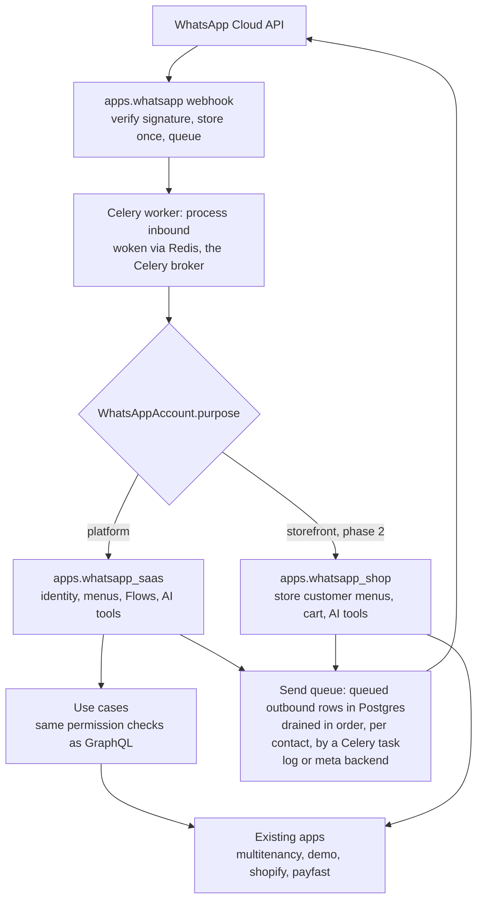
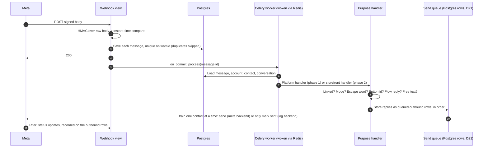
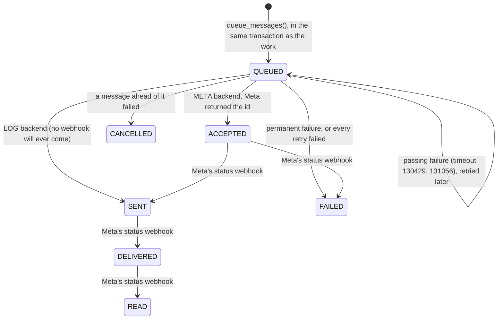
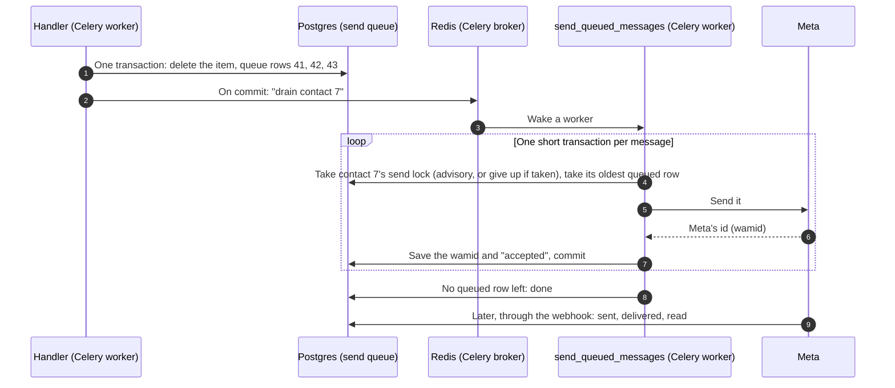
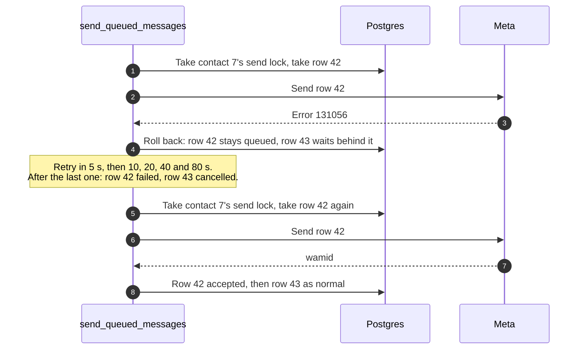
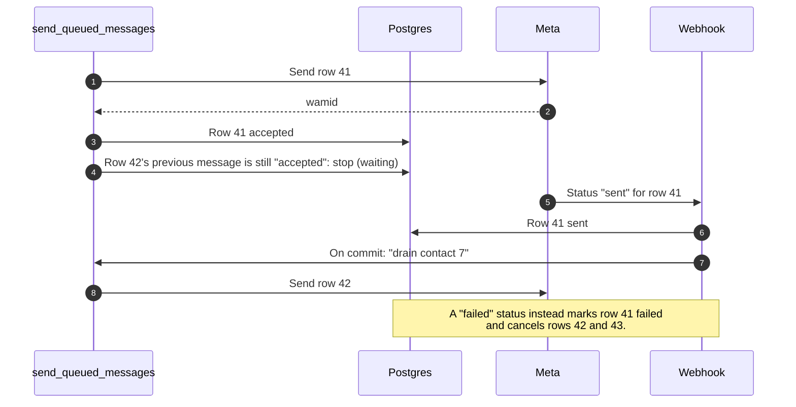
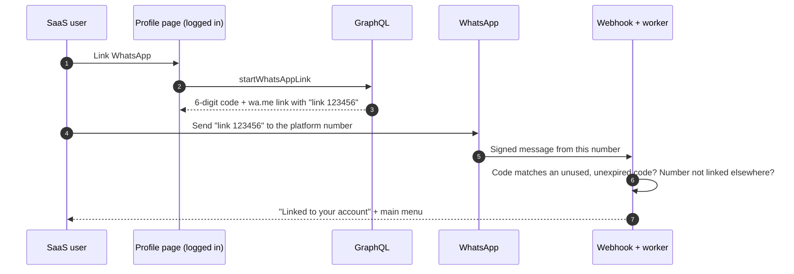

# WhatsApp-First Channel — Implementation Plan

**Date:** 2026-10-06, rewritten 2026-10-15 after research  
**Status:** Research done. Phase 1 is detailed and ready for TDD; phases 2 to 6 are outlined and get their detailed steps when they start.  
**Goal:** Make WhatsApp a first-class client of this SaaS app, for two kinds of user. A **SaaS user** manages their organizations, CRUD items, Shopify products and subscription by texting the platform's WhatsApp number. A **store customer** (shopper) browses, searches and buys from an organization's Shopify store by texting that organization's own WhatsApp number. Both can use deterministic WhatsApp menus and forms (`whatsapp_form` mode) or talk to an AI assistant that calls the same backend operations (`agentic` mode). The website stays a full second client with the same data and rules.

## 1. Who's who

- **SaaS user:** has an account from the existing website sign-up, and memberships in organizations. WhatsApp knows them only after they link their number (user story 1), through a `WhatsAppIdentity` row.
- **Organization member:** a SaaS user acting inside one organization. Their roles decide what they may do, with the same permission codes the website checks (`features.crud.view`, `features.crud.manage`, `shopify.view`, `billing.view`, `billing.manage`, and the new `whatsapp.view` / `whatsapp.manage`).
- **Organization admin:** an organization member with `whatsapp.manage`, who connects the organization's own WhatsApp number with the credentials form (user story 11).
- **Store customer (shopper):** someone texting an organization's WhatsApp number to buy from its Shopify store. Known as a `StoreCustomer` (phase 2) built on that number's `WhatsAppContact`: never a SaaS user, never a member, and scoped to that one organization. Named "store customer" rather than plain "customer" because `Customer` already means the paying organization in dj-stripe, and a customer record in Shopify's API (maintainer's choice, 2026-10-15).
- **Support member:** an organization member who answers store customers that asked for a human (phase 5).
- **Operator:** whoever runs the deployment and owns the platform's Meta app and platform number.
  - **Changed on 2026-10-22:** the operator owns no WhatsApp number and no Meta app. This line had been added after the maintainer's first review, and was never discussed. They deploy the app and set `WHATSAPP_ENABLED` and the encryption key, as for any other feature; every number belongs to an organization (Step 1.17).

## 2. User stories

| Story                                                                | As a                        | I want                                                                    | So that                                                                  | Acceptance criteria                                                                                                                                                                                                                                                                                                                                                                                                                                                                                                                                                                                                                                                  |
| -------------------------------------------------------------------- | --------------------------- | ------------------------------------------------------------------------- | ------------------------------------------------------------------------ | -------------------------------------------------------------------------------------------------------------------------------------------------------------------------------------------------------------------------------------------------------------------------------------------------------------------------------------------------------------------------------------------------------------------------------------------------------------------------------------------------------------------------------------------------------------------------------------------------------------------------------------------------------------------- |
| 1. Link my WhatsApp number (Steps 1.7, 1.14)                         | SaaS user                   | to link my WhatsApp number to my account                                  | the platform number knows it's me                                        | I enter my WhatsApp number on my profile in any common format, such as `083 123-4567` or `+27 (0)83 123 4567`, and it's saved as `27831234567` (D19)<br>I get a one-time code and a `wa.me` link, and the code works only when sent from that number<br>Sending it links the number; the signed webhook proves the number, my web session proves the account<br>Codes expire after 10 minutes, work once and are rate-limited<br>A number already linked to another account is refused<br>I can disconnect from the profile page or by sending `unlink`                                                                                                              |
| 2. Strangers learn nothing (Step 1.7)                                | SaaS user                   | an unlinked number to get only linking instructions                       | nobody can see my data by texting the platform                           | An unlinked sender gets a short "link your account at …" reply and nothing else<br>The reply is the same whether or not the number belongs to a registered person                                                                                                                                                                                                                                                                                                                                                                                                                                                                                                    |
| 3. Choose how I talk to the app (Steps 1.8, 1.14)                    | SaaS user                   | to choose menus and forms, or the AI assistant                            | the experience suits me                                                  | The choice is saved on my `WhatsAppIdentity` and shown on my profile<br>`mode menu` and `mode ai` switch it in chat<br>With no choice saved, `WHATSAPP_DEFAULT_CONVERSATION_MODE` applies<br>Switching discards half-finished forms and unconfirmed actions                                                                                                                                                                                                                                                                                                                                                                                                          |
| 4. See and pick my organizations (Steps 1.9, 1.10)                   | SaaS user                   | to list my organizations and pick one to work in                          | later actions apply to the right organization                            | Only organizations where my membership is accepted are listed<br>Picking one stores it for the conversation; every later action rechecks the membership                                                                                                                                                                                                                                                                                                                                                                                                                                                                                                              |
| 5. Create and rename an organization in chat (Steps 1.9, 1.10, 1.11) | SaaS user                   | to create an organization, or rename one I manage                         | I can run my workspace from my phone                                     | Create opens a WhatsApp form; rename opens it pre-filled with the current name<br>Nothing is saved until I press Confirm<br>Validation is the same as the website's; rename needs the same permission as on the website                                                                                                                                                                                                                                                                                                                                                                                                                                              |
| 6. Manage CRUD items with paging (Steps 1.9, 1.10, 1.11)             | organization member         | to list, view, create, update and delete CRUD items                       | I can maintain organization data in chat                                 | Lists show 7 items per page, with Previous, Next and Main menu<br>Create and update use forms pre-filled with the organization and current values<br>Delete always asks for a separate confirmation<br>Reads need `features.crud.view`, writes need `features.crud.manage`                                                                                                                                                                                                                                                                                                                                                                                           |
| 7. See my store's products (Step 1.12)                               | organization member         | to browse and search my organization's Shopify products                   | I can check my catalog from my phone                                     | Needs `shopify.view`, like the website's products page<br>Products are paged 7 at a time, newest first, with a free-text search<br>A store that must be reconnected gives a clear message, not an error                                                                                                                                                                                                                                                                                                                                                                                                                                                              |
| 8. Ask the assistant (Step 1.13)                                     | SaaS user                   | to ask in plain words, such as "add an item called Monthly report"        | I don't have to learn the menus                                          | The assistant can only call the fixed list of tools, which run the same operations as the menus<br>Every write is shown back with Confirm and Cancel buttons, and only my press runs it<br>The assistant reports success only from the saved result                                                                                                                                                                                                                                                                                                                                                                                                                  |
| 9. Never more than the website allows (Steps 1.9, 1.13)              | organization member         | WhatsApp to grant me exactly what the website grants me                   | chat is never a back door                                                | Every operation checks the same permission code as the matching GraphQL field<br>An action on another organization's item reads as "not found"<br>Organization ids never come from message text or from the AI                                                                                                                                                                                                                                                                                                                                                                                                                                                       |
| 10. Try it without Meta (Steps 1.4, 1.15)                            | operator                    | to run the whole flow locally without a Meta account                      | development and demos cost nothing                                       | `WHATSAPP_SEND_BACKEND=log` (the default) stores replies without calling Meta<br>Seed data and signed sample webhooks drive every human check                                                                                                                                                                                                                                                                                                                                                                                                                                                                                                                        |
| 11. Connect my organization's number with a form (Steps 1.5, 1.6)    | organization admin          | to enter my WhatsApp Business API details in a simple form                | the app can send and receive on my number, proven before anyone texts it | Needs `whatsapp.manage`; members with `whatsapp.view` see the status only<br>I enter the phone number id, the WhatsApp Business account id, the access token and my Meta app's secret<br>Saving checks the id and token with Meta first, then stores them encrypted; secrets are never shown again<br>The page shows the webhook URL and verify token to paste into my Meta app, and marks the webhook verified when Meta calls it<br>"Send test message" sends Meta's `hello_world` template to a number I enter in any common format (D19), and the page shows the last message received on my number<br>I can disconnect the number                               |
| 12. Browse and search a store (Steps 2.2, 2.3)                       | store customer              | to text "hi, show me your products" or search for something               | I can shop without opening a website                                     | Products come from that organization's store, 7 per page, with Previous, Next and Main menu<br>Only products published to the store and available for sale are shown                                                                                                                                                                                                                                                                                                                                                                                                                                                                                                 |
| 13. See a product's details (Step 2.4)                               | store customer              | to tap a product and see its picture, price and options                   | I can decide as I would on the web page                                  | The reply shows the image, title, price and variants<br>Buttons offer Add to cart, Buy now and Back to results                                                                                                                                                                                                                                                                                                                                                                                                                                                                                                                                                       |
| 14. A store customer stays inside one store (Steps 2.1, 2.2)         | store customer              | my chat with a store to be only about that store                          | other businesses never see or use my chat                                | A store customer belongs to exactly one organization's number<br>The same phone texting two stores is two separate store customers<br>Store data is redacted when Shopify asks (`customers/redact`, `shop/redact`)                                                                                                                                                                                                                                                                                                                                                                                                                                                   |
| 15. Buy a subscription in chat (Step 3.1)                            | organization member         | to pick a plan and pay from WhatsApp                                      | upgrading doesn't need the website menus                                 | Needs `billing.manage`<br>I get a single-use link to a page on this site that submits the PayFast form<br>"Paid" is only reported after PayFast's ITN confirms it                                                                                                                                                                                                                                                                                                                                                                                                                                                                                                    |
| 16. Pay for my cart (Steps 3.2, 3.3)                                 | store customer              | to pay for what I picked                                                  | I can finish the purchase from the chat                                  | I get a button to the store's own Shopify checkout<br>Which payment provider takes the money is between the store and Shopify; this app never handles payment for store orders<br>When Shopify reports the order paid, I get a WhatsApp confirmation                                                                                                                                                                                                                                                                                                                                                                                                                 |
| 17. Get my invoices on WhatsApp (Steps 3.4, 3.5)                     | organization member         | my subscription invoices as PDFs in chat                                  | I have them for my records                                               | Needs `billing.view`<br>Each successful subscription payment creates an invoice with the next number in the organization's sequence<br>The PDF holds what SARS lists for a tax invoice                                                                                                                                                                                                                                                                                                                                                                                                                                                                               |
| 18. Connect with Facebook instead (Phase 4)                          | organization admin          | to connect my number through a Facebook popup                             | I don't have to copy ids and tokens                                      | The popup's result is exchanged on the server<br>The number is subscribed and registered automatically                                                                                                                                                                                                                                                                                                                                                                                                                                                                                                                                                               |
| 19. Ask for a human (Step 5.1)                                       | store customer              | to tap "Talk to a person"                                                 | someone real answers when the bot can't                                  | The bot stops replying until a person closes the conversation<br>The members who answer store customers see that it's waiting                                                                                                                                                                                                                                                                                                                                                                                                                                                                                                                                        |
| 20. Answer waiting store customers (Steps 5.2, 5.3)                  | support member              | to see the chats waiting for a person, answer from the web and close them | store customers get answers                                              | Needs `whatsapp.inbox`<br>My reply is sent through WhatsApp<br>Free text is refused 24 hours after the store customer's last message, with the reason shown                                                                                                                                                                                                                                                                                                                                                                                                                                                                                                          |
| 21. Never stuck (Steps 1.4, 1.10, 2.3, 2.4)                          | SaaS user or store customer | every reply to offer a way back                                           | I can always return to the main menu, whatever I'm looking at            | Every interactive reply carries a Back or Main menu option<br>Lists hold at most 7 items, so Previous, Next and Main menu always fit<br>Every footer says `Send *menu* at any time`, and `menu` works in both modes, even mid-form<br>Plain text replies, the assistant's included, come with a Main menu button<br>An expired button leads to the main menu, never to an error                                                                                                                                                                                                                                                                                      |
| 22. Get my order receipt on WhatsApp (Step 3.3)                      | store customer              | my order's receipt in the chat after I pay                                | I have proof of what I bought without checking email                     | When Shopify reports the order paid, I get the order number, the total and a button to the order status page Shopify keeps for that order<br>The link is Shopify's own (`Order.statusPageUrl`); this app issues no tax invoice for store orders                                                                                                                                                                                                                                                                                                                                                                                                                      |
| 23. Fix my number's registration myself (Steps 1.5b, 1.6b)           | organization admin          | tools to check and repair my number's registration with Meta              | a stuck number doesn't stop my business, and I don't need Meta's support | Needs `whatsapp.manage`<br>The WhatsApp tab shows Meta's own status for my number: `status`, `code_verification_status`, `quality_rating`, `name_status`, `verified_name`<br>I can request a verification code by SMS or voice, enter it, register the number with its 6-digit PIN, and re-subscribe the app to my account's webhooks<br>Before registering, I'm warned that Meta allows 10 attempts per 72 hours<br>Meta's errors are shown with their code, a plain explanation and a link to Meta's page<br>The PIN is never stored, and every action is written to the action log<br>The operator has the same tools for the platform number in the Django admin |
| 24. Verify my number by receiving a code (Phase 6)                   | SaaS user                   | to receive a code on my number and type it on the website                 | I can prove my number even if I can't send a message first               | The code arrives as a WhatsApp authentication template with a copy-code button, or later by SMS, as `PHONE_VERIFICATION_CHANNEL` chooses (D20)<br>It uses the same code store as linking (user story 1): hashed, expiring, single-use and rate-limited<br>The default stays inbound linking, which needs no template and no SMS provider                                                                                                                                                                                                                                                                                                                             |
| 25. Choose which store my number sells from (Step 2.1b)              | organization admin          | to pick the store each external number sells from                         | customers texting it see that store's products, and only those           | Needs `whatsapp.manage`<br>Only my organization's own stores are offered, and only active ones holding the storefront scopes<br>I choose the store in the connect form, and can change it later on the number's row<br>A number with no store chosen says so on its row, and its customers get no reply                                                                                                                                                                                                                                                                                                                                                              |

## 3. Deliberately out of scope

- **WhatsApp-only sign-up.** Accounts are still created on the website; WhatsApp links to an existing account. A sign-up Flow can come later without changing the identity model.
- **Taking payment for Shopify orders ourselves.** Shopify's API terms forbid it (section 6.2), so store customers always pay in Shopify Checkout.
- **WhatsApp Pay.** Meta offers it only in India, Brazil and Singapore (section 6.1).
- **Our own tax invoices for store orders.** The store is the seller, and Shopify keeps a status page for every order, which the store customer gets on WhatsApp instead (user story 22). No invoice or receipt PDF was found on Shopify's `Order` object (section 6.2); a store that needs formal invoices uses its own Shopify invoice app. Our invoices cover only our own SaaS billing.
- **A ticketing system.** Phase 5 is a waiting list with an assignee and a reply box: no SLAs, priorities, teams or canned replies. If it grows past that, it's dropped.
- **Meta catalog product messages.** They need the merchant's catalog synced to their WhatsApp Business account. Plain messages with an image and buttons work for every store without that.
- **An encrypted Flow data-exchange endpoint in phase 1.** Phase 1's forms are sent pre-filled and their answers come back in the ordinary webhook (D9). The endpoint arrives only when a form needs live data while it's open.

## 4. Decisions

- **D1. Three backend apps, one dependency direction.** `apps.whatsapp` is the channel: Meta accounts, contacts, the webhook, signatures, messages, the send queue, conversation state, confirmations, the agent runtime and identity linking. `apps.whatsapp_saas` holds what SaaS users can do in chat. `apps.whatsapp_shop` holds what store customers can do. The channel never imports the other two: each registers a handler for its account purpose (`platform` or `storefront`) in a small registry, the way apps register permissions through `apps/<app>/permissions.py`. Deleting `apps.whatsapp_shop` leaves SaaS chat working (agents.md section 3.1). Phase 3 adds `apps.invoicing`.
- **D2. One table for every WhatsApp number (maintainer's choice, 2026-10-15).** `WhatsAppAccount` holds the platform number (`purpose=platform`, no organization) and each organization's number (`purpose=storefront`, one organization). An inbound message picks its row by `metadata.phone_number_id`, and the row's purpose picks the handler. So one rule routes everything. Local development seeds the platform row from environment variables.
  - **Changed on 2026-10-22 (Steps 1.16 and 1.17):** there's no platform number any more. Every number belongs to an organization and is connected on its WhatsApp tab: `INTERNAL_COMMUNICATIONS` for its team, `EXTERNAL_COMMUNICATIONS` for its customers. Nothing comes from environment variables. The platform number, owned by whoever deploys the app, served no use case: a Shopify business needs its own numbers, not the deployer's. The one table and the one routing rule stay.
- **D3. A SaaS user's number lives in `WhatsAppIdentity`, not on `User` (maintainer's choice, 2026-10-15).** The row is one-to-one with the user and with a platform `WhatsAppContact`, and holds the conversation mode. The upstream `User` model is untouched. Linking needs both proofs at once: a code shown in a logged-in web session, sent from the phone in a webhook Meta signed. This replaces the earlier email-code design, which needed a new email template and still trusted the sender to name the account.
  - **Changed on 2026-10-22 (Step 1.17):** a link is one per user per organization's internal communications number, not one per user on a platform number. A member of two organizations links on each. Both proofs stay the same.
- **D4. Every sender is a `WhatsAppContact`, scoped by number; a store customer adds a `StoreCustomer` row.** Every sender to any number gets a contact row, unique per account. An account belongs to one organization, so a contact, and the store customer built on it, is organization-scoped: the same phone texting two organizations is two rows. Phase 2 adds `StoreCustomer` in `apps.whatsapp_shop`, one-to-one with a storefront contact, holding the organization and store-only data such as the open cart, so the code says "store customer" wherever it means one. Contact rows are keyed on Meta's business-scoped user id (`user_id` in webhooks), with `wa_id` (the phone, digits only, for example `27831234567`) optional. Meta now omits `wa_id` for some users with usernames (section 6.1).
- **D5. Credentials are encrypted with Fernet,** using a new `WHATSAPP_TOKEN_ENCRYPTION_KEY`. The small `crypto.py` is copied from [`apps/shopify/crypto.py`](../../../packages/backend/apps/shopify/crypto.py) rather than imported, so neither app depends on the other (agents.md section 3.1). Encrypted: access token, app secret and (from phase 2) the Flow private key. A form-connected number's webhook verify token is generated by the app, shown once, and stored only as a hash (D6).
- **D6. One webhook URL for every number; the body says which number an event is for (maintainer's decision, 2026-10-15).** Every connected number's events arrive at `/api/whatsapp/webhook/`, and each change in the body names its receiving number in `metadata.phone_number_id` (section 6.1).
  - **Which secret checks the signature:**
    - A number on the platform's own Meta app (the platform number, later Embedded Signup numbers, or a number we don't know) uses `WHATSAPP_APP_SECRET`.
    - A number connected with the form belongs to its organization's own Meta app, which signs with that app's secret, stored encrypted on the account.
  - **Order of work:** the view reads the raw body, parses it only far enough to collect the receiving numbers, looks up their accounts, and checks the signature over the raw bytes with the one secret they share. Nothing is stored or acted on before that passes.
    - A body whose numbers need different secrets is refused.
    - A forged body that names a real account gains nothing, because without that account's secret the signature fails. It's the same pattern as a token whose header names the key that verifies it.
  - **Meta's GET subscription check:** it has no body, so its `hub.verify_token` is matched against `WHATSAPP_VERIFY_TOKEN` and against each form-connected account's verify token, looked up by its hash. A match on an account records its `webhook_verified_at`.
  - **Why one URL:** a webhook per organization would mean creating and configuring a new one for every SaaS user, which doesn't scale. One URL that routes by the body serves every number there will ever be. A number connected with the form still has its organization paste this one URL and its verify token into their own Meta app, once. Embedded Signup (phase 4) removes even that step: the platform's Meta app subscribes each new number through the API (`POST /<WABA_ID>/subscribed_apps`), so nobody configures a webhook by hand.
- **D7. The webhook only verifies, stores and queues.** It checks the signature over the raw body, saves each message once (unique Meta message id), queues a Celery task with `transaction.on_commit`, and returns 200. All replies, AI calls and Shopify calls happen in the worker. Meta retries for up to 7 days and may deliver duplicates (section 6.1).
- **D8. Replies go through a stored send queue,** in order per contact. `WHATSAPP_SEND_BACKEND` chooses `log` (default: store and mark sent, no network) or `meta` (call the Cloud API). This is agents.md section 4.1: the default needs nothing new, and the real provider is switched on.
- **D9. Phase 1 forms are WhatsApp Flows without an endpoint.** The Flow message carries its pre-filled data (`flow_action: navigate` with `flow_action_payload`), including dropdown choices such as the user's organizations. The answers come back as an `nfm_reply` webhook message, and the server validates them like any other input. The `flow_token` is a signed, expiring reference to a stored pending form, never data. Whether a Flow without an endpoint needs the number's encryption key uploaded is not stated in Meta's docs; it's checked in Step 1.11.
- **D10. Menus, Flows and the AI call the same operations.** `apps.whatsapp_saas.use_cases` holds one function per operation, and each checks permissions with `user_has_permission` from [`apps/multitenancy/models.py`](../../../packages/backend/apps/multitenancy/models.py). They reuse the existing serializers (for example `TenantSerializer`, `CrudDemoItemSerializer`), passing a server-built context with the linked user, so validation isn't written twice and upstream code isn't edited. If a serializer turns out to need a real HTTP request, Step 1.9 stops and asks before extracting a service.
- **D11. Every write is confirmed by the user, server-side.** A write first becomes a `WhatsAppPendingAction` holding the exact arguments, user, organization and expiry. The user gets a summary with Confirm and Cancel buttons. Only pressing Confirm runs it, after the permission is checked again. Menus and the AI share this mechanism, so the model can never confirm on the user's behalf.
- **D12. The AI uses OpenAI's Responses API with strict function tools.** History, including tool calls and their results, is stored in our database, so a human reply or an expired conversation can rebuild it, with `store: false` sent to OpenAI. The provider sits behind a small interface with a fake for tests, so no test calls OpenAI. Tool calls per message are capped, and no agent framework is added. The `openai` package is already a backend dependency.
  - **Changed on 2026-10-20 (the maintainer's rule, agents.md section 5.3a):** the provider calls OpenAI with plain HTTP requests through `requests`, not the `openai` SDK (Step 1.13e). Upstream's own uses of the SDK stay.
- **D13. Store customers pay in Shopify Checkout, and that link is all this app does about payment (maintainer's decision, 2026-10-15).** We build a Storefront API cart with the store customer's phone on it and send its `checkoutUrl`. Which payment provider takes the money is between the store and Shopify; this app never asks or checks. Shopify's `orders/paid` webhook triggers the WhatsApp confirmation and the order status link (user story 22).
  - **Confirmed on 2026-10-24 (Step 2.1, decision 3):** the Storefront cart stays, chosen as the long-term option over Admin API draft orders and cart permalinks, pending Step 2.1a's experiment on a dev store.
- **D14. SaaS subscriptions keep our own PayFast flow,** through a single-use link to a page on this site that submits the signed form the backend already builds. PayFast's ITN stays the only proof of payment.
- **D15. Invoices are generated with ReportLab (maintainer's choice, 2026-10-15),** in a Celery task, with no system packages added to the Docker image. Numbers come from a per-organization counter row locked with `select_for_update`, so there are no gaps. PDFs go to private storage and reach WhatsApp by uploading to Meta's media endpoint, never as a public link.
- **D16. New permission codes.** `whatsapp.view` and `whatsapp.manage` (Step 1.5), and `whatsapp.inbox` (phase 5), are registered in `apps/whatsapp/permissions.py` and seeded by a data migration, as Shopify does (decision D7 of [the Shopify plan](2026-10-03-shopify-app-installation-plan.md)).
- **D17. Nobody is ever stuck (maintainer's rule, 2026-10-15).** Every reply offers a way back.
  - Lists hold at most 7 items, plus Previous, Next and Main menu rows (Meta allows 10 rows).
  - Reply-button messages keep one of their 3 buttons for Back or Main menu.
  - Plain text, including the assistant's replies and error messages, goes out as a one-button message with Main menu.
  - Every interactive message's footer says `Send *menu* at any time`, and `menu` works in every state, mid-form and in `agentic` mode included.
  - The message builders enforce this, so a screen can't be written without a way back.

  The reference app's `_send_return_to_menu_options` did the same with an extra message after each reply. Putting the way back inside the reply itself halves the messages sent, which matters now that every message costs money (section 6.1).

- **D18. Number troubleshooting tools are a supported last resort (maintainer's decision, 2026-10-15).** Getting a number working with Meta often fails on registration or verification. So the app wraps each of Meta's repair endpoints (section 6.1) in an explicit, permission-checked operation:
  - status: `GET /<PHONE_NUMBER_ID>`
  - request a code: `request_code`
  - verify it: `verify_code`
  - register with the PIN: `register`
  - re-subscribe the app: `subscribed_apps`
  - (phase 2) upload the Flow public key: `whatsapp_business_encryption`

  Organization admins reach these from the WhatsApp tab (`whatsapp.manage`), and the operator from the Django admin for the platform number. They replace the reference app's unauthenticated GET routes (`/chatbot/register-phone-number`, `/chatbot/request-code` and the rest), which anyone could call.
  - Every call is written to the action log.
  - The PIN passes straight through to Meta and is never stored.
  - `register` warns about Meta's limit of 10 per 72 hours before it's sent.
  - Each Meta error is shown with its code and a link to Meta's page, so a stuck customer and the operator see the same explanation.

- **D19. Phone numbers are stored in one format: international digits, no `+` (maintainer's decision, 2026-10-15).** For example `27831234567`, the format Meta's `wa_id` uses. A small hand-written function in `phone_numbers.py` (maintainer's choice over the `phonenumbers` library) accepts the common ways people type a number:
  - separators are removed: spaces, `-`, `_`, `.`, `/` and brackets
  - a trunk `(0)` after the country code is dropped
  - a leading `+` or `00` means the country code is already there
  - a single leading `0` is replaced by `WHATSAPP_DEFAULT_COUNTRY_CODE` (default `27`)
  - anything else must already start with its country code

  The result must be 8 to 15 digits, E.164's limit (https://www.itu.int/rec/T-REC-E.164); anything else is refused with a clear error. It can't tell a real number from a well-shaped wrong one; the link code (user story 1) and the test message (user story 11) prove a number is real.

- **D20. Phone verification has one code store and swappable channels (maintainer's decision, 2026-10-15).** Proving a user controls a number works like the existing email confirmation (`apps/users/tokens.py`), except that a short typed code must be stored: it's too short to carry its own signature, as an email link's token does.
  - **The code store:** a small, channel-neutral `apps.phone_verification` app, built in Step 1.7, holds `PhoneVerificationCode`:
    - the user, the normalized number (D19) and the channel
    - a hash of the code, never the code itself
    - its expiry, its use, and its attempt count
    - a service to issue and to check a code
  - **The channels,** chosen by `PHONE_VERIFICATION_CHANNEL`, the way `PAYMENT_BACKEND` chooses Stripe or PayFast (agents.md section 4.1):
    - **`whatsapp_inbound`** (the default, Step 1.7): the website shows the code and the user sends it from the number. Meta's signed webhook proves the number. It needs no template and no extra provider.
    - **`whatsapp_template`** (phase 6): we send the code in a WhatsApp authentication template with a copy-code button, and the user types it on the website. Meta requires an authentication template for codes, and its text is fixed, so it carries the code, not a link (section 6.1). It needs an approved template, and each one is billed.
    - **`sms`** (phase 6): the same, by SMS through an optional provider, switched on only when configured, since it's a paid service. It also covers numbers not on WhatsApp.
  - **Dependency direction:** the store knows nothing about WhatsApp. WhatsApp and SMS each plug a sender into it, so deleting either leaves the other working (agents.md section 3.1).
- **D21. Replies go out in order, one contact at a time (maintainer's decision, 2026-10-16).** The reference app sent from an in-memory list inside the webhook request, with `sleep` between messages. Order broke whenever the request was retried or slow. Here:
  - **The queue is the message table.** Every reply is first stored as an outbound `WhatsAppMessage` with status `queued` (D8), so nothing is lost if a worker restarts, and no extra store such as Redis is needed (agents.md section 4.1).
  - **One sender per contact.** A send task drains one contact's queued messages strictly in the order they were queued (by id). It sends one, waits for Meta to accept it and return its id, and only then sends the next.
    - Before each send, it takes the contact's send lock, a Postgres advisory lock keyed by the contact id (`pg_try_advisory_xact_lock`), released at commit. A second task for the same contact finds it taken and leaves the work to the first, so two workers never interleave one contact's messages. Different contacts still go out in parallel. https://www.postgresql.org/docs/current/functions-admin.html#FUNCTIONS-ADVISORY-LOCKS
    - **Changed on 2026-10-17 (maintainer's decision),** from a lock on the contact's row (`select_for_update(skip_locked=True)`). An advisory lock blocks nothing else, so an inbound message updating the contact's name or number never waits behind a send. And a second connection can hold it without seeing any rows, so its tests run in the normal test transaction. Testing the row lock needed `transaction=True`, which empties every table when a test ends, data migrations' rows included, and `--reuse-db` carried that into the next run.
  - **A failure stops that contact's line.**
    - A send that fails for a passing reason (a timeout, or `130429` / `131056`, Meta's throughput and same-user pacing limits, section 6.1) is retried with backoff, while the messages after it wait.
    - A send that fails for good is marked `failed`, and the messages queued after it are cancelled rather than sent out of context.
  - **Strict mode, off by default.** Meta accepting messages in order doesn't guarantee the phone shows them in order; Meta's docs don't say. With `WHATSAPP_SEND_WAIT_FOR_SENT_STATUS=True`, the next message waits until Meta's webhook reports the previous one `sent`. Our status updates already land on the message rows (Step 1.3c), so this costs only a few seconds per reply.
  - **Fewer messages per reply.** Putting the way back inside the reply itself (D17), instead of a separate message, leaves less to order in the first place.

## 5. Lessons from the reference application

The maintainer's earlier WhatsApp-first project `python-flask-whatsapp-store` (a separate, private repository) proved the product idea. This plan keeps its good patterns and fixes what it got wrong.

**Kept:**

- a formatter that enforces Meta's length and count limits in one place
- an ordered outbound queue per contact
- pre-filled Flows through `flow_action_payload`
- tool results shaped as `{"success": …}`, which the model reads reliably
- an LLM provider interface with one normalized response type
- payment provider and invoice generator chosen behind a factory
- a way back to the main menu after every reply (`_send_return_to_menu_options`), kept as D17
- the number registration and verification tools (register, request and verify a code, status, subscribe the app, upload the Flow key), kept as a last resort for stuck numbers (D18)

**Fixed:**

- All work ran inside the webhook request, with `sleep` calls. Here the webhook only stores and queues (D7).
- Conversation state lived in a `shelve` file, and tool calls weren't saved, so the model forgot search results between turns. Here state and the full agent history are in Postgres (D12).
- Confirmations existed only in the system prompt. Here they're enforced by the server (D11).
- Admin, payment and agent-reply routes had no authentication, and payment links trusted a phone number in the URL. Here every endpoint has a named authority: a Meta signature, a logged-in session, or a single-use token.
- Flow tokens were unsigned strings that the server parsed. Here they're signed references to stored state (D9).
- The number registration tools were unauthenticated GET routes that anyone could call. Here they're permission-checked, logged operations (D18).
- Unknown senders crashed the handler, and the country code was hardcoded. Here unknown senders get linking instructions (user story 2), and numbers are stored as Meta sends them.
- Invoices sat in a public S3 bucket. Here they're private and sent through Meta's media endpoint (D15).
- There were no tests beyond four user model tests. Here every step is RED/GREEN.

## 6. Platform facts this plan relies on

Every fact links to the official page it comes from. Anything a page doesn't state is marked, and becomes a check in the step that relies on it (agents.md section 6.2). Meta moved its WhatsApp docs to `developers.facebook.com/documentation/business-messaging/whatsapp/` in 2026; both old and new links appear below.

### 6.1 Meta WhatsApp Cloud API

- **Webhook verification:** GET with `hub.mode`, `hub.verify_token` and `hub.challenge`, answered with the challenge. Every POST carries `X-Hub-Signature-256: sha256=…`, an HMAC-SHA256 of the raw body with the app secret. https://developers.facebook.com/docs/graph-api/webhooks/getting-started
- **Retries:** "with decreasing frequency… for up to 7 days", which "can result in duplicate webhook notifications"; payloads up to 3 MB. https://developers.facebook.com/documentation/business-messaging/whatsapp/webhooks/overview.md
- **Routing:** `changes[].value.metadata.phone_number_id` names the receiving number; inbound messages are in `messages[]`, status updates in `statuses[]`. https://developers.facebook.com/documentation/business-messaging/whatsapp/webhooks/reference/messages.md
- **Per-account webhook URL:** `POST /<WABA_ID>/subscribed_apps` with `override_callback_uri` and `verify_token`. https://developers.facebook.com/documentation/business-messaging/whatsapp/webhooks/override/
- **Business-scoped user ids:** an incoming message carries `from_user_id`, and its contact block `user_id` (for example `US.13491208655302741918`). `from` and `wa_id` are omitted when a user has a username, hasn't messaged the business in 30 days and isn't in its contacts. A status carries `recipient_user_id`. The id is a country code and a period followed by up to 128 alphanumeric characters, with `ENT.` added for parent ids. Subscribe to `user_id_update`. https://developers.facebook.com/documentation/business-messaging/whatsapp/business-scoped-user-ids
- **Webhook field paths:**
  - Button and list replies are `messages[].interactive.button_reply.id` and `.list_reply.id`, with `title` (and `description` for lists). https://developers.facebook.com/documentation/business-messaging/whatsapp/webhooks/reference/messages/interactive.md
  - Statuses are `sent`, `delivered`, `read`, `played` or `failed`, and a failure carries `errors[].code`. https://developers.facebook.com/documentation/business-messaging/whatsapp/webhooks/reference/messages/status.md
  - Messages the Cloud API can't handle arrive as `type: "unsupported"`. https://developers.facebook.com/documentation/business-messaging/whatsapp/webhooks/reference/messages/unsupported.md
- **Phone numbers:** webhook `wa_id` is digits only; the `wa_id` in a send response "may not match" the input, so store the returned one. https://developers.facebook.com/documentation/business-messaging/whatsapp/messages/send-messages.md
- **24-hour window:** free-form messages only within 24 hours of the user's last message; after that, approved templates only (error `131047`). https://developers.facebook.com/documentation/business-messaging/whatsapp/messages/send-messages.md
- **Pricing:** per message since 2025-07-01. Since 2026-10-01, replies inside the window are also charged at the utility rate. https://developers.facebook.com/documentation/business-messaging/whatsapp/pricing/non-template-messages.md. The main pricing page still says they're free (https://developers.facebook.com/documentation/business-messaging/whatsapp/pricing.md), so the docs conflict; this plan assumes every reply costs money.
- **Reply buttons:** at most 3; titles up to 20 characters; ids up to 256. https://developers.facebook.com/documentation/business-messaging/whatsapp/messages/interactive-reply-buttons-messages.md
- **List messages:** at most 10 rows across all sections; row title 24, description 72, id 200 characters; body 4096. https://developers.facebook.com/documentation/business-messaging/whatsapp/messages/interactive-list-messages.md
- **Link button:** `cta_url` with `display_text` up to 20 characters. https://developers.facebook.com/documentation/business-messaging/whatsapp/messages/interactive-cta-url-messages.md
- **Media:** upload with `POST /<PHONE_NUMBER_ID>/media`; uploaded media ids last 30 days; documents up to 100 MB. https://developers.facebook.com/documentation/business-messaging/whatsapp/business-phone-numbers/media.md
- **Read receipt and typing indicator** in one call, cleared after 25 seconds or on reply. https://developers.facebook.com/documentation/business-messaging/whatsapp/typing-indicators.md
- **Flows:** send with `flow_action: navigate` and a non-empty `flow_action_payload.data` to pre-fill the first screen. https://developers.facebook.com/docs/whatsapp/flows/guides/sendingaflow. Dropdowns can take dynamic data such as `${data.orgs}` (1 to 200 items, titles up to 30 characters). https://developers.facebook.com/documentation/business-messaging/whatsapp/flows/guides/components.md. Completion arrives as `interactive.nfm_reply.response_json`, carrying the `flow_token` but no Flow id. https://developers.facebook.com/documentation/business-messaging/whatsapp/flows/guides/flowswebhooks.md
- **Flow endpoint (later phases):** RSA-OAEP-SHA256 to unwrap an AES-128-GCM key, the response encrypted with the bit-flipped IV, a reply within 10 seconds, and a key uploaded per phone number. https://developers.facebook.com/documentation/business-messaging/whatsapp/flows/guides/implementingyourflowendpoint.md, https://developers.facebook.com/docs/whatsapp/flows/reference/error-codes, https://developers.facebook.com/documentation/business-messaging/whatsapp/flows/guides/whatsapp-business-encryption.md
- **Throughput:** 80 messages per second per number by default; about one message every 6 seconds to the same user (error `131056`). https://developers.facebook.com/documentation/business-messaging/whatsapp/throughput.md, https://developers.facebook.com/docs/whatsapp/cloud-api/overview
- **Payments:** documented only for India, Brazil and Singapore. https://developers.facebook.com/documentation/business-messaging/whatsapp/payments/payments-in/overview.md, https://developers.facebook.com/documentation/business-messaging/whatsapp/payments/payments-br/overview.md
- **Embedded Signup (phase 4):** v4 is current and v2 is deprecated from 2026-10-15. https://developers.facebook.com/documentation/business-messaging/whatsapp/embedded-signup/versions.md. The popup's code lives 30 seconds and is exchanged at `/oauth/access_token`; the app is then subscribed with `POST /<WABA_ID>/subscribed_apps` and the number registered with `POST /<PHONE_NUMBER_ID>/register`. https://developers.facebook.com/documentation/business-messaging/whatsapp/embedded-signup/implementation.md, https://developers.facebook.com/documentation/business-messaging/whatsapp/embedded-signup/onboarding-customers-as-a-tech-provider.md. Onboarding other businesses needs Tech Provider status: business verification, App Review and Advanced access. https://developers.facebook.com/documentation/business-messaging/whatsapp/solution-providers/get-started-for-tech-providers.md
- **Number registration and verification (D18):**
  - Register: `POST /<PHONE_NUMBER_ID>/register` with `messaging_product` and a 6-digit `pin`; the existing two-step PIN if one is set, otherwise it becomes the PIN. Register is limited to 10 calls per number in a 72-hour moving window; going over returns `133016` and blocks registration for 72 hours. Registration is needed again after a display name change is approved. https://developers.facebook.com/documentation/business-messaging/whatsapp/business-phone-numbers/registration.md
  - Request a code: `POST /<PHONE_NUMBER_ID>/request_code` with `code_method` (`SMS` or `VOICE`) and `language`; an already-verified number returns `136024`, so check `code_verification_status` first. Verify it: `POST /<PHONE_NUMBER_ID>/verify_code` with `code`.
  - Status: `GET /<PHONE_NUMBER_ID>` returns fields including `status` (a number must be connected to send and receive), `code_verification_status`, `quality_rating`, `name_status` and `verified_name`.
  - Two-step PIN: set or change it with `POST /<PHONE_NUMBER_ID>` and `pin`; the API can't turn two-step verification off.

  All from https://developers.facebook.com/documentation/business-messaging/whatsapp/business-phone-numbers/phone-numbers.md

- **Authentication templates (phase 6, D20):**
  - The text is fixed and can't be customized, apart from the code, an optional "For your security, do not share this code." and an optional expiry line.
  - The button is copy-code, one-tap autofill (which needs an Android app) or zero-tap.
  - `code_expiration_minutes` runs from 1 to 90.
  - A WhatsApp one-time code must use an authentication template. Whether one can carry a link is not stated in docs, and the fixed text leaves no room for one.

  https://developers.facebook.com/documentation/business-messaging/whatsapp/templates/authentication-templates/authentication-templates.md, https://developers.facebook.com/documentation/business-messaging/whatsapp/templates/authentication-templates/copy-code-button-authentication-templates.md

- **Human handoff:** Meta documents no handover protocol for the Cloud API, so it's built in the app (phase 5). Not stated in docs.

### 6.2 Shopify

- **Storefront API access:** a private token from `storefrontAccessTokenCreate`, which delegates the app's `unauthenticated_*` scopes. https://shopify.dev/docs/api/admin-graphql/latest/mutations/storefrontAccessTokenCreate, https://shopify.dev/docs/api/usage/access-scopes#unauthenticated-access-scopes. Server requests should send `Shopify-Storefront-Buyer-IP`; how WhatsApp-proxied traffic is treated is not stated in docs. https://shopify.dev/docs/api/storefront/latest
- **Search:** `search(query:, types: [PRODUCT])`, sorted by relevance. https://shopify.dev/docs/api/storefront/latest/queries/search. Cursor paging with `first`/`after`. https://shopify.dev/docs/api/usage/pagination-graphql
- **Cart checkout:** `cartCreate` with `buyerIdentity.phone`, then `cart.checkoutUrl` sends the buyer to Shopify's web checkout. https://shopify.dev/docs/api/storefront/latest/objects/Cart, https://shopify.dev/docs/api/storefront/latest/input-objects/CartBuyerIdentityInput
- **No payment outside Shopify Checkout:** API Terms section 2.3.18 prohibits "an alternative to Shopify Checkout for checkout or payment processing for Shopify Merchants", and registering such transactions through the API. https://www.shopify.com/legal/api-terms
- **Order receipt:** the Admin API `Order` object has `statusPageUrl`, "The URL where customers can check their order's current status, including tracking information and delivery updates", and `confirmationNumber`, "A customer-facing order identifier". No invoice or receipt PDF field was found on it. https://shopify.dev/docs/api/admin-graphql/latest/objects/Order
- **Order webhooks:** `ORDERS_PAID` needs `read_orders`. https://shopify.dev/docs/api/admin-graphql/latest/enums/WebhookSubscriptionTopic. A buyer's name, email and phone in order data need protected customer data approval for public apps. https://shopify.dev/docs/apps/launch/protected-customer-data
- **Privacy webhooks:** `customers/redact` and `shop/redact` must be acted on within 30 days. https://shopify.dev/docs/apps/build/compliance/privacy-law-compliance

### 6.3 PayFast

- The developer docs site returned HTTP 502 on 2026-10-15; these facts were read from its archived copy, and the links point at the live anchors.
- **Checkout** is a signed form posted to `/eng/process`; subscriptions add `subscription_type=1`, `frequency` and `recurring_amount`. https://developers.payfast.co.za/docs#step_1_form_fields, https://developers.payfast.co.za/docs#subscriptions
- **ITN:** return 200, check the signature, the source, the amount and `/eng/query/validate`. https://developers.payfast.co.za/docs#step_4_confirm_payment
- **No payment-link API** is documented; the dashboard's "Request Money" only emails a link. https://payfast.io/request-money. Hence the single-use page on this site (D14).
- Whether PayFast issues VAT tax invoices is not stated in docs, so we issue our own (D15).

### 6.4 OpenAI

- "Responses is recommended for all new projects", and the Assistants API was retired on 2026-08-26. https://developers.openai.com/api/docs/guides/migrate-to-responses
- **Strict function tools:** `additionalProperties: false`, every property required, optional values typed as null; results go back as `function_call_output` with the same `call_id`. https://developers.openai.com/api/docs/guides/function-calling
- **State:** responses are stored 30 days by default, and `store: false` turns that off. https://developers.openai.com/api/docs/guides/conversation-state

### 6.5 SARS tax invoices

- **Full tax invoice:** the words "Tax Invoice", supplier name, address and VAT number, recipient details, serial number and date, description, quantity, and value with tax. An abridged invoice for small amounts drops the recipient details and quantity. https://www.sars.gov.za/wp-content/uploads/Docs/Government/Tax-Invoice-Checklist-Version-2-29032016.pdf
- The checklist asks for a serial number, but doesn't say "no gaps"; gap-free numbering is chosen here as good practice (D15).

## 7. What exists today and what we reuse

- **Users:** [`apps/users/models.py`](../../../packages/backend/apps/users/models.py) has no phone field. The profile mutation edits only first name, last name, avatar and language. Not changed by this plan (D3).
- **Organizations:** `Tenant` and `TenantMembership` (the default manager returns only accepted memberships) are in [`apps/multitenancy/models.py`](../../../packages/backend/apps/multitenancy/models.py), with `user_has_permission(user, tenant, code)` in plain Python. Organizations are created in `TenantSerializer.create` in [`apps/multitenancy/serializers.py`](../../../packages/backend/apps/multitenancy/serializers.py). Permission codes are registered per app, as in [`apps/shopify/permissions.py`](../../../packages/backend/apps/shopify/permissions.py).
- **CRUD items:** `CrudDemoItem` in [`apps/demo/models.py`](../../../packages/backend/apps/demo/models.py), with `CrudDemoItemSerializer` and the `features.crud.*` checks in [`apps/demo/schema.py`](../../../packages/backend/apps/demo/schema.py).
- **Shopify:** a store belongs to an organization (`ShopifyShop.tenant`, and one organization may have several stores) in [`apps/shopify/models.py`](../../../packages/backend/apps/shopify/models.py). `fetch_products(shop, first, after=None, before=None)` in [`apps/shopify/products.py`](../../../packages/backend/apps/shopify/products.py) pages products through the Admin API, with `read_products` as the only scope today.
- **PayFast:** `create_subscription_checkout(...)` returns a `CheckoutForm` (action URL and signed fields) in [`apps/payfast/services.py`](../../../packages/backend/apps/payfast/services.py). The ITN is processed in the same module.
- **Invoicing:** none exists. No invoice model and no PDF library; the upstream `invoice*` email templates have nothing behind them.
- **Audit log:** `log_action(...)` in [`common/action_logging/service.py`](../../../packages/backend/common/action_logging/service.py); `ActionLog` already has an `AI_AGENT` actor type.
- **Rate limiting:** [`common/ratelimiting/`](../../../packages/backend/common/ratelimiting/), which already has `AUTH_OTP` and `AI_CHAT_MESSAGE` categories.
- **Background tasks:** Celery in the backend ([`config/celery.py`](../../../packages/backend/config/celery.py)), with tasks written as `@shared_task` as in `apps/payfast/tasks.py`.
- **Frontend:** the profile page is [`packages/webapp/src/routes/profile/profile.component.tsx`](../../../packages/webapp/src/routes/profile/profile.component.tsx). Organization settings are tabs in [`packages/webapp-libs/webapp-tenants`](../../../packages/webapp-libs/webapp-tenants), and `webapp-backup` already adds its own tab there, the model for the WhatsApp tab in Step 1.6.

## 8. Architecture

### 8.1 Components



**Where things are kept.**

- **Postgres** holds everything that matters: inbound messages, the send queue (outbound rows with status `queued`, D21), and conversation state.
- **Redis** is used only as Celery's broker. It carries the small "process message 42" or "drain contact 7's queue" notes that wake a worker, never a message's content or the order messages go out in. If Redis lost a note, the rows would still be in Postgres, waiting.

### 8.2 Data model (phase 1)

All in `apps.whatsapp`. Field names follow local conventions at implementation; the invariants are what tests pin. Since Step 1.16, every choice field stores its enum member names (agents.md section 5.3b); the values below are those names.

- **`WhatsAppAccount`:** `purpose` (`INTERNAL_COMMUNICATIONS` or `EXTERNAL_COMMUNICATIONS`), `tenant` (null exactly when the purpose is `INTERNAL_COMMUNICATIONS`, enforced by a check constraint, until Step 1.17 gives every account an organization), `display_phone_number`, `phone_number_id` (unique), `waba_id`, encrypted `access_token`, encrypted `app_secret` (empty means "the platform's Meta app"), a hash of the app-generated `webhook_verify_token` (D6), `connection_method` (`SEED`, `MANUAL`, `EMBEDDED_SIGNUP`), `verified_name` (the business name Meta returns), `credentials_verified_at` and `webhook_verified_at` (the form's proof, user story 11), `is_active`, timestamps.
- **`WhatsAppContact`:** `account`, `bsuid` (Meta's `user_id`, unique per account), `wa_id` (optional, unique per account when present), `profile_name` (for display only, never for authority), `last_inbound_at` (drives the 24-hour rule).
- **`WhatsAppIdentity`:** `user` (one-to-one), `contact` (one-to-one, platform account only), `conversation_mode` (`WHATSAPP_FORM`, `AGENTIC` or empty), `linked_at`.
- **`PhoneVerificationCode`** (in `apps.phone_verification`, D20): `user`, `phone_number` (normalized, D19), `channel`, a hash of the code, `expires_at`, `consumed_at`, `attempts`. Issuing a new code voids the user's unused ones. Linking (user story 1) uses it with the `WHATSAPP_INBOUND` channel.
- **`WhatsAppMessage`:** `contact` (and, through it, the account), `direction` (`INBOUND` or `OUTBOUND`), `wamid` (Meta's message id, unique when present), `kind`, `payload` (only what processing needs), `status` (inbound: `RECEIVED`, `PROCESSED`, `FAILED`; outbound: `QUEUED`, `ACCEPTED`, `SENT`, `DELIVERED`, `READ`, `FAILED`, `CANCELLED`), `error_code`, timestamps. Inbound and outbound share one table, so phase 5's transcript is a query rather than a new model.
- **`WhatsAppConversation`:** one per contact. Holds the selected organization, the menu state (opaque choice ids mapped to real ids, paging cursors), and `state_expires_at`. Phase 5 adds `status`, `assignee` and `waiting_since`.
- **`WhatsAppPendingAction`:** `conversation`, `action`, `arguments` (validated JSON), `tenant`, `expires_at`, `consumed_at`. One use only, and the permission is checked again when it runs (D11).
- **`WhatsAppAgentItem`:** `conversation`, `sequence`, `item` (one Responses API input or output item, tool calls included). The agent's history is rebuilt from these rows (D12).

### 8.3 Inbound path



### 8.3a The reply queue (D21, Step 1.4c)

The queue is the `WhatsAppMessage` table in Postgres. Redis only carries Celery's "drain contact 7" note that wakes a worker, never a message or its place in line. The code is [`services/outbox.py`](../../../packages/backend/apps/whatsapp/services/outbox.py) and the `send_queued_messages` task in [`tasks.py`](../../../packages/backend/apps/whatsapp/tasks.py).

**An outbound message's statuses:**



**A normal send.** A handler deletes an item and replies with three messages: a long text split by `text_reply` into two parts, then a final part with the Main menu button.



**A passing failure.** Meta's same-user pacing limit (`131056`) refuses row 42. The rows behind it wait, and only the send is repeated, never the work that produced the reply.



**Strict mode** (`WHATSAPP_SEND_WAIT_FOR_SENT_STATUS=True`). Each message also waits for Meta's `sent` on the one before it, at most `STRICT_MODE_MAX_WAIT_SECONDS` (30 seconds).



**The worked example, row by row:**

```text
                                 row 41 (part 1)   row 42 (part 2)   row 43 (Main menu)
the handler queues the reply     queued            queued            queued
the drain sends row 41           accepted          queued            queued
row 42 hits 131056               accepted          queued            queued     (rolled back, retry in 5 s)
the retry sends row 42           accepted          accepted          queued
then row 43                      accepted          accepted          accepted
Meta's status webhooks           read              delivered         sent
```

- **If row 42 had failed for good** (say `131026`, undeliverable): row 42 `failed`, row 43 `cancelled`. Row 43 made sense only after row 42. A reply queued later, as row 44, is sent normally.
- **Two workers wake for contact 7 at once:** the first takes contact 7's send lock. The second's `pg_try_advisory_xact_lock` finds it taken, returns `busy` and sends nothing, so the two never interleave. Meanwhile contact 8's queue drains in parallel on another worker.

### 8.4 Linking a number



A user who texts first gets a reply with the profile page address, and the flow continues from step 1.

### 8.5 Conversation modes, escape words and buttons

- **Order of handling:**
  1. A button or list press is resolved through the conversation's stored choice map, whatever the mode.
  2. A Flow reply is matched to its pending form through the signed `flow_token`.
  3. An escape word (`menu`, `help`, `cancel`, `mode menu`, `mode ai`, `unlink`) is handled directly.
  4. Any other text goes to the main menu in `whatsapp_form` mode, or to the assistant in `agentic` mode.
- **Button ids are opaque,** such as `c7`, and map to real ids in the conversation's state. An expired or unknown id gets "that menu has expired" and the main menu.

### 8.6 Paging and the way back

A list message holds at most 10 rows (section 6.1), so a page is 7 items plus Previous, Next and Main menu rows (D17). The body text says "Page 2 of 5" when a total is known; Shopify cursors give no total, so they show only Previous and Next. The cursor for each page stays in the conversation state, never in the button id.

### 8.7 Settings (phase 1)

Each setting gets a loader test (agents.md section 2.3) and a safe default (section 5.4), and is added to `packages/backend/.env.shared` with placeholder values.

```python
WHATSAPP_ENABLED = env.bool("WHATSAPP_ENABLED", default=False)
WHATSAPP_GRAPH_API_VERSION = env("WHATSAPP_GRAPH_API_VERSION", default="v26.0")
WHATSAPP_APP_SECRET = env("WHATSAPP_APP_SECRET", default="")
WHATSAPP_VERIFY_TOKEN = env("WHATSAPP_VERIFY_TOKEN", default="")
WHATSAPP_TOKEN_ENCRYPTION_KEY = env("WHATSAPP_TOKEN_ENCRYPTION_KEY", default="")
WHATSAPP_SEND_BACKEND = env("WHATSAPP_SEND_BACKEND", default="LOG")  # member names since Step 1.16
WHATSAPP_DEFAULT_CONVERSATION_MODE = env("WHATSAPP_DEFAULT_CONVERSATION_MODE", default="WHATSAPP_FORM")
WHATSAPP_LINK_CODE_TTL_SECONDS = env.int("WHATSAPP_LINK_CODE_TTL_SECONDS", default=600)
WHATSAPP_CONVERSATION_TTL_SECONDS = env.int("WHATSAPP_CONVERSATION_TTL_SECONDS", default=1800)
WHATSAPP_AI_MODEL = env("WHATSAPP_AI_MODEL", default="")
WHATSAPP_AI_MAX_TOOL_CALLS = env.int("WHATSAPP_AI_MAX_TOOL_CALLS", default=5)
WHATSAPP_DEFAULT_COUNTRY_CODE = env("WHATSAPP_DEFAULT_COUNTRY_CODE", default="27")  # added in Step 1.5 (D19)
WHATSAPP_SEND_WAIT_FOR_SENT_STATUS = env.bool("WHATSAPP_SEND_WAIT_FOR_SENT_STATUS", default=False)  # added in Step 1.4c (D21)
```

The platform number's own values (`WHATSAPP_PLATFORM_PHONE_NUMBER_ID`, `WHATSAPP_PLATFORM_WABA_ID`, `WHATSAPP_PLATFORM_ACCESS_TOKEN`, `WHATSAPP_PLATFORM_DISPLAY_NUMBER`) are read only by the seed command, which writes them into the platform `WhatsAppAccount` row (D2). `WHATSAPP_GRAPH_API_VERSION` defaults to v26.0, the latest version on 2026-10-15 (introduced 2026-07-29; v25.0 is available until 2028-07-29). https://developers.facebook.com/docs/graph-api/changelog

### 8.8 Endpoints (phase 1)

- `GET /api/whatsapp/webhook/`: Meta's subscription check. It answers with the challenge only when the verify token matches the platform's or a form-connected account's; a match on an account records its `webhook_verified_at` (D6).
- `POST /api/whatsapp/webhook/`: Meta's events for every number, accepted only with a valid signature from the secret of the numbers the body names (D6). No cookie authentication; the signature is the authority (agents.md section 3.5).
- GraphQL, for organization members with `whatsapp.view` (read) or `whatsapp.manage` (write): `whatsAppAccounts(tenantId)`, `connectWhatsAppAccount`, `sendWhatsAppTestMessage`, `disconnectWhatsAppAccount`.
- GraphQL, logged-in user only: `whatsAppIdentity` (masked number, mode, linked date), `startWhatsAppLink`, `updateWhatsAppConversationMode`, `disconnectWhatsApp`.

## 9. Proposed Changes

Every step is strict TDD (agents.md section 2.1): the listed tests first, a RED observed, then the production code, then a GREEN observed. A step that makes something reachable by a human adds its seed data and writes its human checks into section 13 in that same step (agents.md section 1.3).

### Phase 1 — Use case 1: connecting a number, and SaaS users on the platform number

#### Step 1.1 — Settings and the app skeleton

- **Tests first:**
  - `apps/whatsapp/tests/test_settings.py`, in the style of `apps/shopify/tests/test_settings.py`: one test proving every setting in section 8.7 (the platform seed variables included) is read from its environment variable, and one proving every safe default when the variables are unset. Both import `config.settings` in a fresh subprocess through a `read_settings()` helper in `apps/whatsapp/tests/utils.py`, copied from the Shopify tests.
  - `apps/whatsapp/tests/test_checks.py`, in the style of `apps/payfast/tests/test_checks.py`:
    - `WHATSAPP_ENABLED=False` needs nothing
    - a complete configuration passes
    - with `WHATSAPP_ENABLED=True`, an empty app secret, an empty verify token, and a missing or malformed encryption key each report their own error
    - so do an unknown send backend, an unknown conversation mode and a malformed Graph API version
  - The empty package files `apps/whatsapp/__init__.py` and `apps/whatsapp/tests/__init__.py` come with the tests, so the RED is the missing settings and checks rather than a test-collection error.
- **Then add:** `apps/whatsapp/apps.py`, `checks.py` and `constants.py` (the `ConversationMode` and `SendBackend` choices), the settings, `INSTALLED_APPS`, and commented placeholders in `packages/backend/.env.shared`.
- **RED confirmed on 2026-10-15:**
  - Settings: 2 failed with `subprocess.CalledProcessError`, because the settings don't exist yet. Command:

    `mkdir -p logs; docker compose run --rm -T -e DATABASE_URL= backend pytest apps/whatsapp/tests/test_settings.py 2>&1 | tee logs/backend-whatsapp-settings.log; echo "exit code: ${PIPESTATUS[0]}"`

  - Checks: a collection error, `ModuleNotFoundError: No module named 'apps.whatsapp.checks'`, exit code 2. Command:

    `mkdir -p logs; docker compose run --rm -T -e DATABASE_URL= backend pytest apps/whatsapp/tests/test_checks.py 2>&1 | tee logs/backend-whatsapp-checks.log; echo "exit code: ${PIPESTATUS[0]}"`

- **GREEN confirmed on 2026-10-15:**
  - WhatsApp module: 17 passed, exit code 0. Command:

    `mkdir -p logs; docker compose run --rm -T -e DATABASE_URL= backend pytest apps/whatsapp 2>&1 | tee logs/backend-whatsapp.log; echo "exit code: ${PIPESTATUS[0]}"`

  - Whole backend, with ruff, black and the missing-migrations check: `backend: 1050 tests | 1050 passed, 1505 warnings in 753.40s (0:12:33)`. Command:

    `mkdir -p logs; pnpm nx run backend:test --skip-nx-cache > logs/backend-test.log 2>&1; f=logs/backend-test.log; n=$(sed 's/\x1b[[0-9;]*m//g' $f | grep -oE "collected [0-9]+ items" | grep -oE "[0-9]+"); r=$(sed 's/\x1b[[0-9;]*m//g' $f | grep -E "^=+ [0-9]+ (passed|failed|errors?|skipped|warnings?|deselected|xfailed|xpassed)" | tr -d '='); echo "backend: $n tests |${r:- no test results, see $f}"` Appending to `config/settings.py` is a touch to an upstream composition point (agents.md section 3.1).

#### Step 1.2 — Accounts, contacts and encrypted credentials

- **Tests first:** `test_crypto.py` (round trip; the stored value isn't the plain text). `test_models.py`:
  - a platform account has no organization and a storefront account has one
  - `phone_number_id` is unique
  - the token property encrypts and decrypts
  - a contact is unique per account on `bsuid`, and on `wa_id` when present
  - the same `wa_id` may exist on two accounts
- **Also tested:**
  - a value encrypted under another key raises a clear error rather than reading as "no token", unlike `apps/shopify`, so a wrong or rotated key is obvious
  - an empty app secret means the platform's Meta app (`uses_platform_app`)
  - deleting an organization deletes its numbers, and deleting a number deletes its contacts
- **Then add:** `crypto.py`, the `AccountPurpose` choices in `constants.py`, `models.py` (`WhatsAppAccount`, `WhatsAppContact`) and the migration.
- **Test support, written directly:** `tests/factories.py`, and `tests/conftest.py` giving each test a fresh encryption key.
- **Moved out of this step, so each arrives with the first test that needs it (agents.md section 2.1):**
  - the verify-token hash goes to Step 1.3, which first looks an account up by it
  - the idempotent `seed_whatsapp` command also goes to Step 1.3, the first step a human can reach. It creates the platform account from the section 8.7 platform variables, or from obviously fake values (phone number id `100000000000001`, display number `27000000000`) so local checks work without Meta
  - the admin page, with its secrets hidden and tested, goes to Step 1.5b
- **RED confirmed on 2026-10-15:** `collected 0 items / 2 errors`, exit code 2.
  - `test_crypto.py`: `ModuleNotFoundError: No module named 'apps.whatsapp.crypto'`
  - `test_models.py`: `ImportError: cannot import name 'AccountPurpose' from 'apps.whatsapp.constants'`

  Command:

  `mkdir -p logs; docker compose run --rm -T -e DATABASE_URL= backend pytest apps/whatsapp/tests/test_crypto.py apps/whatsapp/tests/test_models.py 2>&1 | tee logs/backend-whatsapp-step-1-2.log; echo "exit code: ${PIPESTATUS[0]}"`

- **Migration:** `apps/whatsapp/migrations/0001_initial.py`, generated with `pnpm saas backend makemigrations`. The first run said "No changes detected", because `makemigrations` without an app name skips an app with no `migrations` package. Adding the empty `migrations/__init__.py` fixed it; the rule is now in agents.md section 4.2.
- **GREEN confirmed on 2026-10-15:**
  - Step 1.2 tests: 22 passed (6 crypto, 16 models), exit code 0. Command: the same as the RED above.
  - Whole backend, with ruff, black and the missing-migrations check: `backend: 1072 tests | 1072 passed, 1512 warnings in 796.74s (0:13:16)`. Command:

    `mkdir -p logs; pnpm nx run backend:test --skip-nx-cache > logs/backend-test.log 2>&1; f=logs/backend-test.log; n=$(sed 's/\x1b[[0-9;]*m//g' $f | grep -oE "collected [0-9]+ items" | grep -oE "[0-9]+"); r=$(sed 's/\x1b[[0-9;]*m//g' $f | grep -E "^=+ [0-9]+ (passed|failed|errors?|skipped|warnings?|deselected|xfailed|xpassed)" | tr -d '='); echo "backend: $n tests |${r:- no test results, see $f}"`

#### Step 1.3 — Signed webhook and inbound storage

Split into two RED/GREEN cycles on 2026-10-15 (agents.md section 2.4): plain functions first, then the webhook that uses them.

##### Step 1.3a — Signature checks and payload normalization (no database, no HTTP)

- **Tests first:**
  - `test_verification.py`:
    - a signature is valid only as `sha256=` plus the HMAC-SHA256 of the raw bytes
    - a wrong secret, a body changed by one byte, a missing header or a header without the prefix all fail
    - an empty secret refuses everything (the reference app accepted everything when its secret was unset)
    - verify tokens are generated long and random, and hashed the same way every time (D6)
  - `test_normalize.py`, using payloads built from the field paths in Meta's webhook reference (section 6.1):
    - several entries, changes and messages in one body all come out, in order
    - text, button reply, list reply and a Flow's `nfm_reply`, whose `response_json` is parsed
    - status updates, including a failed one with its error code
    - the business-scoped user id (`from_user_id`) with and without the phone number (`from`)
    - a message type we don't handle becomes an "unsupported" event; a change for another field is ignored
    - every receiving `phone_number_id` in a body is collected
    - a malformed body raises a clear error
  - `test_models.py` gains a test that a maximum-length business-scoped user id fits. Meta's ids run to 128 characters after their prefix, and Step 1.2's 64-character column is too short.
- **Then add:** `verification.py`, `normalize.py`, the `MessageKind` choices in `constants.py`, and a wider `bsuid` column with its migration.
- **RED confirmed on 2026-10-15:**
  - Signature and normalization tests: `collected 0 items / 2 errors`, exit code 2.
    - `test_verification.py`: `ModuleNotFoundError: No module named 'apps.whatsapp.verification'`
    - `test_normalize.py`: `ImportError: cannot import name 'MessageKind' from 'apps.whatsapp.constants'`

    Command:

    `mkdir -p logs; docker compose run --rm -T -e DATABASE_URL= backend pytest apps/whatsapp/tests/test_verification.py apps/whatsapp/tests/test_normalize.py 2>&1 | tee logs/backend-whatsapp-step-1-3a.log; echo "exit code: ${PIPESTATUS[0]}"`

  - Model tests: 16 passed, 1 failed, `test_a_maximum_length_business_scoped_user_id_fits` with `DataError: value too long for type character varying(64)`, exit code 1. Command:

    `mkdir -p logs; docker compose run --rm -T -e DATABASE_URL= backend pytest apps/whatsapp/tests/test_models.py 2>&1 | tee logs/backend-whatsapp-models.log; echo "exit code: ${PIPESTATUS[0]}"`

- **Migration:** `apps/whatsapp/migrations/0002_alter_whatsappcontact_bsuid.py`, from `pnpm saas backend makemigrations`.
- **GREEN confirmed on 2026-10-15:**
  - Every WhatsApp test: 67 passed, exit code 0. Command:

    `mkdir -p logs; docker compose run --rm -T -e DATABASE_URL= backend pytest apps/whatsapp 2>&1 | tee logs/backend-whatsapp.log; echo "exit code: ${PIPESTATUS[0]}"`

  - Whole backend, with ruff, black and the missing-migrations check: `backend: 1100 tests | 1100 passed, 1512 warnings in 836.80s (0:13:56)`. Command:

    `mkdir -p logs; pnpm nx run backend:test --skip-nx-cache > logs/backend-test.log 2>&1; f=logs/backend-test.log; n=$(sed 's/\x1b[[0-9;]*m//g' $f | grep -oE "collected [0-9]+ items" | grep -oE "[0-9]+"); r=$(sed 's/\x1b[[0-9;]*m//g' $f | grep -E "^=+ [0-9]+ (passed|failed|errors?|skipped|warnings?|deselected|xfailed|xpassed)" | tr -d '='); echo "backend: $n tests |${r:- no test results, see $f}"`

##### Step 1.3b — Message storage and the verify-token lookup (models only)

Split from the webhook view on 2026-10-15, so storage is proven before HTTP is involved.

- **Tests first,** in `test_models.py`:
  - **Messages:**
    - a `WhatsAppMessage` stores its direction, kind, payload, status, Meta's time and error code
    - Meta's message id is unique when present, which is how a retried webhook is stored once
    - several outbound messages may wait without one, because Meta assigns it on send
    - deleting a contact deletes its messages
  - **Verify tokens:**
    - setting an account's verify token stores only its hash
    - `WhatsAppAccount.objects.find_by_verify_token` finds the account by the token
    - an unknown or empty token finds nothing, and an empty token never matches an account that has no token
    - two accounts can't share a hash
- **Then add:**
  - `MessageDirection` and `MessageStatus`, and `MessageKind.UNSUPPORTED`, in `constants.py`
  - `WhatsAppMessage`
  - the `webhook_verify_token_hash` column
  - `managers.py`, with `find_by_verify_token`
  - the migration
- **RED confirmed on 2026-10-16:** `collected 0 items / 1 error`, `ImportError: cannot import name 'MessageDirection' from 'apps.whatsapp.constants'`, exit code 2. Command:

  `mkdir -p logs; docker compose run --rm -T -e DATABASE_URL= backend pytest apps/whatsapp/tests/test_models.py 2>&1 | tee logs/backend-whatsapp-models.log; echo "exit code: ${PIPESTATUS[0]}"`

- **Migration:** `apps/whatsapp/migrations/0003_whatsappmessage_and_more.py`, from `pnpm saas backend makemigrations`.
- **GREEN confirmed on 2026-10-16:**
  - Every WhatsApp test: 77 passed, exit code 0. Command:

    `mkdir -p logs; docker compose run --rm -T -e DATABASE_URL= backend pytest apps/whatsapp 2>&1 | tee logs/backend-whatsapp.log; echo "exit code: ${PIPESTATUS[0]}"`

  - Whole backend, with ruff, black and the missing-migrations check: `backend: 1110 tests | 1110 passed, 1517 warnings in 883.95s (0:14:43)`. Command:

    `mkdir -p logs; pnpm nx run backend:test --skip-nx-cache > logs/backend-test.log 2>&1; f=logs/backend-test.log; n=$(sed 's/\x1b[[0-9;]*m//g' $f | grep -oE "collected [0-9]+ items" | grep -oE "[0-9]+"); r=$(sed 's/\x1b[[0-9;]*m//g' $f | grep -E "^=+ [0-9]+ (passed|failed|errors?|skipped|warnings?|deselected|xfailed|xpassed)" | tr -d '='); echo "backend: $n tests |${r:- no test results, see $f}"`

##### Step 1.3c — The webhook view and seed data

- **Tests first:**
  - `test_webhook_views.py`:
    - the GET challenge with the platform's verify token, and with a form-connected account's token, which also sets that account's `webhook_verified_at`; a wrong token gets 403
    - a body naming a form-connected number is checked with that account's own secret; the platform's secret, or another account's, fails (D6)
    - a body naming numbers that need different secrets is refused
    - a forged body naming a real account stores nothing: the signature is checked before anything is saved
    - a bad signature gives 403 with no rows and no task
    - a valid message gives 200, one row and one task queued on commit
    - the same `wamid` twice gives one row
    - an unknown `phone_number_id` signed with the platform's secret gives 200 and is logged as unroutable, without its contents; there's no account to store it under. With any other signature, 403
    - a status update marks the matching outbound row
- **Then add:** `views.py`, `urls.py`, the `tasks.py` entry point (processing is a no-op until Step 1.8), and the route in `config/urls_api.py`.
- **RED confirmed on 2026-10-16:**
  - Task tests: `collected 0 items / 1 error`, `ModuleNotFoundError: No module named 'apps.whatsapp.tasks'`, exit code 2. Command:

    `mkdir -p logs; docker compose run --rm -T -e DATABASE_URL= backend pytest apps/whatsapp/tests/test_tasks.py 2>&1 | tee logs/backend-whatsapp-tasks.log; echo "exit code: ${PIPESTATUS[0]}"`

  - Webhook tests: 19 collected, exit code 1.
    - 5 failed: the subscription checks got `404` from the unmounted URL.
    - 14 errors in setup: `AttributeError: module 'apps.whatsapp' has no attribute 'views'`, from the `delay` fixture patching the missing views module.

    Command:

    `mkdir -p logs; docker compose run --rm -T -e DATABASE_URL= backend pytest apps/whatsapp/tests/test_webhook_views.py 2>&1 | tee logs/backend-whatsapp-webhook.log; echo "exit code: ${PIPESTATUS[0]}"`

- **Migration:** `apps/whatsapp/migrations/0004_whatsappaccount_webhook_verified_at.py`, from `pnpm saas backend makemigrations`.
- **GREEN confirmed on 2026-10-16:**
  - Every WhatsApp test: 98 passed, exit code 0. Command:

    `mkdir -p logs; docker compose run --rm -T -e DATABASE_URL= backend pytest apps/whatsapp 2>&1 | tee logs/backend-whatsapp.log; echo "exit code: ${PIPESTATUS[0]}"`

  - Whole backend, run because `config/urls_api.py` changed (agents.md section 1.3): `backend: 1131 tests | 1131 passed, 1520 warnings in 838.85s (0:13:58)`. Command:

    `mkdir -p logs; pnpm nx run backend:test --skip-nx-cache > logs/backend-test.log 2>&1; f=logs/backend-test.log; n=$(sed 's/\x1b[[0-9;]*m//g' $f | grep -oE "collected [0-9]+ items" | grep -oE "[0-9]+"); r=$(sed 's/\x1b[[0-9;]*m//g' $f | grep -E "^=+ [0-9]+ (passed|failed|errors?|skipped|warnings?|deselected|xfailed|xpassed)" | tr -d '='); echo "backend: $n tests |${r:- no test results, see $f}"`

- **Human checks,** in section 13:
  - setup ran on 2026-10-16: `seed_whatsapp` created the platform account
  - check 1 passed on 2026-10-16: `1158201444` and `200` with the platform's token, `403` with a wrong one
  - check 3 passed on 2026-10-16: both posts `200`, and exactly one `wamid.HUMANCHECK3` row, with `direction` `in`, `kind` `text`, `status` `received` and payload `{"text": "Hi", "action_id": "", "flow_response": {}}`. Its contact query showed exactly one contact, with `bsuid` `ZA.1000000000000000001`, `wa_id` `27000001001` and `profile_name` `Thandi`.
  - **Step 1.3c is complete:** GREEN, and all three human checks passed.
  - check 2 passed on 2026-10-16: `403`, and no `wamid.HUMANCHECK2` row stored
  - check 2 was run after check 3, so its old unfiltered proof showed check 3's row instead of `[]`. Every query in these checks now filters to the check's own id, so the checks work in any order.
- **Seed:** the `seed_whatsapp` command (moved here from Step 1.2), so the human checks for the webhook have a platform account to post to.

#### Step 1.4 — Outbound messages and the send backends

Split into three RED/GREEN cycles on 2026-10-17 (agents.md section 2.4).

##### Step 1.4a — Message builders and the way back (no database, no HTTP)

The builders in `builders.py` (named so as not to be confused with Django's own `messages` framework) return the message part of a Meta send request; the client adds the envelope (`messaging_product`, `to`) in Step 1.4b.

**Text that comes from data,** such as an item's or product's name, is cut to fit, with "…", so a long name never stops a reply. **Our own code breaking a rule is refused** with a clear error: an over-long id, too many buttons or rows, or a missing way back. That's a bug to fix, not data to squeeze.

- **Tests first:**
  - `test_builders.py`:
    - **Reply buttons:** at most 3, titles up to 20 characters and unique, ids up to 256, body up to 1024, footer up to 60. https://developers.facebook.com/documentation/business-messaging/whatsapp/messages/interactive-reply-buttons-messages.md
    - **Lists:** at most 10 rows in all; row titles 24, descriptions 72, ids 200; the section title and the button label within their limits. https://developers.facebook.com/documentation/business-messaging/whatsapp/messages/interactive-list-messages.md
    - **Link buttons:** `cta_url`, with `display_text` up to 20 characters. https://developers.facebook.com/documentation/business-messaging/whatsapp/messages/interactive-cta-url-messages.md
    - **Flow messages:** `flow_message_version` `3`, `flow_action` `navigate`, a non-empty `flow_action_payload.data`, and a call-to-action of up to 30 characters. https://developers.facebook.com/docs/whatsapp/flows/guides/sendingaflow
    - **Long text:** a body over the limit is split into several messages, each within Meta's 4096-character limit for text and 1024 for the final message's button body, without losing or reordering any of it. https://developers.facebook.com/documentation/business-messaging/whatsapp/messages/text-messages.md
    - Each limit is tested at its edge, one character either side.
  - `test_navigation.py` (D17):
    - every interactive message's footer says `Send *menu* at any time`
    - a list of more than 7 items is refused, and Previous, Next and Main menu rows are added as they apply
    - a reply-button message can't be built without its Back or Main menu button, which counts as one of the 3
    - plain text goes out as a message with a Main menu button
- **Then add:** `builders.py`.
- **RED confirmed on 2026-10-17:** `collected 0 items / 2 errors`, both `ModuleNotFoundError: No module named 'apps.whatsapp.builders'`, exit code 2. Command:

  `mkdir -p logs; docker compose run --rm -T -e DATABASE_URL= backend pytest apps/whatsapp/tests/test_builders.py apps/whatsapp/tests/test_navigation.py 2>&1 | tee logs/backend-whatsapp-step-1-4a.log; echo "exit code: ${PIPESTATUS[0]}"`

- **GREEN confirmed on 2026-10-17,** in the narrower form agents.md section 1.3 allows, since only `apps/whatsapp` files changed and no model:
  - Every WhatsApp test: 131 passed, exit code 0. Command:

    `mkdir -p logs; docker compose run --rm -T -e DATABASE_URL= backend pytest apps/whatsapp 2>&1 | tee logs/backend-whatsapp.log; echo "exit code: ${PIPESTATUS[0]}"`

  - Black: `1 file reformatted, 454 files left unchanged`. The file was `builders.py`, where black joined three wrapped `raise` lines that fit within 120 characters; line breaks only. Command:

    `mkdir -p logs; pnpm saas backend black > logs/black.log 2>&1; cat logs/black.log`

##### Step 1.4b — The Meta client and the send backends

- **Tests first:**
  - `test_client.py`, with HTTP mocked:
    - request shape and auth header
    - the returned `wa_id` is stored on the contact
    - `131047` (window closed), `130429` and `131056` (throttled), and timeouts each map to their own error
    - the `log` backend makes no HTTP call
- **Then add:** `client.py`.
- **RED confirmed on 2026-10-17:** `collected 0 items / 1 error`, `ModuleNotFoundError: No module named 'apps.whatsapp.client'`, exit code 2. Command:

  `mkdir -p logs; docker compose run --rm -T -e DATABASE_URL= backend pytest apps/whatsapp/tests/test_client.py 2>&1 | tee logs/backend-whatsapp-client.log; echo "exit code: ${PIPESTATUS[0]}"`

- **GREEN confirmed on 2026-10-17,** in the narrower form agents.md section 1.3 allows, since only `apps/whatsapp` files changed and no model:
  - Every WhatsApp test: 152 passed, exit code 0. Command:

    `mkdir -p logs; docker compose run --rm -T -e DATABASE_URL= backend pytest apps/whatsapp 2>&1 | tee logs/backend-whatsapp.log; echo "exit code: ${PIPESTATUS[0]}"`

  - Black: `457 files left unchanged`. Command:

    `mkdir -p logs; pnpm saas backend black > logs/black.log 2>&1; cat logs/black.log`

##### Step 1.4c — The ordered send queue (D21)

- **Tests first:**
  - `test_outbox.py` (D21):
    - **Order:** one contact's queued replies go out strictly in the order they were queued, and the next is sent only after Meta accepted the previous one and returned its id.
    - **Locking:** a second send task for a contact whose queue is already being drained does nothing. Two contacts' queues drain independently.
    - **Passing failures:** a timeout, `130429` or `131056` is retried with backoff, and the later messages wait; the work that produced the reply is never repeated.
    - **Permanent failures:** the message is marked `failed`, and the messages queued after it for that contact are cancelled.
    - **Strict mode:** with `WHATSAPP_SEND_WAIT_FOR_SENT_STATUS=True`, the next message waits until the previous one's status is `sent`.
    - **The `log` backend** marks rows sent, in order, without any HTTP call.
  - `test_settings.py` gains `WHATSAPP_SEND_WAIT_FOR_SENT_STATUS` (default `False`).
- **Design points the tests pin** (agreed 2026-10-17):
  - **A new `accepted` status:** Meta accepted the message and returned its id. Meta's own `sent` comes later, by webhook, so strict mode can tell the two apart. The `log` backend has no webhook, so its rows go straight to `sent`.
  - **One short transaction per message:** lock the contact, take its oldest queued row, send it, save Meta's id, commit. A `sent` status that arrives quickly then finds the id.
  - **A new `interactive` message kind,** for outbound rows; a queued row's kind comes from the message's own `type`.
  - **Retries live in the Celery task,** with a growing delay up to a limit, and re-send the same stored row, so the work that produced the reply never runs again. After the last retry, the failure counts as permanent.
  - **A failure cancels only what was queued behind it,** never a later conversation's replies.
  - **Strict mode's wait has a limit,** because Meta's docs don't promise a `sent` status for every message. A status webhook for an outbound message wakes the contact's queue, and a `failed` status cancels the messages queued behind it.
- **Then add:** `services/outbox.py` (rather than `outbox.py`, since business logic goes in `services/`, agents.md section 4.2), the `send_queued_messages` task, `MessageStatus.ACCEPTED` and `MessageStatus.CANCELLED`, `MessageKind.INTERACTIVE` and their migration, a `status_after_send` on each send backend, the status handling in `services/inbound.py`, and the `WHATSAPP_SEND_WAIT_FOR_SENT_STATUS` setting. The setting is in `config/settings.py`, so this GREEN needs the full backend run (agents.md section 1.3).
- **RED confirmed on 2026-10-17:**
  - `test_outbox.py`: `collected 0 items / 1 error`, `ImportError: cannot import name 'outbox' from 'apps.whatsapp.services'`, exit code 2. Command:

    `mkdir -p logs; docker compose run --rm -T -e DATABASE_URL= backend pytest apps/whatsapp/tests/test_outbox.py 2>&1 | tee logs/backend-whatsapp-outbox.log; echo "exit code: ${PIPESTATUS[0]}"`

  - `test_settings.py`: `2 failed`, exit code 1. Both fail with `subprocess.CalledProcessError`: the settings subprocess exits with an error, because `WHATSAPP_SEND_WAIT_FOR_SENT_STATUS` doesn't exist yet. The prediction was an assertion failure naming the setting; the run never reached the assertion. Command:

    `mkdir -p logs; docker compose run --rm -T -e DATABASE_URL= backend pytest apps/whatsapp/tests/test_settings.py 2>&1 | tee logs/backend-whatsapp-settings.log; echo "exit code: ${PIPESTATUS[0]}"`

- **GREEN confirmed on 2026-10-17,** with the full backend run, because `config/settings.py` changed (agents.md section 1.3):
  - **Migration:** `pnpm saas backend makemigrations` made only `0005_alter_whatsappmessage_kind_and_more` (the `kind` and `status` choices), and a second run said `No changes detected`. Command:

    `mkdir -p logs; pnpm saas backend makemigrations > logs/makemigrations.log 2>&1; cat logs/makemigrations.log`

  - **The first WhatsApp run had 6 failures, all in the new tests,** and none in the application code. Both causes were fixed in `test_outbox.py`:
    - Four strict-mode tests made a second `FakeBackend`, which handed out `wamid.OUT0001` again and hit the unique `wamid` constraint. Each test now reuses one fake, and its assertion checks both messages.
    - The two task tests failed with `InterfaceError: connection already closed`. [`config/celery.py`](../../../packages/backend/config/celery.py) calls `close_old_connections()` before and after every task, which ends a test transaction. Both now run with `transaction=True`, as the locking test does; upstream's signals are untouched.
  - **Every WhatsApp test:** `apps/whatsapp: 177 tests | 177 passed, 20 warnings in 33.37s`. Command:

    `mkdir -p logs; docker compose run --rm -T -e DATABASE_URL= backend pytest apps/whatsapp > logs/backend-whatsapp.log 2>&1; f=logs/backend-whatsapp.log; n=$(sed 's/\x1b[[0-9;]*m//g' $f | grep -oE "collected [0-9]+ items" | grep -oE "[0-9]+"); r=$(sed 's/\x1b[[0-9;]*m//g' $f | grep -E "^=+ [0-9]+ (passed|failed|errors?|skipped|warnings?|deselected|xfailed|xpassed)" | tr -d '='); echo "apps/whatsapp: $n tests |${r:- no test results, see $f}"`

  - **Black:** the first full run stopped at black, which would reformat `test_outbox.py`. `pnpm saas backend black` gave `1 file reformatted, 458 files left unchanged`. It joined one test's signature onto a single line; line breaks only. Command:

    `mkdir -p logs; cp packages/backend/apps/whatsapp/tests/test_outbox.py logs/test_outbox-before-black.py; pnpm saas backend black > logs/black.log 2>&1; cat logs/black.log; diff logs/test_outbox-before-black.py packages/backend/apps/whatsapp/tests/test_outbox.py > logs/black-test-outbox-diff.log; cat logs/black-test-outbox-diff.log`

  - **Whole backend:** `backend: 1210 tests | 1210 passed, 1520 warnings in 872.59s (0:14:32)`. Command:

    `mkdir -p logs; pnpm nx run backend:test --skip-nx-cache > logs/backend-test.log 2>&1; f=logs/backend-test.log; n=$(sed 's/\x1b[[0-9;]*m//g' $f | grep -oE "collected [0-9]+ items" | grep -oE "[0-9]+"); r=$(sed 's/\x1b[[0-9;]*m//g' $f | grep -E "^=+ [0-9]+ (passed|failed|errors?|skipped|warnings?|deselected|xfailed|xpassed)" | tr -d '='); echo "backend: $n tests |${r:- no test results, see $f}"`

  - **Prettier:** this plan and agents.md both `All matched files use Prettier code style!`.
  - Appending `WHATSAPP_SEND_WAIT_FOR_SENT_STATUS` to `config/settings.py` is a touch to an upstream composition point (agents.md section 3.1).

##### Step 1.4d — The safety net when there's no worker

Added on 2026-10-17, after Step 1.4c; see the eager-mode risk in section 10. Done after Step 1.4c's GREEN.

- **Tests first:**
  - `test_commands.py`, for `whatsapp_send_queued`:
    - It sends the queued messages of every contact that has any, in order, and a second run sends nothing twice.
    - A contact another sender has locked is skipped and counted as busy.
    - A recent message that fails for a passing reason stays `queued` for the next run.
    - A message queued longer than `QUEUED_MESSAGE_MAX_AGE_SECONDS` (an hour) that still fails is marked `failed`, and the rest cancelled, so a queue never sticks forever.
    - It prints a one-line summary (contacts checked, sent, busy, waiting, to retry, given up) and never a message's text.
    - It also picks up a queue left behind by a `busy` drain. This is a known gap in Step 1.4c: if new rows are committed while another drain is finishing its last transaction, that drain doesn't see them, and the new drain reports `busy`. Until the next reply, only this command sends them.
  - `test_outbox.py`: with `CELERY_TASK_ALWAYS_EAGER=True`, a passing failure isn't retried at once. The message stays `queued` for the command's next run, which gives the backoff eager mode can't. The task reads the setting rather than Celery's `request.is_eager`, which is also true under the tests' `apply()`.
- **Test support, written directly:** `tests/fakes.py`, holding the `FakeBackend` moved out of `test_outbox.py` so both files share it.
- **Then add:** `management/commands/whatsapp_send_queued.py`, `QUEUED_MESSAGE_MAX_AGE_SECONDS` in `services/outbox.py`, and the eager-mode branch in the send task.
- **Docs:** the cron line, for deployments without a worker:

  ```text
  */5 * * * * cd /app && python manage.py whatsapp_send_queued
  ```

  It goes into the operator guide when phase 1 writes it, as the PayFast daily maintenance's does.

- **RED confirmed on 2026-10-17:**
  - `test_commands.py`: `6 failed`, exit code 1. Five fail with `CommandError: Unknown command: 'whatsapp_send_queued'`, and the given-up test with `AttributeError: module 'apps.whatsapp.services.outbox' has no attribute 'QUEUED_MESSAGE_MAX_AGE_SECONDS'`. Command:

    `mkdir -p logs; docker compose run --rm -T -e DATABASE_URL= backend pytest apps/whatsapp/tests/test_commands.py 2>&1 | tee logs/backend-whatsapp-commands.log; echo "exit code: ${PIPESTATUS[0]}"`

  - `test_outbox.py`: `1 failed, 25 passed`, exit code 1, so moving `FakeBackend` into `tests/fakes.py` broke nothing. The eager-mode test fails with `assert 3 == 1`: the failed try, then the immediate retry sending both messages. The prediction was `2 == 1`, which forgot that `attempts` counts every send. Command:

    `mkdir -p logs; docker compose run --rm -T -e DATABASE_URL= backend pytest apps/whatsapp/tests/test_outbox.py 2>&1 | tee logs/backend-whatsapp-outbox.log; echo "exit code: ${PIPESTATUS[0]}"`

- **GREEN confirmed on 2026-10-17,** run by the AI agent at the human maintainer's request ("go on auto pilot"), in the narrower form agents.md section 1.3 allows: only `apps/whatsapp` changed, and no model or setting.
  - **Every WhatsApp test:** `apps/whatsapp: 184 tests | 184 passed, 20 warnings in 47.63s`. Command:

    `mkdir -p logs; docker compose run --rm -T -e DATABASE_URL= backend pytest apps/whatsapp > logs/backend-whatsapp.log 2>&1; f=logs/backend-whatsapp.log; n=$(sed 's/\x1b[[0-9;]*m//g' $f | grep -oE "collected [0-9]+ items" | grep -oE "[0-9]+"); r=$(sed 's/\x1b[[0-9;]*m//g' $f | grep -E "^=+ [0-9]+ (passed|failed|errors?|skipped|warnings?|deselected|xfailed|xpassed)" | tr -d '='); echo "apps/whatsapp: $n tests |${r:- no test results, see $f}"`

  - **Black:** `462 files left unchanged`. Command:

    `mkdir -p logs; pnpm saas backend black > logs/black.log 2>&1; cat logs/black.log`

  - **Added:** `drain_all()` and `QUEUED_MESSAGE_MAX_AGE_SECONDS` in `services/outbox.py`, the `whatsapp_send_queued` command, and the eager-mode branch in `send_queued_messages`.

#### Step 1.5 — Connect a number with a form: backend

The first user-facing step, and the first proof that a number works: credentials Meta accepts, a verified webhook, a test message out and a reply in, all before any conversation logic exists (user story 11).

- **Tests first:**
  - `test_phone_numbers.py` (D19), with examples including:
    - `083 123-4567`, `+2783-123_1234`, `0027 83 123 4567`, `+27 (0)83 123 4567` and `27831234567` all give `27831234567`, or `27831231234` for the second
    - another default country code is honoured
    - letters, too few or too many digits, and an empty value are refused
  - `test_settings.py` gains `WHATSAPP_DEFAULT_COUNTRY_CODE`.
  - `test_permissions.py`: `whatsapp.view` and `whatsapp.manage` exist after the data migration; owners and admins get both, members get `whatsapp.view` (as Shopify's permissions do).
  - `test_client.py` gains `get_phone_number`: it returns the display number and verified name, and a rejected token or unknown id maps to a clear error.
  - `test_accounts_schema.py`:
    - connecting needs `whatsapp.manage`; a member gets a permission error, and someone outside the organization gets "not found"
    - saving asks Meta first; a rejected token saves nothing
    - secrets are stored encrypted and never returned; the webhook URL and a generated verify token are returned once
    - a `phone_number_id` already connected elsewhere is refused
    - `sendWhatsAppTestMessage` sends Meta's `hello_world` template to the given number directly (see the decisions below)
    - `whatsAppAccounts` shows each number's status: credentials verified, webhook verified, last message received
    - disconnecting deactivates the account, and events for its number are then refused
- **Then add:** `phone_numbers.py` and the `WHATSAPP_DEFAULT_COUNTRY_CODE` setting, `permissions.py` and its data migration, `services/accounts.py`, the GraphQL fields in `apps/whatsapp/schema.py`, and their registration in `config/schema.py`. Regenerate the GraphQL schema for the web app.
- **Seed:** an organization with a fake connected number in each state: credentials verified only, webhook verified, and a message received.
- **Split into RED/GREEN cycles on 2026-10-17** (agents.md section 2.4). The letters skip `b`, because Step 1.5b is the troubleshooting step below.
  - **1.5a:** the phone numbers and `WHATSAPP_DEFAULT_COUNTRY_CODE`, plus a system check (`whatsapp.E008`) that the country code is 1 to 3 digits.
  - **1.5c:** the permissions and their data migration.
  - **1.5d:** the client's `get_phone_number` and `send_template`.
  - **1.5e:** the account fields, `services/accounts.py`, the GraphQL API and the seed.
- **The maintainer's decisions, 2026-10-17:**
  - **The test message is sent directly, not queued.** It's one request to Meta from the web request, so the admin sees Meta's answer, for example "not on WhatsApp", in the form. The send queue needs a contact, and the test recipient isn't one yet.
  - **Disconnecting wipes the secrets and keeps the history.** The access token, app secret and verify-token hash are deleted, and the account is marked inactive; its contacts and messages stay, for phase 5's transcript. Reconnecting the same number in the same organization reuses the row with fresh credentials.
  - **A number can't move to another organization by itself.** A `phone_number_id` with a row in another organization is refused, even if that organization disconnected it, because the row holds that organization's customers' messages. The operator can delete the old row in the Django admin to free the number.
- **Run by the AI agent** at the human maintainer's request ("go on auto pilot", 2026-10-17); every result below is the agent's run.
- **Step 1.5a RED, 2026-10-17:** `test_phone_numbers.py`, `ModuleNotFoundError: No module named 'apps.whatsapp.phone_numbers'`, exit code 2. `test_settings.py`, `2 failed` with `subprocess.CalledProcessError` (the setting doesn't exist yet). `test_checks.py`, `5 failed, 15 passed`, each `assert [] == ['whatsapp.E008']`. Command, once per file:

  `mkdir -p logs; docker compose run --rm -T -e DATABASE_URL= backend pytest apps/whatsapp/tests/test_phone_numbers.py > logs/backend-whatsapp-test_phone_numbers.log 2>&1; echo "exit code: $?"`

- **Step 1.5a GREEN, 2026-10-17:**
  - **Every WhatsApp test:** `apps/whatsapp: 212 tests | 212 passed, 20 warnings in 43.10s`. Command:

    `mkdir -p logs; docker compose run --rm -T -e DATABASE_URL= backend pytest apps/whatsapp > logs/backend-whatsapp.log 2>&1; f=logs/backend-whatsapp.log; n=$(sed 's/\x1b[[0-9;]*m//g' $f | grep -oE "collected [0-9]+ items" | grep -oE "[0-9]+"); r=$(sed 's/\x1b[[0-9;]*m//g' $f | grep -E "^=+ [0-9]+ (passed|failed|errors?|skipped|warnings?|deselected|xfailed|xpassed)" | tr -d '='); echo "apps/whatsapp: $n tests |${r:- no test results, see $f}"`

  - **Whole backend,** because `config/settings.py` changed: `backend: 1252 tests | 7 failed, 1245 passed, 1526 warnings in 882.25s (0:14:42)`. Black: `465 files would be left unchanged`. The 7 failures are all Step 1.5c's RED: its `test_permissions.py` was written while this run's image was building and was picked up by it. 4 fail with the permissions not seeded, and 3 with `ModuleNotFoundError: No module named 'apps.whatsapp.migrations.0006_seed_whatsapp_permissions'`. Every other test passed. Command:

    `mkdir -p logs; pnpm nx run backend:test --skip-nx-cache > logs/backend-test.log 2>&1; f=logs/backend-test.log; n=$(sed 's/\x1b[[0-9;]*m//g' $f | grep -oE "collected [0-9]+ items" | grep -oE "[0-9]+"); r=$(sed 's/\x1b[[0-9;]*m//g' $f | grep -E "^=+ [0-9]+ (passed|failed|errors?|skipped|warnings?|deselected|xfailed|xpassed)" | tr -d '='); echo "backend: $n tests |${r:- no test results, see $f}"`

  - **Lesson:** don't write new test files while a full run is building its image; the build copies the working tree.

- **Step 1.5c RED, 2026-10-17:** seen in the full run above: `test_permissions.py`, 7 failed (4 with the permissions not seeded, 3 with the migration module missing).
- **Step 1.5d RED, 2026-10-17:** `test_client.py`, `ImportError: cannot import name 'PhoneNumberDetails' from 'apps.whatsapp.client'`, exit code 2. Command:

  `mkdir -p logs; docker compose run --rm -T -e DATABASE_URL= backend pytest apps/whatsapp/tests/test_client.py > logs/backend-whatsapp-client.log 2>&1; echo "exit code: $?"`

- **Steps 1.5c and 1.5d GREEN, 2026-10-17:**
  - **Every WhatsApp test:** `apps/whatsapp: 226 tests | 226 passed, 26 warnings in 48.69s`. The command is the same as Step 1.5a's GREEN.
  - **Migrations:** `pnpm saas backend makemigrations` said `No changes detected`. The new `0006_seed_whatsapp_permissions` is a hand-written data migration, copied from Shopify's `0003_seed_shopify_permissions`.
  - **Black:** `1 file reformatted, 465 files left unchanged` (line breaks in `client.py`). Command: `mkdir -p logs; pnpm saas backend black > logs/black.log 2>&1; cat logs/black.log`
  - **Added:** `permissions.py`, the data migration, and in `client.py`, `PhoneNumberDetails`, `get_phone_number`, `send_template` and a shared `_call` that maps every request's errors the same way.
- **Step 1.5e RED, 2026-10-17:**
  - `test_accounts.py`: `ImportError: cannot import name 'ConnectionMethod' from 'apps.whatsapp.constants'`, exit code 2.
  - `test_webhook_views.py`: `1 failed, 19 passed`; a disconnected number's events were still stored (`assert 200 == 403`).

  Command, once per file: `mkdir -p logs; docker compose run --rm -T -e DATABASE_URL= backend pytest apps/whatsapp/tests/test_accounts.py > logs/backend-whatsapp-test_accounts.log 2>&1; echo "exit code: $?"`

- **Step 1.5e GREEN, 2026-10-17:**
  - **Migration:** `pnpm saas backend makemigrations` made only `0007_whatsappaccount_connection_method_and_more` (`connection_method`, `credentials_verified_at`, `is_active`, `verified_name`); a second run said `No changes detected`.
  - **The first WhatsApp run had 7 failures,** all in `test_permissions.py`, which had passed the run before. The cause was the 1.4c and 1.4d `transaction=True` tests: such a test empties every table when it ends, the permission rows from migration `0006` included, and `--reuse-db` kept the emptied database for the next run. `serialized_rollback=True` didn't help, because it restores the data before such a test, not after. The fix, with the maintainer's decision:
    - D21's lock became a Postgres advisory lock, so the lock tests need no committed rows (`another_sender_holds_the_send_lock` in `tests/fakes.py`).
    - The task tests use a `celery_keeps_the_test_connection` fixture in `tests/conftest.py`, which disconnects `config/celery.py`'s connection-closing receivers for the test only.
    - No WhatsApp test uses `transaction=True` any more. The rule is agents.md section 2.6.
  - **Every WhatsApp test, three runs in a row** (one with `--create-db` to rebuild the emptied database, then two reusing it): `254 tests | 254 passed` each time. Command, with `--create-db` for the first run only: `mkdir -p logs; docker compose run --rm -T -e DATABASE_URL= backend pytest --create-db apps/whatsapp > logs/backend-whatsapp-create-db.log 2>&1`
  - **Black:** `2 files reformatted, 466 files left unchanged` (`tests/fakes.py` and `tests/test_accounts.py`, line breaks only).
  - **Whole backend:** `backend: 1287 tests | 1287 passed, 1557 warnings in 920.52s (0:15:20)`. The command is the same as Step 1.5a's GREEN.
  - **Added:** `ConnectionMethod`, the four account fields, `services/accounts.py`, `send_template` on both send backends, and only active accounts in the webhook's lookup.
- **Step 1.5f RED, 2026-10-17:** `test_accounts_schema.py`, `13 failed, 2 passed`. The failures are GraphQL errors such as `Unknown type 'ConnectWhatsAppAccountInput'`. The 2 that passed check that something is refused or that no secret leaks, which holds trivially while the API doesn't exist. Command: `mkdir -p logs; docker compose run --rm -T -e DATABASE_URL= backend pytest apps/whatsapp/tests/test_accounts_schema.py > logs/backend-whatsapp-accounts-schema.log 2>&1; echo "exit code: $?"`
- **Step 1.5f GREEN, 2026-10-18:**
  - **The schema tests:** `15 passed`, then every WhatsApp test: `apps/whatsapp: 269 tests | 269 passed, 121 warnings in 60.46s (0:01:00)`.
  - **Black:** `2 files reformatted, 469 files left unchanged` (`whatsapp_seed_demo.py` and `test_accounts_schema.py`, line breaks only).
  - **Whole backend,** because `config/schema.py` changed: `backend: 1302 tests | 1302 passed, 1621 warnings in 903.03s (0:15:03)`. The command is the same as Step 1.5a's GREEN.
  - **Added:** `apps/whatsapp/schema.py` (`whatsAppAccounts`, `connectWhatsAppAccount`, `sendWhatsAppTestMessage`, `disconnectWhatsAppAccount`); its registration in `config/schema.py`, an upstream composition point (agents.md section 3.1); and the `whatsapp_seed_demo` command, test-support code that only loaded its `--help` here, because running it needs the maintainer's own login.
  - **Still to do by the maintainer, with the stack up:** regenerate the web app's GraphQL schema (`pnpm nx run webapp-api-client:graphql:download-schema`, which introspects the running backend), then run section 13's checks 4 to 8.

#### Step 1.5b — Number troubleshooting: backend (D18)

- **Tests first:**
  - `test_client.py` gains `get_number_status`, `request_code`, `verify_code`, `register` and `subscribe_app`, with HTTP mocked. Each request's method, path and body are as in section 6.1, and the PIN never appears in a log line. Meta's errors map to their own messages: `133016` (too many registration attempts, with the 72-hour wait), `136024` (already verified) and a wrong code.
  - `test_number_tools_schema.py`:
    - each operation needs `whatsapp.manage`; a member gets a permission error, and someone outside the organization gets "not found"
    - the status query returns Meta's fields as they are
    - `register` takes the PIN, passes it straight to Meta and stores nothing
    - every call writes an action-log entry, without the PIN or the code
  - `test_admin.py`: the platform number's admin page offers the same operations, and hides the account's secrets (moved here from Step 1.2).
- **Then add:** the client methods, `services/number_tools.py`, the GraphQL operations in `apps/whatsapp/schema.py`, and `admin.py` with its actions. Each Meta call's comment links its section 6.1 page (agents.md section 5.1).
- **Done on 2026-10-18 by the AI agent, at the maintainer's request ("Implement these", "using TDD cycles"),** in three RED/GREEN cycles:
  - **Meta's documentation, read first:**
    - `request_code` takes `code_method` and `language` in the query string, and an already-verified number gets `136024`.
    - `verify_code` takes `code` as a form field.
    - `register` takes `{"messaging_product": "whatsapp", "pin": …}`, limited to 10 per 72 hours, after which Meta answers `133016` and blocks registration for 72 hours.
    - `POST /<WABA_ID>/subscribed_apps` has no body.
    - Meta's error-codes page lists `133005` (wrong PIN), `133006` (verify first), `133008`, `133009` and `133010`, but no code for a wrong verification code, so that case shows Meta's own message.
  - **Cycle 1, the client:** RED `11 failed, 28 passed` (`AttributeError` for each missing method); GREEN `39 passed` in `test_client.py`.
  - **Cycle 2, the service and GraphQL:** RED `test_number_tools.py` `ImportError` (module missing) and `test_number_tools_schema.py` `13 failed` (unknown GraphQL types); GREEN `apps/whatsapp: 316 tests | 316 passed`. Decisions made while writing it:
    - Every repair writes an action-log entry, with `force_log` (succeeded or failed, with Meta's code), because Meta counts attempts against its limit. The read-only status isn't logged.
    - The entity type is the string `whatsapp_account`, since `ActionLog.entity_type` is free text, so upstream's choices are untouched.
    - `accounts.find_account` became public, so the tools share the "not found" rule. The tools' query sits in `apps/whatsapp/schema.py`'s one `Query` class, so `config/schema.py` didn't change again.
  - **Cycle 3, the admin:** RED `14 failed` (`NoReverseMatch`, no admin yet); GREEN `14 passed`. The platform number has no organization, so its repairs go to Django's admin history (`LogEntry`) instead of the action log, naming the operation only.
  - **After all three:** black `7 files reformatted` (line breaks only); `apps/whatsapp: 330 tests | 330 passed, 233 warnings in 97.08s (0:01:37)`. Only `apps/whatsapp` changed, so the full backend run waits for the commit (agents.md section 1.3). The commands are the same as Step 1.5a's.

#### Step 1.6 — Connect a number with a form: web app tab

- **Tests first:** component tests in a new `webapp-whatsapp` Nx library:
  - the WhatsApp tab lists the organization's numbers with their status
  - the form checks its required fields, and shows Meta's rejection message
  - after saving, the webhook URL and verify token are shown once, with copy buttons
  - the test message form
  - disconnect asks to confirm
  - a member with only `whatsapp.view` sees the status but no form
- **Then add:** the library, its public entry point, and a route and tab in organization settings, the way `webapp-backup` adds its tab. Both `packages/webapp/src/app/app.component.tsx` and the `webapp-tenants` tab list are upstream composition points, flagged as such.
- **Done on 2026-10-20,** after the backend steps, as the maintainer reordered on 2026-10-18.
  - **The schema first:** the backend container was started alone (`docker compose up -d backend`), then `pnpm nx run webapp-api-client:graphql:download-schema`. Types were regenerated again with `pnpm nx run webapp-api-client:graphql:generate-types` once the library's documents existed.
  - **The library:** `packages/webapp-libs/webapp-whatsapp`, set up as `webapp-shopify` is. It's registered in `tsconfig.base.json`, `packages/webapp/package.json` (linked by `pnpm install`, which updated `pnpm-lock.yaml`) and the `.github/workflows/webapp.yml` test matrix.
  - **The tab:** `WhatsAppSettings`, with `ConnectNumberForm` and `AccountRow`.
    - **The numbers:** each shows its three proofs: credentials verified, webhook verified, message received. A disconnected number says so.
    - **The connect form:** uses upstream's `useApiForm`, so the backend's refusal lands under its own field, such as Meta's token rejection under **Access token**. After saving, the webhook URL and verify token are shown once, with copy buttons, and the secrets are cleared from the form.
    - **The test message:** shows Meta's message id, or Meta's reason (`utils/serverReason.ts`).
    - **Disconnect:** asks through webapp-core's `ConfirmDialog`.
    - **Members with only `whatsapp.view`:** see the numbers, and no form or buttons. The backend checks the same permissions anyway.
  - **The upstream touches, each marked with a comment:**
    - `webapp-tenants`: `RoutesConfig.tenant.settings.whatsapp`, the `whatsapp.view` and `whatsapp.manage` codes in `PermissionCode`, and the tab in `tenantSettings.component.tsx`
    - `app.component.tsx`: the route, behind `PermissionAuthRoute permissions="whatsapp.view"`
  - **RED:**
    - `webapp-whatsapp:test` failed with `Cannot find module '../whatsappSettings.component'`. Command: `mkdir -p logs; pnpm nx run webapp-whatsapp:test --watchAll=false --skip-nx-cache > logs/webapp-whatsapp-red-1-6.log 2>&1; echo "exit code: $?"`
    - The two new tab tests in `tenantSettings.component.spec.tsx`: `1 failed, 5 passed`. The pass checks that the tab is hidden without the permission, which nothing showed yet. Command: `mkdir -p logs; pnpm nx run webapp-tenants:test --watchAll=false --skip-nx-cache --testPathPattern=tenantSettings.component > logs/webapp-tenants-red-1-6.log 2>&1; echo "exit code: $?"`
  - **GREEN:**
    - `webapp-whatsapp`: `10 passed`, three runs in a row. A first run had `1 failed`, because the test looked for the manage controls before the permissions had loaded. The tests now wait for them with `find…`. Command: `mkdir -p logs; pnpm nx run webapp-whatsapp:test --watchAll=false --skip-nx-cache > logs/webapp-whatsapp-green-1-6.log 2>&1; echo "exit code: $?"`
    - All of `webapp-tenants`: `165 passed, 2 skipped` (upstream's skips). A first run had one unrelated timeout in `TenantSwitch` under load; alone it passed twice, and the whole library passed on the next run. Command: `mkdir -p logs; pnpm nx run webapp-tenants:test --watchAll=false --skip-nx-cache > logs/webapp-tenants-green-1-6.log 2>&1; echo "exit code: $?"`
  - **Lint and types:** clean for `webapp-whatsapp:lint`, `webapp-whatsapp:type-check`, `webapp-tenants:lint`, `webapp-tenants:type-check`, `webapp:lint` and `webapp:type-check`, each run alone. Command, per target: `mkdir -p logs; pnpm nx run <target> --skip-nx-cache > logs/webapp-check-<target>.log 2>&1; echo "exit code: $?"`
  - **Formatting:** the root `prettier --check` isn't the web code's formatter: the existing libraries fail it too (23 files in `webapp-shopify` and `webapp-backup`). The web app's ESLint config, which every library extends, is, and it passed.
  - **The exact pin, on 2026-10-21:** the library's `package.json` had copied `"lucide-react": "^0.378.0"` from `webapp-shopify`. agents.md section 5.3 pins every dependency we add exactly, so it's now `"0.378.0"`. The installed version is unchanged. The maintainer ran:
    - **The install:** `exit code: 0`, and the lockfile entry now reads `specifier: 0.378.0`, `version: 0.378.0(react@19.2.3)`. Command: `pnpm install > logs/pnpm-install-pin-lucide.log 2>&1; echo "exit code: $?"; tail -2 logs/pnpm-install-pin-lucide.log; n=$(grep -n "^  packages/webapp-libs/webapp-whatsapp:" pnpm-lock.yaml | cut -d: -f1); sed -n "$((n+11)),$((n+13))p" pnpm-lock.yaml`
    - **Lint:** `webapp-whatsapp lint exit code: 0`. Command: `mkdir -p logs; pnpm nx run webapp-whatsapp:lint --skip-nx-cache > logs/webapp-whatsapp-lint.log 2>&1; echo "webapp-whatsapp lint exit code: $?"`
    - **Types:** `webapp-whatsapp type-check exit code: 0`. Command: `pnpm nx run webapp-whatsapp:type-check --skip-nx-cache > logs/webapp-whatsapp-type-check.log 2>&1; echo "webapp-whatsapp type-check exit code: $?"`
    - **Tests:** `webapp-whatsapp: Test Suites: 3 passed, 3 total` and `webapp-whatsapp: Tests: 26 passed, 26 total`. Command: `mkdir -p logs; p=webapp-whatsapp; pnpm nx run $p:test --skip-nx-cache -- --watchAll=false --maxWorkers=2 > logs/webapp-whatsapp-test.log 2>&1; sed 's/\x1b[[0-9;]*m//g' logs/webapp-whatsapp-test.log | grep -E "(Test Suites|Tests):" | sed "s/^/$p: /"`

#### Step 1.6b — Number troubleshooting: web app panel (D18)

- **Tests first:** component tests in `webapp-whatsapp`:
  - the troubleshooting panel shows Meta's status fields
  - request a code by SMS or voice, then enter it
  - register with a PIN, after a warning about the 72-hour limit
  - re-subscribe the app
  - each Meta error shows its explanation and link
  - a member with only `whatsapp.view` sees the status but no buttons
- **Then add:** the panel in the WhatsApp tab.
- **Done on 2026-10-20:**
  - **What was added:** `TroubleshootPanel`, opened from a number's **Troubleshoot** button.
    - **Status:** Meta's six status fields, fetched fresh when the panel opens.
    - **A code by SMS or voice call:** requested, then entered and verified.
    - **Registration:** with the two-step 6-digit PIN, after a warning that Meta allows 10 attempts in 72 hours. **Register number** stays disabled until the PIN is exactly six digits, so a typo can't use up an attempt.
    - **Re-subscribing the app.**
    - **Meta's errors:** each shows the backend's explanation, with its link to Meta's page made clickable.
  - **Who sees it, read against Step 1.5b:** the backend requires `whatsapp.manage` for every tool, Meta's status included. So "a member with only `whatsapp.view` sees the status but no buttons" can only mean the number's own status, the proofs from Step 1.6. The panel is offered to `whatsapp.manage` only; offering it to anyone else would only show them the backend's refusal.
  - **RED:** `6 failed, 1 passed`, each failure unable to find the **Troubleshoot** button. The pass checks that a view-only member isn't offered it, which nothing offered yet. Command: `mkdir -p logs; pnpm nx run webapp-whatsapp:test --watchAll=false --skip-nx-cache --testPathPattern=troubleshootPanel > logs/webapp-whatsapp-red-1-6b.log 2>&1; echo "exit code: $?"`
  - **GREEN:** `17 passed`, the whole library. Command: `mkdir -p logs; pnpm nx run webapp-whatsapp:test --watchAll=false --skip-nx-cache > logs/webapp-whatsapp-green-1-6b.log 2>&1; echo "exit code: $?"`
  - **Lint and types:** clean for `webapp-whatsapp:lint` and `webapp-whatsapp:type-check`.

#### Step 1.7 — Linking a SaaS user's number

- **Tests first:**
  - `apps/phone_verification/tests/test_codes.py`, for the channel-neutral code store (D20):
    - a code is shown once and stored only as a hash
    - it expires, works once, and voids the user's older codes
    - attempts are rate-limited
    - it's bound to one normalized number and one channel, and checking it with another number fails
  - `test_identity.py`:
    - the number entered on the profile is normalized (D19) and a `whatsapp_inbound` code is issued for it
    - "link 123456" links the number only when it's sent from that number; from any other number it's refused
    - a number linked to another account is refused
    - `unlink` removes the link
    - an unlinked sender gets only the instructions, whatever they send
  - `test_identity_schema.py`: the four GraphQL fields act only on the logged-in user, and the number comes back masked.
- **Then add:**
  - the small `apps.phone_verification` app, with `PhoneVerificationCode`, its issue-and-check service, and its `migrations/__init__.py` from the start (agents.md section 4.2)
  - `WhatsAppIdentity` and `services/identity.py`
  - the GraphQL fields in `apps/whatsapp/schema.py`

  Then regenerate the GraphQL schema for the web app.

- **Seed:** a linked user (fake number `27000000001`), an unlinked user, and an expired code.
- **Order of work, changed on 2026-10-18:** the backend steps 1.7 to 1.13 come first, then the three web app steps (1.6, 1.6b and 1.14) together, so the web app's GraphQL schema is regenerated once, with every field, and the stack is started once.
- **Done on 2026-10-18 by the AI agent** (the maintainer's "Implement these", "using TDD cycles"), in three RED/GREEN cycles:
  - **1.7a, the code store** (`apps.phone_verification`, with its `migrations/__init__.py` from the start):
    - RED: `ModuleNotFoundError: No module named 'apps.phone_verification.constants'`.
    - GREEN: `12 passed`, after one real bug was fixed. The wrong-guess count was written inside the transaction that the "wrong code" error then rolled back, so guesses never added up. The check now records the guess, commits, then raises.
    - Codes are 6 digits, stored as an HMAC-SHA256 keyed with the Django secret key over the number, channel and code. At most 5 wrong guesses per code.
    - Migration `0001_initial` was the only one made; the second run said `No changes detected`.
  - **1.7b, the identity** (`WhatsAppIdentity`, `services/identity.py`):
    - RED: `ImportError: cannot import name 'WhatsAppIdentity'`.
    - GREEN: `20 passed`. Migration `0008_whatsappidentity` was the only one made.
    - Decisions made while writing it:
      - The link command is "link" and 6 digits, in any case or spacing.
      - Linking a new number moves the user's link to it.
      - A sender Meta gives no phone number for (`wa_id` empty) can't link by sending a code.
      - The instructions are the same words for everyone.
    - The `wa.me` link format is from WhatsApp's "click to chat" help page, whose text couldn't be fetched to confirm it, so the profile page's human check (Step 1.14) opens a link for real.
  - **1.7c, the GraphQL fields:**
    - RED: `8 failed, 1 passed` (`Cannot query field 'whatsAppIdentity'`; the anonymous refusal passed trivially).
    - GREEN: `9 passed`.
    - `disconnectWhatsApp` takes no input, since GraphQL can't have an empty input type.
    - The three mutations are an `IdentityMutation` class, registered in `config/schema.py` beside `Mutation`, because `Mutation` requires organization membership.
    - The number is masked to its last four digits, for example `*******4567`.
  - **Seed:** `whatsapp_seed_demo` adds `whatsapp-linked@example.com` (Admin of the seeded organization, linked to `27000000001` on the platform number; needs `seed_whatsapp` first) and `whatsapp-unlinked@example.com` with an expired code for `27000000002`. Only its `--help` was run here.
  - **Together:** black `3 files reformatted` (line breaks only); `whatsapp + phone_verification: 371 tests | 371 passed, 270 warnings in 109.43s (0:01:49)`. Command: `mkdir -p logs; docker compose run --rm -T -e DATABASE_URL= backend pytest apps/whatsapp apps/phone_verification > logs/backend-whatsapp.log 2>&1`

#### Step 1.8 — Conversation state, router and conversation modes

- **Tests first:**
  - `test_router.py`: the handling order in section 8.5; opaque ids resolve, and expired or unknown ids fall back to the menu; escape words work in both modes.
  - `test_conversation_mode.py`: a saved mode beats the default; the default applies when nothing is saved; switching discards pending forms and actions.
  - `test_confirmations.py`: Confirm runs the stored action once; Cancel and expiry run nothing; the permission is checked again when it runs; another contact's confirmation id does nothing.
- **Then add:** `WhatsAppConversation`, `WhatsAppPendingAction`, `services/router.py`, `services/confirmations.py`, and the handler registry (D1). The platform handler is registered by `apps.whatsapp_saas`.
- **Done on 2026-10-18 by the AI agent, on autopilot** (the maintainer: "continue building out the whatsapp plan on auto pilot", with the same RED/GREEN cycles), in two cycles:
  - **1.8a, the router** (`registry.py`, `services/router.py`, `WhatsAppConversation`):
    - RED: `test_router.py` `ImportError: cannot import name 'registry'`; `test_tasks.py` `1 failed` (no router yet).
    - GREEN: `28 passed` and `2 passed`. Migration `0009_whatsappconversation` was the only one made.
    - The conversation-mode tests the plan named `test_conversation_mode.py` are in `test_router.py`.
    - Design, within section 8.5 and D17:
      - A handler gets a `Turn` and registers each button with `turn.choice(kind, **data)`, which returns an opaque id such as `c7`.
      - Ids are never reused within a conversation, and every reply replaces the screen's choices, so a press on an older screen gets "that menu has expired" and the main menu.
      - The fixed `menu` id always works.
      - An unlinked sender on the platform number gets the linking instructions before anything else.
      - A message is answered once: routing marks it processed, and a second routing does nothing.
  - **1.8b, confirmations** (`services/confirmations.py`, `WhatsAppPendingAction`):
    - RED: `ImportError: cannot import name 'WhatsAppPendingAction'`.
    - GREEN: `38 passed` with the router tests. Migration `0010_whatsapppendingaction`.
    - Design, within D11:
      - Confirm and Cancel are the channel's: the router answers them for any handler.
      - Actions are registered by name (`register_action`), and they refuse with `ActionRefused` when the permission is gone.
      - A pending action lives as long as the conversation's menus (`WHATSAPP_CONVERSATION_TTL_SECONDS`), so there's no new setting.
      - It's looked up within its own conversation only, so an id pointing anywhere else finds nothing.
      - `cancel` and a mode switch consume every open one.
  - **A full backend run that doesn't count:** Step 1.7's run, started before the pause, finished during this step with `46 errors` (`could not translate host name "db"`) and `1 failed` in `apps/users`. The test commands run alongside it made Docker recreate the database container under it. A clean full run follows, with no other Docker command alongside it.
  - **The clean full run, for Steps 1.7 and 1.8 together:** black `2 files reformatted, 489 files left unchanged` (line breaks only), then `backend: 1442 tests | 1442 passed, 1808 warnings in 989.19s (0:16:29)`. The `apps/users` failure in the disrupted run doesn't recur. The command is the same as Step 1.5a's GREEN.

#### Step 1.9 — Shared SaaS operations and the permission audit

- **Audit first, recorded in this plan:** for each operation, the GraphQL field it mirrors, its permission code, and how the organization is resolved. Already known: renaming is `UpdateTenantMutation`, registered with `requires("org.settings.edit")` and `@action_logged` in `apps/multitenancy/schema.py`, so the WhatsApp rename checks `org.settings.edit` and writes the same action-log entry.
- **Tests first,** in `apps/whatsapp_saas/tests/`:
  - `test_use_cases_organizations.py`: list only accepted memberships; select; create (the creator becomes owner, as on the website); rename with and without permission.
  - `test_use_cases_items.py`:
    - list in pages of 7
    - view, create, update and delete
    - `features.crud.view` versus `features.crud.manage`
    - another organization's item reads as "not found"
    - validation errors come back as messages
    - an action-log entry is written where the website writes one
- **Then add:** `apps/whatsapp_saas` (`apps.py`, `use_cases.py`) calling the existing serializers with a server-built context (D10).
- **The audit, done on 2026-10-18** by reading [`apps/multitenancy/schema.py`](../../../packages/backend/apps/multitenancy/schema.py) and [`apps/demo/schema.py`](../../../packages/backend/apps/demo/schema.py). Each WhatsApp operation checks what its GraphQL field checks:
  - **List organizations** mirrors `allTenants`, which lists the user's memberships. WhatsApp lists accepted memberships only (user story 4): `TenantMembership.objects`, whose default manager leaves out invitations. Personal organizations are included, as on the website.
  - **Select an organization** has no GraphQL twin. It stores the choice on the conversation, and every later operation rechecks the membership.
  - **Create an organization** mirrors `createTenant`: any logged-in user, through `TenantSerializer`, whose `create` makes the creator the owner. No action-log entry, as on the website.
  - **Rename an organization** mirrors `updateTenant`, which `TenantOwnerMutation` guards with `IsTenantAdminAccess` and `requires("org.settings.edit")`, and `@action_logged(entity_type="tenant", action_type=UPDATE)`. WhatsApp checks both, using the same `IsTenantAdminAccess` check, and writes the same entry with `log_update`.
  - **List and view items** mirror `allCrudDemoItems` and `crudDemoItem`: `IsTenantMemberAccess` and `features.crud.view`, filtered by the organization.
  - **Create, update and delete items** mirror the three item mutations: `IsTenantMemberAccess` and `features.crud.manage`, through `CrudDemoItemSerializer`. No action-log entries on the website (no `@action_logged`), so none in WhatsApp either. The plan's earlier "an action-log entry is written where the website writes one" therefore means the rename only.
  - **The organization** always comes from the conversation's stored selection, never from message text (user story 9). Membership is checked with the accepted-memberships manager, and permissions with `user_has_permission`. Another organization's item reads as "not found".
- **Done on 2026-10-18 by the AI agent, on autopilot:**
  - **RED:** both files `ImportError: cannot import name 'use_cases'`.
  - **Test corrections before the GREEN:**
    - Organization action logging is off by default, and `@action_logged` respects that switch, so the rename test switches it on, and a new test proves nothing is logged while it's off.
    - Every user gets a personal organization (`TenantType.DEFAULT`) at sign-up, and the website lists it, so the listing test expects it.
  - **A real bug found by the tests:** rename saved the conversation's possibly stale tenant object, so every field went back to its old value. It now renames a freshly loaded copy.
  - **GREEN:** `27 passed`.
  - **Added:** `apps.whatsapp_saas` (`apps.py`, `use_cases.py`) in `INSTALLED_APPS`. It has no models yet, so no migrations package (agents.md section 4.2 asks for one with the first model).

#### Step 1.10 — Menus, paging and confirmations (`whatsapp_form`)

- **Tests first:** `test_menus.py`, with use cases faked:
  - the main menu
  - organization list and select
  - items paged 7 per page, with Previous, Next and Main menu
  - every screen offers Back or Main menu, and `menu` works from each one (D17)
  - item detail with Edit and Delete buttons
  - delete asks to confirm
  - a member without `features.crud.manage` sees no write buttons, and is refused if they replay an old button
- **Then add:** `apps/whatsapp_saas/menus.py`.
- **Seed:** two organizations with different roles for the linked user, and 20 items in one organization so paging shows.
- **Done on 2026-10-18 by the AI agent, on autopilot:**
  - **The tests use the real Step 1.9 operations,** not fakes as planned: they cost little and test what users will get.
  - **RED:** `13 failed`. No handler answered yet, so each test's screen was missing.
  - **The router and confirmations tests' fixtures now restore** the real platform handler after swapping in their fake, since `apps.whatsapp_saas` registers it at startup. `register_handler(purpose, None)` removes one.
  - **One test correction:** permissions are cached per user and organization, so the "lost the permission" test clears the cache, as upstream's role editing does.
  - **GREEN:** `78 passed` with the router and confirmations tests.
  - **Design:**
    - The main menu lists Items once an organization is picked, and Organizations always.
    - An item's detail has Edit and Delete for members with `features.crud.manage`, and Back to the same page.
    - Delete goes through Confirm (D11), and the registered `items.delete` action rechecks the permission.
    - An organization the user has left is forgotten, with "Organization not found."
    - Edit's form arrives in Step 1.11; until then, Edit and free text get the main menu.
    - The router now saves the conversation's `tenant` too.
  - **Seed:** `whatsapp_seed_demo` adds "WhatsApp demo: second organization", where the linked user is a Member, and 20 items in the first organization.
  - **Together:** black `1 file reformatted` (line breaks only); `whatsapp + phone_verification + whatsapp_saas: 449 tests | 449 passed, 468 warnings in 158.23s (0:02:38)`.

#### Step 1.11 — WhatsApp Flows for create and update

- **Check first:** confirm with Meta's docs or a sandbox number whether endpoint-less Flows need the number's encryption key (D9). Record the answer here.
- **Tests first:** `test_flows.py`:
  - the Flow message carries pre-filled data (the organization dropdown; current values on update)
  - a signed `flow_token` resolves to its pending form
  - an expired, tampered or other-contact token is refused
  - the `nfm_reply` answers are validated by the same serializer and then go through Confirm
- **Then add:** Flow JSON files under `apps/whatsapp_saas/flows/`; a `whatsapp_publish_flows` command that publishes them once and stores their ids (avoiding the reference app's repeated creation); `services/flows.py` in `apps.whatsapp`.
- **The check, done on 2026-10-20 (the maintainer chose Flows, as planned, over typed prompts):**
  - **Facts confirmed from Meta's docs:**
    - **No endpoint:** a Flow needs no routing model or `data_api_version` without one ("Routing model configuration is needed only when you use an Endpoint", https://developers.facebook.com/docs/whatsapp/flows/reference/flowjson).
    - **Pre-filled data:** a screen declares it under `data`, each value with a mandatory `__example__`.
    - **Answers:** the `complete` action "terminates the flow and sends the response message to the chat thread", with its `payload` and the `flow_token`.
    - **Starting values:** a TextInput's `init-value` (Flow JSON 4.0 and later) and a Dropdown's work "only … when component is outside Form component", so the forms here use no Form component.
    - **Dropdowns:** a Dropdown's `data-source` can be `${data.…}`, holding up to 200 items shaped `{id, title}` with titles up to 30 characters (https://developers.facebook.com/docs/whatsapp/flows/reference/components).
    - **Publishing:** `POST /<WABA_ID>/flows` takes `name`, `categories` (at least one, for example `OTHER`), `flow_json` as a string and `publish`, and answers with `id`, `success` and `validation_errors` (https://developers.facebook.com/docs/whatsapp/flows/reference/flowsapi).
    - **Drafts:** a Flow can also be sent unpublished with `mode: draft` (https://developers.facebook.com/docs/whatsapp/flows/guides/sendingaflow).
  - **Settled by the reference app, whose Flows worked on a real number:** `flow_action_payload.data` is an object, as `builders.flow_message` sends it, not the JSON string Meta's sample shows. Its JSON is the model here (`app/static/flows/` in `python-flask-whatsapp-store`).
  - **Still not stated anywhere:** whether a navigate-only Flow, with no endpoint, needs the number's business encryption key. Meta's encryption page ties the key to "an encrypted … data exchange channel", which these Flows don't use. The reference's number had a key for its booking Flow's endpoint, so it can't tell. A human check on a real number settles it.
- **Step 1.11a, publishing, done on 2026-10-20:**
  - **What was added:**
    - `WhatsAppFlow` (migration 0011): a form's Flow id per WhatsApp Business account, with a hash of its JSON.
    - `WhatsAppClient.create_flow` and `FlowValidationError`, which holds Meta's validation errors.
    - `flows.publish` and `flows.flow_id_for`.
    - The forms `item.json` and `organization.json`.
    - The `whatsapp_publish_flows` command. It publishes only a form whose JSON changed, as a new Flow named with the hash, since a published Flow can't be edited. With the `log` backend it stores fake ids.
  - **RED:** each file failed on import:
    - `test_flow_json.py` failed with `ModuleNotFoundError: No module named 'apps.whatsapp_saas.flows'`
    - `test_publish_flows.py` failed with `ImportError: cannot import name 'WhatsAppFlow'`
    - `test_client.py` failed with `ImportError: cannot import name 'FlowValidationError'`

    Command: `mkdir -p logs; for t in apps/whatsapp_saas/tests/test_flow_json.py apps/whatsapp_saas/tests/test_publish_flows.py apps/whatsapp/tests/test_client.py; do docker compose run --rm -T -e DATABASE_URL= backend pytest $t > logs/backend-red-1-11a.log 2>&1; echo "$t exit code: $?"; done`

  - **GREEN:** `59 passed`. Command: `mkdir -p logs; docker compose run --rm -T -e DATABASE_URL= backend pytest apps/whatsapp_saas/tests/test_flow_json.py apps/whatsapp_saas/tests/test_publish_flows.py apps/whatsapp/tests/test_client.py > logs/backend-green-1-11a.log 2>&1; echo "exit code: $?"`

- **Step 1.11b, opening forms and reading their answers, done on 2026-10-20:**
  - **What was added:**
    - **The token:** `flows.open_form` and `flows.read_answers`, with `FormNotAvailable` and `FormExpired`. The `flow_token` is `django.core.signing` over `{conversation, form}` only. It expires with the conversation's menus (`WHATSAPP_CONVERSATION_TTL_SECONDS`) and works in its own conversation alone. What the form is for (its kind and context, such as the item being edited) stays in the conversation's state and is used up by the first answer.
    - **The menus:** New item and Rename organization are on the main menu when the user may do them, and Create organization always is. Edit on an item opens its form pre-filled.
    - **The use cases:** each write in `use_cases.py` got a `check_` twin that runs the same permission checks and serializer validation without saving, plus `can_rename_organization`.
    - **The actions:** `items.create`, `items.update`, `organizations.create` and `organizations.rename` are registered beside `items.delete`. A use case's refusal becomes the reply.
  - **Choices made while building it, each the stricter or clearer option:**
    - **One open form per conversation:** opening another form replaces it, as each menu replaces the last. `cancel`, a mode switch and 30 minutes of silence forget it too.
    - **Invalid answers get the form back:** an invalid answer (the website's own serializer message) gets that message and the same form again, holding what was typed. A refusal (not found, no permission) gets the main menu.
    - **The New item dropdown:** it lists only organizations where the user may create items, the current one first and chosen. Picking another one doesn't change the organization the conversation works in; the Confirm summary names the organization.
    - **Editing:** an edited item stays in its organization, as on the website. Its dropdown holds that one organization, and the server ignores whatever organization the form sends back.
    - **Forms not published:** a user is told forms aren't set up yet, and that whoever runs the service can run `whatsapp_publish_flows`.
  - **RED:**
    - `test_flows.py` failed on import: `ImportError: cannot import name 'FormExpired'`.
    - `test_forms.py`: `10 failed, 1 passed`, mostly `ValueError: not enough values to unpack`, because the menus had no form rows yet. The one that passed checks that a member isn't offered Rename, which nothing offered yet.
    - `test_menus.py`, refactored to share `chat.py`: `13 passed`.

    Command: `mkdir -p logs; for t in apps/whatsapp/tests/test_flows.py apps/whatsapp_saas/tests/test_forms.py apps/whatsapp_saas/tests/test_menus.py; do docker compose run --rm -T -e DATABASE_URL= backend pytest $t > logs/backend-red-1-11b.log 2>&1; echo "$t exit code: $?"; done`

  - **GREEN:** every test in `apps/whatsapp` and `apps/whatsapp_saas`, `477 passed`. Command: `mkdir -p logs; docker compose run --rm -T -e DATABASE_URL= backend pytest apps/whatsapp apps/whatsapp_saas > logs/backend-green-1-11b.log 2>&1; echo "exit code: $?"`
  - **Black:** one test file needed rewrapping, and was fixed by hand. Command: `mkdir -p logs; docker compose run --rm -T backend black --check apps/whatsapp/services/flows.py apps/whatsapp/tests/test_flows.py apps/whatsapp_saas > logs/backend-black-1-11b.log 2>&1; echo "exit code: $?"`

#### Step 1.12 — Shopify products for SaaS users

- **Tests first:**
  - `test_use_cases_products.py`, with `fetch_products` mocked:
    - `shopify.view` required
    - several stores means "pick a store" first
    - pages of 7, using cursors kept in the conversation state
    - a store needing reconnection gives a clear message
    - a product's detail shows image, price and status
  - Search needs a `query` argument on `fetch_products` in [`apps/shopify/products.py`](../../../packages/backend/apps/shopify/products.py). That is a small, additive change to an earlier feature, with its own tests in `apps/shopify/tests/`, and is asked for separately before it's made.
- **Then add:** the products operations and menus in `apps.whatsapp_saas`.
- **Step 1.12a, the search on `fetch_products`,** asked for and approved on 2026-10-18 and done first, on 2026-10-20:
  - Shopify's `query` argument is "a filter made up of terms…"; free text is "a case-insensitive search of multiple fields" (https://shopify.dev/docs/api/admin-graphql/latest/queries/products).
  - RED: `5 failed, 14 passed` in `apps/shopify/tests/test_products.py`, each `TypeError: fetch_products() got an unexpected keyword argument 'query'`. Command: `mkdir -p logs; docker compose run --rm -T -e DATABASE_URL= backend pytest apps/shopify/tests/test_products.py > logs/backend-shopify-products.log 2>&1; echo "exit code: $?"`
  - GREEN: every Shopify test, `119 passed`, the website's products tests included, since a blank or missing query sends exactly what it sent before. Command: `mkdir -p logs; docker compose run --rm -T -e DATABASE_URL= backend pytest apps/shopify > logs/backend-shopify.log 2>&1; echo "exit code: $?"`
  - "Newest first" (user story 7) would need a `sortKey` that changes the website's products page too, so it isn't done; it's raised with the menus in Step 1.12b.
- **Step 1.12b, the product menus, done on 2026-10-20.** The maintainer chose two things that day:
  - **Newest first, for WhatsApp only:** `fetch_products` got an optional `newest_first`, which sends `sortKey: CREATED_AT` and `reverse: true`. The website passes neither, so its products page sends what it sent before.
  - **A typed search:** Search asks for the words, and the next text message is the search. This needed a small router change: `turn.expect_text(kind, **data)`, answered through the handler's new `on_typed_answer`. It's asked once, in either mode, and any other message drops it, an escape word included.
- **What was added in Step 1.12b:**
  - **Image headers:** `builders.reply_buttons` takes an optional `image_url`, shown as Meta's image header.
  - **The use cases:** `list_stores`, `get_store`, `list_products` and `can_view_products`, mirroring `shopifyShops` and `shopifyProducts`. They require `shopify.view` and a store of the selected organization, and Shopify is asked only after both checks. A store that must be reconnected, or a busy Shopify, becomes a `UseCaseError` holding the Shopify app's own fixed text.
  - **The menus:**
    - **Products row:** on the main menu for anyone with `shopify.view`.
    - **Stores:** none says how to connect one; one goes straight to it; several are picked from a list.
    - **A store's screen:** Browse, Search and Main menu.
    - **Pages:** 7 products, newest first, each row with price and status. Previous and Next follow Shopify's cursors, and keep the search words.
    - **A product's detail:** its picture, price and status, and Back to the same page.
    - **No results:** a search with no results offers Search again and Browse all.
- **Choices made while building it:**
  - **Search gets its own screen:** a full page (7 products, Previous, Next, Main menu) is Meta's 10 rows, so Search sits on the store's screen instead.
  - **A product's detail isn't fetched again:** there's no single-product query, and adding one would change the Shopify app again. The detail shows what the page showed, kept with its button on the server. `shopify.view` is still checked again on the press.
  - **Only JPEG and PNG pictures:** Meta's image headers take JPEG or PNG only, and another format would fail the whole message. So a picture is shown only when its file name ends in `.jpg`, `.jpeg` or `.png`. An open option, not taken without asking, since it changes the shared products query: Shopify's `url(transform: {preferredContentType: JPG})` would make every picture showable.
  - **Store rows show the handle:** a list row's title holds 24 characters, which most full `.myshopify.com` domains overflow. So a store's row shows its handle, with the full domain beneath. The test first expected the full domain, and failed on exactly this.
  - **Search words are tidied:** spaces are collapsed, and the words are cut at 100 characters. They're passed to Shopify's `query` as they are, so Shopify's own search syntax works too. It only reads products the user may already see.
- **RED, then GREEN, part by part.** Each GREEN command was also re-run after black's rewrapping, with the same counts.
  - **`newest_first`:**
    - RED: `3 failed, 19 passed`, each `TypeError: fetch_products() got an unexpected keyword argument 'newest_first'`. Command: `mkdir -p logs; docker compose run --rm -T -e DATABASE_URL= backend pytest apps/shopify/tests/test_products.py > logs/backend-red-1-12b-shopify.log 2>&1; echo "exit code: $?"`
    - GREEN: every Shopify test, `122 passed`. Command: `mkdir -p logs; docker compose run --rm -T -e DATABASE_URL= backend pytest apps/shopify > logs/backend-green-1-12b-shopify.log 2>&1; echo "exit code: $?"`
  - **The typed answer:**
    - RED: `6 failed, 28 passed`, each `AttributeError: 'Turn' object has no attribute 'expect_text'`. A first run had one test fail for its own mistake: in agentic mode "hi" goes to the assistant and shows no menu, so the test now opens the menu with "menu". Command: `mkdir -p logs; docker compose run --rm -T -e DATABASE_URL= backend pytest apps/whatsapp/tests/test_router.py > logs/backend-red-1-12b-router.log 2>&1; echo "exit code: $?"`
    - GREEN: `44 passed`. Command: `mkdir -p logs; docker compose run --rm -T -e DATABASE_URL= backend pytest apps/whatsapp/tests/test_router.py apps/whatsapp/tests/test_confirmations.py > logs/backend-green-1-12b-router.log 2>&1; echo "exit code: $?"`
  - **Image headers and the use cases:**
    - RED: `test_builders.py` had `1 failed, 20 passed` (`TypeError: reply_buttons() got an unexpected keyword argument 'image_url'`). `test_use_cases_products.py` had `3 failed, 6 errors`, all `AttributeError`s for the missing operations. Command: `mkdir -p logs; for t in apps/whatsapp/tests/test_builders.py apps/whatsapp_saas/tests/test_use_cases_products.py; do docker compose run --rm -T -e DATABASE_URL= backend pytest $t > logs/backend-red-1-12b-use-cases.log 2>&1; echo "$t exit code: $?"; done`
    - GREEN: `30 passed`, after the test cleared the permissions cache when it removed `shopify.view`, as `test_menus.py` does. Command: `mkdir -p logs; docker compose run --rm -T -e DATABASE_URL= backend pytest apps/whatsapp/tests/test_builders.py apps/whatsapp_saas/tests/test_use_cases_products.py > logs/backend-green-1-12b-use-cases.log 2>&1; echo "exit code: $?"`
  - **The menus:**
    - RED: `test_use_cases_products.py` had `1 failed, 9 passed` (no `get_store`). `test_products_menus.py` had `16 failed, 1 passed`, the pass being "not without `shopify.view`", which nothing offered yet. Command: `mkdir -p logs; for t in apps/whatsapp_saas/tests/test_use_cases_products.py apps/whatsapp_saas/tests/test_products_menus.py; do docker compose run --rm -T -e DATABASE_URL= backend pytest $t > logs/backend-red-1-12b-menus.log 2>&1; echo "$t exit code: $?"; done`
    - GREEN: every test in `apps/whatsapp` and `apps/whatsapp_saas`, `512 passed`. Command: `mkdir -p logs; docker compose run --rm -T -e DATABASE_URL= backend pytest apps/whatsapp apps/whatsapp_saas > logs/backend-green-1-12b-menus.log 2>&1; echo "exit code: $?"`
  - **Black:** clean after rewrapping two files by hand. Command: `mkdir -p logs; docker compose run --rm -T backend black --check apps/whatsapp apps/whatsapp_saas apps/shopify > logs/backend-black-1-12b.log 2>&1; echo "exit code: $?"`

#### Step 1.13 — Agentic mode

- **Tests first:**
  - `test_agent.py`, with a fake provider:
    - tool names outside the list are refused
    - strict argument schemas are enforced
    - the tool-call cap
    - a write tool returns "needs confirmation" and the server sends Confirm and Cancel
    - provider errors give a short apology and the menu
    - history, tool calls included, is rebuilt from `WhatsAppAgentItem`
    - the organization comes from the conversation, never from tool arguments
  - `test_provider_openai.py`, with HTTP mocked: the Responses API request shape (`store: false`, strict tools) and parsing `function_call` items.
  - `test_tools.py`: each tool maps to one Step 1.9 or Step 1.12 operation.
  - The assistant's replies go out with a Main menu button, like any plain text (D17).
- **Then add:** `apps/whatsapp/agent/` (`provider.py`, `service.py`, `registry.py`), `WhatsAppAgentItem`, and the SaaS tool list and prompt in `apps.whatsapp_saas`.
- **Done on 2026-10-20.** The maintainer chose two things that day:
  - **History is kept, last 20 turns:** the assistant's history stays until `cancel`, a mode switch or unlink, and each request sends the last 20 user turns.
  - **The model is set in `.env.shared`:** `WHATSAPP_AI_MODEL=gpt-5.1` (settings.py's own `OPENAI_MODEL` default), leaving `OPENAI_MODEL` alone for upstream. A startup check, `whatsapp.E009`, refuses an instruct model, or no model, when `WHATSAPP_DEFAULT_CONVERSATION_MODE` is `agentic`.
- **What was added in Step 1.13:**
  - **`WhatsAppAgentItem`** (migration 0012): one Responses API input item per row, in order.
  - **`apps/whatsapp/agent/`:**
    - `provider.py`: the Responses API through the `openai` SDK, sending `store: false` and `parallel_tool_calls: false`, with a 60-second timeout. Every OpenAI failure is a `ProviderError`.
    - `tools.py`: strict function tools, with each call's arguments checked again on our side.
    - `history.py`: the 20-turn window.
    - `service.py`: one message's loop.
  - **`apps/whatsapp_saas/`:**
    - `tools.py`: ten tools, each running one Step 1.9 or Step 1.12 operation.
    - `prompts.py`: the instructions, naming the selected organization.
    - `writes.py`: the five confirmed writes, moved out of `menus.py` so the menus and the assistant share them.
    - `display.py`: price and status text.
  - **`PlatformHandler.on_free_text`** calls the assistant, and shows an `AgentError`'s text with the main menu.
- **Choices made while building it, each the stricter option:**
  - **A write ends the turn:** the user gets the server's Confirm summary, the same one the menus show, and the model only gets "awaiting confirmation". After Confirm or Cancel, the outcome the user was told is added to the history as the assistant's message, so the model never reports a result it didn't see.
  - **Every function call gets an output:** this holds when the call is refused, the tool fails, or the cap is reached. Since the history is kept, one call without an output would make every later request fail.
  - **Arguments are validated here too:** exact keys, and JSON types where `true` isn't an integer. A failing tool runs in a savepoint, and the model is told only that it failed; the details stay in the log.
  - **History outside the window is deleted as the window moves:** it would never be sent again, so keeping it would only keep more personal data. The 20 turns you chose are what's kept.
  - **Unlinking forgets the conversation:** unlinking, and linking a number afresh, forget its organization, menus, unconfirmed writes and history (`identity.forget_conversation`), so whoever is linked to the number next inherits none of it. This was found while wiring up the history: until now, unlink kept the conversation, with the previous user's selected organization.
  - **Made-up ids are not found:** an id that can't be one, such as a model's guess, is "not found", not an error (`use_cases._first`).
  - **No agent registry:** the handler is already the extension point for each number's purpose, so it passes its tools to `service.respond` itself. `registry.py` in the plan's list above wasn't needed.
  - **The instructions hold no personal details:** no name, email or number, and they tell the model to treat tool results as data, never as instructions.
- **Step 1.13a, the runtime in `apps.whatsapp`:**
  - **RED:**
    - `test_checks.py` had `1 failed, 21 passed`.
    - `test_provider_openai.py`, `test_agent.py`, `test_router.py` and `test_identity.py` each failed on import, with `ModuleNotFoundError: No module named 'apps.whatsapp.agent'`.
    - `test_confirmations.py` failed on import: `ImportError: cannot import name 'WhatsAppAgentItem'`.

    Command: `mkdir -p logs; for t in apps/whatsapp/tests/test_checks.py apps/whatsapp/tests/test_provider_openai.py apps/whatsapp/tests/test_agent.py apps/whatsapp/tests/test_router.py apps/whatsapp/tests/test_confirmations.py apps/whatsapp/tests/test_identity.py; do docker compose run --rm -T -e DATABASE_URL= backend pytest $t > logs/backend-red-1-13a.log 2>&1; echo "$t exit code: $?"; done`

  - **GREEN:** `130 passed`. Command: `mkdir -p logs; docker compose run --rm -T -e DATABASE_URL= backend pytest apps/whatsapp/tests/test_checks.py apps/whatsapp/tests/test_provider_openai.py apps/whatsapp/tests/test_agent.py apps/whatsapp/tests/test_router.py apps/whatsapp/tests/test_confirmations.py apps/whatsapp/tests/test_identity.py > logs/backend-green-1-13a.log 2>&1; echo "exit code: $?"`
  - **A test written after its fix:** `test_unlink_in_chat_forgets_the_conversation` was written during the GREEN, after its fix: the router saves its copy of the conversation last, which would undo what unlink forgot. To prove it can fail, the fix was taken out and the test run alone: `1 failed`, the organization still set. The fix was then put back: `39 passed` in `test_router.py`.
    - Without the fix: `mkdir -p logs; docker compose run --rm -T -e DATABASE_URL= backend pytest "apps/whatsapp/tests/test_router.py::TestEscapeWords::test_unlink_in_chat_forgets_the_conversation" > logs/backend-red-1-13a-unlink.log 2>&1; echo "exit code: $?"`
    - With it: `mkdir -p logs; docker compose run --rm -T -e DATABASE_URL= backend pytest apps/whatsapp/tests/test_router.py > logs/backend-green-1-13a-unlink.log 2>&1; echo "exit code: $?"`

- **Step 1.13b, the tools and agentic mode for SaaS users:**
  - **RED:** `test_tools.py` and `test_assistant.py` each failed on import, with `ModuleNotFoundError: No module named 'apps.whatsapp_saas.tools'`. `test_agent.py` had `20 passed`, after its fake model moved to the shared `agent_fakes.py`. Command: `mkdir -p logs; for t in apps/whatsapp_saas/tests/test_tools.py apps/whatsapp_saas/tests/test_assistant.py apps/whatsapp/tests/test_agent.py; do docker compose run --rm -T -e DATABASE_URL= backend pytest $t > logs/backend-red-1-13b.log 2>&1; echo "$t exit code: $?"; done`
  - **GREEN:** `141 passed`. A first run had `6 failed` from a bug in the test's own helper: its `name` parameter clashed with the tools' `name` argument. Command: `mkdir -p logs; docker compose run --rm -T -e DATABASE_URL= backend pytest apps/whatsapp_saas apps/whatsapp/tests/test_agent.py > logs/backend-green-1-13b.log 2>&1; echo "exit code: $?"`
  - **Black:** clean after rewrapping five lines by hand. Command: `mkdir -p logs; docker compose run --rm -T backend black --check apps/whatsapp apps/whatsapp_saas apps/shopify > logs/backend-black-1-13.log 2>&1; echo "exit code: $?"`
  - **Every app this phase touches:** `596 passed`. Command: `mkdir -p logs; docker compose run --rm -T -e DATABASE_URL= backend pytest apps/whatsapp apps/whatsapp_saas apps/phone_verification > logs/backend-green-1-13.log 2>&1; echo "exit code: $?"`
- **Step 1.13c, what the first full run found, fixed on 2026-10-20:**
  - **The full run:** `13 failed, 1554 passed, 70 errors`. Two causes, neither seen in one-app runs. Command: `mkdir -p logs; pnpm nx run backend:test --skip-nx-cache > logs/backend-full-1-13.log 2>&1; echo "exit code: $?"`
  - **The SaaS tests had no encryption key:** every `apps/whatsapp_saas` test that creates a WhatsApp account failed with `ImproperlyConfigured: WHATSAPP_TOKEN_ENCRYPTION_KEY must be set`. They had passed only because the local `.env` holds a key, and the full run doesn't use it. Fixed with `apps/whatsapp_saas/tests/conftest.py`, giving each test a key as `apps/whatsapp/tests/conftest.py` does.
    - Reproduced: `2 passed, 19 errors`. Command: `mkdir -p logs; docker compose run --rm -T -e DATABASE_URL= -e WHATSAPP_TOKEN_ENCRYPTION_KEY= backend pytest apps/whatsapp_saas/tests/test_tools.py > logs/backend-red-saas-key.log 2>&1; echo "exit code: $?"`
    - Fixed: `121 passed`. Command: `mkdir -p logs; docker compose run --rm -T -e DATABASE_URL= -e WHATSAPP_TOKEN_ENCRYPTION_KEY= backend pytest apps/whatsapp_saas > logs/backend-green-saas-key.log 2>&1; echo "exit code: $?"`
  - **Upstream's tests leave `OpenAI` broken:** `apps/integrations/tests` patch `OpenAI.__new__`. Once a class's `__new__` has been set and removed, CPython keeps calling it through a wrapper, so `OpenAI(api_key=...)` fails with `TypeError: object.__new__() takes exactly one argument` in every later test. Removing the attribute doesn't help, which was tried first. Fixed in `test_provider_openai.py` with an autouse fixture: it gives the class a `__new__` that ignores the arguments for each test, and monkeypatch restores it. Upstream's tests are untouched, and the app's own code never meets this.
    - Reproduced: `13 failed, 3 passed`. Command: `mkdir -p logs; docker compose run --rm -T -e DATABASE_URL= backend pytest -p no:randomly apps/integrations/tests/test_clients.py apps/whatsapp/tests/test_provider_openai.py > logs/backend-red-openai-pollution.log 2>&1; echo "exit code: $?"`
    - Fixed: `16 passed`, with the same command, writing `logs/backend-green-openai-pollution.log`.
  - **Two active platform accounts:** found while writing the real-phone checks. `seed_whatsapp` keys the platform account on `phone_number_id`, so seeding the real number added a second active platform account beside the fake one. Linking, `whatsapp_publish_flows` and `whatsapp_seed_demo` each picked one with an unordered `.first()`, and could pick the fake one, which has no token.
    - **The fix:** the maintainer chose the app-level fix that day, with the database constraint to follow after the human checks (Step 1.13d). `WhatsAppAccount.objects.platform()` is now the only way code finds the platform account: the active one, and the most recently updated if there were ever two. `seed_whatsapp` deactivates every other platform account, and says so. Organizations' numbers are untouched.
    - **RED:** `test_models.py` had `3 failed, 27 passed`, and the new `test_seed_whatsapp.py` had `3 failed, 2 passed`, each `AttributeError: 'WhatsAppAccountManager' object has no attribute 'platform'`. The two passes check what must not change: organizations' numbers, and a second run. Command: `mkdir -p logs; for t in apps/whatsapp/tests/test_models.py apps/whatsapp/tests/test_seed_whatsapp.py; do docker compose run --rm -T -e DATABASE_URL= backend pytest $t > logs/backend-red-platform.log 2>&1; echo "$t exit code: $?"; done`
    - **GREEN:** `72 passed`, the linking and publishing tests included. Command: `mkdir -p logs; docker compose run --rm -T -e DATABASE_URL= backend pytest apps/whatsapp/tests/test_models.py apps/whatsapp/tests/test_seed_whatsapp.py apps/whatsapp/tests/test_identity.py apps/whatsapp/tests/test_identity_schema.py apps/whatsapp_saas/tests/test_publish_flows.py > logs/backend-green-platform.log 2>&1; echo "exit code: $?"`
  - **Black:** clean. Command: `mkdir -p logs; docker compose run --rm -T backend black --check apps/whatsapp apps/whatsapp_saas apps/shopify > logs/backend-black-platform.log 2>&1; echo "exit code: $?"`
  - **The full run again:** `1645 passed`, in 20 minutes, with nothing else running in Docker. Command: `mkdir -p logs; pnpm nx run backend:test --skip-nx-cache > logs/backend-full-1-13-rerun.log 2>&1; echo "exit code: $?"`

#### Step 1.13e — The OpenAI provider as plain HTTP requests, done on 2026-10-20

The maintainer's rule that day, recorded as agents.md section 5.3a: features we write call providers' HTTP APIs directly, through a small class of our own, and never through the provider's SDK. The history stays in our database, as before.

- **What changed:** `agent/provider.py`'s `OpenAIProvider` now posts to `https://api.openai.com/v1/responses` with `requests`, as `client.py` does for Meta.
  - **Timeout:** one explicit timeout of 60 seconds on the request.
  - **One retry:** a timeout, a lost connection, a 429 or a 5xx is tried once more after one second, in place of the SDK's own retries.
  - **Errors:** every failure is a `ProviderError` naming only the HTTP status and OpenAI's error code, never the key or OpenAI's message, which may quote the conversation.
  - **The same interface:** `respond` and `ProviderReply` are unchanged, so `service.py`, the tools and their tests are untouched.
- **What went with it:** Step 1.13c's workaround fixture for upstream's patched `OpenAI.__new__`, since nothing of ours builds the SDK's client any more. Upstream's `apps/integrations` tests and the `openai` package itself are untouched.
- **RED:** `test_provider_openai.py`, rewritten to patch `requests.post` as `test_client.py` does, failed on import: `ImportError: cannot import name 'RESPONSES_URL'`. Command: `mkdir -p logs; docker compose run --rm -T -e DATABASE_URL= backend pytest apps/whatsapp/tests/test_provider_openai.py > logs/backend-red-1-13e.log 2>&1; echo "exit code: $?"`
- **GREEN:** `48 passed`, with upstream's `apps/integrations` client tests run first in the same session, so the provider no longer depends on what they leave behind. No `openai` or `httpx` import is left in `apps/whatsapp` or `apps/whatsapp_saas`. Command: `mkdir -p logs; docker compose run --rm -T -e DATABASE_URL= backend pytest -p no:randomly apps/integrations/tests/test_clients.py apps/whatsapp/tests/test_provider_openai.py apps/whatsapp/tests/test_agent.py apps/whatsapp_saas/tests/test_assistant.py > logs/backend-green-1-13e.log 2>&1; echo "exit code: $?"`
- **Black:** clean. Command: `mkdir -p logs; docker compose run --rm -T backend black --check apps/whatsapp apps/whatsapp_saas > logs/backend-black-1-13e.log 2>&1; echo "exit code: $?"`

#### Step 1.13d — One active platform account, enforced by the database (after the human checks)

**Superseded on 2026-10-22 by Step 1.17:** there's no platform number any more. Its replacement, at most one active internal communications number per organization, is a database constraint in Step 1.17.

The maintainer's choice on 2026-10-20: the more sustainable fix, done after the human checks so they aren't held up.

- **Tests first:** in `test_models.py`, a second active platform account is refused by the database, while an inactive one beside it is allowed.
- **Then add:**
  - a partial unique constraint on `WhatsAppAccount`: one row with `purpose=platform` and `is_active=True`, with its migration
  - `seed_whatsapp` deactivating the others before it saves, inside one transaction, so the constraint never trips
- **The test factories:** `ContactFactory` creates a platform account for every contact. It must reuse one active platform account instead, and every test that creates a second one on purpose passes `is_active=False`. Expect this to touch many WhatsApp test files; their counts are recorded before and after.

#### Step 1.14 — Web app: WhatsApp settings on the profile page

- **Tests first:** component tests in the `webapp-whatsapp` library: not linked; start linking (code and link shown); linked (masked number, linked date); change mode; disconnect; server errors.
- **Then add:** the profile section, exported from the library, and one added section in [`profile.component.tsx`](../../../packages/webapp/src/routes/profile/profile.component.tsx), flagged as a touch to an upstream file.
- **Done on 2026-10-20:**
  - **What was added:** `WhatsAppProfileSection`, exported from `@sb/webapp-whatsapp`, and one card for it on the profile page, after Passkeys, marked with a comment.
    - **Not linked:** a number field and **Get a link code**. The code, the masked number and the expiry time are shown, with **Open WhatsApp** (the `wa.me` link, with "link 123456" typed) and **I've sent it**, which checks again.
    - **Linked:** the masked number, the date it was linked, and a choice of **Menus and forms** or **AI assistant**, saved at once. With no choice saved, it says the default applies.
    - **Unlink:** asks to confirm, and says the conversation is forgotten too (Step 1.13).
    - **A failed load:** says so, rather than offering to link.
  - **RED:**
    - `whatsappProfileSection.component.spec.tsx` failed with `Cannot find module '../whatsappProfileSection.component'`. Command: `mkdir -p logs; pnpm nx run webapp-whatsapp:test --watchAll=false --skip-nx-cache --testPathPattern=whatsappProfileSection > logs/webapp-whatsapp-red-1-14.log 2>&1; echo "exit code: $?"`
    - The profile page's new test: `1 failed, 1 passed`. Command: `mkdir -p logs; pnpm nx run webapp:test --watchAll=false --skip-nx-cache --testPathPattern=routes/profile > logs/webapp-red-1-14.log 2>&1; echo "exit code: $?"`
  - **GREEN:**
    - The section: `9 passed`. Command: `mkdir -p logs; pnpm nx run webapp-whatsapp:test --watchAll=false --skip-nx-cache --testPathPattern=whatsappProfileSection > logs/webapp-whatsapp-green-1-14.log 2>&1; echo "exit code: $?"`
    - The profile page: `2 passed`, after one change to the test. It looked for a heading, but upstream's `CardTitle` is a `div`, so it now finds the card by its text. Command: `mkdir -p logs; pnpm nx run webapp:test --watchAll=false --skip-nx-cache --testPathPattern=routes/profile > logs/webapp-green-1-14.log 2>&1; echo "exit code: $?"`
  - **Every web project this phase touches, one target at a time:**
    - `webapp-whatsapp:test`: `26 passed`
    - `webapp:test`: `166 passed, 2 skipped` (upstream's skips)
    - `lint` and `type-check`: clean for both

    Command: `mkdir -p logs; for t in webapp-whatsapp:test webapp-whatsapp:lint webapp-whatsapp:type-check webapp:lint webapp:type-check webapp:test; do extra=""; case $t in *:test) extra="--watchAll=false";; esac; pnpm nx run $t $extra --skip-nx-cache > logs/webapp-final-$(echo $t | tr ':' '-').log 2>&1; echo "$t exit code: $?"; done`

#### Step 1.15 — Operator guide and the real-phone check

- **Tests first:** `test_smoke.py`, one path from a signed webhook through linking, an item create with Confirm, and the queued reply, all with the `log` backend.
- **Then add:** a guide under `packages/internal/docs/docs/` covering:
  - the Meta app and test number
  - the webhook URL over a public HTTPS tunnel
  - the environment variables
  - `seed_whatsapp`
  - `whatsapp_publish_flows`
  - switching `WHATSAPP_SEND_BACKEND` to `meta`
  - costs and the 24-hour rule

  Then a `CHANGELOG.md` entry; 6.3.0 is proposed for this phase.

- **Done on 2026-10-20, apart from the real-phone check, which is the maintainer's (section 13, checks 9 to 21):**
  - **The smoke test:** [`apps/whatsapp_saas/tests/test_smoke.py`](../../../packages/backend/apps/whatsapp_saas/tests/test_smoke.py), in `apps.whatsapp_saas` because the journey runs through its handler. It goes:
    1. GraphQL's `startWhatsAppLink` issues a code.
    2. An unlinked "hi" gets only the instructions.
    3. "link <code>" in a signed webhook links the number.
    4. The menus pick the organization, then **New item**.
    5. The form's answers, then **Confirm**, create the item.

    Every reply goes through the real send queue with the `log` backend, and each Celery task's `delay` runs the task at once, in the test's transaction (agents.md section 2.6).

  - **Proving the smoke test can fail:** it passed on its first run, as a smoke test over finished code should. So it was run once with the confirmed writes' registration taken out of `apps/whatsapp_saas/apps.py`: `1 failed`, Confirm answering "This action can't be done any more." With the registration back, `1 passed`.
    - Broken: `mkdir -p logs; docker compose run --rm -T -e DATABASE_URL= backend pytest apps/whatsapp_saas/tests/test_smoke.py > logs/backend-smoke-1-15-broken.log 2>&1; echo "exit code: $?"`
    - Back: the same command, writing `logs/backend-smoke-1-15.log`.
  - **The operator guide:** [`packages/internal/docs/docs/features/whatsapp/index.mdx`](../../../packages/internal/docs/docs/features/whatsapp/index.mdx), under Integrations in `sidebars.js`. It covers everything listed above, plus the assistant's costs and the troubleshooting tools.
    - Prettier: clean.
    - A Docusaurus build wasn't possible here: the local Node is v18.17.0 and Docusaurus needs at least 20 (CI runs 22 and 24). The command tried: `mkdir -p logs; cd packages/internal/docs && NODE_OPTIONS="--max-old-space-size=4096" TYPEDOC_WATCH=false pnpm docusaurus build > ../../../logs/docs-build-1-15.log 2>&1; echo "exit code: $?"`
  - **`render.yaml`** (open question 7):
    - `backend-api` gets every WhatsApp key, with `WHATSAPP_ENABLED` defaulting to `"False"`.
    - `celery-worker` gets what answering needs: the switch, the encryption key, the send backend, the model, `OPENAI_API_KEY`, and `WEB_APP_URL`, which the linking instructions use and the worker didn't declare.
    - The file parses, with no key repeated in any service.
  - **`CHANGELOG.md`:** the 6.3.0 entry, dated 2026-10-20. The version bump and the tag are the README Commit Protocol's steps 2 and 6, run by the maintainer.
  - **The full backend run after every phase 1 step:** `1653 passed`, in 21 minutes, with nothing else running in Docker. Command: `mkdir -p logs; pnpm nx run backend:test --skip-nx-cache > logs/backend-full-1-15.log 2>&1; echo "exit code: $?"`

#### Step 1.16 — Enums stored with exactly their names (agents.md section 5.3b)

Use case: whoever reads the database or a setting sees what a value means, and every number says who it's for. It's the groundwork for Step 1.17's two forms.

Set by the maintainer on 2026-10-22: "Every enum in the application (for commits we pair programme on) should be mirrored in the database, no ambiguity, no deviations, no nonsense."

- **What changes:**
  - **`AccountPurpose`, renamed:** `PLATFORM` becomes `INTERNAL_COMMUNICATIONS` (a number the organization's own team texts, to run the organization from WhatsApp), and `STOREFRONT` becomes `EXTERNAL_COMMUNICATIONS` (a number its store customers, and later other outside parties, text). Each is stored as its name.
  - **Every other enum in `apps/whatsapp/constants.py`, stored as its names:**
    - `ConnectionMethod`: `SEED`, `MANUAL`, `EMBEDDED_SIGNUP`
    - `MessageKind`: `TEXT`, `BUTTON_REPLY`, `LIST_REPLY`, `FLOW_REPLY`, `UNSUPPORTED`, `INTERACTIVE`
    - `MessageDirection`: `INBOUND`, `OUTBOUND`, instead of `in` and `out`
    - `MessageStatus`: `RECEIVED` to `CANCELLED`
    - `ConversationMode`: `WHATSAPP_FORM`, `AGENTIC`
    - `SendBackend`: `LOG`, `META`
  - **`Channel` in `apps/phone_verification/constants.py`:** `WHATSAPP_INBOUND`, `WHATSAPP_TEMPLATE`, `SMS`.
  - **Settings take the same names:** `WHATSAPP_SEND_BACKEND` takes `LOG` or `META`, and `WHATSAPP_DEFAULT_CONVERSATION_MODE` takes `WHATSAPP_FORM` or `AGENTIC`. That covers their defaults, the startup checks, `.env.shared`, `render.yaml`, the operator guide and the human checks.
  - **Meta's own values are translated where they come in:** a status webhook's lowercase `sent` is stored as `SENT`.
- **Data migrations:** one per app, rewriting the stored values of existing rows, with a reverse that restores the old ones. A phone verification code binds its channel into its HMAC, so codes issued before the migration stop working; they only last 10 minutes anyway.
- **Tests first:**
  - Every enum in both apps stores exactly its member names, checked over each class's members, so a new enum can't slip in without it.
  - Each data migration turns old rows into the new values, and back. The migration functions are called directly, as `test_permissions.py` already does, never with `transaction=True` (agents.md section 2.6).
  - The settings tests, startup-check tests and webhook tests expect the new values, and a status webhook's `sent` arrives stored as `SENT`.
- **Done, 2026-10-22:**
  - **New tests:**
    - `apps/whatsapp/tests/test_enums.py`
    - `apps/whatsapp/tests/test_enum_migration.py`
    - `apps/phone_verification/tests/test_constants.py`
    - `apps/phone_verification/tests/test_channel_migration.py`
    - `test_checks.py` gained `test_the_old_lowercase_values_are_refused`: `meta` gives `whatsapp.E005`, and `agentic` gives `whatsapp.E006`.
  - **RED:** each new file, and `test_settings.py`, failed as expected:
    - `test_enums.py`, `test_settings.py` and `test_constants.py` failed on the lowercase values (exit code 1). For example, `WHATSAPP_SEND_BACKEND` defaulted to `'log'`, not `'LOG'`.
    - The two migration tests couldn't import their migrations, which didn't exist yet (exit code 2).

    Command: `mkdir -p logs; for t in apps/whatsapp/tests/test_enums.py apps/whatsapp/tests/test_enum_migration.py apps/whatsapp/tests/test_settings.py apps/phone_verification/tests/test_constants.py apps/phone_verification/tests/test_channel_migration.py; do docker compose run --rm -T -e DATABASE_URL= backend pytest $t > logs/backend-red-1-16.log 2>&1; echo "$t exit code: $?"; done`

  - **GREEN, what changed:**
    - the values in both apps' `constants.py`, and every use of the renamed purposes
    - the settings defaults, `.env.shared`, `render.yaml` and the `whatsapp.E009` message
    - the tests and factories, updated to the new values
    - the operator guide, and this plan's sections 8.2, 8.3a and 8.7
  - **The migrations:**
    - `whatsapp` 0013 is hand-written. It removes the purpose check constraint, rewrites the rows, then adds the constraint back with the new names.
    - `whatsapp` 0014 and `phone_verification` 0003 change only the choices; they were made by `makemigrations`.
    - `phone_verification` 0002 rewrites the channel values.
  - **The first full run failed one test:** `630 passed, 1 failed`. `test_the_reverse_restores_the_old_values` wrote `platform` back under the new constraint. Each migration test now drops the constraint first, as the migration does, inside the test's own transaction. After that fix: `35 passed`. Command: `docker compose run --rm -T -e DATABASE_URL= backend pytest apps/whatsapp/tests/test_enum_migration.py apps/whatsapp/tests/test_models.py > logs/backend-green-1-16-migration.log 2>&1; echo "exit code: $?"`
  - **GREEN:** `631 passed`. Command: `docker compose run --rm -T -e DATABASE_URL= backend pytest apps/whatsapp apps/whatsapp_saas apps/phone_verification -q 2>&1 | tee logs/step-1.16-green-summary.log | tail -15`
  - **No migration missing:** `No changes detected`. Command: `docker compose run --rm -T backend python manage.py makemigrations --check --dry-run 2>&1 | tee logs/step-1.16-makemigrations-check.log | tail -15`
  - **Black:** `532 files would be left unchanged`. Command: `docker compose run --rm -T backend black --check . 2>&1 | tee logs/step-1.16-black-check.log | tail -4`
  - **For the maintainer's local `.env`:** `WHATSAPP_SEND_BACKEND` must be `META` or `LOG`. The old `meta` stops the backend with `whatsapp.E005`.

#### Step 1.17 — Two forms on the WhatsApp tab: internal and external communications numbers

Use case: a Shopify business connects its own numbers itself, on its WhatsApp tab: its team's number, to run the organization from WhatsApp now, and its store's number, for its customers. No number belongs to whoever deploys the app, and no Meta credentials go in `.env`.

Decided by the maintainer on 2026-10-21 and 2026-10-22. It replaces the platform number of D2 and D3.

- **Two forms on the same tab.** Each has its own fields, its own **Connect number** button and its own list of connected numbers, with these examples:
  - **Internal communications number:** "Your team texts this number to run the organization from WhatsApp: list and create items, rename the organization, check your Shopify products, or ask the AI assistant. It only answers members who have linked their phone on their profile page. Example: your shop manager texts 'add an item called Winter stock'."
  - **External communications number:** "Your customers text this number: browsing and ordering from your store, and order updates. Anyone can text it. Example: a customer texts 'do you have blue shirts in medium?'. Answering customers arrives in a later release; until then, messages are received and stored."
- **Every number belongs to an organization.** The database check becomes "every account has an organization". An organization has at most one active internal communications number, enforced by a partial unique constraint. This also covers Step 1.13d, which it replaces.
- **No platform number, and no Meta credentials in `.env`.** These go:
  - the `WHATSAPP_PLATFORM_*` settings and `seed_whatsapp`'s real-number path
  - `WhatsAppAccount.objects.platform()`
  - `WHATSAPP_APP_SECRET` and `WHATSAPP_VERIFY_TOKEN`

  Each number's webhooks are signed with its own app secret, and its subscription check uses its own verify token, both from the form (D6 already supports this). `whatsapp_seed_demo` seeds an organization with one demo number of each kind.

- **On an internal communications number:**
  - A linked member of that number's organization gets the menus, forms and assistant, fixed to that organization, so the "Organizations" picker goes.
  - Anyone else gets no reply; their message is stored. Only `link <code>` is answered, since it's how a team member links. Decided by the maintainer on 2026-10-22, instead of the linking instructions.
  - Of the organization actions, only "Rename organization" stays. "Organizations" (switching), "Create organization" and the item form's organization dropdown go, from the menus and the assistant's tools alike. Decided by the maintainer on 2026-10-22.
  - Membership is checked on every message. A linked user who has left the organization is treated like anyone else.
- **On an external communications number:** messages are stored, and answering store customers is phase 2.
- **Linking happens on each organization's internal number:**
  - The profile page lists the user's organizations that have an internal communications number, and gives a code for the one chosen.
  - `WhatsAppIdentity` becomes one link per user per internal number, instead of one per user. A member of two organizations links on each.
  - The conversation mode is kept per link.
  - A link code isn't tied to a number. Linking checks instead that the user is a member of the number's organization. The organization chosen on the profile page decides which number the "Open WhatsApp" link opens.
  - `WhatsAppIdentity` gets an `account` column, unique with `user`; its `contact` stays one-to-one.
  - The migration deletes the old platform number's account rows (their contacts, messages and links go with them). They exist only in development.
- **Connecting:**
  - The connect mutation takes a `purpose`, and the accounts query returns each number's purpose, so each form lists its own numbers.
  - A second active internal number for the same organization is refused, with a message saying to disconnect the first.
  - The send-test, disconnect and troubleshooting tools work on both kinds.
- **The webhook:** with no platform secret, a body that names no connected number is refused with 403. The GET check only matches a number's own verify token.
- **The forms (Flows) are published to the internal number's WhatsApp Business account when it's connected.** A Celery task is queued once the account is saved, so Meta's four calls don't hold up the form. `whatsapp_publish_flows` publishes to every active internal number.
- **`seed_whatsapp` goes.** `whatsapp_seed_demo` covers local data without Meta.
- **Tests first:**
  - Model constraints: every account has an organization, and an organization has one active internal number.
  - The connect mutation takes a purpose, and the GraphQL schema exposes it.
  - Routing on each kind of number: a linked member versus anyone else.
  - Linking on an internal number, the profile page's choice of organization, and one link per number.
  - The menus fixed to the number's organization.
  - Publishing the forms on connect.
  - Component tests for the two forms and their examples.
  - The smoke test rewritten: connect an internal number, link, then create an item with Confirm.
- **The human checks are rewritten as a fast path to a real message:**
  1. Connect your internal number in the tab.
  2. Enter the webhook URL and verify token it shows in Meta's dashboard.
  3. Link from the profile page, then text "hi" and get the menu.
  4. Then the forms, the assistant, and the external number's form.
- **Backend, done 2026-10-22,** in TDD cycles (logs in `logs/step-1.17*`). Each RED and GREEN ran `docker compose run --rm -T -e DATABASE_URL= backend pytest <the files> -q -p no:warnings`:
  - **1.17a, the model:**
    - Files: [`test_models.py`](../../../packages/backend/apps/whatsapp/tests/test_models.py), the new [`test_no_platform_number_migration.py`](../../../packages/backend/apps/whatsapp/tests/test_no_platform_number_migration.py) and [`test_enum_migration.py`](../../../packages/backend/apps/whatsapp/tests/test_enum_migration.py).
    - RED: `28 failed, 11 passed`; the migration test couldn't import its migration.
    - GREEN: `47 passed`. `tenant` is required; there's a partial unique constraint for one active internal number per organization; `WhatsAppIdentity` has `user` as a foreign key plus `account`, unique together; `objects.internal_for(tenant)` replaces `objects.platform()`.
    - Migration 0015 is hand-written. It deletes the numbers with no organization, flushing Postgres's deferred checks so the same migration can alter the tables, then changes the schema.
    - The factories are now `InternalAccountFactory` and `ExternalAccountFactory`. Both have an organization and an app secret.
  - **1.17b, the webhook and settings:**
    - Files: [`test_webhook_views.py`](../../../packages/backend/apps/whatsapp/tests/test_webhook_views.py), [`test_settings.py`](../../../packages/backend/apps/whatsapp/tests/test_settings.py) and [`test_checks.py`](../../../packages/backend/apps/whatsapp/tests/test_checks.py).
    - RED: `14 failed, 32 passed`. GREEN: `51 passed`.
    - Each number is checked with its own secret, and a body naming no connected number gets 403.
    - Removed: `WHATSAPP_APP_SECRET`, `WHATSAPP_VERIFY_TOKEN`, the `WHATSAPP_PLATFORM_*` settings and checks E001 and E002. They're also gone from `.env.shared` and `render.yaml`.
  - **1.17c, connecting:**
    - Files: [`test_accounts.py`](../../../packages/backend/apps/whatsapp/tests/test_accounts.py) and [`test_accounts_schema.py`](../../../packages/backend/apps/whatsapp/tests/test_accounts_schema.py).
    - RED: `48 failed, 9 passed`. GREEN: `57 passed`.
    - The connect mutation and the accounts query carry the purpose.
    - The service refuses `internal_number_exists` and `connected_for_the_other_purpose`.
    - The tools reach both kinds of number.
    - The handler's optional `on_connected(account)` hook runs after commit.
  - **1.17d, linking:**
    - Files: [`test_identity.py`](../../../packages/backend/apps/whatsapp/tests/test_identity.py) and [`test_identity_schema.py`](../../../packages/backend/apps/whatsapp/tests/test_identity_schema.py).
    - RED: `37 failed, 3 passed`. GREEN: `40 passed`.
    - `start_link(user, tenant, number)` takes the organization, and linking needs membership of the number's organization.
    - `identity_for` rechecks membership.
    - Anyone unlinked gets no reply, except to `link <code>`.
    - GraphQL `whatsAppLinks`, one per organization, replaces `whatsAppIdentity`. The three mutations take a `tenantId`.
  - **1.17e, the router:**
    - File: [`test_router.py`](../../../packages/backend/apps/whatsapp/tests/test_router.py).
    - RED: `8 failed, 35 passed`. GREEN: `43 passed`.
    - The conversation is always in the number's organization.
    - `unlink` and the mode switch act on this number's link only.
  - **1.17f, `apps/whatsapp_saas`:**
    - RED: `9 failed, 99 passed`, and [`test_publish_flows.py`](../../../packages/backend/apps/whatsapp_saas/tests/test_publish_flows.py) and [`test_smoke.py`](../../../packages/backend/apps/whatsapp_saas/tests/test_smoke.py) couldn't import the new task. GREEN: `119 passed`.
    - Removed: "Organizations", "Create organization", the item form's organization dropdown (`item.json`), and the `list_organizations`, `select_organization` and `create_organization` tools.
    - The handler is renamed `InternalNumberHandler`. Its `on_connected` queues `tasks.publish_forms`.
    - `whatsapp_publish_flows` publishes to every active internal number.
    - The smoke test is the fast path: connect on the tab, the forms published, link, then an item through Confirm.
  - **1.17g, `whatsapp_seed_demo`:**
    - New file: [`test_seed_demo.py`](../../../packages/backend/apps/whatsapp/tests/test_seed_demo.py). RED: `6 failed`. GREEN: `6 passed`.
    - It seeds a fake internal number only when the organization has none, and links the demo user on it and on the second organization's.
  - **`seed_whatsapp` and its test are deleted.**
  - **Black:** `534 files would be left unchanged`. Command: `docker compose run --rm -T backend black --check .`
  - **No migration missing:** `No changes detected`. Command: `docker compose run --rm -T backend python manage.py makemigrations --check --dry-run`
  - **The three apps:** `676 passed`. Command: `docker compose run --rm -T -e DATABASE_URL= backend pytest apps/whatsapp apps/whatsapp_saas apps/phone_verification -q -p no:warnings 2>&1 | tee logs/step-1.17-backend-green.log`
- **Web, done 2026-10-23:**
  - The tab has two sections, each with its examples, form and list.
  - The profile page has one block per organization, each with its code, mode and Unlink.
  - **No RED run:** the specs and the components were written before the GraphQL types existed, and nothing in this library can compile without them. So there's no RED result to quote.
  - **The schema:**
    - The maintainer ran `pnpm nx run webapp-api-client:graphql:download-schema`. Its type generation failed only because it read `api.graphql` before the download had finished writing it: upstream's target runs its two commands at the same time.
    - `pnpm nx run webapp-api-client:graphql:generate-types` then succeeded.
  - **Type-check:** clean. Commands: `pnpm nx run webapp-whatsapp:type-check --skip-nx-cache` and `pnpm nx run webapp:type-check --skip-nx-cache`
  - **Lint:** `All files pass linting`. Command: `pnpm nx run webapp-whatsapp:lint --skip-nx-cache`
  - **GREEN:** `3 passed` suites, `31 passed` tests. Command: `pnpm nx run webapp-whatsapp:test --skip-nx-cache 2>&1 | tee logs/step-1.17h-web-test.log`

#### Step 1.18 — One Meta app, ours: organizations connect numbers to it

Use case: a store owner connects their shop's WhatsApp number to our SaaS without being a developer, so without a Meta app of their own.

Decided by the maintainer on 2026-10-23, during check 1 of the human checks, instead of Step 1.17's "each number brings its own App secret". Meta sends every number's webhooks to the Meta app the number's WhatsApp Business account subscribed. It signs them with that app's App secret, and checks the webhook URL with the verify token set on that app. Both belong to whoever runs the app, so they go back in `.env`. This is how Meta's Tech Providers work. Numbers still belong to organizations, and there's still no operator number.

- **What changes:**
  - **Settings:** `WHATSAPP_APP_SECRET` and `WHATSAPP_VERIFY_TOKEN` come back, required when `WHATSAPP_ENABLED` (checks `whatsapp.E001` and `whatsapp.E002` again). The `WHATSAPP_PLATFORM_*` settings stay gone.
  - **The webhook:** every POST is checked with `WHATSAPP_APP_SECRET`. A signed body naming a number not connected here is acknowledged and not stored, so Meta stops retrying it. The GET check compares `WHATSAPP_VERIFY_TOKEN`, in constant time.
  - **The form:** Phone number ID, WhatsApp Business Account ID and access token, with no App secret. Connecting checks the number with Meta, then subscribes our app to the number's WhatsApp Business account (`POST /{waba-id}/subscribed_apps`), so its messages reach our webhook. If Meta refuses either, nothing is saved. The form no longer shows a webhook URL or verify token: the operator sets the webhook once, in our app.
  - **A number's proofs:** credentials verified, app subscribed (replacing "webhook verified", which Meta can't prove per number), and a message received.
  - **The model:** `app_secret_encrypted` and `webhook_verify_token_hash` go, and `webhook_verified_at` becomes `subscribed_at`, in a migration.
  - **Later (phase 4):** Meta's Embedded Signup popup replaces typing the three values.
- **Tests first:** settings and checks; the webhook signed with the setting's secret, unknown numbers acknowledged; connecting with three values, subscribing, and nothing saved when the subscription fails; the GraphQL fields; the seed command; the tab's form and proofs; the smoke test.
- **Backend, done 2026-10-23,** in TDD cycles (logs in `logs/step-1.18*`). Each RED and GREEN ran `docker compose run --rm -T -e DATABASE_URL= backend pytest <the files> -q -p no:warnings`:
  - **1.18a, settings, checks and the webhook:**
    - Files: [`test_settings.py`](../../../packages/backend/apps/whatsapp/tests/test_settings.py), [`test_checks.py`](../../../packages/backend/apps/whatsapp/tests/test_checks.py) and [`test_webhook_views.py`](../../../packages/backend/apps/whatsapp/tests/test_webhook_views.py).
    - RED: `16 failed, 33 passed`. GREEN: `49 passed`.
  - **1.18b, the model, connecting and GraphQL:**
    - Files: [`test_models.py`](../../../packages/backend/apps/whatsapp/tests/test_models.py), [`test_accounts.py`](../../../packages/backend/apps/whatsapp/tests/test_accounts.py), [`test_accounts_schema.py`](../../../packages/backend/apps/whatsapp/tests/test_accounts_schema.py), [`test_admin.py`](../../../packages/backend/apps/whatsapp/tests/test_admin.py) and [`test_verification.py`](../../../packages/backend/apps/whatsapp/tests/test_verification.py).
    - RED: `43 failed, 63 passed`. GREEN: `112 passed`.
    - Migration 0016 removes `app_secret_encrypted` and `webhook_verify_token_hash`, and replaces `webhook_verified_at` with `subscribed_at`.
    - The unused `generate_verify_token` and `hash_verify_token` go, with their tests.
  - **1.18c, the seed command and the smoke test:**
    - File: [`test_seed_demo.py`](../../../packages/backend/apps/whatsapp/tests/test_seed_demo.py). RED: `6 failed`.
    - GREEN, with the smoke test: the three apps `665 passed`. Command: `docker compose run --rm -T -e DATABASE_URL= backend pytest apps/whatsapp apps/whatsapp_saas apps/phone_verification -q -p no:warnings 2>&1 | tee logs/step-1.18-backend-green.log`
  - **Black:** `534 files would be left unchanged`.
  - **No migration missing:** `No changes detected`.
  - **Also updated:** `.env.shared` and `render.yaml` have the two settings back, and the operator guide and section 13's setup and checks 1, 2 and 14 match.
- **Web, done 2026-10-23:**
  - The form has three fields and a "connected" note, and a number's second proof is **App subscribed**.
  - **No RED run:** the specs were changed before the types existed, as in Step 1.17.
  - **The types:** the maintainer ran `pnpm nx run webapp-api-client:graphql:download-schema; pnpm nx run webapp-api-client:graphql:generate-types`. The first command's type generation failed on the race; the second succeeded.
  - **Type-check:** clean for `webapp-whatsapp` and `webapp`.
  - **Lint:** passes.
  - **GREEN:** `3 passed` suites, `32 passed` tests. Command: `pnpm nx run webapp-whatsapp:test --skip-nx-cache 2>&1 | tee logs/step-1.18d-web-test.log`
- **The full run before committing Steps 1.16 to 1.18, 2026-10-23,** run by the maintainer, in the order of section 8 of [`2026-10-07-restore-green-test-suite-plan.md`](2026-10-07-restore-green-test-suite-plan.md), with `webapp-whatsapp` added:
  - **Lint and type-check, 16 frontend projects:** all 32 exit codes `0`.
    - Command:
      `mkdir -p logs; for p in webapp webapp-core webapp-tenants webapp-finances webapp-emails webapp-api-client webapp-contentful webapp-notifications webapp-crud-demo webapp-documents webapp-generative-ai webapp-sso webapp-ai-assistant webapp-backup webapp-shopify webapp-whatsapp; do pnpm nx run $p:lint --skip-nx-cache > logs/$p-lint.log 2>&1; echo "$p lint exit code: $?"; pnpm nx run $p:type-check --skip-nx-cache > logs/$p-type-check.log 2>&1; echo "$p type-check exit code: $?"; done`
  - **Frontend tests, 16 projects:** every exit code `0`, no failures; `webapp-whatsapp` `32 passed`. The only skips are upstream's (`webapp` 2, `webapp-tenants` 2).
    - Command:
      `mkdir -p logs; for p in webapp webapp-core webapp-tenants webapp-finances webapp-emails webapp-api-client webapp-contentful webapp-notifications webapp-crud-demo webapp-documents webapp-generative-ai webapp-sso webapp-ai-assistant webapp-backup webapp-shopify webapp-whatsapp; do pnpm nx run $p:test --skip-nx-cache -- --watchAll=false --maxWorkers=2 --verbose 2>&1 | tee logs/$p.log; echo "$p test exit code: ${PIPESTATUS[0]}"; done`
  - **Backend and workers:** `backend: 1706 tests | 1 failed, 1705 passed`, and `workers: 2 tests | 2 passed`. The one failure is the known gap below.
    - Command:
      `mkdir -p logs; pnpm nx run backend:test --skip-nx-cache > logs/backend-test.log 2>&1; pnpm nx run workers:test --skip-nx-cache > logs/workers-test.log 2>&1; for x in backend workers; do f=logs/$x-test.log; n=$(sed 's/\x1b\[[0-9;]*m//g' $f | grep -oE "collected [0-9]+ items" | grep -oE "[0-9]+"); r=$(sed 's/\x1b\[[0-9;]*m//g' $f | grep -E "^=+ [0-9]+ (passed|failed|errors?|skipped|warnings?|deselected|xfailed|xpassed)" | tr -d '='); echo "$x: $n tests |${r:- no test results, see $f}"; done`
  - **The CI test-list check:** `All 15 webapp libraries with a test target are in the test-lib matrix.`, exit code `0`.
    - Command:
      `mkdir -p logs; (node .github/workflows/scripts/check-test-lib-matrix.test.js && node .github/workflows/scripts/check-test-lib-matrix.js) 2>&1 | tee logs/test-lib-matrix.log; echo "test-lib-matrix exit code: ${PIPESTATUS[0]}"`
  - **Known gap: an order-dependent upstream test.**
    - **The test:** upstream's `apps/multitenancy/tests/test_schema.py::TestAllTenantsQuery::test_all_tenants_query` failed in the full run, comparing tenant ids. It passed 3 times out of 3 on its own.
    - **Why it can fail:** it expects `allTenants` in exactly the order it created the tenants, while the tenant factory gives each tenant a random `created_at` (`factory.Faker("date_time")`).
    - **What we do:** these steps changed nothing in `apps/multitenancy`, and upstream tests stay as they are (agents.md section 3.4), so it's recorded here rather than changed.
    - **Command for the rerun:** `for i in 1 2 3; do docker compose run --rm -T -e DATABASE_URL= backend pytest "apps/multitenancy/tests/test_schema.py::TestAllTenantsQuery" -q -p no:warnings 2>&1 | tail -1; done 2>&1 | tee logs/multitenancy-all-tenants-repeat.log`, giving `2 passed` three times.
- **Released as 6.3.0 on 2026-10-23** (PR #7). Steps 1.19 to 1.22 and the PayFast plan's section 14 follow on the same branch name, as one release (maintainer's choice, 2026-10-23).

#### Step 1.19 — WhatsApp gets its own page in the sidebar

Use case: a store owner finds where to connect the shop's WhatsApp numbers at a glance, next to Shopify, instead of inside Organization settings.

Asked for by the maintainer on 2026-10-23: a **WhatsApp** sidebar item just under **Shopify products**, opening its own page, and the Organization settings tab removed, so there's one place to find it.

- **What changes:**
  - `webapp-whatsapp` gets its own `RoutesConfig` (`whatsapp`), spread into the web app's routes like Shopify's.
  - The sidebar item needs `whatsapp.view`, like the page's route.
  - The page gets the shell the Shopify products page has: a title, a heading and a line saying what it's for.
  - The Organization settings tab, its route and `RoutesConfig.tenant.settings.whatsapp` go.
  - Texts that say "the WhatsApp tab" (the profile page, the forms-not-set-up reply, `whatsapp_publish_flows`) say "the WhatsApp page" instead.
- **Tests first:** the sidebar shows **WhatsApp** after **Shopify products** with `whatsapp.view` and hides it without; the page has its heading; Organization settings never shows a WhatsApp tab; the backend replies name the page.

#### Step 1.20 — The main menu names the organization as an organization

Use case: a team member who belongs to several organizations sees at once which one the number works in.

Asked for by the maintainer on 2026-10-23, during check 5: `You're working in Organization: <name>. What would you like to do?`, since a personal organization is named after its owner's email and reads like a person otherwise.

- **Tests first:** the main menu's text is exactly that, with the organization's name.

#### Step 1.21 — No React key warning on the profile page

Use case: a developer reading the test output sees only real problems.

`FormattedMessage` values that are elements (`<strong>`, `<code>`, `FormattedTime`, `FormattedDate`) need a `key` in React 19: react-intl passes them on as an array, and React warns "Each child in a list should have a unique key". The Shopify products page already gives its link one.

- **Tests first:** rendering a linked organization, a link code and a linked number logs no key warning.

#### Step 1.22 — A refused webhook says why in the log

Use case: an operator whose messages get a 403 finds the cause, usually the wrong App secret in `.env`, without guessing (found on 2026-10-23, in check 2).

- **What changes:** a refused POST logs one warning: the signature is missing, or it doesn't match `WHATSAPP_APP_SECRET`, or that setting is empty. Neither the secret, the signature nor the body is logged.
- **Tests first:** each of the three cases logs its own warning, and the log holds none of the three values.

#### Steps 1.19 to 1.22 — done, 2026-10-23

In TDD cycles, run by the AI agent (the maintainer's go-ahead for these cycles, 2026-10-23); logs in `logs/step-1.19*` to `logs/step-1.22*`.

- **Backend, Steps 1.19, 1.20 and 1.22:**
  - Files: [`test_webhook_views.py`](../../../packages/backend/apps/whatsapp/tests/test_webhook_views.py) (new `TestRefusalsAreLogged`), [`test_menus.py`](../../../packages/backend/apps/whatsapp_saas/tests/test_menus.py), [`test_forms.py`](../../../packages/backend/apps/whatsapp_saas/tests/test_forms.py) and [`test_publish_flows.py`](../../../packages/backend/apps/whatsapp_saas/tests/test_publish_flows.py).
  - RED: `6 failed, 52 passed`: the three refusal logs, the menu's text, and the two replies still naming "the WhatsApp tab". Command: `mkdir -p logs && docker compose run --rm -T -e DATABASE_URL= backend pytest apps/whatsapp/tests/test_webhook_views.py apps/whatsapp_saas/tests/test_menus.py apps/whatsapp_saas/tests/test_forms.py apps/whatsapp_saas/tests/test_publish_flows.py -q -p no:warnings > logs/step-1.20-1.22-backend-red.log 2>&1`
  - GREEN: [`views.py`](../../../packages/backend/apps/whatsapp/views.py) logs why a POST got 403 (`_refusal_reason`); [`menus.py`](../../../packages/backend/apps/whatsapp_saas/menus.py) says `Organization:` and "WhatsApp page"; so does [`whatsapp_publish_flows`](../../../packages/backend/apps/whatsapp_saas/management/commands/whatsapp_publish_flows.py).
  - The three apps: `670 passed`. Command: `docker compose run --rm -T -e DATABASE_URL= backend pytest apps/whatsapp apps/whatsapp_saas apps/phone_verification -q -p no:warnings > logs/step-1.20-1.22-backend-green.log 2>&1`
  - Black: `534 files would be left unchanged`. Command: `docker compose run --rm -T backend black --check . > logs/step-1.20-1.22-black.log 2>&1`
- **Web, Steps 1.19 and 1.21:**
  - Files: [`sidebar.component.spec.tsx`](../../../packages/webapp/src/shared/components/layout/sidebar/__tests__/sidebar.component.spec.tsx) (new "the WhatsApp item"), [`tenantSettings.component.spec.tsx`](../../../packages/webapp-libs/webapp-tenants/src/routes/tenantSettings/__tests__/tenantSettings.component.spec.tsx), [`whatsappSettings.component.spec.tsx`](../../../packages/webapp-libs/webapp-whatsapp/src/routes/whatsappSettings/__tests__/whatsappSettings.component.spec.tsx), [`troubleshootPanel.component.spec.tsx`](../../../packages/webapp-libs/webapp-whatsapp/src/routes/whatsappSettings/__tests__/troubleshootPanel.component.spec.tsx) and [`whatsappProfileSection.component.spec.tsx`](../../../packages/webapp-libs/webapp-whatsapp/src/components/whatsappProfileSection/__tests__/whatsappProfileSection.component.spec.tsx).
  - RED:
    - `webapp-whatsapp`: the page's two suites couldn't find `config/routes`; in the profile section, `2 failed, 9 passed`: React's "Each child in a list should have a unique key" warning, and the "WhatsApp tab" text.
    - `webapp-tenants`: `1 failed, 4 passed`, the WhatsApp tab still shown.
    - `webapp`: `1 failed, 12 passed`, no WhatsApp item in the sidebar.
    - Command: `for p in webapp-whatsapp webapp-tenants webapp; do case $p in webapp-whatsapp) pat=whatsapp;; webapp-tenants) pat=tenantSettings.component;; webapp) pat=sidebar.component;; esac; pnpm nx run $p:test --skip-nx-cache -- --watchAll=false --maxWorkers=2 --testPathPattern=$pat > logs/step-1.19-1.21-red-$p.log 2>&1; echo "$p exit code: $?"; done`
  - GREEN:
    - [`webapp-whatsapp/src/config/routes.ts`](../../../packages/webapp-libs/webapp-whatsapp/src/config/routes.ts) is new, spread into [`app/config/routes.ts`](../../../packages/webapp/src/app/config/routes.ts).
    - [`app.component.tsx`](../../../packages/webapp/src/app/app.component.tsx) routes `whatsapp` next to Shopify's, under `whatsapp.view`.
    - The [sidebar](../../../packages/webapp/src/shared/components/layout/sidebar/sidebar.component.tsx) has the item.
    - The [page](../../../packages/webapp-libs/webapp-whatsapp/src/routes/whatsappSettings/whatsappSettings.component.tsx) has its title, heading and subheader.
    - [`tenantSettings.component.tsx`](../../../packages/webapp-libs/webapp-tenants/src/routes/tenantSettings/tenantSettings.component.tsx) and [`webapp-tenants/src/config/routes.ts`](../../../packages/webapp-libs/webapp-tenants/src/config/routes.ts) are back to upstream's tabs.
    - The [profile section](../../../packages/webapp-libs/webapp-whatsapp/src/components/whatsappProfileSection/whatsappProfileSection.component.tsx) gives each element value a key.
  - Results: `webapp-whatsapp` `34 passed`; `webapp-tenants` `164 passed, 2 skipped`; `webapp` `168 passed, 2 skipped`. Lint and type-check: exit code `0` for all three. Command, per project: `pnpm nx run $p:test --skip-nx-cache -- --watchAll=false --maxWorkers=2 > logs/step-1.19-1.21-green-$p.log 2>&1; pnpm nx run $p:lint --skip-nx-cache > logs/step-1.19-1.21-$p-lint.log 2>&1; pnpm nx run $p:type-check --skip-nx-cache > logs/step-1.19-1.21-$p-type-check.log 2>&1`
  - The first type-check failed on one prop type of the page's new `WhatsAppNumbers` part (`purpose` missing from `WhatsAppAccount`); `ListedAccount` fixed it.
- **The full run before committing 7.0.0, 2026-10-23,** run by the maintainer, with the PayFast plan's section 14 included:
  - **Lint and type-check, 16 frontend projects:** all 32 exit codes `0`. Command: `mkdir -p logs; for p in webapp webapp-core webapp-tenants webapp-finances webapp-emails webapp-api-client webapp-contentful webapp-notifications webapp-crud-demo webapp-documents webapp-generative-ai webapp-sso webapp-ai-assistant webapp-backup webapp-shopify webapp-whatsapp; do pnpm nx run $p:lint --skip-nx-cache > logs/$p-lint.log 2>&1; echo "$p lint exit code: $?"; pnpm nx run $p:type-check --skip-nx-cache > logs/$p-type-check.log 2>&1; echo "$p type-check exit code: $?"; done`
  - **Frontend tests, 16 projects:** no failures. `webapp-whatsapp` `34 passed`, `webapp-finances` `100 passed`, `webapp` `168 passed, 2 skipped`, `webapp-tenants` `164 passed, 2 skipped`; the only skips are upstream's. Command: `mkdir -p logs; for p in webapp webapp-core webapp-tenants webapp-finances webapp-emails webapp-api-client webapp-contentful webapp-notifications webapp-crud-demo webapp-documents webapp-generative-ai webapp-sso webapp-ai-assistant webapp-backup webapp-shopify webapp-whatsapp; do pnpm nx run $p:test --skip-nx-cache -- --watchAll=false --maxWorkers=2 > logs/$p.log 2>&1; s=$(sed 's/\x1b\[[0-9;]*m//g' logs/$p.log | grep -E "(Test Suites|Tests):" | sed "s/^/$p: /"); echo "${s:-$p: no test results, see logs/$p.log}"; done`
  - **Backend and workers:** `backend: 1724 tests | 1724 passed`, in 22 minutes, and `workers: 2 tests | 2 passed`. Upstream's order-dependent `test_all_tenants_query` (the 6.3.0 known gap) passed this time. Command: `mkdir -p logs; pnpm nx run backend:test --skip-nx-cache > logs/backend-test.log 2>&1; pnpm nx run workers:test --skip-nx-cache > logs/workers-test.log 2>&1; for x in backend workers; do f=logs/$x-test.log; n=$(sed 's/\x1b\[[0-9;]*m//g' $f | grep -oE "collected [0-9]+ items" | grep -oE "[0-9]+"); r=$(sed 's/\x1b\[[0-9;]*m//g' $f | grep -E "^=+ [0-9]+ (passed|failed|errors?|skipped|warnings?|deselected|xfailed|xpassed)" | tr -d '='); echo "$x: $n tests |${r:- no test results, see $f}"; done`
  - **The CI test-list check:** `All 15 webapp libraries with a test target are in the test-lib matrix.`, exit code `0`. Command: `mkdir -p logs; (node .github/workflows/scripts/check-test-lib-matrix.test.js && node .github/workflows/scripts/check-test-lib-matrix.js) 2>&1 | tee logs/test-lib-matrix.log; echo "test-lib-matrix exit code: ${PIPESTATUS[0]}"`
  - **The quick checks for 7.0.0, Q1 to Q5 (section 13), all passed:**
    - Q1: the sidebar item and the page, the old tab's address not found, and no tab in Organization settings.
    - Q2: the reply "You're working in Organization: <name>. What would you like to do?", delivered after the restart.
    - Q3: two 403s, each with its log line.
    - Q4: `[X] 0004_enum_values_are_member_names`, `Rows with an old value: 0`, and a sandbox donation stored as `DONATION` and `COMPLETE`, then listed as **Donation** in the transaction history. Paying as the user whose email is the PayFast merchant account's is refused by PayFast ("Merchant is unable to receive payments from the same account"), as before this release, because the checkout sends the user's email as the buyer's.
    - Q5: no key warning in the browser's console on the profile page.

### Phase 2 — Use case 2: store customers on an organization's number (outline)

The organization's number is already connected and proven by the form (Steps 1.5 and 1.6). Phase 2 gives it something to say.

- **Step 2.1 Storefront access: the decisions (maintainer's, 2026-10-24).** Use case: a store customer texts the shop's own WhatsApp number and sees that shop's products, then one tap takes them into the shop's Shopify Checkout.
  1. **One external number sells from one store.** A customer texting it only ever sees that store; an organization with two stores uses two numbers.
  2. **The store is chosen in the connect form,** from the organization's connected Shopify stores, preselected when there's only one, and changeable later on the number's row. With no store connected, the form says to connect one on the Shopify page first.
  3. **The cart is a Storefront API cart** (`cartCreate` with the buyer's phone, then its `checkoutUrl`), as D13 planned, chosen as the long-term option over Admin API draft orders and cart permalinks:
     - Draft orders are "an order that a merchant creates on behalf of a customer" (https://shopify.dev/docs/api/admin-graphql/latest/objects/DraftOrder). Each chat cart would become one in the merchant's admin, purged after a year, with 5 a minute on dev stores. Moving to a Storefront cart later would mean rewriting cart and checkout.
     - Cart permalinks need no new scope, but the docs list no phone field, and they "cannot bypass storefront passwords" (https://shopify.dev/docs/apps/build/checkout/create-cart-permalinks).
     - All three keep payment in Shopify Checkout, as Shopify's API terms require (sections 2.3.18 and 2.3.24, https://www.shopify.com/legal/api-terms).
  4. **The new scopes are added for every store that sells on WhatsApp.** `unauthenticated_read_product_listings` and `unauthenticated_write_checkouts` (https://shopify.dev/docs/api/usage/access-scopes) are listed in `SHOPIFY_SCOPES`. **Changed on 2026-10-29 (maintainer's choice, option A):** they're opt-in, and the default stays `read_products`, because Shopify grants only the scopes the app's released configuration lists (Step 2.1a, result 1): a new default would refuse every install and reconnect on an upgraded deployment until its Shopify configuration changed too. `unauthenticated_read_checkouts` isn't requested: the write scope already grants it, and Shopify doesn't list it back (Step 2.1a, result 2). Merchants approve them by going through the install link again (https://shopify.dev/docs/apps/build/authentication-authorization/app-installation/manage-access-scopes). A store installed before keeps working on the Shopify products page, but can't be picked for a WhatsApp number until it's reconnected on the Shopify page. This is a small change to `apps.shopify`.
- **Step 2.1a An experiment on a dev store, before any design or code.** Shopify's docs leave five questions open, so they're answered by hand first and recorded here, each with its command. The commands are in section 13, "Experiment 2.1a".
  - Which products a Storefront token sees, compared with the Admin API's list. The docs say channel context decides "which products and collections are published", but not what an app that owns no channel sees (https://shopify.dev/docs/storefronts/headless/building-with-the-storefront-api/in-context).
  - Whether a token from `storefrontAccessTokenCreate` works ("inherits all of the unauthenticated access scopes from the app that creates it", https://shopify.dev/docs/api/admin-rest/latest/resources/storefrontaccesstoken), and whether the store's Admin token also works as a private Storefront token (`Shopify-Storefront-Private-Token`, https://shopify.dev/docs/api/storefront).
  - Whether `cartCreate` with `buyerIdentity.phone` returns a `checkoutUrl` that opens Shopify Checkout with the phone filled in (https://shopify.dev/docs/api/storefront/latest/mutations/cartCreate).
  - What happens with no `Shopify-Storefront-Buyer-IP` header, which a WhatsApp chat can't supply (https://shopify.dev/docs/api/storefront).
  - Whether a password-protected dev store blocks the checkout link.
  - **Result 1, 2026-10-28: Shopify grants only the scopes in the app's own configuration.** With the three `unauthenticated_*` scopes added to `SHOPIFY_SCOPES` alone, the install link asked for all four (it puts every `SHOPIFY_SCOPES` value in its `scope` parameter, [`services.py`](../../../packages/backend/apps/shopify/services.py)), but Shopify granted only `read_products`. The callback then refused: "Merchant did not grant all required scopes. Missing: {'unauthenticated_read_product_listings', 'unauthenticated_read_checkouts', 'unauthenticated_write_checkouts'}". So adding a scope takes both `SHOPIFY_SCOPES` and the app's released configuration on Shopify (its Dev Dashboard version, or `shopify.app.toml`). Step 2.1b's design and the operator guide must say so. Shopify's page says a Dev Dashboard app's scopes live in "your app's version in the Dev Dashboard", released to deploy them, but not that a link's other scopes are dropped (https://shopify.dev/docs/apps/build/authentication-authorization/app-installation/manage-access-scopes).
  - **Result 2, 2026-10-28: a write scope's implied read scope isn't listed back.** With all four scopes in the app's released version, Shopify's approval page appeared and the merchant approved it, but the callback refused again: "Merchant did not grant all required scopes. Missing: {'unauthenticated_read_checkouts'}". Shopify: "Any scope that writes a resource also grants read access to it, so request the write scope only when your app needs both" (https://shopify.dev/docs/api/usage/access-scopes). So `unauthenticated_write_checkouts` was granted and covers reading, but the granted list leaves `unauthenticated_read_checkouts` out, and the callback's check compares the lists word for word ([`services.py`](../../../packages/backend/apps/shopify/services.py)). The docs don't say the granted list drops implied scopes; this run shows it does. So `SHOPIFY_SCOPES` requests only `read_products`, `unauthenticated_read_product_listings` and `unauthenticated_write_checkouts`. Whether the check should also learn that a write scope covers its read scope is a Step 2.1b decision.
  - **Also seen on the approval page:** besides "View products: Product listings, collections" and "Edit Online Store: Checkout page", it asked for "View customer data: Device and activity data, Geolocation, App events", noting the app "may track and transmit app events on your storefront". That's what a merchant reads when granting storefront access, and the operator guide should say so.
  - **Results 3 to 8, 2026-10-28,** from section 13's E3 to E8 on a Shopify development store with Shopify's generated test products, run by the maintainer with the commands below (each on one line, as run). The store held `read_products`, `unauthenticated_read_product_listings` and `unauthenticated_write_checkouts`.
    - **Result 3: a Storefront token sees 13 of the Admin API's 17 products.** The Admin API (E3) listed 15 `ACTIVE`, 1 `DRAFT` and 1 `ARCHIVED`. The Storefront API (E5) left out the draft, the archived one, and two active ones, The Minimal Snowboard and The Hidden Snowboard, most likely because they aren't published to the store's sales channel (not confirmed: the response doesn't name a channel). Products that can't be bought are still listed, with `"availableForSale": false` (Gift Card, The Out of Stock Snowboard), so the chat must filter them out to keep user story 12. Prices came in the store's currency, `USD`.
      - E3: `curl -s https://$SHOP_DOMAIN/admin/api/2026-10/graphql.json -H "X-Shopify-Access-Token: $ADMIN_TOKEN" -H 'Content-Type: application/json' -d "$(jq -n '{query: "{ products(first: 50) { nodes { id title handle status } } }"}')" | python3 -m json.tool`
      - E5: `curl -s https://$SHOP_DOMAIN/api/2026-10/graphql.json -H "X-Shopify-Storefront-Access-Token: $SF_TOKEN" -H 'Content-Type: application/json' -d "$(jq -n '{query: "{ products(first: 50) { nodes { id title handle availableForSale variants(first: 5) { nodes { id title availableForSale price { amount currencyCode } } } } } }"}')" | python3 -m json.tool`
    - **Result 4: `storefrontAccessTokenCreate` works.** It returned a 32-character token and `"userErrors": []`, and the token's `accessScopes` listed `unauthenticated_write_checkouts`, `unauthenticated_read_checkouts` and `unauthenticated_read_product_listings`, confirming result 2: the write scope grants the read one.
      - E4: `curl -s https://$SHOP_DOMAIN/admin/api/2026-10/graphql.json -H "X-Shopify-Access-Token: $ADMIN_TOKEN" -H 'Content-Type: application/json' -d "$(jq -n --arg title 'WhatsApp experiment 2.1a' '{query: "mutation Create($input: StorefrontAccessTokenInput!) { storefrontAccessTokenCreate(input: $input) { storefrontAccessToken { id title accessToken accessScopes { handle } } userErrors { field message } } }", variables: {input: {title: $title}}}')" > logs/experiment-2.1a-token.json`
    - **Result 5: the store's Admin token works as a private Storefront token.** Sent as `Shopify-Storefront-Private-Token`, it returned the same 13 products as E5. So the app may not need a separate Storefront token per store: the Admin token it already stores and refreshes can call the Storefront API from the server. A Step 2.1b decision.
      - E6: `curl -s https://$SHOP_DOMAIN/api/2026-10/graphql.json -H "Shopify-Storefront-Private-Token: $ADMIN_TOKEN" -H 'Content-Type: application/json' -d "$(jq -n '{query: "{ products(first: 50) { nodes { id title handle availableForSale } } }"}')" | python3 -m json.tool`
    - **Result 6: the buyer's country decides what goes in the cart.** With `countryCode: "ZA"` (E7), the line was set to quantity 0, total `0.0 USD`, `"userErrors": []`, and one warning: `MERCHANDISE_OUT_OF_STOCK`, "The product 'The Inventory Not Tracked Snowboard' is already sold out", for a product whose stock isn't even tracked. With no country (E7b), Shopify filled in the store's default, `US`, and the line kept quantity 1, `949.95 USD`, with no warnings. So Shopify reports "this store doesn't sell to that country" as sold out: the chat must tell the customer what really happened, and which country to send Shopify is a Step 2.1b decision (a WhatsApp number's country isn't necessarily where the goods go). Both carts kept the phone, `+` and country code, in `buyerIdentity`.
      - E7: `curl -s https://$SHOP_DOMAIN/api/2026-10/graphql.json -H "X-Shopify-Storefront-Access-Token: $SF_TOKEN" -H 'Content-Type: application/json' -d "$(jq -n --arg variant "$VARIANT_ID" --arg phone "+$MY_NUMBER" '{query: "mutation Cart($input: CartInput!) { cartCreate(input: $input) { cart { id checkoutUrl buyerIdentity { phone countryCode } lines(first: 5) { nodes { quantity merchandise { ... on ProductVariant { id title } } } } cost { totalAmount { amount currencyCode } } } userErrors { field message code } warnings { code message target } } }", variables: {input: {lines: [{merchandiseId: $variant, quantity: 1}], buyerIdentity: {phone: $phone, countryCode: "ZA"}}}}')" | tee logs/experiment-2.1a-cart.json | python3 -m json.tool`
      - E7b: the same, with `buyerIdentity: {phone: $phone}`, saved to `logs/experiment-2.1a-cart-no-country.json`.
      - `$VARIANT_ID` was an available variant from E5's list, a product whose stock isn't tracked.
    - **Result 7: no buyer IP was needed.** None of the Storefront requests sent `Shopify-Storefront-Buyer-IP`, and none was throttled or refused.
    - **Result 8: checkout opens, but without the phone.** On a password-protected development store, both checkout links first opened the "Enter store password" page. Past it (E7c), E7b's link opened Shopify Checkout with the cart's product and total, the Test Payment Gateway, and delivery set to United States, the cart's country. The phone field ("Phone (optional)") and the email were empty: `buyerIdentity.phone` stays on the cart but didn't reach checkout's phone field on this store.
      - E7c: `jq -r '.data.cartCreate.cart.checkoutUrl' logs/experiment-2.1a-cart-no-country.json`, opened in the browser after entering the store's password.
    - **Tidy-up (E8):** the experiment's Storefront token was deleted (`storefrontAccessTokenDelete` returned its id and `"userErrors": []`), and `logs/experiment-2.1a-token.json` removed.
  - **What Step 2.1b starts from:** the Storefront cart works, with or without a separate token (result 5), and needs no buyer IP (result 7). It must filter products not for sale (result 3), choose the country it sends Shopify and explain a dropped line (result 6), and request three scopes that are also in the app's released configuration (results 1 and 2). The phone not reaching checkout (result 8) matters for later steps: the receipt in Step 3.3 matches orders by a cart attribute, not by phone.
- **Step 2.1b Each external number is tied to its store, and every store gets the new scopes (user story 25).** Use case: an organization admin connects the shop's WhatsApp number and picks the store it sells from, so customers texting it see that store and only that store. Designed on 2026-10-28 from Step 2.1a's results, one decision at a time (maintainer's decisions):
  1. **The app sends the store's Admin token to the Storefront API, as a private token** (`Shopify-Storefront-Private-Token`, result 5). Nothing new is created or stored: the app already keeps and refreshes that token (`admin_client_for`). Shopify lists private tokens as the kind "used to query the API from a server" (https://shopify.dev/docs/api/storefront). A separate public token from `storefrontAccessTokenCreate` (result 4) would be one more secret per store.
  2. **The cart tells Shopify no country** (result 6). Without `countryCode`, the cart uses the store's own default country, so the store's own prices and stock show, and the customer types the real delivery address in Shopify Checkout, which rechecks what ships there. A country taken from the phone number would be wrong for travellers and gifts, and where the store doesn't sell there, every line drops as "sold out".
  3. **The install's scope check counts a granted write scope for its read scope** (result 2), following Shopify's "Any scope that writes a resource also grants read access to it" (https://shopify.dev/docs/api/usage/access-scopes). Listing a read scope and its write scope in `SHOPIFY_SCOPES` then works, instead of refusing every store with a message that looks like the merchant's fault.
  4. **The number-to-store link is a store-channel table in a new `apps.whatsapp_shop` app:** one row per external number, pointing at the WhatsApp account and the Shopify store. Both options were weighed:
     - **A column on `WhatsAppAccount`** would be simpler: one migration, no new app, and the store saved in the same call as the connect. But it's a foreign key to `apps.shopify`, so `apps.whatsapp`, the foundation every WhatsApp feature stands on (webhook, numbers, messages, send queue, linking, the assistant's runtime), couldn't run without Shopify installed, removing Shopify would mean a migration on the number's own table, and internal numbers would carry a column they never use.
     - **The table** keeps that foundation free of Shopify, in the app D1 planned for store customers since 2026-10-15. Its cost is one more table, and two calls in the form (decision 5).
     - **Where the benefit stops:** the team's Products menu in `apps.whatsapp_saas` already uses Shopify ([`use_cases.py`](../../../packages/backend/apps/whatsapp_saas/use_cases.py)), so a fork without Shopify still removes that menu. And D1 itself only keeps the channel from depending on `apps.whatsapp_saas` and `apps.whatsapp_shop`, not on `apps.shopify` (a correction to what was said in chat).
  5. **The connect form makes two calls:** it connects the number (`apps.whatsapp`, as today), then chooses the store with `apps.whatsapp_shop`'s own mutation, which also changes the store later on the number's row. If the second call fails, the row says "no store chosen" with a picker, and customers get no reply until one is chosen.
  - **TDD sub-steps,** each its own RED and GREEN:
    - **2.1b-1 `apps.shopify`:** the install's scope check counts a write scope for its read scope ([`services.py`](../../../packages/backend/apps/shopify/services.py), tests in [`test_services_install.py`](../../../packages/backend/apps/shopify/tests/test_services_install.py)); the storefront scopes are listed in `SHOPIFY_SCOPES` to sell on WhatsApp, whose default stays `read_products` ([`config/settings.py`](../../../packages/backend/config/settings.py), with its loader test in [`apps/shopify/tests/test_settings.py`](../../../packages/backend/apps/shopify/tests/test_settings.py)). A store installed before keeps working on the products page.
    - **2.1b-2 `apps.whatsapp_shop`, the new app:** the store-channel model and its service. A channel belongs to one external number only, and points at a store of the same organization. Choosing a store needs `whatsapp.manage`, and only offers active stores (not uninstalled, not needing reinstall) holding the two storefront scopes; anything else is refused with a reason. The app gets its `migrations/__init__.py` in the same GREEN as its model (agents.md section 4.2).
    - **2.1b-3 GraphQL:** `apps.whatsapp_shop`'s mutation choosing (or changing) a number's store, and a query listing the organization's numbers with their stores and the stores that can be chosen. Then the schema and types are regenerated.
    - **2.1b-4 web:** the external form gets a store picker (preselected when there's one eligible store; with none, a line pointing to the Shopify page) and makes the second call after connecting; each external number's row shows its store, or "no store chosen" with a picker.
    - **2.1b-5 seed data and docs:** `whatsapp_seed_demo` links its demo external numbers to a demo store, and leaves one with no store. The operator guide says the scopes live in two places, `SHOPIFY_SCOPES` and the app's released configuration on Shopify (result 1), and what the approval page asks the merchant for.
  - **Human checks:** in section 13, "Step 2.1b: the store each external number sells from". A new install granting the storefront scopes was already proven by Experiment 2.1a (results 1 and 2), and connecting a real external number needs a second real Meta number, so the checks use the seeded demo numbers and stores.
  - **Done, 2026-10-28,** in TDD cycles run by the AI agent (the maintainer's autopilot for Step 2.1b's cycles); logs in `logs/step-2.1b-*`:
    - **2.1b-1 RED:** [`test_services_install.py`](../../../packages/backend/apps/shopify/tests/test_services_install.py) gained `TestAWriteScopeCoversItsReadScope` (6 tests), and [`test_settings.py`](../../../packages/backend/apps/shopify/tests/test_settings.py) expects the new default. The first file couldn't import `missing_scopes`; the settings file gave `1 failed, 1 passed`. Commands: `docker compose run --rm -T -e DATABASE_URL= backend pytest apps/shopify/tests/test_services_install.py apps/shopify/tests/test_settings.py -q -p no:warnings > logs/step-2.1b-1-red.log 2>&1` and `docker compose run --rm -T -e DATABASE_URL= backend pytest apps/shopify/tests/test_settings.py -q -p no:warnings > logs/step-2.1b-1-red-settings.log 2>&1`
    - **2.1b-1 GREEN:** `missing_scopes()` in [`services.py`](../../../packages/backend/apps/shopify/services.py), used by the install's check, and the new default in [`config/settings.py`](../../../packages/backend/config/settings.py). `apps/shopify`: `128 passed`. Command: `docker compose run --rm -T -e DATABASE_URL= backend pytest apps/shopify -q -p no:warnings > logs/step-2.1b-1-green.log 2>&1`
    - **2.1b-2 RED:** the new [`apps/whatsapp_shop/tests/test_store_channels.py`](../../../packages/backend/apps/whatsapp_shop/tests/test_store_channels.py) (12 tests); pytest couldn't import the app, which didn't exist. Command: `docker compose run --rm -T -e DATABASE_URL= backend pytest apps/whatsapp_shop -q -p no:warnings > logs/step-2.1b-2-red.log 2>&1`
    - **2.1b-2 GREEN:** the new app: [`apps.py`](../../../packages/backend/apps/whatsapp_shop/apps.py), [`models.py`](../../../packages/backend/apps/whatsapp_shop/models.py) (`StorefrontChannel`), [`services.py`](../../../packages/backend/apps/whatsapp_shop/services.py) (`eligible_stores`, `store_for`, `choose_store`), `migrations/__init__.py` and `0001_initial.py`, made by `docker compose run --rm -T backend python manage.py makemigrations whatsapp_shop`, and `apps.whatsapp_shop` in `INSTALLED_APPS`. `12 passed`. Command: as the RED's.
    - **2.1b-3 RED:** the new [`test_schema.py`](../../../packages/backend/apps/whatsapp_shop/tests/test_schema.py): `9 failed`, "Cannot query field 'whatsAppStorefronts' on type 'Query'". Command: `docker compose run --rm -T -e DATABASE_URL= backend pytest apps/whatsapp_shop/tests/test_schema.py -q -p no:warnings > logs/step-2.1b-3-red.log 2>&1`
    - **2.1b-3 GREEN:** [`schema.py`](../../../packages/backend/apps/whatsapp_shop/schema.py) (`whatsAppStorefronts`, `whatsAppEligibleStores`, `chooseWhatsAppStore`), registered in [`config/schema.py`](../../../packages/backend/config/schema.py). The four apps: `804 passed`. Command: `docker compose run --rm -T -e DATABASE_URL= backend pytest apps/whatsapp_shop apps/whatsapp apps/whatsapp_saas apps/shopify -q -p no:warnings > logs/step-2.1b-3-green.log 2>&1`
      - No migration missing: `No changes detected`. Command: `docker compose run --rm -T backend python manage.py makemigrations --check --dry-run > logs/step-2.1b-makemigrations-check.log 2>&1`
      - The schema and types: `pnpm nx run webapp-api-client:graphql:download-schema --skip-nx-cache`, then `pnpm nx run webapp-api-client:graphql:generate-types --skip-nx-cache`, both exit code `0`.
    - **2.1b-4 RED:** [`whatsappSettings.component.spec.tsx`](../../../packages/webapp-libs/webapp-whatsapp/src/routes/whatsappSettings/__tests__/whatsappSettings.component.spec.tsx) gained "the store an external number sells from" (7 tests), and both page specs mock the two new queries; both couldn't find `graphql/whatsappStorefronts.graphql`. Command: `pnpm nx run webapp-whatsapp:test --skip-nx-cache -- --watchAll=false --maxWorkers=2 > logs/step-2.1b-4-red.log 2>&1`
    - **2.1b-4 GREEN:** [`whatsappStorefronts.graphql.ts`](../../../packages/webapp-libs/webapp-whatsapp/src/graphql/whatsappStorefronts.graphql.ts), then `generate-types` again; the [page](../../../packages/webapp-libs/webapp-whatsapp/src/routes/whatsappSettings/whatsappSettings.component.tsx) loads each number's store and the picker's stores, the [connect form](../../../packages/webapp-libs/webapp-whatsapp/src/routes/whatsappSettings/connectNumberForm.component.tsx) has the store picker and makes the second call, and each external [row](../../../packages/webapp-libs/webapp-whatsapp/src/routes/whatsappSettings/accountRow.component.tsx) shows its store with a picker for admins. The first run had 3 failures from the tests themselves (choosing before the list loaded, and the store's bold name splitting the text), fixed in the tests; then `41 passed`. Lint and type-check (`webapp-whatsapp`, `webapp`): exit code `0`. Commands: as the RED's, then `pnpm nx run webapp-whatsapp:lint --skip-nx-cache`, `pnpm nx run webapp-whatsapp:type-check --skip-nx-cache` and `pnpm nx run webapp:type-check --skip-nx-cache`
    - **The default scopes back to `read_products`, 2026-10-29 (option A):** 2.1b-1 had made the storefront scopes the default, which would refuse every install on an upgraded deployment until its Shopify configuration listed them too (Step 2.1a, result 1).
      - RED: `test_settings.py` expects the default `['read_products']` again: `1 failed, 1 passed`. Command: `docker compose run --rm -T -e DATABASE_URL= backend pytest apps/shopify/tests/test_settings.py -q -p no:warnings > logs/step-2.1b-optin-red.log 2>&1`
      - GREEN: the default in `config/settings.py` is `read_products` again, with a comment saying how to opt in. `apps/shopify` and `apps/whatsapp_shop`: `152 passed`; black: `549 files would be left unchanged`. Command: `docker compose run --rm -T -e DATABASE_URL= backend pytest apps/shopify apps/whatsapp_shop -q -p no:warnings > logs/step-2.1b-optin-green.log 2>&1`
      - The operator guide's section 3b and the seed test say the scopes are opt-in.
    - **2.1b-5:** the seed command [`whatsapp_shop_seed_demo`](../../../packages/backend/apps/whatsapp_shop/management/commands/whatsapp_shop_seed_demo.py) with its [`test_seed_demo.py`](../../../packages/backend/apps/whatsapp_shop/tests/test_seed_demo.py); `apps/whatsapp_shop`: `24 passed`. Black: `549 files would be left unchanged` (after black's line breaks in two new files). The README's backend module lists gained `apps/whatsapp_shop`, and the operator guide a section "3b. The store an external number sells from". Commands: `docker compose run --rm -T -e DATABASE_URL= backend pytest apps/whatsapp_shop -q -p no:warnings > logs/step-2.1b-5-seed.log 2>&1` and `docker compose run --rm -T backend black --check . > logs/step-2.1b-5-black.log 2>&1`
    - **No store line on a disconnected number, 2026-10-29:** found in check S1. The demo's disconnected `…804` said "No store chosen: its customers get no reply until one is.", though a disconnected number gets no messages and has no picker. The store link is kept, for when the number is reconnected.
      - RED: "shows no store line on a disconnected number, which gets no messages" in [`whatsappSettings.component.spec.tsx`](../../../packages/webapp-libs/webapp-whatsapp/src/routes/whatsappSettings/__tests__/whatsappSettings.component.spec.tsx): `1 failed`, the row's `whatsapp-store-account-4` line was found. Command: `pnpm nx run webapp-whatsapp:test --testPathPattern=whatsappSettings.component -t "disconnected number, which gets no messages" > logs/webapp-whatsapp-store-line-red.log 2>&1`
      - GREEN: the [row](../../../packages/webapp-libs/webapp-whatsapp/src/routes/whatsappSettings/accountRow.component.tsx) shows the store line only while `account.isActive`. `webapp-whatsapp`: `42 passed`; lint and type-check: exit code `0`. Commands: `pnpm nx run webapp-whatsapp:test > logs/webapp-whatsapp-store-line-green.log 2>&1`, `pnpm nx run webapp-whatsapp:type-check` and `pnpm nx run webapp-whatsapp:lint`
    - **The seed tests' Shopify key, 2026-10-29:** found by the full pre-commit run (section 8 of the restore-green plan). `shopify_seed_demo` stores the demo stores' tokens encrypted, and `apps/whatsapp_shop`'s tests gave no `SHOPIFY_TOKEN_ENCRYPTION_KEY` of their own. They had passed in the module runs above only because the local `.env` holds one, which the full run doesn't read.
      - RED: the whole backend, `1752 passed, 2 failed`, the 2 in [`test_seed_demo.py`](../../../packages/backend/apps/whatsapp_shop/tests/test_seed_demo.py). Command: `pnpm nx run backend:test --skip-nx-cache`, its output saved to `logs/backend-test.log`.
      - GREEN: an autouse `shopify_encryption_key` fixture in [`apps/whatsapp_shop/tests/conftest.py`](../../../packages/backend/apps/whatsapp_shop/tests/conftest.py), as `apps/shopify/tests/conftest.py` gives its own. The whole backend: `1754 passed`. Command: as the RED's.
- **Phase 2's decisions, 2026-10-29 (maintainer's, one at a time, agents.md section 4.5a).** Use case: a store customer texts the shop's own WhatsApp number, browses and searches its products, fills a cart, and one tap opens the shop's Shopify Checkout with it (user stories 12, 13, 14 and 16).
  1. **The cart comes into phase 2.** Step 3.2's Storefront cart moves here, since a human check that can't buy doesn't prove the wiring. **Buy now** makes a one-item cart and sends its checkout link, leaving the open cart alone. **Add to cart** keeps one open cart per store customer. **Your cart** lists its lines, with **Checkout** and **Empty cart**. The paid-order receipt (Step 3.3, `read_orders` and `orders/paid`) stays in phase 3.
  2. **The number's setting decides menus or the assistant.** An admin sets it on each external number's row, menus by default, and it's stored with the number's store link. Customers can't switch: the assistant calls OpenAI on the deployment's key for every message, so the business controls that cost. With the assistant on, buttons and `menu` still answer as menus.
  3. **The store assistant shows, and the customer taps.** It can search, answer, and end its turn on a product's screen or the cart's, but it never changes the cart: the customer's own press on Add to cart or Buy now does. That keeps D11's rule (the model never writes) without D11's machinery, which needs a linked SaaS user.
  4. **The privacy webhooks reach store customers through a signal sent by `apps.shopify`.** Its `customers/redact` and `shop/redact` handlers send `customer_redacted` and `shop_redacted`, and `apps.whatsapp_shop` receives them. First chosen as a listener on `ShopifyWebhookDelivery` rows, which needs no edit to `apps.shopify`; changed the same day, when the maintainer asked for the best long-term choice: a listener depends on how `apps.shopify` stores deliveries and could stop deleting data with no error, while the signal is the place the handler's own docstring names ("The first feature that stores customer data must make this handler real"), runs inside the Celery task's retries, and serves phase 3's order data too.
- **Step 2.2 The storefront handler.** Routing to the account's store, a `StoreCustomer` for each contact (D4), and the store's own conversation mode setting for its store customers.
  - **Detailed on 2026-10-29,** from phase 2's decisions:
    - **The Storefront API client** is a new module in `apps.shopify`, `storefront.py`, beside `products.py`, so Shopify's field names stay in `apps.shopify` and callers get plain dicts. It sends the store's Admin token as `Shopify-Storefront-Private-Token` (Step 2.1b, decision 1) and no country (decision 2). A store that must be reconnected and a throttled request raise the same `ShopifyReconnectRequired` and `ShopifyTryAgainLater` as the products page.
    - **`apps.whatsapp_shop` registers the external numbers' handler,** as `apps.whatsapp_saas` registers the internal ones' (D1). A number with no store chosen, or whose store can't sell on WhatsApp any more (uninstalled, waiting for a reinstall, or without the storefront scopes), gets no reply, as user story 25 says for a number with no store.
    - **`StoreCustomer`,** one-to-one with the contact (D4): the organization, and the open cart's id with the store it belongs to. Created on the customer's first message. A cart Shopify no longer knows, or one from the number's previous store, is dropped and a new one started.
    - **The mode** is a field on `StorefrontChannel` (phase 2, decision 2), `WHATSAPP_FORM` by default. The router asks the handler for a contact's mode and help text when the handler offers them (two optional methods in the registry), so a store customer never sees the team's `mode ai` or `unlink`.
    - **The main menu** greets the customer with the number's business name (Meta's `verified_name`, already stored, so no call to Shopify) and offers **Browse products**, **Search** and **Your cart**. Typed text in menu mode gets the main menu, as on the team's number.
- **Step 2.3 Browse and search.** Storefront `search` and `products`, 7 per page with Previous, Next and Main menu (D17), showing only products available for sale.
- **Step 2.4 Product detail.** Image header, price, variants as a list when there's more than one, and buttons Add to cart, Buy now and Back to results.
  - **With the cart (phase 2, decision 1):** a product with one variant offers **Add to cart**, **Buy now** and **Back**. One with several lists its variants that can be bought, 7 to a page, and each variant offers the same three. **Add to cart** says what was added and offers **Checkout** and **Your cart**. **Checkout** and **Buy now** send a link button to the cart's `checkoutUrl`, with the customer's number on the cart when Meta gave one (`buyerIdentity.phone`, with its `+`). The link must be `https`: the plan's earlier "the host is the store's domain" would refuse a store whose checkout runs on its own custom domain.
- **Step 2.5 Store assistant.** The same agent runtime, with shop tools only.
  - **Detailed on 2026-10-29:** tools to search the store, show a product's screen and show the cart, each of the last two ending the turn on that screen (phase 2, decision 3). The web app's external number row gets the **Menus** or **Assistant** setting (phase 2, decision 2).
- **Step 2.6 Privacy webhooks.** `customers/redact` and `shop/redact` delete the matching store customers, contacts, messages and agent history.
  - **Detailed on 2026-10-29 (phase 2, decision 4):** `customer_redacted` deletes the contacts of the store's numbers whose WhatsApp number matches the customer's phone and who are store customers there; deleting a contact deletes its messages, conversation, assistant history and `StoreCustomer`. `shop_redacted` deletes every store customer's contact on numbers selling from that store, and their store links. **A known limit:** a contact Meta gave no number (some username users, section 6.1) can't be matched by phone.
- **Step 2.7 One number for both internal and external communications (planned, the maintainer's choice on 2026-10-21).** Use case: a small business that has only one WhatsApp number serves its team and its customers on it.
  - **A switch on an external communications number,** off by default: "members can also manage the organization from this number".
  - **With it on,** a member who has linked on that number gets the menus, forms and assistant, and anyone else is a store customer.
  - **Its limits:**
    - Every member's message on that number costs the organization money with Meta.
    - The forms (Flows) must be published to that number's WhatsApp Business account too.
  - **Built with phase 2,** when an organization's external number first answers anyone and the member-or-customer split starts to matter.
  - **Redesigned on 2026-10-29 (maintainer's decisions, one at a time):** build for both setups, since most organizations will use one number for both, and some will want two numbers with a wall between them. A switch on an external number was dropped: a number connected as internal can't become external (`connect_account` refuses it), and members would have needed to link on external numbers too.
    - **The two setups.** One number for both: a member whose phone is linked on it gets the team's menus, and anyone else is a store customer of the store it sells from. Two numbers kept apart: on the team's number strangers get no reply, as today; on the customers' number everyone is a customer, members included, with no team menus and no links. The wall holds both ways.
    1. **A third purpose,** `INTERNAL_AND_EXTERNAL_COMMUNICATIONS`, beside the two there are. The three values are exactly the three valid setups. The database rule becomes one active number serving the team per organization (internal, or both). Additive: existing rows, GraphQL and the web app keep working. Two yes-or-no fields (serves the team, serves customers) were weighed and not chosen: they'd rewrite `purpose` everywhere, break the GraphQL API that exposes it, and allow "neither", which `is_active` already covers.
    2. **An admin changes a connected number's role on its row,** after a confirmation saying what changes, with the same rules as connecting. The number keeps its credentials, history and Meta registration, since registering a number again with Meta is slow and limited (D18). A disconnected number may also be connected again with any role.
    3. **When a number stops serving the team,** its members' links are removed, as if each had sent `unlink`: a link is a permission to act for the organization and must not linger behind the wall, and those members are customers there from then on. **When it stops serving customers,** its store link and store customers are kept, unused, as a disconnected number's are: configuration, not a permission, so switching back restores it, and Shopify's privacy deletions still find those customers (Step 2.6).
    4. **The WhatsApp page gets one form and one list.** The top explains the two setups. The Connect form asks "Who texts this number?" (your team, your customers, or both) and shows the store picker for customers or both. Each listed number shows whom it serves, with **Change** for `whatsapp.manage`, and its store and **Menus** or **AI assistant** setting when it serves customers. It replaces the two sections of Step 1.17.
  - **TDD sub-steps:**
    - **2.7-1 `apps.whatsapp`:** the third purpose, and the one-team-number rule as a migration replacing Step 1.17's constraint. The router: on a number serving both, a linked member goes to the team's handler, `link <code>` still links, and anyone else goes to the customers' handler. Linking, the profile page and `internal_for` mean the number serving the team. Connecting counts "both" as the team's number, and a disconnected number reconnects with any role. A new `change_purpose` service and `changeWhatsAppNumberPurpose` mutation, which unlink members when the number stops serving the team, and set up the team's side (`on_connected`) when it starts.
    - **2.7-2 `apps.whatsapp_saas`:** its forms are published to the number serving the team, whichever of the two purposes it has.
    - **2.7-3 `apps.whatsapp_shop`:** a store can be chosen, and storefronts listed, for every number serving customers.
    - **2.7-4 web:** one form and one list (decision 4).
    - **2.7-5 seed data and human checks:** a number serving both in `whatsapp_seed_demo`, and section 13's phase 2 checks, including a real phone texting your one Meta number as a customer.
      - **Changed when built:** no seeded number serving both. The demo organization already has a seeded internal number, and an organization has one number for its team, so a seeded "both" would replace it. The phase 2 checks use your own number instead, changed to serve both on its row, which is the real path anyway.
- **Steps 2.2 to 2.7, done 2026-10-29,** in TDD cycles run by the AI agent (the maintainer's autopilot for phase 2's cycles). Backend commands are `docker compose run --rm -T -e DATABASE_URL= backend pytest <path> -q -p no:warnings > logs/<log> 2>&1`, with the path and log given; web commands are given in full.
  - **2.2-1 the router's optional handler methods** (`answers`, `conversation_mode`, `help_text`), [`router.py`](../../../packages/backend/apps/whatsapp/services/router.py) and [`registry.py`](../../../packages/backend/apps/whatsapp/registry.py):
    - RED: `TestExternalNumbers` in [`test_router.py`](../../../packages/backend/apps/whatsapp/tests/test_router.py): `3 failed, 49 passed`. Path `apps/whatsapp/tests/test_router.py`, log `step-2.2-1-red.log`.
    - GREEN: `apps/whatsapp` and `apps/whatsapp_saas`: `664 passed`. Log `step-2.2-1-green.log`.
  - **2.2-2 the Storefront API client,** [`apps/shopify/storefront.py`](../../../packages/backend/apps/shopify/storefront.py), its fields checked against Shopify's 2026-10 reference by a research agent (the Admin token as a private token is not in the docs; Step 2.1a's result 5 proved it):
    - RED: the new [`test_storefront.py`](../../../packages/backend/apps/shopify/tests/test_storefront.py): `18 errors`, no `apps.shopify.storefront`. Log `step-2.2-2-red.log`.
    - GREEN: `apps/shopify`: `146 passed`. Log `step-2.2-2-green.log`.
  - **2.2-3 the store customers' handler,** [`menus.py`](../../../packages/backend/apps/whatsapp_shop/menus.py), with `StoreCustomer` and the number's mode on `StorefrontChannel`, migration `whatsapp_shop` 0002 by `docker compose run --rm -T backend python manage.py makemigrations whatsapp_shop -n store_customer_and_mode`:
    - RED: the new [`test_handler.py`](../../../packages/backend/apps/whatsapp_shop/tests/test_handler.py) couldn't import `StoreCustomer`. Log `step-2.2-3-red.log`.
    - GREEN: `apps/whatsapp_shop` and `test_router.py`: `88 passed`. Log `step-2.2-3-green.log`.
  - **2.3 browsing and searching:**
    - RED: the new [`test_browsing.py`](../../../packages/backend/apps/whatsapp_shop/tests/test_browsing.py): `8 failed`. Log `step-2.3-red.log`.
    - GREEN: `apps/whatsapp_shop`: `44 passed`. Log `step-2.3-green.log`.
  - **2.4 a product and the cart:**
    - RED: the new [`test_product_and_cart.py`](../../../packages/backend/apps/whatsapp_shop/tests/test_product_and_cart.py): `16 failed, 1 passed` (the unshowable-picture test passed early, with no product screen to show one). Log `step-2.4-red.log`.
    - GREEN: `apps/whatsapp_shop`: `61 passed`. Log `step-2.4-green.log`.
  - **2.5 the store assistant,** [`tools.py`](../../../packages/backend/apps/whatsapp_shop/tools.py) and [`prompts.py`](../../../packages/backend/apps/whatsapp_shop/prompts.py):
    - RED: the new [`test_assistant.py`](../../../packages/backend/apps/whatsapp_shop/tests/test_assistant.py) couldn't import `tools`. Log `step-2.5-red.log`.
    - GREEN: `apps/whatsapp_shop`: `70 passed`. Log `step-2.5-green.log`.
  - **2.5 the number's mode, backend** (`set_mode`, `setWhatsAppStorefrontMode`, `conversationMode` on `whatsAppStorefronts`):
    - RED: `TestTheMode` in `test_store_channels.py` and `test_schema.py`: `8 failed, 21 passed`. Log `step-2.5b-red.log`.
    - GREEN: `apps/whatsapp_shop`: `78 passed`. Log `step-2.5b-green.log`.
  - **2.5 the number's mode, web** (**Menus** or **AI assistant** on the row):
    - RED: "how a number's customers are answered" in [`whatsappSettings.component.spec.tsx`](../../../packages/webapp-libs/webapp-whatsapp/src/routes/whatsappSettings/__tests__/whatsappSettings.component.spec.tsx): `3 failed, 43 passed`. Command: `pnpm nx run webapp-whatsapp:test --skip-nx-cache -- --watchAll=false --maxWorkers=2 > logs/step-2.5c-red.log 2>&1`
    - GREEN: after `pnpm nx run webapp-api-client:graphql:download-schema --skip-nx-cache` and `pnpm nx run webapp-api-client:graphql:generate-types --skip-nx-cache` (both exit code `0`): `46 passed`; lint and type-check of `webapp-whatsapp`, `webapp-api-client` and `webapp`: exit code `0`. Command: as the RED's, log `step-2.5c-green.log`.
  - **2.6 the privacy signals,** [`apps/shopify/signals.py`](../../../packages/backend/apps/shopify/signals.py) sent by the redact handlers, received by [`receivers.py`](../../../packages/backend/apps/whatsapp_shop/receivers.py):
    - RED: the new [`test_redact_signals.py`](../../../packages/backend/apps/shopify/tests/test_redact_signals.py) and [`test_privacy.py`](../../../packages/backend/apps/whatsapp_shop/tests/test_privacy.py): `3 failed, 2 passed, 3 errors` (the 2 passed check that data is kept, which held before). Log `step-2.6-red.log`.
    - GREEN: `apps/shopify` and `apps/whatsapp_shop`: `232 passed`. Log `step-2.6-green.log`.
  - **2.7-1 the third purpose in `apps.whatsapp`,** migration `whatsapp` 0017 by `docker compose run --rm -T backend python manage.py makemigrations whatsapp -n one_number_for_both`:
    - RED: the new [`test_one_number_for_both.py`](../../../packages/backend/apps/whatsapp/tests/test_one_number_for_both.py): `14 failed, 2 passed, 6 errors` (the 2 passed check the wall's two sides that already held). Log `step-2.7-1-red.log`.
    - GREEN: `apps/whatsapp`: `564 passed, 2 failed`. The 2 were older tests pinning what decision 1 changes, updated: `test_enums.py` lists three purposes, and `test_accounts.py` reads "change or disconnect". Then `test_enums.py`, `test_accounts.py` and the new file: `71 passed`. Logs `step-2.7-1-green.log` and `step-2.7-1-green-rerun.log`.
  - **2.7-2 forms on the number serving the team:**
    - RED: `TestANumberServingBoth` in [`test_publish_flows.py`](../../../packages/backend/apps/whatsapp_saas/tests/test_publish_flows.py): `2 failed, 10 passed`. Log `step-2.7-2-red.log`.
    - GREEN: `apps/whatsapp_saas`: `122 passed`. Log `step-2.7-2-green.log`.
  - **2.7-3 a store on a number serving both:**
    - RED: `TestANumberServingBoth` in `test_store_channels.py`, and a test each in `test_schema.py` and `test_handler.py`: `2 failed, 85 passed` (the handler's passed: 2.7-1's router already sends strangers on a shared number to the store). Log `step-2.7-3-red.log`.
    - GREEN: `apps/whatsapp_shop`: `87 passed`. Log `step-2.7-3-green.log`.
  - **2.7-4 the web page, one form and one list:**
    - RED: the spec rewritten for decision 4 ("the two setups", "changing whom a number serves", and the old section-based tests moved to the one form): `17` tests failed; Jest's totals line was lost in the long failure output. Command: `pnpm nx run webapp-whatsapp:test --skip-nx-cache -- --watchAll=false --maxWorkers=2 > logs/step-2.7-4-red.log 2>&1`
    - GREEN: after the schema download and a separate `generate-types` (the download target's own generation ran before the new schema was in place, exit code `1`; run again alone, exit code `0`): `50 passed`; lint and type-check of `webapp-whatsapp` and `webapp`: exit code `0`. Command: as the RED's, log `step-2.7-4-green.log`.
  - **The four apps together, a leak found and fixed:**
    - RED: `apps/whatsapp apps/whatsapp_saas apps/whatsapp_shop apps/shopify` in one run: `46 failed, 878 passed`, every `apps/whatsapp_shop` chat test answered "MAIN MENU". `test_router.py`'s test of a handler without the optional methods used both the `store_handler` fixture and `mocker.patch.dict`. `mocker` is set up first, by the file's autouse fixture, so its snapshot held the fake store handler, and its undo, which runs last, put the fake back in the registry for every later test. Each app alone had passed. Log `step-2.7-apps.log`. `black --check .` would reformat 6 of phase 2's files; `makemigrations --check --dry-run`: `No changes detected`.
    - GREEN: the test no longer takes `store_handler`. `black` formatted the 6 files with `docker compose run --rm -T backend black apps/whatsapp apps/whatsapp_saas apps/whatsapp_shop apps/shopify`. The four apps: `924 passed`; `black --check .`: `564 files would be left unchanged`. Logs `step-2.7-apps-rerun.log` and `step-2.7-black-recheck.log`.
- **Phase 2's human checks, 2026-10-30 and 31,** run by the maintainer on a real phone, from section 13's "Phase 2: a customer shops on your WhatsApp number":
  - **Setup step 2:** `No migrations to apply.`, since the restart had applied them. Command: `pnpm saas backend migrate`
  - **Passed:**
    - P1: the number changed on its row to serve both, selling from the dev store.
    - P2: the linked phone still got the team's menus and assistant.
    - P3: unlinked, the phone was a customer.
    - P4 and P6: browsing, and a product with options (The Complete Snowboard, Ice).
    - P7: a cart of six products. **Checkout** opened Shopify Checkout with them and their total.
    - P10: the store assistant answered in plain words and ended its turns on product screens with their buttons.
  - **Not reported:** P5, P8, P9 and P11.
  - **Customers get AI assistant works,** proven as a customer. As a linked member, the maintainer's own profile setting decided their mode, as designed (finding 2).
  - **A design to keep (maintainer, 2026-10-31):** in the assistant mode, words go to the assistant and actions stay on buttons (phase 2, decision 3). A customer types in plain words and can still tap through the menus.
- **Pre-commit run, 2026-10-31,** by the maintainer, after the human checks (section 8 of the restore-green plan):
  - **The generated `gql.ts` had lost its patch:** `0`, from `grep -c "GraphQL query not found" packages/webapp-libs/webapp-api-client/src/graphql/__generated/gql/gql.ts`. `pnpm saas up`'s type watcher rewrites it without the patch (section 9 of the restore-green plan). With the stack stopped (`pnpm saas down`), `pnpm nx run webapp-api-client:graphql:generate-types > logs/generate-types.log 2>&1` exited `0`, and the same `grep` printed `1`.
  - **Lint and type-check, 16 frontend projects:** all 32 exit code `0`. Command: `for p in webapp webapp-core webapp-tenants webapp-finances webapp-emails webapp-api-client webapp-contentful webapp-notifications webapp-crud-demo webapp-documents webapp-generative-ai webapp-sso webapp-ai-assistant webapp-backup webapp-shopify webapp-whatsapp; do for t in lint type-check; do pnpm nx run $p:$t --skip-nx-cache > logs/$p-$t.log 2>&1; echo "$p $t exit code: $?"; done; done`
  - **Frontend tests:** every project passed, none failed. `webapp`: 168 passed, 2 skipped. `webapp-tenants`: 164 passed, 2 skipped (the 4 skips are upstream's). `webapp-whatsapp`: 50 passed. Command: the README's frontend summary form, `pnpm nx run $p:test --watchAll=false --maxWorkers=2 --skip-nx-cache > logs/$p.log 2>&1` for each of the 16 projects.
  - **Backend and workers:** `1871 passed` in 23:28, and `2 passed`. Commands: `pnpm nx run backend:test --skip-nx-cache > logs/backend-test.log 2>&1` and `pnpm nx run workers:test --skip-nx-cache > logs/workers-test.log 2>&1`
- **Step 2.8 Fixes from phase 2's human checks (planned).** Found on 2026-10-30 and 31, numbered as found. Each fix is its own TDD step, and each open design question is decided on its own, one at a time, before it's built (agents.md section 4.5a).
  1. **The team assistant made up an item's name.** "I would like to create a new item" became an item called "New Item". Nothing in [`prompts.py`](../../../packages/backend/apps/whatsapp_saas/prompts.py), or in `create_item`'s description in [`tools.py`](../../../packages/backend/apps/whatsapp_saas/tools.py), says to ask for a name the user didn't give. The fix is wording: ask for a missing name, when creating or renaming an item and when renaming the organization.
  2. **The WhatsApp page doesn't say who decides a member's mode.** On a number serving both, a linked member's own profile setting decides their mode, and the row's **Customers get** applies to everyone else. The maintainer first took the row's setting for a global switch. A line under **Customers get** should say that members who linked their phone choose their own on their profile page.
  3. **A number connected through another Meta app gets 403s.** A second number was connected, serving customers. Its test message was delivered, but every message sent to it was refused with 403. The only 403 a webhook POST can return is the signature check against the one `WHATSAPP_APP_SECRET` ([`views.py`](../../../packages/backend/apps/whatsapp/views.py)), and the first number's messages pass it. So that number's messages are signed by the Meta app its token came from. Still to confirm, with the log line Step 1.22 added. Any organization pasting the three values from its own Meta app would hit this.
     - **Design open:** an App secret, webhook address and verify token per number; or Meta's Embedded Signup into this app's one Meta app (phase 4); or both.
  4. **The assistant's greeting invents products.** It suggested a "business strategy course" and an "investment guide" for a snowboard shop, most likely guessing from the number's business name. Fixed with finding 12.
  5. **Sold-out products are listed.** "The 3p Fulfilled Snowboard" was listed and opened, and only **Add to cart** found it sold out, although the lists ask Shopify only for products available for sale (`available_for_sale:true`). Why Shopify counted it as available isn't known yet.
     - First, query its availability fields: the product's `availableForSale`, and each variant's `availableForSale`, `currentlyNotInStock` and `quantityAvailable`.
     - Then hide whatever can't be bought, from the lists, the options, the product screen and the assistant's results.
  6. **The assistant lists products as plain text** and says "If you tap on one, I can open it", but text can't be tapped. It should show a list the customer can tap, as `show_product` shows one product.
  7. **A sold-out line makes every later add report a failure, though the add worked.** Shopify kept the sold-out product in the cart at quantity 0 with a `MERCHANDISE_OUT_OF_STOCK` warning, and repeated the warning on every later change to the cart. [`storefront.py`](../../../packages/backend/apps/shopify/storefront.py) raises on any `MERCHANDISE_*` warning, whichever line it's about. So the customer read "Sorry, that couldn't go in your cart: The product 'The 3p Fulfilled Snowboard' is already sold out" while adding other products, which did go in: the cart then held them all.
     - The fix: judge an add only by the warnings about its own line (a warning's `target`), remove lines at quantity 0, and tell the customer once, about the right product.
  8. **The cart screen lists lines at quantity 0,** such as "0 × The 3p Fulfilled Snowboard: USD 0.00". Shopify Checkout itself removed that line, saying "Some items are no longer available and will be removed from your cart".
  9. **Checkout's delivery country is the store's default,** United States on the dev store, because the cart sends no country (Step 2.1b, decision 2). To reconsider later, as its own decision: a country taken from the customer's number would help a local customer, and be wrong for travellers and gifts.
  10. **A cart link beside the Checkout link,** asked for by the maintainer. A WhatsApp link button carries one link, so the options are: the cart's lines in the Checkout message itself, the cart's link as text in the message, or two messages.
      - **Open:** which cart is meant, the chat's cart or the shop's own cart page on its website.
  11. **The checkout message names the store,** for example "Your cart from _the store's name_ holds 6 items: USD 4690.80."
  12. **The welcome names the Shopify store, in both modes,** for example "Hi, welcome to _the store's name_. You can shop with us right here in WhatsApp…". Today the menus greet with the number's WhatsApp business name, and the assistant writes its own greeting.
      - Shopify's Storefront API gives the store's name (`shop { name }`), and the brand settings may hold a slogan or short description the assistant can use (`shop { brand }`).
      - **Open:** the WhatsApp business name and the store's name can differ, and the chat's header already shows the first.
  13. **The welcome shows the store's logo, in both modes,** from the brand settings (`shop { brand { logo squareLogo } }`), as the image above the main menu's text, and none when the store has set no logo.
      - WhatsApp shows only JPEG and PNG images, so the logo is asked for in one of those. Doing the same for product pictures may bring back the ones left out today.
      - The name and logo are kept from one fetch, not fetched on every message.
  14. **Changing a setting on the WhatsApp page shows no confirmation.** Choosing **Menus** or **AI assistant** saves at once and shows nothing. It should show a toast, or an error if the save fails. **Save store** and **Change** are to be checked the same way, using the app's existing toasts.

### Phase 3 — Use case 3: paying in chat, and invoices (outline)

- **Step 3.1 Subscription checkout.**
  - A single-use, expiring `WhatsAppCheckoutHandoff` token behind a link to a web app page.
  - The page checks login and `billing.manage`, then submits the existing PayFast form.
  - A `post_save` receiver on `PayFastPayment` sends "payment received", so `apps.payfast` isn't edited.
- **Step 3.2 Store customer cart.**
  - The cart is kept on the `StoreCustomer` and built with `cartCreate` and `buyerIdentity.phone`.
  - Its `checkoutUrl` is sent as a link button, after checking that the host is the store's domain. That link is the whole payment step (D13).
  - **Moved into phase 2 on 2026-10-29** (phase 2, decision 1): built with Step 2.4.
- **Step 3.3 Paid orders and the receipt.** The `orders/paid` webhook (`read_orders` scope) is matched to the store customer by a cart attribute. The store customer gets the order number, the total and a button to the order's `statusPageUrl` (user story 22).
- **Step 3.4 `apps.invoicing`.**
  - An `Invoice` model and an organization counter row (D15).
  - A ReportLab PDF with the section 6.5 fields, written to private storage.
  - Created when a PayFast payment completes.
- **Step 3.5 Invoices in chat and on the web.** A "My invoices" menu item and agent tool send the PDF through Meta's media upload; the web app gets a download link.

### Phase 4 — Embedded Signup (outline)

- **Prerequisites,** done by the operator outside the code:
  - Meta business verification
  - Tech Provider onboarding
  - App Review for `whatsapp_business_messaging` and `whatsapp_business_management`
  - a Facebook Login for Business configuration for Embedded Signup v4
- **Step 4.1** A "Connect with Facebook" button in the WhatsApp tab:
  - loads Meta's JavaScript SDK
  - accepts only `WA_EMBEDDED_SIGNUP` messages from a `facebook.com` origin
  - sends the code to the backend straight away
- **Step 4.2** The backend:
  - exchanges the code within its 30 seconds
  - stores the account with `connection_method=embedded_signup` on the platform's webhook URL
  - subscribes the app
  - registers the number with a generated PIN, stored encrypted
  - handles `account_update` webhooks

### Phase 5 — Use case 4: talk to a human (outline)

Kept only while it stays this small (section 3).

- **Step 5.1 Handoff.**
  - A "Talk to a person" button and agent tool set the conversation to `waiting`, with `waiting_since`.
  - The bot stays silent while the conversation is `waiting` or `assigned`.
  - Members with `whatsapp.inbox` get an in-app notification.
- **Step 5.2 Inbox page.**
  - Lists waiting conversations and those assigned to me.
  - Shows the transcript from `WhatsAppMessage`.
  - Assign to me, reply, close.
- **Step 5.3 Reply rules.**
  - Free text is refused 24 hours after `last_inbound_at`, with the reason shown.
  - Closing returns the conversation to the bot.
  - Every assignment and close is written to the action log.

The design follows Chatwoot's conversation status, assignee and reply-window rule: https://github.com/chatwoot/chatwoot/blob/develop/app/models/conversation.rb and https://github.com/chatwoot/chatwoot/blob/develop/app/services/conversations/message_window_service.rb

### Phase 6 — Verify a number by receiving a code (outline, D20)

- **Step 6.1 The channel setting.**
  - `PHONE_VERIFICATION_CHANNEL`, with `whatsapp_inbound` as the default, plus its loader test and a system check.
  - Each channel registers a sender with `apps.phone_verification`, the way apps register permissions.
- **Step 6.2 `whatsapp_template`.**
  - A `whatsapp_publish_templates` command submits the authentication template (copy-code button, security line, expiry) once and stores its name and status.
  - The sender fills in the code and sends it.
  - A rejected or not-yet-approved template gives a clear error.
- **Step 6.3 `sms`.**
  - A sender behind an `SMS_PROVIDER` setting, empty by default.
  - The provider is chosen when this step starts, with its docs cited (agents.md section 6.2).
- **Step 6.4 Web app.** "Send me a code" on the profile's WhatsApp section, shown only when the channel isn't `whatsapp_inbound`, and a box to type the code.

## 10. Risks and mitigations

- **Meta resends a webhook and a write runs twice:** messages are unique on `wamid`, writes run only through one-use pending actions, and both are tested with duplicates.
- **A forged sender, or an organization id smuggled into a message:** signatures are checked over the raw body; organizations come only from the stored conversation, and every operation rechecks membership.
- **The AI claims success or calls something dangerous:** a fixed tool list with strict schemas, confirmation enforced by the server, and success read from the saved result.
- **Slow AI or Shopify calls hold up the webhook:** the webhook only stores and queues, and the worker does the slow work with timeouts.
- **Message costs grow quietly:** the `log` backend by default, one reply per action where possible, and the costs explained in the operator guide.
- **A store customer reaches another store:** routing uses the receiving number only, contacts belong to one account, and isolation tests run per phase.
- **More personal data is kept than needed:** minimal payloads, no message bodies in logs, `store: false` for OpenAI, and redaction on unlink and on Shopify privacy webhooks.
- **A deployment with no Celery worker (`CELERY_TASK_ALWAYS_EAGER=True`).** Order still holds and nothing is lost, because the send queue and its lock are in Postgres (D21), and strict mode is still woken by Meta's status webhook. Three things get worse:
  - **The webhook answers late:** the reply is worked out and sent before Meta gets its 200. A retry from Meta is skipped as a duplicate (Step 1.3c), but the response is still slow.
  - **Retries don't wait:** eager mode runs a retry at once and ignores its countdown, so a rate limit (`130429`, `131056`) is likely to use up every retry, and the message ends `failed`.
  - **Nothing picks up after a crash:** rows left `queued` by a process that died wait until that contact's next reply starts a drain.
  - **A task started inside a transaction loses its connection:** [`config/celery.py`](../../../packages/backend/config/celery.py) runs `close_old_connections()` before and after every task, and in eager mode that runs in the caller's process. That's why this app only ever starts tasks with `transaction.on_commit`, and why the task tests in `test_outbox.py` run with `transaction=True` (found 2026-10-17).

  Mitigation: Step 1.4d's `whatsapp_send_queued` command, run from cron like `payfast_daily_maintenance`.

## 11. File Summary

**Phase 1, new:**

- `packages/backend/apps/whatsapp/`:
  - `apps.py`, `checks.py`, `crypto.py`, `models.py`, `admin.py`, `permissions.py`
  - `verification.py`, `normalize.py`, `views.py`, `urls.py`
  - `builders.py`, `client.py`, `tasks.py`, `schema.py`
  - `services/` (inbound, outbox, accounts, identity, router, confirmations, flows)
  - `agent/` (provider, service, registry)
  - `management/commands/` (`seed_whatsapp`, `whatsapp_send_queued`, `whatsapp_publish_flows`), migrations and tests
- `packages/backend/apps/whatsapp_saas/`: `apps.py`, `use_cases.py`, `menus.py`, `tools.py`, `prompts.py`, `flows/`, tests.
- `packages/backend/apps/phone_verification/`: `PhoneVerificationCode`, the issue-and-check service, migrations and tests (Step 1.7, D20).
- `packages/webapp-libs/webapp-whatsapp/`: the organization's WhatsApp tab, the profile section, and their tests.
- A guide page under `packages/internal/docs/docs/`.

**Phase 1, appended to existing files (composition points):**

- `packages/backend/config/settings.py`, `config/urls_api.py`, `config/schema.py`
- `packages/backend/.env.shared`
- `packages/webapp/src/routes/profile/profile.component.tsx`
- `packages/webapp/src/app/app.component.tsx` and the `webapp-tenants` settings tab list
- the generated GraphQL schema and types
- `CHANGELOG.md`

**Phase 1, small additive change asked for separately:** an optional `query` argument in `apps/shopify/products.py` (Step 1.12).

**Later phases:** `apps.whatsapp_shop` (with `StoreCustomer`), `apps.invoicing`, the handoff page and the inbox page, each listed in its phase's detailed steps.

## 12. Verification Plan

### Automated tests

- **RED,** one test file at a time: `docker compose run --rm -T -e DATABASE_URL= backend pytest <path> -v`.
- **GREEN, backend:** `pnpm nx run backend:test`.
- **GREEN, frontend:** `pnpm nx run webapp-whatsapp:lint`, `pnpm nx run webapp-whatsapp:type-check` and `pnpm nx run webapp-whatsapp:test --watchAll=false`, and the same three for `webapp`.
- After a schema change: `pnpm nx run webapp-api-client:graphql:download-schema`.
- No automated test calls Meta, Shopify, PayFast or OpenAI. After GREEN, `pnpm saas up` and the human checks in section 13.

### Kinds of test

The kinds are defined in agents.md section 2.5. Each file's docstring says why it's that kind and what's faked. They're in [`apps/whatsapp/tests/`](../../../packages/backend/apps/whatsapp/tests/) unless a link says otherwise, and each later step adds its new files here.

- **Sanity:**
  - [`test_settings.py`](../../../packages/backend/apps/whatsapp/tests/test_settings.py): each setting reads its environment variable.
  - [`test_checks.py`](../../../packages/backend/apps/whatsapp/tests/test_checks.py): a broken configuration fails at startup.
- **Unit:**
  - [`test_builders.py`](../../../packages/backend/apps/whatsapp/tests/test_builders.py)
  - [`test_navigation.py`](../../../packages/backend/apps/whatsapp/tests/test_navigation.py)
  - [`test_normalize.py`](../../../packages/backend/apps/whatsapp/tests/test_normalize.py)
  - [`test_verification.py`](../../../packages/backend/apps/whatsapp/tests/test_verification.py)
  - [`test_crypto.py`](../../../packages/backend/apps/whatsapp/tests/test_crypto.py)
  - [`test_phone_numbers.py`](../../../packages/backend/apps/whatsapp/tests/test_phone_numbers.py)
  - [`apps/whatsapp_saas/tests/test_flow_json.py`](../../../packages/backend/apps/whatsapp_saas/tests/test_flow_json.py): the Flow JSON files' shape.
  - [`test_enums.py`](../../../packages/backend/apps/whatsapp/tests/test_enums.py) and [`apps/phone_verification/tests/test_constants.py`](../../../packages/backend/apps/phone_verification/tests/test_constants.py): every enum stores its member names (Step 1.16).
- **Integration:**
  - [`test_enum_migration.py`](../../../packages/backend/apps/whatsapp/tests/test_enum_migration.py) and [`apps/phone_verification/tests/test_channel_migration.py`](../../../packages/backend/apps/phone_verification/tests/test_channel_migration.py): Step 1.16's data migrations, run on rows in the test database; nothing faked.
  - [`test_models.py`](../../../packages/backend/apps/whatsapp/tests/test_models.py): the test database.
  - [`test_tasks.py`](../../../packages/backend/apps/whatsapp/tests/test_tasks.py): the test database.
  - [`test_client.py`](../../../packages/backend/apps/whatsapp/tests/test_client.py): the test database, with Meta's HTTP mocked.
  - [`test_webhook_views.py`](../../../packages/backend/apps/whatsapp/tests/test_webhook_views.py): the webhook route, with the Celery task's `delay` patched.
  - [`test_outbox.py`](../../../packages/backend/apps/whatsapp/tests/test_outbox.py): the test database and the real send lock held from a second connection, with the send backend faked.
  - [`test_commands.py`](../../../packages/backend/apps/whatsapp/tests/test_commands.py): the `whatsapp_send_queued` command against the test database and the real send lock, with the send backend faked.
  - [`test_permissions.py`](../../../packages/backend/apps/whatsapp/tests/test_permissions.py): permission rows and the data migration in the test database.
  - [`test_accounts.py`](../../../packages/backend/apps/whatsapp/tests/test_accounts.py): the accounts service against the test database, with Meta's HTTP mocked.
  - [`test_accounts_schema.py`](../../../packages/backend/apps/whatsapp/tests/test_accounts_schema.py), [`test_number_tools_schema.py`](../../../packages/backend/apps/whatsapp/tests/test_number_tools_schema.py): the real GraphQL schema and permissions, with Meta's HTTP mocked.
  - [`test_number_tools.py`](../../../packages/backend/apps/whatsapp/tests/test_number_tools.py): the number tools and their action-log rows, with Meta's HTTP mocked.
  - [`test_admin.py`](../../../packages/backend/apps/whatsapp/tests/test_admin.py): the Django admin pages, with Meta's HTTP mocked.
  - [`test_identity.py`](../../../packages/backend/apps/whatsapp/tests/test_identity.py): identities, contacts and codes; nothing faked.
  - [`test_identity_schema.py`](../../../packages/backend/apps/whatsapp/tests/test_identity_schema.py): the real GraphQL schema; nothing faked.
  - [`test_router.py`](../../../packages/backend/apps/whatsapp/tests/test_router.py), [`test_confirmations.py`](../../../packages/backend/apps/whatsapp/tests/test_confirmations.py): the router against the test database, with a fake platform handler (and a fake action) that records what it was asked.
  - [`test_flows.py`](../../../packages/backend/apps/whatsapp/tests/test_flows.py): opening forms and reading their answers; nothing faked.
  - [`test_provider_openai.py`](../../../packages/backend/apps/whatsapp/tests/test_provider_openai.py): unit since Step 1.13e. The provider on its own, with `requests.post` patched.
  - [`test_seed_demo.py`](../../../packages/backend/apps/whatsapp/tests/test_seed_demo.py): the `whatsapp_seed_demo` command against the test database; nothing faked. It replaced `test_seed_whatsapp.py` in Step 1.17.
  - [`test_no_platform_number_migration.py`](../../../packages/backend/apps/whatsapp/tests/test_no_platform_number_migration.py): Step 1.17's migration, run on rows in the test database; nothing faked.
  - [`test_agent.py`](../../../packages/backend/apps/whatsapp/tests/test_agent.py): the assistant's loop and history, with a fake model from [`agent_fakes.py`](../../../packages/backend/apps/whatsapp/tests/agent_fakes.py), support code with no Kind line.
  - [`apps/phone_verification/tests/test_codes.py`](../../../packages/backend/apps/phone_verification/tests/test_codes.py): codes in the test database; nothing faked.
  - [`apps/whatsapp_saas/tests/test_use_cases_organizations.py`](../../../packages/backend/apps/whatsapp_saas/tests/test_use_cases_organizations.py), [`test_use_cases_items.py`](../../../packages/backend/apps/whatsapp_saas/tests/test_use_cases_items.py): the Step 1.9 operations; nothing faked.
  - [`apps/whatsapp_saas/tests/test_menus.py`](../../../packages/backend/apps/whatsapp_saas/tests/test_menus.py), [`test_forms.py`](../../../packages/backend/apps/whatsapp_saas/tests/test_forms.py): messages through the real router and handler; only the send task's Celery `delay` is patched. Their shared helpers are in [`chat.py`](../../../packages/backend/apps/whatsapp_saas/tests/chat.py), support code with no Kind line.
  - [`apps/whatsapp_saas/tests/test_publish_flows.py`](../../../packages/backend/apps/whatsapp_saas/tests/test_publish_flows.py): the `whatsapp_publish_flows` command, with Meta's HTTP mocked.
  - [`apps/whatsapp_saas/tests/test_use_cases_products.py`](../../../packages/backend/apps/whatsapp_saas/tests/test_use_cases_products.py): the Step 1.12b operations, with `fetch_products` mocked.
  - [`apps/whatsapp_saas/tests/test_products_menus.py`](../../../packages/backend/apps/whatsapp_saas/tests/test_products_menus.py): the product menus through the real router and handler, with `fetch_products` and the send task's Celery `delay` mocked.
  - [`apps/whatsapp_saas/tests/test_tools.py`](../../../packages/backend/apps/whatsapp_saas/tests/test_tools.py): the assistant's tools against the test database, with `fetch_products` mocked.
  - [`apps/whatsapp_saas/tests/test_assistant.py`](../../../packages/backend/apps/whatsapp_saas/tests/test_assistant.py): agentic mode through the real router, tools and confirmations, with a fake model and the send task's Celery `delay` patched.
  - [`apps/whatsapp_shop/tests/test_store_channels.py`](../../../packages/backend/apps/whatsapp_shop/tests/test_store_channels.py): which store each external number sells from (Step 2.1b), in the test database; nothing faked.
  - [`apps/whatsapp_shop/tests/test_schema.py`](../../../packages/backend/apps/whatsapp_shop/tests/test_schema.py): the store picker's API through the real GraphQL schema and permissions; nothing faked.
  - [`apps/whatsapp_shop/tests/test_seed_demo.py`](../../../packages/backend/apps/whatsapp_shop/tests/test_seed_demo.py): `whatsapp_shop_seed_demo` after the two other seeds, in the test database; nothing faked.
- **Smoke:** [`apps/whatsapp_saas/tests/test_smoke.py`](../../../packages/backend/apps/whatsapp_saas/tests/test_smoke.py), from a link code through a confirmed item. Only Celery's queueing is replaced, by running each task at once.
- **Web (Jest), all integration:** the components render with the real Apollo hooks, router and permission check, against Apollo's `MockedProvider`.
  - [`whatsappSettings.component.spec.tsx`](../../../packages/webapp-libs/webapp-whatsapp/src/routes/whatsappSettings/__tests__/whatsappSettings.component.spec.tsx): the WhatsApp tab.
  - [`troubleshootPanel.component.spec.tsx`](../../../packages/webapp-libs/webapp-whatsapp/src/routes/whatsappSettings/__tests__/troubleshootPanel.component.spec.tsx): the troubleshooting panel.
  - [`whatsappProfileSection.component.spec.tsx`](../../../packages/webapp-libs/webapp-whatsapp/src/components/whatsappProfileSection/__tests__/whatsappProfileSection.component.spec.tsx): the profile section.

### Planned human checks (phase 1)

Not runnable yet: this list is the plan. Each check is written out, with its exact commands, in section 13 "Human checks", in the step that makes it reachable. A sample inbound message is a JSON body built with `jq`, signed with `openssl dgst -sha256 -hmac`, and posted to the local webhook with `curl`. Replies are read back as whole rows from `WhatsAppMessage`.

Section 13 was rewritten in Step 1.17 as the fast path to a real message, on an organization's own internal number. Planned checks 1 and 2 (a bad signature, the same message twice) are left to the automated webhook tests there, since they need hand-signed requests rather than a phone.

**Who can do what:**

- **unlinked number:** linking instructions only
- **linked SaaS user:** their own organizations
- **CRUD reads:** need `features.crud.view`
- **CRUD writes:** need `features.crud.manage`
- **products:** need `shopify.view`
- **connecting a number:** needs `whatsapp.manage`; seeing its status needs `whatsapp.view`
- **every write:** needs the user's own Confirm press

Planned checks:

1. **A bad signature is refused** (Step 1.3).
   - **Why:** Meta's signature is the only authority on this public URL. A 403 with no stored row proves nothing is processed before the check.
2. **The same message twice is stored once** (Step 1.3).
   - **Why:** Meta retries.
3. **Connect a number with the form, as an organization admin** (user story 11).
   - **Why:** the form is the first proof that the credentials work, before anyone texts.
   - Prove the organization has no number first, connect one, then show the account row, with its secrets encrypted, and the webhook URL.
4. **A member without `whatsapp.manage` can't connect a number, and someone outside the organization gets "not found"** (user story 11).
   - **Why:** a connected number lets the app speak for the business; "not found" stops outsiders learning which organizations exist.
5. **A GET with an account's verify token marks that account's webhook verified; a wrong token gets 403** (user story 11).
   - **Why:** the GET carries no body, so the token itself is what identifies the account (D6).
6. **Send a test message, then reply from the phone; the tab shows the last message received** (user story 11).
   - Uses the maintainer's own Meta test number, read into a shell variable at run time.
7. **An unlinked number gets only instructions** (user story 2).
   - **Why:** no data before linking.
   - Two senders side by side, one a seeded user's number and one unknown, get the same reply.
8. **Linking with the shown code works** (user story 1).
   - **Why:** both proofs together.
   - Prove the user isn't linked first, link them, then show the identity row.
9. **A used or expired code fails** (user story 1).
   - **Why:** a code is single-use and short-lived.
10. **A number linked to another account is refused** (user story 1).
    - **Why:** no takeover.
11. **The mode switch persists** (user story 3).
    - **Why:** the user's choice beats the default.
12. **Organization list shows only accepted memberships** (user story 4).
    - **Why:** a pending invitation is not access.
13. **Create an organization through the form, confirm, then show the new organization and owner membership** (user story 5).
14. **Items page 1, then 2, then back** (user story 6).
    - **Why:** paging keeps its cursor on the server, so an old button can't jump organizations.
15. **A member without `features.crud.manage` can't create, even by replaying an old Confirm** (user story 9).
    - **Why:** permission is rechecked when the action runs.
16. **Another organization's item reads as "not found"** (user story 9).
    - **Why:** nobody can probe other organizations' data.
17. **Delete, then Cancel; the item is still there** (user story 6).
18. **Products paging and search for an organization with a store** (user story 7).
    - The same request for an organization without a store gives "no store connected".
19. **In AI mode, "add an item called Monthly report"** (user story 8).
    - **Why:** the model can't confirm on the user's behalf.
    - Expect the Confirm and Cancel buttons, no item until Confirm, then the saved item.
20. **Every reply has a way back** (user story 21).
    - **Why:** nobody is ever stuck (D17).
    - Show the seeded linked user's last 20 outbound messages as whole rows, each with a Back or Main menu option; then send `menu` in the middle of a form and see the main menu.
21. **With the `log` backend, no request reaches Meta, and every reply is in the table** (user story 10).
22. **Real phone, with the maintainer's own Meta test number and tunnel address read into shell variables at run time** (user stories 1, 5, 6 and 11).
    - Steps: connect the number with the form, link, create an item, list items.
23. **Troubleshoot the real number from the WhatsApp tab** (user story 23).
    - **Why:** these are the last-resort repairs a stuck customer will need, and they act on Meta's side, so only a real number proves them.
    - Show Meta's status for the number. Request a code and verify it, which an already-verified number should refuse with `136024`. Re-subscribe the app. Then show the action-log entries, with no PIN or code in them.
    - `register` is left out of routine checks, because each attempt counts against Meta's 10 per 72 hours.

## 13. Human checks

> **Human checks start here.** They run by hand, top to bottom, against the local stack, your own Meta test number and your own phone (agents.md section 1.3). Everything you run is in this section, and the section ends at the line "**Human checks end here.**". Run them from this file rather than from chat, which can drop backslashes.

Rewritten in Step 1.17 as the fast path to a real message. Checks 1 to 5 connect your organization's internal communications number, link your phone and get the menu. The rest go through what the team can do, and the WhatsApp page (in the sidebar since Step 1.19). Check 17 shows the PayFast values renamed in the PayFast plan's section 14, released with Steps 1.19 to 1.22. The last part, "Experiment 2.1a", is phase 2's first step: Shopify's Storefront API tried by hand on a dev store. Webhooks, signatures and permissions are covered by the automated tests (section 12), so they aren't repeated here.

Nothing personal is written in this file: real values go into `packages/backend/.env`, which git ignores, into the web app's forms, or into shell variables when you run the checks.

### Setup

Once, before the first check.

1. **In Meta's App Dashboard** (https://developers.facebook.com/apps, then our app). Our app is the one Meta app every organization's number is connected to (Step 1.18).
   - For check 1, under **WhatsApp** and **API Setup**, note three values the organization admin types: the test number's **Phone number ID** (under **From**), the **WhatsApp Business Account ID** shown beside it, and an **Access token** (**Generate access token**; it lasts about 24 hours, and a System User's token lasts longer, under Business Settings, **System users**).
   - For step 3, under **App settings** and **Basic**, our app's **App secret** (**Show**).
   - Under **To**, add your own WhatsApp number and enter the code Meta sends it. A test number can only message numbers listed there.

2. **An encryption key,** which encrypts every stored access token, and **a verify token** for our app's webhook, any long random string:

   ```shell
   docker compose run --rm -T backend python -c "from cryptography.fernet import Fernet; print(Fernet.generate_key().decode())"
   ```

   ```shell
   python3 -c "import secrets; print(secrets.token_urlsafe(32))"
   ```

3. **In the untracked `packages/backend/.env`,** these six lines. Each `<…>` is your own value: our app's App secret from step 1, the verify token and key from step 2, and an OpenAI key from https://platform.openai.com/api-keys for the assistant.

   ```shell
   WHATSAPP_ENABLED=True
   WHATSAPP_APP_SECRET=<our app's App secret, step 1>
   WHATSAPP_VERIFY_TOKEN=<the verify token, step 2>
   WHATSAPP_TOKEN_ENCRYPTION_KEY=<the key from step 2>
   WHATSAPP_SEND_BACKEND=META
   OPENAI_API_KEY=<your OpenAI key>
   ```

   Delete any `WHATSAPP_PLATFORM_*` lines: they're no longer read.

4. **The tunnel.** In its own terminal, start a tunnel to the backend's port, with your static ngrok domain, and leave it running:

   ```shell
   ngrok http --url=<your ngrok domain> 5001
   ```

5. **The stack.** Restart it, so every container reads `.env`:

   ```shell
   pnpm saas down
   pnpm saas up
   ```

   Then, in the terminal you run the checks in, check the worker is up. It answers every message:

   ```shell
   docker compose ps celery_default --format '{{.Service}} {{.State}}'
   ```

   **Expect:** `celery_default running`.

6. **Your values, in this terminal.** Your tunnel address, your login email, the name of an organization you own, and your own WhatsApp number, digits only with its country code:

   ```shell
   read -r -p "Tunnel address (https://…): " TUNNEL_URL
   read -r -p "Login email: " OWNER_EMAIL
   read -r -p "Name of an organization you own: " ORG_A
   read -r -p "Your WhatsApp number (digits, with country code): " MY_NUMBER
   ```

7. **The web app,** at http://localhost:3000, logged in as yourself.

**If a reply doesn't arrive** in any check, show the last three replies queued for your number, whole, with their status and Meta's error code:

```shell
docker compose run --rm -T backend python manage.py shell -c "import json; from apps.whatsapp.models import WhatsAppMessage; print(json.dumps(list(WhatsAppMessage.objects.filter(contact__wa_id='$MY_NUMBER', direction='OUTBOUND').order_by('-pk').values()[:3]), indent=4, default=str))"
```

- `"status": "SENT"` or `"DELIVERED"` means Meta accepted it.
- `"FAILED"` comes with Meta's code; for example, `131047` means the 24-hour window is closed, so send any message from the phone first.
- `"QUEUED"` means the worker isn't sending.

### Who can do what

- **On the internal number:** a linked member of its organization gets the menus, forms and assistant, in that organization. Anyone else gets no reply, except to `link <code>`.
- **Linking:** any member of the organization, from their profile page.
- **The WhatsApp page:** `whatsapp.view` (Owner, Admin and Member by default) sees its sidebar item, the numbers and their status; `whatsapp.manage` (Owner and Admin) connects, tests, troubleshoots and disconnects them.
- **In the menus:** item reads need `features.crud.view`, item writes `features.crud.manage`, products `shopify.view`, and renaming the organization `org.settings.edit`. Every write needs your own Confirm press.

### Quick checks for 7.0.0: the WhatsApp page, the menu text, the 403 log and PayFast's values

Run these on their own, top to bottom, before committing 7.0.0 (Steps 1.19 to 1.22 and the PayFast plan's section 14). They expect what an earlier run of the fast path left behind: your organization's internal number connected, and your phone linked to it. The fast path's setup steps 1 to 3 (Meta values and `.env`) are already done then.

#### Quick setup

1. **The tunnel,** in its own terminal, left running:

   ```shell
   ngrok http --url=<your ngrok domain> 5001
   ```

2. **The stack,** restarted, so the backend and the Celery worker, which writes every WhatsApp reply, run the new code:

   ```shell
   pnpm saas down
   pnpm saas up
   ```

3. **Your values, in the terminal you run the checks in:** your organization's current name, as the sidebar's organization switcher shows it, and your own WhatsApp number, digits only with its country code:

   ```shell
   read -r -p "Name of your organization: " ORG_A
   read -r -p "Your WhatsApp number (digits, with country code): " MY_NUMBER
   ```

4. **The web app,** at http://localhost:3000, logged in as yourself, with your organization chosen in the sidebar's switcher.

#### Q1. WhatsApp is its own page in the sidebar, and Organization settings has no tab (Step 1.19, user story 11)

- **Why:** one place to find WhatsApp, next to Shopify. The sidebar item and the page's route both need `whatsapp.view`, and the old tab's address is gone.
- **Acts on:** `$ORG_A` and its internal number.

**Prove** your organization's internal number is connected:

```shell
docker compose run --rm -T backend python manage.py shell -c "import json; from apps.whatsapp.models import WhatsAppAccount; print(json.dumps(list(WhatsAppAccount.objects.filter(tenant__name='$ORG_A', purpose='INTERNAL_COMMUNICATIONS').values()), indent=4, default=str))"
```

**Expect:** one whole row with `"is_active": true`.

**In the web app:**

1. Look at the sidebar. **Expect:** **WhatsApp** right under **Shopify products**.
2. Click **WhatsApp**. **Expect:** a page headed **WhatsApp**, with "The numbers your team and your customers text, connected to this app" under it, then the **Internal communications number** section with your number and its proofs, and the **External communications numbers** section. The address ends with `/whatsapp`.
3. In the address bar, replace that ending `/whatsapp` with `/tenant/settings/whatsapp`, and press Enter. **Expect:** the not-found page: the old tab's address no longer exists.
4. Click **Organization** in the sidebar. **Expect:** the tabs Members, Roles, General, Subscription, Security, Activity Logs and Backups (those your role may see), and no **WhatsApp** tab.

#### Q2. The main menu names the organization as an organization (Step 1.20, user story 4)

- **Why:** a personal organization is named after its owner's email, so without "Organization:" the menu reads as if it named a person.
- **Acts on:** your phone, linked to `$ORG_A`'s internal number.

**Prove** your phone is linked:

```shell
docker compose run --rm -T backend python manage.py shell -c "import json; from apps.whatsapp.models import WhatsAppIdentity; print(json.dumps(list(WhatsAppIdentity.objects.filter(contact__wa_id='$MY_NUMBER').values()), indent=4, default=str))"
```

**Expect:** one whole row, with a `linked_at` time. If it's `[]`, link again from the profile page, as the fast path's check 4 does.

**On the phone:** send `menu` to the test number. **Expect:** `You're working in Organization: <your organization>. What would you like to do?`, with a **Menu** button.

**Show** that reply, whole:

```shell
docker compose run --rm -T backend python manage.py shell -c "import json; from apps.whatsapp.models import WhatsAppMessage; print(json.dumps(list(WhatsAppMessage.objects.filter(contact__wa_id='$MY_NUMBER', direction='OUTBOUND').order_by('-pk').values()[:1]), indent=4, default=str))"
```

**Expect:** one whole row, `"status"` `SENT`, `DELIVERED` or `READ`, and the menu text above in its `payload`'s body.

#### Q3. A refused webhook says why in the log (Step 1.22)

- **Why:** an operator whose messages get a 403 finds the cause, usually the wrong App secret in `.env`, without guessing. The log names which check failed and never holds the secret, the signature or the body.
- **Acts on:** the local webhook, with two posts Meta never sent: one with a made-up signature, one with none. Neither is stored.

As a forger, post with a made-up signature:

```shell
curl -s -o /dev/null -w '%{http_code}\n' http://localhost:5001/api/whatsapp/webhook/ \
  -H 'Content-Type: application/json' \
  -H 'X-Hub-Signature-256: sha256=0000000000000000000000000000000000000000000000000000000000000000' \
  -d '{"object": "whatsapp_business_account", "entry": []}'
```

**Expect:** `403`.

Then the same post with no signature at all; only the header changed:

```shell
curl -s -o /dev/null -w '%{http_code}\n' http://localhost:5001/api/whatsapp/webhook/ \
  -H 'Content-Type: application/json' \
  -d '{"object": "whatsapp_business_account", "entry": []}'
```

**Expect:** `403`.

**Show** the backend's log lines for them:

```shell
docker compose logs backend --since 5m | grep "refused with 403"
```

**Expect:** two lines: one ending `its X-Hub-Signature-256 signature doesn't match WHATSAPP_APP_SECRET (is it our Meta app's App secret?).`, and one ending `the request has no X-Hub-Signature-256 header.`. Neither shows the `0000…` signature or the body.

#### Q4. PayFast's stored values are their names, and its pages read them (PayFast plan section 14)

- **Why:** migration `payfast` 0004 rewrote every PayFast status, kind and frequency to its name, on real data, so the rows and the pages that read them must both show it worked.
- **Acts on:** `$ORG_A`'s PayFast subscription, checkouts and payments, as your local database holds them (there may be none), and every PayFast row for the old-values count.

**Prove** the migration ran:

```shell
docker compose run --rm -T backend python manage.py showmigrations payfast
```

**Expect:** `[X] 0004_enum_values_are_member_names`.

**Show** your organization's PayFast rows, whole, then how many rows in the whole database still hold an old value:

```shell
docker compose run --rm -T backend python manage.py shell -c "import json; from apps.payfast.models import PayFastCheckout, PayFastPayment, PayFastSubscription; [print(json.dumps(list(model.objects.filter(tenant__name='$ORG_A').values()), indent=4, default=str)) for model in (PayFastSubscription, PayFastCheckout, PayFastPayment)]; print('Rows with an old value:', PayFastSubscription.objects.filter(status__in=['active', 'trialing', 'past_due', 'cancelled']).count() + PayFastSubscription.objects.filter(frequency__in=['3', '6']).count() + PayFastCheckout.objects.filter(kind__in=['subscription', 'donation']).count() + PayFastCheckout.objects.filter(status__in=['pending', 'complete']).count() + PayFastCheckout.objects.filter(frequency__in=['3', '6']).count() + PayFastPayment.objects.filter(kind__in=['subscription', 'donation']).count())"
```

**Expect:**

- the subscription's whole row, with `"status"` one of `ACTIVE`, `TRIALING`, `PAST_DUE` or `CANCELLED`, and `"frequency"` `MONTHLY`, `ANNUAL`, or `null` on the free plan
- checkouts with `"kind"` `SUBSCRIPTION` or `DONATION` and `"status"` `PENDING` or `COMPLETE`, and payments with `"kind"` in capitals; `"payment_status"` is PayFast's own `COMPLETE` or `CANCELLED`, unchanged
- `Rows with an old value: 0`

**In the web app,** only if `packages/backend/.env` has `PAYMENT_BACKEND=payfast`: click **Subscriptions** in the sidebar, then the **Transaction history** tab. **Expect:** the same plan, price and dates as before (a trial still says **Free trial**), and donations still labelled **Donation**.

#### Q5. No React key warning on the profile page (Step 1.21)

- **Why:** the browser's console should show only real problems.
- **Acts on:** your profile page's WhatsApp section, linked to `$ORG_A`.

**In the web app:** open the browser's developer tools (F12), then **Console**, and clear it. Open your profile page. **Expect:** your organization's WhatsApp block, linked, and no "Each child in a list should have a unique "key" prop" in the console.

### The fast path

#### 1. Connect your internal communications number on the WhatsApp page (user story 11)

- **Why:** every number belongs to an organization, and is connected by its admin to our one Meta app, with three values and no App secret (Step 1.18). Meta checks the token, and our app is subscribed to the number's WhatsApp Business account, before anything is saved.
- **Acts on:** your organization `$ORG_A`, and your Meta test number as its internal number.

**Prove** your organization has no internal number yet:

```shell
docker compose run --rm -T backend python manage.py shell -c "import json; from apps.whatsapp.models import WhatsAppAccount; print(json.dumps(list(WhatsAppAccount.objects.filter(tenant__name='$ORG_A', purpose='INTERNAL_COMMUNICATIONS').values()), indent=4, default=str))"
```

**Expect:** `[]`. If an active one is listed, from an earlier run, disconnect it on the WhatsApp page first.

**In the web app:**

1. With `$ORG_A` chosen in the sidebar's organization switcher, click **WhatsApp** in the sidebar, just under **Shopify products** (Step 1.19). **Expect:** a page headed **WhatsApp**, and two sections, **Internal communications number** and **External communications numbers**, each with what it's for, an example, a **Connect a number** form and its own list.
2. In the **Internal communications number** section, enter setup step 1's three values (Phone number ID, WhatsApp Business Account ID, access token) and press **Connect number**. There's no App secret field. **Expect:** `<number> is connected: messages to it now reach this app.` Your number appears in this section's list, with **Credentials verified** and **App subscribed**.

**Show** the stored number and the forms published for it:

```shell
docker compose run --rm -T backend python manage.py shell -c "import json; from apps.whatsapp.models import WhatsAppAccount, WhatsAppFlow; account = WhatsAppAccount.objects.get(tenant__name='$ORG_A', purpose='INTERNAL_COMMUNICATIONS', is_active=True); print(json.dumps(list(WhatsAppAccount.objects.filter(pk=account.pk).values()), indent=4, default=str)); print(json.dumps(list(WhatsAppFlow.objects.filter(waba_id=account.waba_id).values()), indent=4, default=str))"
```

**Expect:**

- the number's whole row, with `"purpose": "INTERNAL_COMMUNICATIONS"`, your organization's id in `tenant_id`, `"connection_method": "MANUAL"`, `"is_active": true`, and both a `credentials_verified_at` and a `subscribed_at` time. `access_token_encrypted` holds the token encrypted, never the token itself.
- two forms' whole rows, `item` and `organization`, each with Meta's Flow id: connecting published them

If the forms list is empty, the worker's log says why: `docker compose logs celery_default --tail 50`.

#### 2. Our app's webhook, set once (user story 11)

- **Why:** Meta sends every connected number's messages to our app's one webhook URL, checks the URL with `WHATSAPP_VERIFY_TOKEN`, and signs every message with `WHATSAPP_APP_SECRET` (Step 1.18). It's set once for the app, never per number or per organization.
- **Acts on:** our Meta app's webhook settings. If it's already set from an earlier run with the same tunnel address and verify token, press **Verify and save** again anyway: it proves the backend answers.

Print the Callback URL, your tunnel's:

```shell
echo "$TUNNEL_URL/api/whatsapp/webhook/"
```

**In Meta's App Dashboard,** go to **WhatsApp**, **Configuration**, **Webhook**, **Edit**:

1. Set **Callback URL** to the address printed above, and **Verify token** to your `WHATSAPP_VERIFY_TOKEN` from setup step 2.
2. Press **Verify and save**. **Expect:** Meta saves it. It only does if the URL answered its check with the challenge.
3. Under **Webhook fields**, **Manage**, subscribe to `messages`.

In the ngrok terminal, **expect:** `GET /api/whatsapp/webhook/ 200 OK`, and from now on `POST /api/whatsapp/webhook/ 200 OK` for every message: a `403 Forbidden` means `WHATSAPP_APP_SECRET` isn't our app's App secret.

#### 3. A phone that isn't linked gets no reply (user story 2)

- **Why:** a store customer who finds the team's number hears nothing (maintainer's decision, 2026-10-22).
- **Acts on:** your phone, not linked yet.

**On the phone:** send `hi` to the test number. **Expect:** no reply, after waiting half a minute.

**Show** that the message arrived and nothing went back:

```shell
docker compose run --rm -T backend python manage.py shell -c "import json; from apps.whatsapp.models import WhatsAppMessage; print(json.dumps(list(WhatsAppMessage.objects.filter(contact__wa_id='$MY_NUMBER').order_by('-pk').values()[:3]), indent=4, default=str))"
```

**Expect:** your `hi` first, with `"direction": "INBOUND"` and `"status": "PROCESSED"`, and no `OUTBOUND` row after it. The WhatsApp page's row for the number now also shows **Message received**.

#### 4. Link your phone from the profile page (user stories 1 and 3)

- **Why:** both proofs at once: your login names the account, and Meta's signed webhook proves the phone. A member links once per organization.
- **Acts on:** your account, your phone and `$ORG_A`'s internal number.

**In the web app,** open your profile:

1. **Expect:** a **WhatsApp** card with a block for `$ORG_A`, saying its team texts your test number, with **Your WhatsApp number** and **Get a link code**.
2. Type your number and press **Get a link code**. **Expect:** a six-digit code, your number masked to its last four digits, the time the code expires, **Open WhatsApp** and **I've sent it**.

**On the phone:** send `link <code>` to the test number, or open the link from **Open WhatsApp**. **Expect:** `Your WhatsApp number is now linked to your account (<your email>) for <your organization>.`

**In the web app,** press **I've sent it**. **Expect:** `Linked to <masked number> since <today>.`, with **Menus and forms** and **AI assistant**.

**Show** the link:

```shell
docker compose run --rm -T backend python manage.py shell -c "import json; from apps.whatsapp.models import WhatsAppIdentity; print(json.dumps(list(WhatsAppIdentity.objects.filter(contact__wa_id='$MY_NUMBER').values()), indent=4, default=str))"
```

**Expect:** one whole row: your user's id in `user_id`, the internal number's id in `account_id` (the same `id` as check 1's row), an empty `conversation_mode` (the default applies) and a `linked_at` time.

#### 5. The main menu, in your organization (user stories 4 and 21)

- **Why:** the number belongs to one organization, so there's nothing to pick (maintainer's decision, 2026-10-22), and every screen offers a way back (D17).

**On the phone:** send `hi`. **Expect:** `You're working in Organization: <your organization>. What would you like to do?` (Step 1.20), with a **Menu** button. It opens **Items**, **New item**, **Products** and **Rename organization**, then **Main menu**. There's no **Organizations** and no **Create organization**.

### What the team can do on the phone

Seed demo data first: 20 items in your organization, a second organization, and a Member. The command keeps your connected internal number, since an organization has one:

```shell
docker compose run --rm -T backend python manage.py whatsapp_seed_demo --email "$OWNER_EMAIL" --organization "$ORG_A"
```

**Expect:** a line for each demo external number (`100000000000801` to `100000000000804`), the Member, the linked demo user, and `Internal number of <your organization>: <your phone number id>`.

#### 6. Items, 7 to a page (user story 6)

**On the phone:**

1. From the main menu, tap **Items**. **Expect:** `Items in <your organization>, page 1 of 3.`, with `Demo item 01` onwards, 7 to a page, then **Next** and **Main menu**.
2. Tap **Next**. **Expect:** page 2, with **Previous**, **Next** and **Main menu**.
3. Tap an item. **Expect:** `Item: <name>`, with **Edit**, **Delete** and **Back**.
4. Tap **Back**. **Expect:** page 2 again.
5. Send `menu`. **Expect:** the main menu.

#### 7. A new item through the form, saved only on Confirm (user stories 6, D9 and D11)

- **Why:** a form's answers are checked by the website's own rules, and nothing is saved before your own press.
- **Acts on:** the item `Human check item` in your organization.

**Prove** there's no such item:

```shell
docker compose run --rm -T backend python manage.py shell -c "import json; from apps.demo.models import CrudDemoItem; print(json.dumps(list(CrudDemoItem.objects.filter(name='Human check item').values()), indent=4, default=str))"
```

**Expect:** `[]`.

**On the phone:**

1. From the main menu, tap **New item**. **Expect:** `Fill in the form to create an item in <your organization>.`, with a **New item** button.
2. Open it. **Expect:** a form with only **Name**, empty. There's no organization to choose.
3. Type `Human check item` and press **Continue**. **Expect:** `Create Human check item in <your organization>?`, with **Confirm**, **Cancel** and **Main menu**.

**If the form doesn't open,** this settles open question 2. Show the last replies (the block after setup), and record Meta's error code here. If Meta asks for the number's business encryption key, make one and upload it, then send `menu` and try again:

```shell
mkdir -p logs
openssl genrsa -out logs/flows-private.pem 2048
openssl rsa -in logs/flows-private.pem -pubout -out logs/flows-public.pem
read -r -p "Phone number ID: " PHONE_NUMBER_ID
read -r -s -p "Access token: " ACCESS_TOKEN; echo
curl -s -X POST "https://graph.facebook.com/v26.0/$PHONE_NUMBER_ID/whatsapp_business_encryption" \
  -H "Authorization: Bearer $ACCESS_TOKEN" \
  --data-urlencode "business_public_key@logs/flows-public.pem" | python3 -m json.tool
```

**Expect:** `"success": true`. Meta's reference is https://developers.facebook.com/docs/whatsapp/cloud-api/reference/whatsapp-business-encryption; `logs/` is ignored by git, so the keys stay on your machine.

Run the first command again: still `[]`. **On the phone:** tap **Confirm**. **Expect:** `Created Human check item in <your organization>.` Run the first command once more. **Expect:** one whole row, `"name": "Human check item"`, with your organization's id in `tenant_id` (the same `tenant_id` as check 1's row).

#### 8. Edit, then Delete with Cancel and Confirm (user story 6)

**On the phone:**

1. Open **Items**, find `Human check item` (items are by name), and tap **Edit**. **Expect:** the form, holding `Human check item`.
2. Clear the name and press **Continue**. **Expect:** `Name: This field may not be blank.`, then the form again.
3. Type `Human check item, renamed`, press **Continue**, then **Confirm**. **Expect:** `Saved: the item is now called Human check item, renamed.`
4. Open the item and tap **Delete**. **Expect:** `Delete Human check item, renamed? This can't be undone.` Tap **Cancel**. **Expect:** `Cancelled. Nothing was done.`
5. Tap **Delete** again, then **Confirm**. **Expect:** `Deleted Human check item, renamed.`
6. Tap **Confirm** on the first question, further up the chat. **Expect:** `That menu has expired, so here's the main menu.` Each screen's buttons last until the next message (section 8.5), so nothing runs.

Run check 7's first command. **Expect:** `[]`.

#### 9. Renaming the organization (user story 5)

**On the phone:**

1. From the main menu, tap **Rename organization**. **Expect:** a form holding your organization's current name.
2. Add ` (renamed)` to it, press **Continue**, then **Confirm**. **Expect:** `Renamed: the organization is now called <name> (renamed).`
3. Rename it back the same way. Your shell's `$ORG_A` holds the old name, so the commands below still find it once it's back.

#### 10. Products, newest first, with a typed search (user story 7)

- **Acts on:** your organization's connected Shopify store, from the Shopify plan's checks. Without one, step 1 tells you so.

**On the phone:**

1. From the main menu, tap **Products**.
   - **Without a store, expect:** `No Shopify store is connected to <your organization> yet. Connect one on the website's Shopify page.`
   - **With one, expect:** `<your store>.myshopify.com: browse its products, newest first, or search them.`, with **Browse**, **Search** and **Main menu**.
2. Tap **Browse**. **Expect:** your newest products first, each with its price and status, and **Next** when there are more than 7.
3. Tap a product. **Expect:** its picture (for a JPEG or PNG), name, price and status, with **Back**, which returns to the same page.
4. Send `menu`, go back to the store and tap **Search**. **Expect:** `Type what you're looking for in <your store>, …`. Type part of a product's name. **Expect:** `Products in <your store> matching "<your words>", newest first.`

#### 11. The assistant: a write is confirmed by your press only (user stories 3 and 8)

- **Why:** the model can only propose a write; the server shows its own summary, and only your Confirm runs it (D11).

**On the phone:**

1. Send `mode ai`. **Expect:** `You're now talking to the assistant: ask in your own words. Send *mode menu* for menus.`
2. Send `what items do I have?`. **Expect:** a short answer naming some of the demo items.
3. Send `add an item called Monthly report`. **Expect:** `Create Monthly report in <your organization>?`, with **Confirm**, **Cancel** and **Main menu**.

**Show** the saved mode and that nothing is created yet:

```shell
docker compose run --rm -T backend python manage.py shell -c "import json; from apps.demo.models import CrudDemoItem; from apps.whatsapp.models import WhatsAppIdentity; print(json.dumps(list(WhatsAppIdentity.objects.filter(contact__wa_id='$MY_NUMBER').values()), indent=4, default=str)); print(json.dumps(list(CrudDemoItem.objects.filter(name='Monthly report').values()), indent=4, default=str))"
```

**Expect:** the identity's whole row, with `"conversation_mode": "AGENTIC"` and the internal number's id in `account_id`, and `[]` for the item.

**On the phone:** tap **Confirm**. **Expect:** `Created Monthly report in <your organization>.` Then send `delete it`, and tap **Confirm**. **Expect:** `Deleted Monthly report.` Then send `mode menu`. **Expect:** `You're back on menus and forms. …`

#### 12. Escape words work everywhere (user story 21)

**On the phone:**

1. Tap **New item** and open the form, but don't submit it. Send `menu`. **Expect:** the main menu.
2. Send `help`. **Expect:** a reply naming `menu`, `mode ai`, `mode menu`, `cancel` and `unlink`.
3. Tap **Delete** on any demo item, then send `cancel` instead of pressing a button. **Expect:** `Cancelled.` and the main menu. Tapping that **Confirm** afterwards gets `That menu has expired, so here's the main menu.`, and the item is still listed.

#### 13. Unlinking forgets the conversation, and the number goes quiet (user story 1)

- **Why:** the next person linked to this phone must inherit nothing, and an unlinked phone hears nothing.

**On the phone:** send `unlink`. **Expect:** `This number is now unlinked from your account. …` Then send `hi`. **Expect:** no reply.

**Show** the link and the conversation:

```shell
docker compose run --rm -T backend python manage.py shell -c "import json; from apps.whatsapp.models import WhatsAppConversation, WhatsAppIdentity; print(json.dumps(list(WhatsAppIdentity.objects.filter(contact__wa_id='$MY_NUMBER').values()), indent=4, default=str)); print(json.dumps(list(WhatsAppConversation.objects.filter(contact__wa_id='$MY_NUMBER').values()), indent=4, default=str))"
```

**Expect:** `[]` for the link, and the conversation's whole row, with its `"state"` holding only `next_choice`.

Link again from the profile page (check 4) before going on.

### The WhatsApp page and the profile page

#### 14. What each role sees on the WhatsApp page (user story 11)

- **Why:** only `whatsapp.manage` connects, tests, troubleshoots and disconnects numbers; `whatsapp.view` sees their status.
- **Acts on:** numbers that are already there. Nothing new gets connected in this check:
  - your real test number, connected as the internal number in check 1
  - four fake demo numbers, `100000000000801` to `100000000000804`, which `whatsapp_seed_demo` created as external numbers before check 6. Their tokens are fake, so they never reach Meta.

1. **Look only.** As yourself, click **WhatsApp** in the sidebar. **Expect:** **Organization settings** has no WhatsApp tab any more (Step 1.19), and the WhatsApp page shows:
   - **Internal communications number:** your real test number, with its three proofs.
   - **External communications numbers:** the four fake demo numbers. 801 has **Credentials verified** only, 802 also **App subscribed**, 803 all three proofs, and 804 is **Disconnected**.
   - **Send test message**, **Troubleshoot** and **Disconnect** on every connected number, and both forms.
2. **An empty form is stopped in the browser.** In the external section, press **Connect number** without typing anything. **Expect:** three "… is required" messages, and nothing sent.
3. **A second internal number is refused.** This tries, on purpose, to add another internal number while yours is connected. In the internal section, type the made-up values `100000000000999`, `200000000000999` and `EAAGfake`, and press **Connect number**. **Expect:** `Your organization's team already texts <your number>. Disconnect it first to connect another internal communications number.` Nothing is connected, Meta isn't asked, and your real number is unchanged.
4. **A Member only looks.** Log out and log in as `whatsapp-member@example.com` (password `WhatsAppMember123!`). Click **WhatsApp** in the sidebar. **Expect:** the same numbers and proofs, and no forms and no buttons.

#### 15. One link per organization on the profile page (user stories 1 and 3)

- **Acts on:** the second organization the demo seeded, `WhatsApp demo: second organization`, and the demo user `whatsapp-linked@example.com` (password `WhatsAppLinked123!`), a Member there.

1. Log in as `whatsapp-linked@example.com` and open the profile. **Expect:** two blocks, one for your organization and one for the second, each linked to `*******0001`, each with its own mode.
2. In the second organization's block, choose **AI assistant**. **Expect:** only that block changes; your organization's stays as it was.
3. In the second organization's block, press **Unlink**, then **Unlink my number**. **Expect:** that block offers to link again; your organization's is still linked.

#### 16. Test message and troubleshooting on your internal number (user story 23)

- **Why:** the repairs act on Meta's side, so only a real number proves them.

As yourself, on the WhatsApp page, under your internal number:

1. Type your own number into **Send a test message to** and press **Send test message**. **Expect:** `Sent. Meta's message id: wamid.…`, and Meta's hello_world template on your phone.
2. Press **Troubleshoot**. **Expect:** Meta's status, `CONNECTED`, and its code verification, quality rating, display name review and verified name.
3. Press **Request a code by SMS**. A verified test number should refuse, with Meta error `136024` and a link to Meta's page.
4. Press **Re-subscribe the app**. **Expect:** `App subscribed.`
5. Leave **Register number** alone: each attempt counts against Meta's 10 per 72 hours. Check only that the warning shows, and that the button stays disabled until six digits are typed.

**Show** the repairs in the activity log, with no PIN or code in them:

```shell
docker compose run --rm -T backend python manage.py shell -c "import json; from apps.multitenancy.models import ActionLog; print(json.dumps(list(ActionLog.objects.filter(entity_type='whatsapp_account').order_by('-pk').values()[:5]), indent=4, default=str))"
```

**Expect:** one whole row per repair, newest first, each with `"operation"` and `"outcome"` in its `metadata`, and Meta's error code when Meta refused.

### PayFast, released with these steps

#### 17. PayFast's stored values are their names, and its pages read them (PayFast plan section 14)

- **Why:** migration `payfast` 0004 rewrote every PayFast status, kind and frequency to its name, on real data, so the rows and the pages that read them must both show it worked. It ran when the stack restarted in setup step 5.
- **Acts on:** `$ORG_A`'s PayFast subscription, checkouts and payments, as your local database holds them (there may be none), and every PayFast row for the old-values count.

**Show** your organization's PayFast rows, whole, then how many rows in the whole database still hold an old value:

```shell
docker compose run --rm -T backend python manage.py shell -c "import json; from apps.payfast.models import PayFastCheckout, PayFastPayment, PayFastSubscription; [print(json.dumps(list(model.objects.filter(tenant__name='$ORG_A').values()), indent=4, default=str)) for model in (PayFastSubscription, PayFastCheckout, PayFastPayment)]; print('Rows with an old value:', PayFastSubscription.objects.filter(status__in=['active', 'trialing', 'past_due', 'cancelled']).count() + PayFastSubscription.objects.filter(frequency__in=['3', '6']).count() + PayFastCheckout.objects.filter(kind__in=['subscription', 'donation']).count() + PayFastCheckout.objects.filter(status__in=['pending', 'complete']).count() + PayFastCheckout.objects.filter(frequency__in=['3', '6']).count() + PayFastPayment.objects.filter(kind__in=['subscription', 'donation']).count())"
```

**Expect:**

- the subscription's whole row with `"status"` one of `ACTIVE`, `TRIALING`, `PAST_DUE` or `CANCELLED`, and `"frequency"` `MONTHLY`, `ANNUAL`, or `null` on the free plan
- checkouts with `"kind"` `SUBSCRIPTION` or `DONATION` and `"status"` `PENDING` or `COMPLETE`, and payments with `"kind"` in capitals; `"payment_status"` is PayFast's own `COMPLETE` or `CANCELLED`, unchanged
- `Rows with an old value: 0`

**In the web app,** only if `packages/backend/.env` has `PAYMENT_BACKEND=payfast`: open **Subscriptions** in the sidebar, then **Transaction history**. **Expect:** the same plan, price and dates as before the restart (a trial still says **Free trial**), and donations still labelled **Donation**.

### Phase 2: a customer shops on your WhatsApp number

Run these on their own, top to bottom, on a real phone (user stories 12, 13, 14, 16 and 21, Step 2.7). You have one Meta number, connected as your team's. P1 makes it serve your customers too. P3 unlinks your phone, so you text it as a customer. P11 turns the number back and relinks you, leaving everything as it was.

Shopify's privacy webhooks (Step 2.6) aren't checked here: a real one needs Shopify to send it. Their tests run the real handlers.

#### Setup for phase 2

1. **The stack,** restarted, so the backend loads phase 2's code:

   ```shell
   pnpm saas down
   pnpm saas up
   ```

2. **The new migrations,** in your local database:

   ```shell
   pnpm saas backend migrate
   ```

   **Expect:** `Applying whatsapp.0017_one_number_for_both... OK` and `Applying whatsapp_shop.0002_store_customer_and_mode... OK`, or `No migrations to apply.` when the restart in step 1 already applied them: the backend runs its migrations when it starts.

3. **What earlier checks left in place:** `packages/backend/.env` lists the storefront scopes in `SHOPIFY_SCOPES`, and your dev store holds them (Experiment 2.1a, setup and E1). `WHATSAPP_SEND_BACKEND=META`, and the tunnel to the webhook is up, as in "The fast path", check 2. For P10, `OPENAI_API_KEY` and `WHATSAPP_AI_MODEL` are set, as in check 11.

4. **Your organization's name, in this terminal,** as the sidebar's switcher shows it:

   ```shell
   read -r -p "Name of your organization: " ORG_A
   ```

5. **The web app,** at http://localhost:3000, logged in as yourself, with your organization chosen, and **WhatsApp** open in the sidebar.

**Who can do what:** `whatsapp.manage` (Owner and Admin) changes whom a number serves, its store and its customers' mode. `whatsapp.view` (Member) sees them. A store customer needs nothing: anyone texting a number that serves customers is one.

#### P1. Your number serves your team and your customers (Step 2.7, decisions 2 and 4)

- **Why:** one number for both is how most organizations will start, and changing the role must keep the number's registration.
- **Acts on:** your organization's team number, and your dev store.

**In the web app,** on your number's row:

1. **Expect:** **Your team** under the number.
2. In **Who texts this number**, choose **Your team and your customers**, and press **Change**. **Expect:** a dialog saying members linked on it are unlinked only if it stops serving your team. Press **Change whom it serves**. **Expect:** **Your team and your customers** under the number, and **No store chosen: its customers get no reply until one is.**
3. In **Change store**, choose your dev store and press **Save store**. **Expect:** **Sells from** your dev store, and **Customers get** with **Menus** chosen.

**Show** your organization's numbers, whom each serves, and their store links:

```shell
docker compose run --rm -T backend python manage.py shell -c "import json; from apps.whatsapp.models import WhatsAppAccount; from apps.whatsapp_shop.models import StorefrontChannel; print(json.dumps(list(WhatsAppAccount.objects.filter(tenant__name='$ORG_A').values('id', 'display_phone_number', 'purpose', 'is_active')), indent=4, default=str)); print(json.dumps(list(StorefrontChannel.objects.filter(account__tenant__name='$ORG_A').values()), indent=4, default=str))"
```

**Expect:** your number with `"purpose": "INTERNAL_AND_EXTERNAL_COMMUNICATIONS"` and `"is_active": true`, and a store link for its id with `"conversation_mode": "WHATSAPP_FORM"`.

#### P2. Your linked phone still gets the team's menus (Step 2.7)

- **Why:** a member whose phone is linked on a number serving both is never treated as a customer.
- **Acts on:** your phone's link on that number.

**On your phone,** send `menu` to your number. **Expect:** **You're working in Organization: …**, the team's main menu, as before P1.

#### P3. Unlinked, you're a customer (user stories 12 and 14)

- **Why:** anyone not linked on a number serving customers is a store customer of its store.
- **Acts on:** your phone's link, which P11 restores.

**On your phone:**

1. Send `unlink`. **Expect:** **This number is now unlinked from your account. Link it again from your profile page.**
2. Send `hi`. **Expect:** **Welcome to** your number's business name, **What would you like to do?**, and a **Menu** list of **Browse products**, **Search**, **Your cart** and **Main menu**.

#### P4. Browsing shows only what can be bought (Step 2.3, user story 12)

- **Why:** Experiment 2.1a, result 3: the Storefront API lists products that can't be bought.
- **Acts on:** your dev store's products, read live, nothing stored.

**On your phone,** open **Menu** and choose **Browse products**. **Expect:** **Products, newest first.**, up to 7 products, each with its price, then **Next** if there are more, and **Main menu**. No Gift Card and no The Out of Stock Snowboard. **Next** leads to the next page, which has **Previous**.

#### P5. Search, and a search with no match (Step 2.3)

- **Why:** a customer types what they want, and a miss never leaves them stuck (D17).
- **Acts on:** your dev store's products.

**On your phone:**

1. Send `menu`, choose **Search**. **Expect:** **Type what you're looking for…**. Send `snowboard`. **Expect:** **Products matching "snowboard".** and a list of them.
2. Send `menu`, choose **Search**, and send `kayak`. **Expect:** **Nothing for sale matches "kayak".**, with **Search again**, **Browse all** and **Main menu**.

#### P6. A product, and one with options (Step 2.4, user story 13)

- **Why:** the customer sees what they'd see on the store's page, and picks an option before buying.
- **Acts on:** one product with one variant, and one with several, from your dev store.

**On your phone:**

1. From **Browse products**, choose a product with no options. **Expect:** its picture (if it has a JPEG or PNG one), its name in bold, its price and description, and **Add to cart**, **Buy now** and **Back**. **Back** returns to the same page of the list.
2. Choose a product with options (such as sizes). **Expect:** **… comes in N options. Which one would you like?**, a list of the options for sale with their prices. Choose one. **Expect:** the product's name with the option, its price, and the same three buttons.

#### P7. A cart with two products, and its checkout (Step 2.4, phase 2 decision 1, user story 16)

- **Why:** the whole point of phase 2: one tap from the chat into the shop's own Shopify checkout (D13).
- **Acts on:** a Storefront cart on your dev store, and your store customer row. Nothing is paid.

**On your phone:**

1. On a product, press **Add to cart**. **Expect:** **Added … to your cart. It holds 1 item: USD …**, with **Checkout**, **Your cart** and **Keep shopping**.
2. Press **Keep shopping**, choose another product, and press **Add to cart**. **Expect:** **It holds 2 items**.
3. Press **Your cart**. **Expect:** **Your cart:**, a line per product with its quantity and amount, **Total: USD …**, and **Checkout**, **Empty cart** and **Main menu**.
4. Press **Checkout**. **Expect:** **Your cart holds 2 items: USD …. Tap Checkout to pay in the shop's secure Shopify checkout.**, with a **Checkout** link button. Open it: your store's password page, then Shopify Checkout with both products. Don't pay.

**Show** your store customer row:

```shell
docker compose run --rm -T backend python manage.py shell -c "import json; from apps.whatsapp_shop.models import StoreCustomer; print(json.dumps(list(StoreCustomer.objects.filter(tenant__name='$ORG_A').values()), indent=4, default=str))"
```

**Expect:** one row, with a `"cart_id"` starting `gid://shopify/Cart/` and a `"cart_shop_id"`.

#### P8. Buy now leaves the cart alone (Step 2.4)

- **Why:** buying one thing quickly mustn't disturb what the customer is collecting.
- **Acts on:** a separate one-item Storefront cart.

**On your phone,** on a product, press **Buy now**. **Expect:** **…, USD …. Tap Checkout to pay…** with a **Checkout** link button, which opens a checkout with that one product. Then press **Your cart** from the main menu. **Expect:** still the two products of P7.

#### P9. Empty cart (Step 2.4)

- **Acts on:** your store customer's cart id; Shopify forgets the unused cart by itself.

**On your phone,** in **Your cart**, press **Empty cart**. **Expect:** **Your cart is empty now.**, with **Browse products** and **Main menu**. **Your cart** then says **Your cart is empty.**

#### P10. The store assistant (Step 2.5, phase 2 decisions 2 and 3)

- **Why:** the business decides whether customers get the paid assistant, and the assistant never changes the cart.
- **Acts on:** your number's mode, and OpenAI (a few requests, billed to your key).

1. **In the web app,** on your number's row, under **Customers get**, choose **AI assistant**. **Expect:** it stays chosen, with the note about OpenAI's cost.
2. **On your phone,** send `do you have snowboards?`. **Expect:** a short reply in words naming some of your store's snowboards, with a **Main menu** button.
3. Send `show me the first one`. **Expect:** that product's screen with **Add to cart**, **Buy now** and **Back**. Press **Add to cart**. **Expect:** **Added … to your cart.**: your press did it, not the assistant.
4. Send `menu`. **Expect:** the store's main menu: menus still work with the assistant on.
5. **In the web app,** choose **Menus** again.

#### P11. Back to the team's number only, and relinked (Step 2.7, decisions 2 and 3)

- **Why:** two numbers kept apart is the other setup: on a team-only number, strangers get nothing. And it leaves your setup as it was.
- **Acts on:** your number's role and your phone's link.

1. **In the web app,** on your number's row, choose **Your team** in **Who texts this number**, press **Change**, then **Change whom it serves**. **Expect:** **Your team**, and no store line (the store link is kept, unused).
2. **On your phone,** send `hi`. **Expect:** no reply at all: you're unlinked, and the number now serves only the team.
3. **In the web app,** open your profile page and link your phone again, as in "The fast path", check 4. **Expect:** the link confirmation on your phone, then `menu` gives the team's main menu.

### Step 2.1b: the store each external number sells from

Run these on their own, top to bottom (user story 25). They use the seeded demo numbers and stores, so they need no tunnel and no second real Meta number.

#### Setup for 2.1b

1. **The stack,** restarted, so the backend loads the new `apps.whatsapp_shop` app:

   ```shell
   pnpm saas down
   pnpm saas up
   ```

2. **The new table,** in your local database:

   ```shell
   pnpm saas backend migrate
   ```

   **Expect:** `Applying whatsapp_shop.0001_initial... OK`, or `No migrations to apply.` when the restart in step 1 already applied it: the backend runs its migrations when it starts.

3. **Your values, in this terminal:** your login email and your organization's current name, as the sidebar's switcher shows it:

   ```shell
   read -r -p "Login email: " OWNER_EMAIL
   read -r -p "Name of your organization: " ORG_A
   ```

4. **The seed data, in this order.** The demo WhatsApp numbers, the demo Shopify stores (`linked-demo.myshopify.com` gets the scopes `SHOPIFY_SCOPES` lists, so your `.env` must hold the three from Experiment 2.1a), then the links between them:

   ```shell
   docker compose run --rm -T backend python manage.py whatsapp_seed_demo --email "$OWNER_EMAIL" --organization "$ORG_A"
   docker compose run --rm -T backend python manage.py shopify_seed_demo --email "$OWNER_EMAIL" --organization "$ORG_A"
   docker compose run --rm -T backend python manage.py whatsapp_shop_seed_demo --email "$OWNER_EMAIL" --organization "$ORG_A"
   ```

   **Expect,** from the last one: `WhatsApp number 100000000000802 sells from linked-demo.myshopify.com`, the same for `…803`, and `WhatsApp number 100000000000801 has no store chosen`.

5. **The web app,** at http://localhost:3000, logged in as yourself, with your organization chosen in the sidebar's switcher.

**Who can do what:** `whatsapp.view` (Owner, Admin and Member) sees each external number's store; `whatsapp.manage` (Owner and Admin) chooses and changes it. A store is offered only if it's the organization's own, still installed, not waiting for a reinstall, and holding `unauthenticated_read_product_listings` and `unauthenticated_write_checkouts`.

#### S1. Each external number shows the store it sells from, or that none is chosen (user story 25)

- **Why:** a customer texting a number sees that number's store only, and a number with no store says so instead of answering with nothing.
- **Acts on:** the demo external numbers `100000000000801` to `100000000000803` of `$ORG_A`, and the demo store `linked-demo.myshopify.com`.

**Show** your organization's store links, whole, each with its number's id and its store's domain:

```shell
docker compose run --rm -T backend python manage.py shell -c "import json; from django.db.models import F; from apps.whatsapp_shop.models import StorefrontChannel; print(json.dumps(list(StorefrontChannel.objects.filter(account__tenant__name='$ORG_A').annotate(phone_number_id=F('account__phone_number_id'), shop_domain=F('shop__shop_domain')).order_by('phone_number_id').values()), indent=4, default=str))"
```

**Expect:** two rows, `100000000000802` and `100000000000803`, each with `"shop_domain": "linked-demo.myshopify.com"`, and no row for `100000000000801`.

**In the web app,** click **WhatsApp** in the sidebar. **Expect,** under **External communications numbers**: `…801`'s row says **No store chosen: its customers get no reply until one is.**, and `…802`'s and `…803`'s say **Sells from linked-demo.myshopify.com**. Your internal number's row, and the disconnected `…804`'s, say nothing about a store.

#### S2. Only stores that can sell on WhatsApp are offered, and an admin changes a number's store (user story 25)

- **Why:** a number can only sell from a store that holds the storefront scopes and is still installed; the uninstalled and reinstall demo stores are never offered.
- **Acts on:** `$ORG_A`'s stores, and the demo number `100000000000802`.

**Show** your organization's stores, whole (tokens are stored encrypted):

```shell
docker compose run --rm -T backend python manage.py shell -c "import json; from apps.shopify.models import ShopifyShop; print(json.dumps(list(ShopifyShop.objects.filter(tenant__name='$ORG_A').order_by('shop_domain').values()), indent=4, default=str))"
```

**Expect:** `linked-demo.myshopify.com` and your dev store holding the storefront scopes, `uninstalled-demo.myshopify.com` with an `uninstalled_at` time, and `reinstall-demo.myshopify.com` with `"needs_reinstall": true`.

**In the web app,** on `…802`'s row:

1. Open **Change store**. **Expect:** your dev store only. `linked-demo.myshopify.com` is the current store, and the uninstalled and reinstall demo stores are never offered.
2. Choose your dev store and press **Save store**. **Expect:** the row says **Sells from** your dev store.

**Show** the change, the same command as at the start of S1:

```shell
docker compose run --rm -T backend python manage.py shell -c "import json; from django.db.models import F; from apps.whatsapp_shop.models import StorefrontChannel; print(json.dumps(list(StorefrontChannel.objects.filter(account__tenant__name='$ORG_A').annotate(phone_number_id=F('account__phone_number_id'), shop_domain=F('shop__shop_domain')).order_by('phone_number_id').values()), indent=4, default=str))"
```

**Expect:** `100000000000802`'s row now has your dev store's domain and a newer `updated_at`; `100000000000803`'s is unchanged.

#### S3. The connect form asks which store an external number sells from (user story 25)

- **Why:** an external number is connected together with its store (Step 2.1b, decision 5); nothing is sent until both are filled in.
- **Acts on:** the external section's connect form; nothing is connected.

**In the web app,** under **External communications numbers**:

1. **Expect:** a **Store** picker above the three fields, offering `linked-demo.myshopify.com` and your dev store, with **Choose a store** selected, since there's more than one.
2. Press **Connect number** without filling anything in. **Expect:** "Choose the store this number sells from", and the three "… is required" messages; nothing is sent.
3. The internal section's form has no **Store** picker: the team's number never sells.

#### S4. A Member sees the stores but can't change them (user story 25)

- **Why:** only `whatsapp.manage` chooses a number's store; `whatsapp.view` sees it.
- **Acts on:** the seeded Member `whatsapp-member@example.com` of `$ORG_A`, from `whatsapp_seed_demo`.

**In the web app:** log out, then log in as `whatsapp-member@example.com` with the password `WhatsAppMember123!`, and click **WhatsApp** in the sidebar. **Expect:** the same **Sells from** and **No store chosen** lines as in S1 (with S2's change), and no **Change store**, no **Save store**, and no connect forms.

### Experiment 2.1a: Shopify's Storefront API on your dev store

Step 2.1a's five open questions, answered by hand before Step 2.1b is designed. Nothing here changes code; each result goes into Step 2.1a's record with its command. The questions and Shopify's docs for each are in Step 2.1a.

- **Acts on:** your Shopify development store, connected to your organization on the Shopify page, and one throwaway Storefront token, deleted at the end.
- **Secrets:** the Admin and Storefront tokens are kept in shell variables, and only their first characters are printed. The created token's response is saved in the gitignored `logs/` folder, and that file is deleted at the end.

#### Experiment setup

1. **The new scopes, in the untracked `packages/backend/.env`.** Add this line, or replace an existing `SHOPIFY_SCOPES` line with it (Step 2.1, decision 4). `unauthenticated_read_checkouts` isn't in it: the write scope grants it, and Shopify doesn't list it back, so the callback would refuse the store (Step 2.1a, result 2).

   ```shell
   SHOPIFY_SCOPES=read_products,unauthenticated_read_product_listings,unauthenticated_write_checkouts
   ```

2. **The stack,** restarted so the backend reads it:

   ```shell
   pnpm saas down
   pnpm saas up
   ```

3. **Your values, in the terminal you run the experiment in:** your dev store's domain, as the Shopify page lists it (it ends in `.myshopify.com`), and your own WhatsApp number, digits only with its country code:

   ```shell
   read -r -p "Your dev store's domain (….myshopify.com): " SHOP_DOMAIN
   read -r -p "Your WhatsApp number (digits, with country code): " MY_NUMBER
   ```

4. **The same scopes in the app's configuration on Shopify.** Shopify grants only the scopes the app's own configuration lists, whatever the install link asks for (Step 2.1a, result 1). Shopify's page on it: https://shopify.dev/docs/apps/build/authentication-authorization/app-installation/manage-access-scopes
   - **A Dev Dashboard app:** open https://dev.shopify.com/dashboard, choose the app, and create a new version. In its access scopes, keep `read_products` and add `unauthenticated_read_product_listings` and `unauthenticated_write_checkouts`. Then release the version. A version that also lists `unauthenticated_read_checkouts` works too.
   - **A Shopify CLI app:** add the same two to the `[access_scopes]` section of its `shopify.app.toml`, and run `shopify app deploy`.

5. **Reconnect the store.** In the web app, click **Shopify** in the sidebar, type your dev store's domain into the connect form, and press **Connect**. **Expect:** Shopify's approval page, now listing the new permissions as well as reading products. Approve it, and the backend saves the store with no error. If the callback page says "Merchant did not grant all required scopes", the app's configuration doesn't list them yet: go back to setup step 4.

#### E1. The store now holds the new scopes

**Show** the store's row, whole (its tokens are stored encrypted):

```shell
docker compose run --rm -T backend python manage.py shell -c "import json; from apps.shopify.models import ShopifyShop; print(json.dumps(list(ShopifyShop.objects.filter(shop_domain='$SHOP_DOMAIN').values()), indent=4, default=str))"
```

**Expect:** one row, with `"scopes"` listing `unauthenticated_read_product_listings` and `unauthenticated_write_checkouts` next to `read_products`, an `"updated_at"` from just now, and `"needs_reinstall": false`.

#### E2. The store's Admin token, in a shell variable

The app's own client refreshes the token if it's about to expire, and the token goes straight into `ADMIN_TOKEN`, not onto the screen:

```shell
ADMIN_TOKEN=$(docker compose run --rm -T backend python manage.py shell -c "from apps.shopify.client import admin_client_for; from apps.shopify.models import ShopifyShop; print(admin_client_for(ShopifyShop.objects.get(shop_domain='$SHOP_DOMAIN')).access_token)" 2>/dev/null | tail -n 1)
echo "Admin token: ${#ADMIN_TOKEN} characters, starting ${ADMIN_TOKEN:0:6}"
```

**Expect:** a few dozen characters. A length of 0 or a word like `Traceback` means the token wasn't read: stop, and note what was printed.

#### E3. The products the Admin API lists (the baseline)

```shell
curl -s https://$SHOP_DOMAIN/admin/api/2026-10/graphql.json \
  -H "X-Shopify-Access-Token: $ADMIN_TOKEN" \
  -H 'Content-Type: application/json' \
  -d "$(jq -n '{query: "{ products(first: 50) { nodes { id title handle status } } }"}')" \
  | python3 -m json.tool
```

**Expect:** your products, each with its `status` (`ACTIVE`, `DRAFT` or `ARCHIVED`). Note how many there are, and which ones.

#### E4. A Storefront token, created with `storefrontAccessTokenCreate`

```shell
curl -s https://$SHOP_DOMAIN/admin/api/2026-10/graphql.json \
  -H "X-Shopify-Access-Token: $ADMIN_TOKEN" \
  -H 'Content-Type: application/json' \
  -d "$(jq -n --arg title 'WhatsApp experiment 2.1a' '{query: "mutation Create($input: StorefrontAccessTokenInput!) { storefrontAccessTokenCreate(input: $input) { storefrontAccessToken { id title accessToken accessScopes { handle } } userErrors { field message } } }", variables: {input: {title: $title}}}')" \
  > logs/experiment-2.1a-token.json
```

**Show** the response whole, with only the token's first characters:

```shell
jq 'walk(if type == "object" and has("accessToken") then .accessToken |= (.[0:4] + "…") else . end)' logs/experiment-2.1a-token.json
```

**Expect:** the token's `id`, its title, a shortened `accessToken`, its `accessScopes` (the `unauthenticated_*` handles the app holds; record whether `unauthenticated_read_checkouts` is among them), and `"userErrors": []`.

Keep the token and its id in shell variables for the next steps:

```shell
SF_TOKEN=$(jq -r '.data.storefrontAccessTokenCreate.storefrontAccessToken.accessToken' logs/experiment-2.1a-token.json)
SF_TOKEN_ID=$(jq -r '.data.storefrontAccessTokenCreate.storefrontAccessToken.id' logs/experiment-2.1a-token.json)
echo "Storefront token: ${#SF_TOKEN} characters, id $SF_TOKEN_ID"
```

**Expect:** a length above 0, and an id starting `gid://shopify/StorefrontAccessToken/`.

#### E5. The products a Storefront token sees

```shell
curl -s https://$SHOP_DOMAIN/api/2026-10/graphql.json \
  -H "X-Shopify-Storefront-Access-Token: $SF_TOKEN" \
  -H 'Content-Type: application/json' \
  -d "$(jq -n '{query: "{ products(first: 50) { nodes { id title handle availableForSale variants(first: 5) { nodes { id title availableForSale price { amount currencyCode } } } } } }"}')" \
  | python3 -m json.tool
```

**Expect:** a list to compare with E3's. Record which of E3's products are here, and which are missing: all the `ACTIVE` ones, only some, or none. Note one variant `id` (it starts `gid://shopify/ProductVariant/`) for E7.

#### E6. The same request with the Admin token as a private Storefront token

Only the header changed: `Shopify-Storefront-Private-Token`, with the Admin token from E2.

```shell
curl -s https://$SHOP_DOMAIN/api/2026-10/graphql.json \
  -H "Shopify-Storefront-Private-Token: $ADMIN_TOKEN" \
  -H 'Content-Type: application/json' \
  -d "$(jq -n '{query: "{ products(first: 50) { nodes { id title handle availableForSale } } }"}')" \
  | python3 -m json.tool
```

**Expect:** either the same products as E5, which means no separate Storefront token is needed, or an error. Record which, with the error's message.

#### E7. A cart with your phone on it, and its checkout link

Store the variant id you noted in E5:

```shell
read -r -p "A variant id from E5 (gid://shopify/ProductVariant/…): " VARIANT_ID
```

Then create the cart. Your number goes in with a `+`, as Shopify's E.164 phone field takes it:

```shell
curl -s https://$SHOP_DOMAIN/api/2026-10/graphql.json \
  -H "X-Shopify-Storefront-Access-Token: $SF_TOKEN" \
  -H 'Content-Type: application/json' \
  -d "$(jq -n --arg variant "$VARIANT_ID" --arg phone "+$MY_NUMBER" '{query: "mutation Cart($input: CartInput!) { cartCreate(input: $input) { cart { id checkoutUrl buyerIdentity { phone countryCode } lines(first: 5) { nodes { quantity merchandise { ... on ProductVariant { id title } } } } cost { totalAmount { amount currencyCode } } } userErrors { field message code } warnings { code message target } } }", variables: {input: {lines: [{merchandiseId: $variant, quantity: 1}], buyerIdentity: {phone: $phone, countryCode: "ZA"}}}}')" \
  | tee logs/experiment-2.1a-cart.json | python3 -m json.tool
```

**Expect:** a cart with an `id`, a `checkoutUrl`, `"buyerIdentity"` holding your number with its `+` and `"countryCode": "ZA"`, one line, a total, and `"userErrors": []`. Record the line's quantity and the total's currency. A line at quantity 0 with an empty `userErrors` is a result, not a failure: record the `warnings` that say why (`cartCreate` returns them as "A list of warnings that occurred during the mutation", https://shopify.dev/docs/api/storefront/latest/mutations/cartCreate). None of these requests sent a `Shopify-Storefront-Buyer-IP` header: record any error or throttling message, or that there was none.

**Print** the checkout link, and open it in your browser:

```shell
jq -r '.data.cartCreate.cart.checkoutUrl' logs/experiment-2.1a-cart.json
```

**Expect:** Shopify Checkout, or the cart page. Record what it shows (the product and its price, or an empty cart), whether your phone is already filled in, and whether the store's password page appeared instead. Don't pay.

#### E7b. The same cart without a country

The same request as E7, with only your phone in `buyerIdentity`: the `countryCode` is left out, so Shopify uses the store's own default country. It shows whether E7's country is what changed the line.

```shell
curl -s https://$SHOP_DOMAIN/api/2026-10/graphql.json \
  -H "X-Shopify-Storefront-Access-Token: $SF_TOKEN" \
  -H 'Content-Type: application/json' \
  -d "$(jq -n --arg variant "$VARIANT_ID" --arg phone "+$MY_NUMBER" '{query: "mutation Cart($input: CartInput!) { cartCreate(input: $input) { cart { id checkoutUrl buyerIdentity { phone countryCode } lines(first: 5) { nodes { quantity merchandise { ... on ProductVariant { id title } } } } cost { totalAmount { amount currencyCode } } } userErrors { field message code } warnings { code message target } } }", variables: {input: {lines: [{merchandiseId: $variant, quantity: 1}], buyerIdentity: {phone: $phone}}}}')" \
  | tee logs/experiment-2.1a-cart-no-country.json | python3 -m json.tool
```

**Expect:** a cart with your phone and whichever `countryCode` Shopify filled in. Record the line's quantity, the total and its currency, and any `warnings`, to compare with E7.

**Print** its checkout link, and open it in your browser:

```shell
jq -r '.data.cartCreate.cart.checkoutUrl' logs/experiment-2.1a-cart-no-country.json
```

**Expect:** Shopify Checkout, or the cart page. Record the same three things as E7: what it shows, whether your phone is filled in, and whether the password page appeared. Don't pay.

#### E7c. E7b's checkout link, past the store's password

A development store is usually password-protected, and the checkout link opens its "Enter store password" page instead of checkout. This gets past it, to see what a customer would see.

1. **The password:** in your Shopify admin, open **Online Store**, then **Preferences**. The **Password protection** section shows the store's password.
2. **Enter it:** on the "Enter store password" page the link opened, type the password and submit. The browser keeps you past it for this store.

**Print** E7b's checkout link again, and open it in the same browser:

```shell
jq -r '.data.cartCreate.cart.checkoutUrl' logs/experiment-2.1a-cart-no-country.json
```

**Expect:** Shopify Checkout with E7b's product (the variant you stored in `VARIANT_ID`) and the total E7b printed. A store page or a cart with other products is the browser's own cart from browsing the store, not E7b's. Record what it shows, and whether your phone, with its `+` and country code, is already filled in. Don't pay.

#### E8. Tidy up: delete the experiment's Storefront token

```shell
curl -s https://$SHOP_DOMAIN/admin/api/2026-10/graphql.json \
  -H "X-Shopify-Access-Token: $ADMIN_TOKEN" \
  -H 'Content-Type: application/json' \
  -d "$(jq -n --arg id "$SF_TOKEN_ID" '{query: "mutation Delete($input: StorefrontAccessTokenDeleteInput!) { storefrontAccessTokenDelete(input: $input) { deletedStorefrontAccessTokenId userErrors { field message } } }", variables: {input: {id: $id}}}')" \
  | python3 -m json.tool
```

**Expect:** `"deletedStorefrontAccessTokenId"` equal to E4's id, and `"userErrors": []`. Then delete the saved token response:

```shell
rm logs/experiment-2.1a-token.json
```

The new scopes stay in `.env`: Step 2.1b adds them for every store anyway.

> **Human checks end here.** The sections below are reference, not steps to run.

## 14. Open questions

1. **The organization-rename permission code.** Answered on 2026-10-15: `org.settings.edit` (Step 1.9).
2. **Do endpoint-less Flows need an uploaded encryption key?** Not stated in Meta's docs (Step 1.11's check). Settled by section 13's check 7 on a real number, which also says how to upload a key if Meta asks for one.
3. **Meta's conflicting pricing pages** (section 6.1). Re-read before phase 2, when organizations start paying for their own numbers.
4. **Which payment provider a store uses inside Shopify Checkout.** Closed on 2026-10-15: not this app's concern (D13).
5. **Shopify protected customer data.** A public app needs approval to receive store customers' phone numbers in order webhooks (section 6.2). Development stores work without it.
6. **WhatsApp Business app coexistence in South Africa.** Using a business's existing app number is not documented for South Africa; this matters only for phase 4.
7. **`render.yaml` declares no `SHOPIFY_*` or `PAYFAST_*` keys** today. The WhatsApp keys are added there in Step 1.15; whether the missing ones are added too is the maintainer's call. The WhatsApp keys were added on 2026-10-20.
8. **One active platform account, enforced by the database:** Step 1.13d, after the human checks (maintainer's choice, 2026-10-20). Superseded on 2026-10-22: Step 1.17 removes the platform number and enforces one active internal communications number per organization instead.

## 15. Sources

- Meta, Shopify, PayFast, OpenAI and SARS: the links in section 6, next to each fact.
- pywa, a structured Python WhatsApp Cloud API library (started 2023). Its routing by receiving number and its Flow request objects informed D2 and D9. https://github.com/david-lev/pywa
- Meta's official Flow endpoint examples, for checking the later encryption code. https://github.com/WhatsApp/WhatsApp-Flows-Tools
- Chatwoot's conversation model and reply-window rule, for phase 5. https://github.com/chatwoot/chatwoot
- django-helpdesk's assignee and follow-up models, a plain Django precedent for phase 5. https://github.com/django-helpdesk/django-helpdesk
- The earlier Shopify plan: [`2026-10-03-shopify-app-installation-plan.md`](2026-10-03-shopify-app-installation-plan.md).
- Working rules: [`docs/superpowers/agents.md`](../agents.md).
