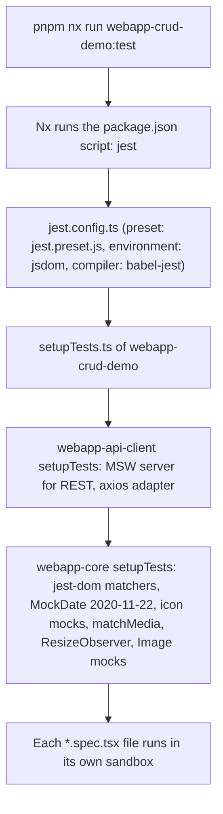
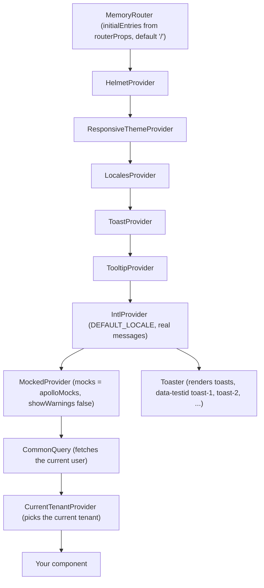
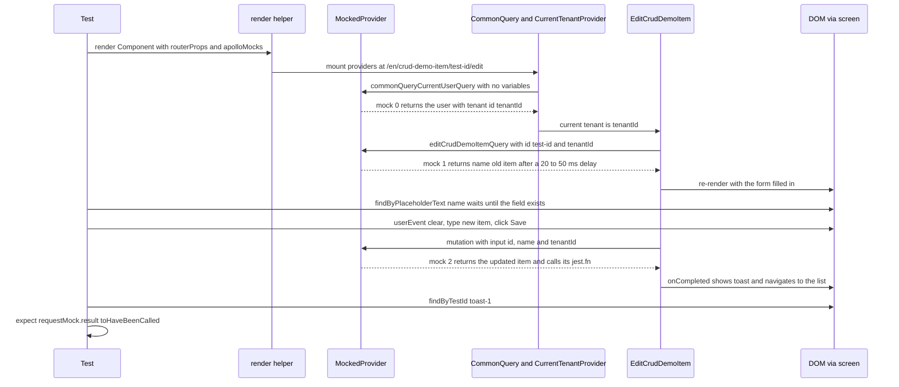

# Anatomy of a frontend test in this repository

A temporary reading note. Delete it once you have read it.

It is for someone who knows pytest, fixtures, factories, pytest-mock and the Django test client, but not Jest or React Testing Library. After reading it, you should be able to follow a RED or GREEN frontend step on your own.

The worked example is the CRUD demo library, [`webapp-crud-demo`](../../../packages/webapp-libs/webapp-crud-demo/). It is a list, details, add and edit feature with GraphQL queries and mutations. Its edit test shows everything in one file: a query mock, a mutation mock, typing, clicking and a route.

Files used:

- Test (main example): [`editCrudDemoItem.component.spec.tsx`](../../../packages/webapp-libs/webapp-crud-demo/src/routes/crudDemoItem/editCrudDemoItem/__tests__/editCrudDemoItem.component.spec.tsx)
- Component under test: [`editCrudDemoItem.component.tsx`](../../../packages/webapp-libs/webapp-crud-demo/src/routes/crudDemoItem/editCrudDemoItem/editCrudDemoItem.component.tsx)
- Its GraphQL documents: [`editCrudDemoItem.graphql.ts`](../../../packages/webapp-libs/webapp-crud-demo/src/routes/crudDemoItem/editCrudDemoItem/editCrudDemoItem.graphql.ts)
- Test (second example): [`crudDemoItemDetails.component.spec.tsx`](../../../packages/webapp-libs/webapp-crud-demo/src/routes/crudDemoItem/crudDemoItemDetails/__tests__/crudDemoItemDetails.component.spec.tsx), testing [`crudDemoItemDetails.component.tsx`](../../../packages/webapp-libs/webapp-crud-demo/src/routes/crudDemoItem/crudDemoItemDetails/crudDemoItemDetails.component.tsx)
- Factories: [`crudDemoItem.ts`](../../../packages/webapp-libs/webapp-crud-demo/src/tests/factories/crudDemoItem.ts)
- Render helper: [`rendering.tsx`](../../../packages/webapp-libs/webapp-crud-demo/src/tests/utils/rendering.tsx)
- Jest config: [`jest.config.ts`](../../../packages/webapp-libs/webapp-crud-demo/jest.config.ts) and [`setupTests.ts`](../../../packages/webapp-libs/webapp-crud-demo/src/tests/setupTests.ts)

---

## 1. From pytest to Jest: a translation table

Every row below is true in this repository.

| pytest / Django idea                                        | Jest / React Testing Library in this repo                                                                                                                                                                                                                                                                                                                            | Where to see it                                                                                                                                                                                                                         |
| ----------------------------------------------------------- | -------------------------------------------------------------------------------------------------------------------------------------------------------------------------------------------------------------------------------------------------------------------------------------------------------------------------------------------------------------------- | --------------------------------------------------------------------------------------------------------------------------------------------------------------------------------------------------------------------------------------- |
| A test function `def test_x():`                             | `it('should ...', async () => { ... })`                                                                                                                                                                                                                                                                                                                              | every spec file                                                                                                                                                                                                                         |
| A test class or module grouping tests                       | `describe('EditCrudDemoItem: Component', () => { ... })`. Can be nested, like a class inside a module.                                                                                                                                                                                                                                                               | [`editCrudDemoItem.component.spec.tsx`](../../../packages/webapp-libs/webapp-crud-demo/src/routes/crudDemoItem/editCrudDemoItem/__tests__/editCrudDemoItem.component.spec.tsx) has a nested `describe('action completes successfully')` |
| Test file discovery `test_*.py`                             | Files named `*.spec.tsx` or `*.test.tsx`, usually in a `__tests__/` folder next to the component                                                                                                                                                                                                                                                                     | `testMatch` in the Nx preset, loaded by [`jest.preset.js`](../../../jest.preset.js)                                                                                                                                                     |
| `conftest.py`                                               | `jest.config.ts` plus the `setupTests.ts` it names in `setupFilesAfterEnv`. They run before every test file.                                                                                                                                                                                                                                                         | [`jest.config.ts`](../../../packages/webapp-libs/webapp-crud-demo/jest.config.ts), [`setupTests.ts`](../../../packages/webapp-libs/webapp-crud-demo/src/tests/setupTests.ts)                                                            |
| factory_boy factories                                       | `createFactory` (shallow merge of overrides) and `createDeepFactory` (deep merge with ramda `mergeDeepRight`). They return plain objects, nothing is saved anywhere.                                                                                                                                                                                                 | [`factoryCreators.ts`](../../../packages/webapp-libs/webapp-api-client/src/tests/utils/factoryCreators.ts)                                                                                                                              |
| Fixtures                                                    | Factories, small `fill...` helper functions that build a mock, constants at the top of a `describe`, and `beforeEach`                                                                                                                                                                                                                                                | `fillEditCrudDemoItemQuery` in [`crudDemoItem.ts`](../../../packages/webapp-libs/webapp-crud-demo/src/tests/factories/crudDemoItem.ts)                                                                                                  |
| Autouse fixture / `setup_method`                            | `beforeEach(() => { ... })`; `beforeAll` / `afterAll` for once per file                                                                                                                                                                                                                                                                                              | `beforeEach(() => { jest.clearAllMocks(); })` in the edit spec                                                                                                                                                                          |
| A logged-in user (`client.force_login(user)`)               | A mock of the "current user" GraphQL query: `fillCommonQueryWithUser(currentUserFactory({...}))`                                                                                                                                                                                                                                                                     | [`commonQuery.ts`](../../../packages/webapp-libs/webapp-api-client/src/tests/factories/commonQuery.ts)                                                                                                                                  |
| Rows in the test database                                   | Mocked GraphQL responses. There is no database. The component only "sees" what the mocks return.                                                                                                                                                                                                                                                                     | `apolloMocks` in every test                                                                                                                                                                                                             |
| Django test client `client.get(url)`                        | `render(<Component />, { routerProps, apolloMocks })`. `routerProps` holds the starting URL.                                                                                                                                                                                                                                                                         | [`rendering.tsx`](../../../packages/webapp-libs/webapp-crud-demo/src/tests/utils/rendering.tsx)                                                                                                                                         |
| `client.post(url, data)`                                    | `userEvent.type(...)` into a field, then `userEvent.click(...)` on the submit button                                                                                                                                                                                                                                                                                 | edit spec                                                                                                                                                                                                                               |
| Reading `response.content`                                  | Asking the rendered page: `screen.findByText`, `screen.getByRole`, `screen.queryByText`, ...                                                                                                                                                                                                                                                                         | everywhere                                                                                                                                                                                                                              |
| `assert x == y`                                             | `expect(x).toBe(y)`, `expect(el).toBeInTheDocument()`, `expect(el).toHaveTextContent('...')`                                                                                                                                                                                                                                                                         | matchers come from Jest and `@testing-library/jest-dom`                                                                                                                                                                                 |
| Mocking an external HTTP API (`responses`, `requests-mock`) | Apollo `MockedProvider` with a list of mocked responses, built by `composeMockedQueryResult`. (Plain REST calls go through MSW, set up in setupTests.)                                                                                                                                                                                                               | [`fixtures.ts`](../../../packages/webapp-libs/webapp-api-client/src/tests/utils/fixtures.ts)                                                                                                                                            |
| `mocker.patch('module.func')`                               | `jest.mock('@sb/webapp-core/services/analytics')`. With no second argument every export becomes an auto-generated `jest.fn()`.                                                                                                                                                                                                                                       | edit spec, line 16                                                                                                                                                                                                                      |
| `mocker.patch(..., wraps=real)` / patching one name only    | `jest.mock('mod', () => ({ ...jest.requireActual('mod'), OneThing: fake }))`                                                                                                                                                                                                                                                                                         | [`crudDemoItemList.component.spec.tsx`](../../../packages/webapp-libs/webapp-crud-demo/src/routes/crudDemoItem/crudDemoItemList/__tests__/crudDemoItemList.component.spec.tsx), lines 15 to 19                                          |
| `mock.assert_called_with(...)`                              | `expect(trackEvent).toHaveBeenCalledWith('crud', 'edit', id)`                                                                                                                                                                                                                                                                                                        | edit spec                                                                                                                                                                                                                               |
| `mock.reset_mock()`                                         | `jest.clearAllMocks()`                                                                                                                                                                                                                                                                                                                                               | edit spec `beforeEach`                                                                                                                                                                                                                  |
| freezegun / pytest-freezer                                  | `MockDate.set('2020-11-22')` runs for every test in [`webapp-core/src/tests/setupTests.ts`](../../../packages/webapp-libs/webapp-core/src/tests/setupTests.ts). For timers, a few specs use `jest.useFakeTimers()`, e.g. [`payfastReturn.component.spec.tsx`](../../../packages/webapp-libs/webapp-finances/src/payfast/__tests__/payfastReturn.component.spec.tsx). |                                                                                                                                                                                                                                         |
| Transaction rollback after each test                        | React Testing Library unmounts the page after each test. Every `render` builds a new `MockedProvider`, so each test starts with an empty Apollo cache and its own mock list.                                                                                                                                                                                         |                                                                                                                                                                                                                                         |
| `pytest path/to/test_file.py`                               | `--testPathPattern=<text>`: runs the files whose path contains the text                                                                                                                                                                                                                                                                                              | section 6                                                                                                                                                                                                                               |
| `pytest -v`                                                 | `-- --verbose` (after a bare `--`, see section 6)                                                                                                                                                                                                                                                                                                                    | README "Testing" section                                                                                                                                                                                                                |

There is no `it.each` (the `parametrize` equivalent) in the frontend tests today, so it is left out.

---

## 2. What happens when a test runs

### 2.1 Start-up, before any test



Things worth knowing here:

- There is no `test` target in [`project.json`](../../../packages/webapp-libs/webapp-crud-demo/project.json). Nx picks up the `"test": "jest"` script in [`package.json`](../../../packages/webapp-libs/webapp-crud-demo/package.json) and runs it. Extra flags you give Nx are passed on to Jest.
- `jsdom` is a fake browser inside Node. There is no real browser, no CSS layout and no network.
- `babel-jest` strips TypeScript types without checking them. A type error does not fail a test. That is why `type-check` is its own GREEN step.

### 2.2 One test, from `render` to assertion

`render` here is not React Testing Library's bare `render`. It is the wrapper in [`rendering.tsx`](../../../packages/webapp-libs/webapp-crud-demo/src/tests/utils/rendering.tsx). It wraps your component in the same providers the real app has. These are the real providers, outermost first:



They are built in three layers, each wrapping the one before:

- [`webapp-core/src/tests/utils/rendering.tsx`](../../../packages/webapp-libs/webapp-core/src/tests/utils/rendering.tsx): `CoreTestProviders`, the router, intl, theme and toast providers.
- [`webapp-api-client/src/tests/utils/rendering.tsx`](../../../packages/webapp-libs/webapp-api-client/src/tests/utils/rendering.tsx): `ApiTestProviders`, Apollo's `MockedProvider` and `CommonQuery`. It also creates `waitForApolloMocks`.
- [`webapp-tenants/src/tests/utils/rendering.tsx`](../../../packages/webapp-libs/webapp-tenants/src/tests/utils/rendering.tsx): `TenantsTestProviders`, the `CurrentTenantProvider`.

The crud demo helper delegates to the tenants layer. Other libraries have their own `rendering.tsx` with fewer layers; for example [`packages/webapp/src/tests/utils/rendering.tsx`](../../../packages/webapp/src/tests/utils/rendering.tsx) stops at the API layer.

Now the sequence for the edit test:



How `MockedProvider` picks a mock (from Apollo's `MockLink`, version 4.0.11):

1. It looks only at mocks for the same query document.
2. Among those, it takes the first whose `variables` are deeply equal to the variables the component sent. Key order does not matter. Values and types do: `first: 8` does not match `first: 10`, and `id: 1` does not match `id: '1'`.
3. A matched mock is removed after one use. If the component sends the same query twice, you need two copies of the mock. That is why the list test lists `fillCrudDemoItemPaginationListQuery(...)` twice.
4. If nothing matches, the component gets an error, not data. In this repo the warning is switched off (`showWarnings={false}` in `ApiTestProviders`), so a mismatch is usually silent. You see it only as "the text never appeared".

---

## 3. Anatomy of one real test

From [`editCrudDemoItem.component.spec.tsx`](../../../packages/webapp-libs/webapp-crud-demo/src/routes/crudDemoItem/editCrudDemoItem/__tests__/editCrudDemoItem.component.spec.tsx), lines 1 to 47 (shared setup) and 70 to 102 (the test), quoted unchanged.

### 3.1 Imports and module mocks

```tsx
import {
  currentUserFactory,
  fillCommonQueryWithUser,
} from '@sb/webapp-api-client/tests/factories';
import { composeMockedQueryResult } from '@sb/webapp-api-client/tests/utils';
import { trackEvent } from '@sb/webapp-core/services/analytics';
import { getLocalePath } from '@sb/webapp-core/utils';
import { tenantFactory } from '@sb/webapp-tenants/tests/factories/tenant';
import { screen } from '@testing-library/react';
import { userEvent } from '@testing-library/user-event';
import { Route, Routes } from 'react-router';

import { RoutesConfig } from '../../../../config/routes';
import { fillEditCrudDemoItemQuery } from '../../../../tests/factories';
import {
  createMockRouterProps,
  render,
} from '../../../../tests/utils/rendering';
import { EditCrudDemoItem } from '../editCrudDemoItem.component';
import { editCrudDemoItemMutation } from '../editCrudDemoItem.graphql';

jest.mock('@sb/webapp-core/services/analytics');
```

- `@sb/...` imports are other workspace libraries. `tests/...` paths inside them are test-only helpers.
- `screen` is the whole rendered page. You query it like a user would read it.
- `userEvent` simulates a real user (focus, key presses, click). The repo uses it almost everywhere (about 370 lines). `fireEvent` appears in about 40 lines, mostly in low-level UI component tests.
- `render` and `createMockRouterProps` come from this library's own helper, not straight from Testing Library.
- `jest.mock('@sb/webapp-core/services/analytics')` is like `mocker.patch` on the whole module. Jest hoists it above the imports, so the `trackEvent` imported on line 3 is already a `jest.fn()`. The component imports the same mocked function, so the test can check how it was called.

### 3.2 Shared data, the "fixtures"

```tsx
const tenantId = 'tenantId';

describe('EditCrudDemoItem: Component', () => {
  const defaultItemId = 'test-id';
  const oldName = 'old item';
  const newName = 'new item';
  const routePath = getLocalePath(RoutesConfig.crudDemoItem.edit);

  const queryData = {
    id: defaultItemId,
    name: oldName,
    __typename: 'CrudDemoItemType',
  };
  const queryVariables = { id: defaultItemId, tenantId };

  const mutationVariables = { input: { id: defaultItemId, name: newName, tenantId } };

  const mutationData = {
    updateCrudDemoItem: { crudDemoItem: { id: defaultItemId, name: newName, __typename: 'CrudDemoItemType' } },
  };

  beforeEach(() => {
    jest.clearAllMocks();
  });

  const Component = () => (
    <Routes>
      <Route path={routePath} element={<EditCrudDemoItem />} />
    </Routes>
  );
```

- `queryData` is "the row in the database". `__typename` is the GraphQL type name. Apollo's cache uses it with `id` to store objects, so include it on objects you mock.
- `queryVariables` must equal what the component sends. The component sends `{ id: id ?? '', tenantId: currentTenant?.id ?? '' }` (see [`editCrudDemoItem.component.tsx`](../../../packages/webapp-libs/webapp-crud-demo/src/routes/crudDemoItem/editCrudDemoItem/editCrudDemoItem.component.tsx), line 27). `id` comes from the URL. `tenantId` comes from the current tenant, which comes from the user mock (see 3.3).
- `mutationVariables` must equal what `onFormSubmit` sends: `{ input: { tenantId, id, name } }`. Order differs from the test, which is fine.
- `beforeEach(jest.clearAllMocks)` resets the call history of `trackEvent` between tests, like a function-scoped fixture.
- `routePath` is `/:lang/crud-demo-item/:id/edit`. `RoutesConfig` lives in [`config/routes.ts`](../../../packages/webapp-libs/webapp-crud-demo/src/config/routes.ts). `getLocalePath` adds the `/:lang/` prefix ([`path.ts`](../../../packages/webapp-libs/webapp-core/src/utils/path.ts)).
- `Component` puts the page under test inside a `<Route>`. Without that, `useParams()` would have no `id`. It is the URL conf of this test.

### 3.3 The test itself

```tsx
  describe('action completes successfully', () => {
    it('should commit mutation', async () => {
      const commonQueryMock = fillCommonQueryWithUser(
        currentUserFactory({
          tenants: [
            tenantFactory({
              id: tenantId,
            }),
          ],
        })
      );
      const routerProps = createMockRouterProps(RoutesConfig.crudDemoItem.edit, { id: defaultItemId });

      const queryMock = fillEditCrudDemoItemQuery(queryData, queryVariables);
      const requestMock = composeMockedQueryResult(editCrudDemoItemMutation, {
        variables: mutationVariables,
        data: mutationData,
      });

      render(<Component />, {
        routerProps,
        apolloMocks: [commonQueryMock, queryMock, requestMock],
      });

      const nameField = await screen.findByPlaceholderText(/name/i);
      await userEvent.clear(nameField);
      await userEvent.type(nameField, newName);
      await userEvent.click(screen.getByRole('button', { name: /save/i }));

      // Wait for the mutation to complete (toast appears)
      await screen.findByTestId('toast-1');
      expect(requestMock.result).toHaveBeenCalled();
    });
```

Block by block:

**`async () =>`.** Almost every test here is `async`, because the page fills in after mocked network calls. Every `await` waits for something.

**The logged-in user.**

- `currentUserFactory(...)` ([`auth.ts`](../../../packages/webapp-libs/webapp-api-client/src/tests/factories/auth.ts)) builds a user with random ids and default fields. The override replaces `tenants` with one tenant whose id is `'tenantId'`.
- `tenantFactory` ([`tenant.ts`](../../../packages/webapp-libs/webapp-tenants/src/tests/factories/tenant.ts)) builds a tenant of type `PERSONAL` with an accepted membership.
- `fillCommonQueryWithUser(user)` turns the user into a mock of `commonQueryCurrentUserQuery`, the query every page sends first.
- Why it matters: the URL has no tenant in it. [`CurrentTenantProvider`](../../../packages/webapp-libs/webapp-tenants/src/providers/currentTenantProvider/currentTenantProvider.component.tsx) then picks the first `PERSONAL` tenant of the user ([`currentTenantProvider.utils.ts`](../../../packages/webapp-libs/webapp-tenants/src/providers/currentTenantProvider/currentTenantProvider.utils.ts)). So this mock is what makes `tenantId` equal `'tenantId'` in every later query. Forget the override and the tenant id becomes a random string, and no later mock matches.
- If you pass `apolloMocks`, you replace the default list. The default is `[fillCommonQueryWithUser()]`, a logged-out user. So always put your own user mock first.

**The starting URL.** `createMockRouterProps(RoutesConfig.crudDemoItem.edit, { id: defaultItemId })` returns `{ initialEntries: ['/en/crud-demo-item/test-id/edit'] }`. It fills `:lang` with `en` and `:id` with your params. The core layer hands it to `MemoryRouter`. This is the `client.get('/en/crud-demo-item/test-id/edit')` of the test. (The tenants library has its own `createMockRouterProps` that also puts a `:tenantId` segment in the URL. The crud demo one does not.)

**The query mock.** `fillEditCrudDemoItemQuery(queryData, queryVariables)` ([`crudDemoItem.ts`](../../../packages/webapp-libs/webapp-crud-demo/src/tests/factories/crudDemoItem.ts), line 28) is a one-line wrapper around `composeMockedQueryResult`. It wraps the data in `{ crudDemoItem: data }`, the shape the query returns.

**The mutation mock.** [`composeMockedQueryResult`](../../../packages/webapp-libs/webapp-api-client/src/tests/utils/fixtures.ts) builds one entry for `MockedProvider`:

```ts
return {
  request: {
    query,
    variables,
  },
  // @ts-ignore
  result: jest.fn ? jest.fn(() => result) : () => structuredClone(result),
};
```

- `request` is what must match: the query document and the exact variables.
- `result` is wrapped in `jest.fn`. Apollo calls it only when a request matched. So `expect(requestMock.result).toHaveBeenCalled()` means "the component sent this mutation with exactly these variables". It is the frontend version of asserting that a view called a service with the right arguments.
- The same helper handles mutations and queries. Both are just "a GraphQL document plus variables".

**`render(...)`.** Options:

- `routerProps`: the starting URL.
- `apolloMocks`: the ordered list of mocks. Order does not decide matching (query and variables do), but `waitForApolloMocks(index)` refers to mocks by position.
- It returns everything Testing Library's `render` returns, plus `waitForApolloMocks`.

**Finding elements.** Three prefixes, several suffixes:

| Prefix       | If not found                               | If found more than once | Waits?                   | Use it for                                                                                 |
| ------------ | ------------------------------------------ | ----------------------- | ------------------------ | ------------------------------------------------------------------------------------------ |
| `getBy...`   | throws at once                             | throws                  | no                       | things already on the page                                                                 |
| `findBy...`  | throws after the timeout (default 1000 ms) | throws                  | yes, retries until found | anything that appears after a mock answers                                                 |
| `queryBy...` | returns `null`                             | throws                  | no                       | proving something is absent: `expect(screen.queryByText(/edit/i)).not.toBeInTheDocument()` |

Each has an `All` form (`findAllByText`) that returns a list.

| Suffix                                | Matches                                                                                                          | Example in this repo                                                       |
| ------------------------------------- | ---------------------------------------------------------------------------------------------------------------- | -------------------------------------------------------------------------- |
| `ByRole('button', { name: /save/i })` | an element by its accessible role and label. Closest to how a user or screen reader sees the page, so prefer it. | the Save button. Its text is "Save changes"; the regex matches part of it. |
| `ByText(/demo item name/i)`           | visible text                                                                                                     | most assertions                                                            |
| `ByPlaceholderText(/name/i)`          | an input's placeholder                                                                                           | the name field                                                             |
| `ByDisplayValue('old item')`          | the current value of an input                                                                                    | the prefilled form test                                                    |
| `ByTestId('toast-1')`                 | a `data-testid` attribute                                                                                        | toasts, the item menu's `toggle-button`                                    |

A string matches the whole text exactly. A regex like `/save/i` matches part of it, ignoring case.

The first line, `await screen.findByPlaceholderText(/name/i)`, is the most important line in the test. While the two queries are in flight, the component shows a loading skeleton with no input. `findBy` keeps retrying until the form appears. A `getBy` here would fail at once.

**Interacting.** `await userEvent.clear(field)`, `await userEvent.type(field, 'new item')` and `await userEvent.click(button)`. Always `await` them. Version 14 of user-event returns promises. `getByRole` is enough for the button, because the form is already on the page by then.

**Waiting for the result.** Clicking Save sends the mutation. The mock answers after a short delay. `onCompleted` then calls `trackEvent`, shows a toast and navigates to the list. The test's `Component` has no list route, so the page body goes blank. But the `Toaster` sits outside the routes (see the provider tree), so the toast stays. `await screen.findByTestId('toast-1')` waits for it. Toast ids count from 1 for each render, so the first toast in a test is always `toast-1`.

**The assertion.** `expect(requestMock.result).toHaveBeenCalled()`. The sibling test, "should show success message", checks the other side effects instead:

```tsx
const toast = await screen.findByTestId('toast-1');
expect(trackEvent).toHaveBeenCalledWith('crud', 'edit', defaultItemId);
expect(toast).toHaveTextContent('Changes saved successfully!');
```

### 3.4 What makes it RED, and what makes it GREEN

GREEN: every `findBy` finds its element within its timeout, and every `expect` holds.

A good RED fails for the reason you expect, at an assertion. Some examples for this test:

| Change in the component                 | The RED you see                                                                              |
| --------------------------------------- | -------------------------------------------------------------------------------------------- |
| The Save button sends no mutation       | `findByTestId('toast-1')` times out: "Unable to find an element by: [data-testid="toast-1"]" |
| The mutation is sent without `tenantId` | Same as above. The mock does not match, Apollo returns an error, no toast.                   |
| The toast text changes                  | `expect(element).toHaveTextContent()` shows the expected and received text                   |
| `trackEvent` is not called              | `expect(jest.fn()).toHaveBeenCalledWith(...expected)` with "Number of calls: 0"              |

A bad RED fails before any assertion: "Cannot find module", a syntax error, or a mock missing for an earlier query so the page never loads. Fix those first. They prove nothing about the behaviour you are adding.

---

## 4. A second pattern: an error response and a redirect

From [`crudDemoItemDetails.component.spec.tsx`](../../../packages/webapp-libs/webapp-crud-demo/src/routes/crudDemoItem/crudDemoItemDetails/__tests__/crudDemoItemDetails.component.spec.tsx), lines 19 to 34 and 65 to 79:

```tsx
const Component = () => (
  <Routes>
    <Route
      path={getLocalePath(RoutesConfig.crudDemoItem.details)}
      element={<CrudDemoItemDetails />}
    />
    <Route
      path={getLocalePath(RoutesConfig.crudDemoItem.list)}
      element={<span>List page</span>}
    />
  </Routes>
);

const defaultCommonQueryMock = fillCommonQueryWithUser(
  currentUserFactory({
    tenants: [
      tenantFactory({
        id: tenantId,
      }),
    ],
  }),
);
```

```tsx
it('should show error toast and redirect to list on error', async () => {
  const routerProps = createMockRouterProps(RoutesConfig.crudDemoItem.details, {
    id: defaultItemId,
  });

  const errorMock = composeMockedQueryResult(crudDemoItemDetailsQuery, {
    variables: { id: defaultItemId, tenantId },
    data: {},
    errors: [new GraphQLError('Something went wrong')],
  });

  render(<Component />, {
    routerProps,
    apolloMocks: [defaultCommonQueryMock, errorMock],
  });

  const toast = await screen.findByTestId('toast-1');
  expect(toast).toHaveTextContent('Failed to load item details');
  expect(await screen.findByText('List page')).toBeInTheDocument();
});
```

What is new here:

- **A second route as a stand-in page.** The list route renders `<span>List page</span>`. When the component calls `navigate(...)` to the list, the test can see that the redirect happened by finding that text. This is the frontend version of `assertRedirects(response, '/list/')`. The list test does the same with "CrudDemoItem add page mock".
- **An error mock.** When `errors` is given and `data` is empty, `composeMockedQueryResult` returns `{ request, error }` instead of `{ request, result }`. Apollo then delivers an error to `useQuery`, as a failing server would. Note that such a mock has no `result` function, so `expect(errorMock.result).toHaveBeenCalled()` would not work.
- **What the component does with it.** In [`crudDemoItemDetails.component.tsx`](../../../packages/webapp-libs/webapp-crud-demo/src/routes/crudDemoItem/crudDemoItemDetails/crudDemoItemDetails.component.tsx) a `useEffect` sees `error`, shows a "destructive" toast and navigates to the list. The test waits for both.
- **`defaultCommonQueryMock` at `describe` level.** It is safe to share across tests, because each `render` builds a new `MockedProvider` from a copy of the list. Its `result` jest.fn is shared, though, so don't assert its call count in more than one test.

A related pattern from the same file, the "no data" case, shows `waitForApolloMocks`:

```tsx
const { waitForApolloMocks } = render(<Component />, {
  routerProps,
  apolloMocks: [defaultCommonQueryMock, nullDataMock],
});
await waitForApolloMocks(1);

expect(screen.queryByText(/item information/i)).not.toBeInTheDocument();
```

To prove something is absent, you cannot use `findBy`; there is nothing to wait for. So the test first waits until mock number 1 (the details query) has answered. `waitForApolloMocks(i)` is `waitFor(() => expect(mock.result).toHaveBeenCalled())` ([source](../../../packages/webapp-libs/webapp-api-client/src/tests/utils/rendering.tsx), lines 81 to 103). With no argument it waits for the last mock in the list. Then `queryBy` checks the page.

---

## 5. Common failure messages

| Message                                                                                                    | What it usually means                                                                                                                                                                                                                                                                                             |
| ---------------------------------------------------------------------------------------------------------- | ----------------------------------------------------------------------------------------------------------------------------------------------------------------------------------------------------------------------------------------------------------------------------------------------------------------- |
| `Unable to find an element with the text: ...` (from a `findBy`, after about 1 second)                     | The most common one. Either the text really is not there (good RED), or the data never arrived because a mock did not match. Check the variables first: tenant id, page size, `id` types. Mismatch warnings are switched off here, so this is often the only symptom.                                             |
| `Unable to find an element with the text: ...` (from a `getBy`, at once)                                   | You used `getBy` for something that appears only after a mock answers. Use `findBy`.                                                                                                                                                                                                                              |
| `Found multiple elements with the text: ...`                                                               | The text appears twice (for example in a title and a card). Use a more specific query, or `findAllByText` as the details test does.                                                                                                                                                                               |
| `No more mocked responses for the query: ...` with "Failed to match variables against N mocks"             | Apollo got a request no mock matches. It lists the variables sent and the variables each mock had. You see it only if the error reaches the page or the console. Copy the sent variables into your mock, or fix the component.                                                                                    |
| `expect(jest.fn()).toHaveBeenCalled()` ... `Received number of calls: 0`, from inside `waitForApolloMocks` | The mock at that index was never matched within about 1 second. Same causes as above: wrong variables, or an earlier query (often the user mock) is missing, so the component never got far enough to send it.                                                                                                    |
| `Exceeded timeout of 5000 ms for a test`                                                                   | Jest's per-test limit. Usually a `waitFor` or `findBy` chain that never resolves, or a forgotten `await` on a promise that never settles.                                                                                                                                                                         |
| `Warning: An update to X inside a test was not wrapped in act(...)`                                        | The component changed after the test stopped watching, usually because a mock answered after the last assertion. Usually not a failure. If it bothers you, end the test with a `findBy` or `waitForApolloMocks` on that last change. A test that keeps going without `await` on `userEvent` calls also causes it. |
| `Missing field 'x' while writing result`                                                                   | The mock data lacks a field the query asks for. Apollo cannot store it, so the component may get no data. Add the field, and `__typename`.                                                                                                                                                                        |
| `Cannot find module '...' from '...'`                                                                      | Wrong import path. Not a real RED.                                                                                                                                                                                                                                                                                |
| `TestingLibraryElementError` printing a big HTML dump                                                      | Not an error type of its own. The dump is the page at the moment of failure. Read it: it often shows a loading skeleton (data never came) or a different page (wrong route).                                                                                                                                      |

Debugging aids that need no new tools:

- `screen.debug()` prints the current page HTML inside a test.
- `expect(someMock.result).toHaveBeenCalled()` tells you whether a given mock was ever used.

---

## 6. How to run it

Use Node 20 locally (`nvm use 20`), as the README's "Testing" section says. CI runs Node 22 and 24. Run from the repository root.

One file. `--testPathPattern` takes any text contained in the file path:

```shell
pnpm nx run webapp-crud-demo:test --watchAll=false --testPathPattern=editCrudDemoItem
```

- `--watchAll=false`: run once and exit, instead of waiting for file changes.
- Add `--skip-nx-cache` when you need a real run. Otherwise Nx may replay the last result if no file changed.
- Add `--maxWorkers=2` to limit memory, as the README does.

Verbose, one line per test. `--verbose` must come after a bare `--`, otherwise Nx keeps it for itself:

```shell
pnpm nx run webapp-crud-demo:test --watchAll=false --testPathPattern=editCrudDemoItem -- --verbose
```

One test by name. Jest's `--testNamePattern` matches the joined `describe` and `it` names:

```shell
pnpm nx run webapp-crud-demo:test --watchAll=false --testPathPattern=editCrudDemoItem -- --testNamePattern="should commit mutation"
```

The README's "Testing" section has the logging forms (`tee logs/...`) the working agreement asks for. Use those when recording RED or GREEN in a plan.

### Reading the output

The shape of a verbose run (names from the edit spec; timings and exact layout will differ):

```text
PASS src/routes/crudDemoItem/editCrudDemoItem/__tests__/editCrudDemoItem.component.spec.tsx
  EditCrudDemoItem: Component
    ✓ should display prefilled form
    action completes successfully
      ✓ should commit mutation
      ✓ should show success message

Test Suites: 1 passed, 1 total
Tests:       3 passed, 3 total
```

- `PASS` or `FAIL` is per file. Jest calls a file a "test suite".
- The indented lines are the `describe` blocks and `it` names.
- The last lines are the counts. They are what the README's summary commands pick out.

When a test fails, Jest prints a block per failure, starting with `●`:

```text
● EditCrudDemoItem: Component › action completes successfully › should commit mutation

    Unable to find an element by: [data-testid="toast-1"]

    <body> ... the page HTML at the moment of failure ... </body>

      98 |
      99 |       // Wait for the mutation to complete (toast appears)
    > 100 |       await screen.findByTestId('toast-1');
          |                    ^
```

- The heading is the full test name: `describe › describe › it`.
- Then the message, often with an HTML dump of the page.
- Then the code frame. The `>` marks the line in your test that failed.

---

## 7. Cheat sheet

```text
SHAPE OF A TEST
  jest.mock('@sb/webapp-core/services/analytics');     // patch a module, before describe
  describe('Thing: Component', () => {
    const Component = () => (<Routes><Route path={getLocalePath(RoutesConfig.x.edit)} element={<Thing />} /></Routes>);
    beforeEach(() => jest.clearAllMocks());
    it('should ...', async () => {
      const user  = fillCommonQueryWithUser(currentUserFactory({ tenants: [tenantFactory({ id: 'tenantId' })] }));
      const query = composeMockedQueryResult(someQuery,   { variables: {...exact...}, data: {...} });
      const mut   = composeMockedQueryResult(someMutation,{ variables: {...exact...}, data: {...} });
      render(<Component />, { routerProps: createMockRouterProps(RoutesConfig.x.edit, { id: 'a' }),
                              apolloMocks: [user, query, mut] });
      await userEvent.type(await screen.findByPlaceholderText(/name/i), 'text');
      await userEvent.click(screen.getByRole('button', { name: /save/i }));
      await screen.findByTestId('toast-1');
      expect(mut.result).toHaveBeenCalled();
    });
  });

MOCKS
  user mock first, always (it sets the current tenant)
  variables must deep-equal what the component sends (types too)
  one mock = one request; same request twice = two copies
  errors + empty data  -> error mock (no .result)
  mismatches are silent here (showWarnings false)

QUERIES
  findBy  = wait for it     (after any mock answers)
  getBy   = it is here now  (throws if missing)
  queryBy = prove absence   (returns null)
  prefer ByRole > ByText / ByPlaceholderText / ByDisplayValue > ByTestId

WAITING
  await every userEvent call
  await screen.findBy...(...)
  const { waitForApolloMocks } = render(...); await waitForApolloMocks(i);
  await waitFor(() => expect(fn).toHaveBeenCalledWith(...));

ASSERTIONS
  toBeInTheDocument  toHaveTextContent  toHaveValue  not.toBeInTheDocument
  toHaveBeenCalled   toHaveBeenCalledWith(...)

RUN  (Node 20)
  pnpm nx run <project>:test --watchAll=false --testPathPattern=<text>
  ... -- --verbose
  ... -- --testNamePattern="<it name>"
  add --skip-nx-cache for a real run

DEBUG
  screen.debug()            print the page
  read the HTML dump        skeleton = data never came; other page = wrong route
```
