# Shopify integration: code walkthrough

This document explains how the Shopify integration works in the code as it stands on 2026-10-15. It is not
a design proposal. A merchant installs the app on a Shopify store, either from Shopify or from the
"Connect a store" form in the web app. The backend app [`apps/shopify`](../../../packages/backend/apps/shopify/)
checks every Shopify request with an HMAC, runs the OAuth authorization code grant, and stores the store's
expiring offline tokens encrypted. A store installed from Shopify is not tied to an organization yet: the
backend sends the merchant to a link page with a signed, one-hour claim, and the merchant connects the store
to their current organization. Webhooks handle uninstall and Shopify's mandatory compliance topics. The
React library [`webapp-shopify`](../../../packages/webapp-libs/webapp-shopify/src/) holds the three pages.

What exists today:

- Install started from Shopify (App URL), with HMAC and shop-domain checks.
- Install started from the web app ("Connect a store"), which links the store at once.
- Link a store to an organization with a signed claim, including the logged-out case (`?claim=` survives login).
- Store list with badges (Active, Uninstalled, Needs reinstall) and Disconnect.
- Token refresh in `admin_client_for`; a rejected refresh token flags the store `needs_reinstall`.
- Products page: a store's products read live from Shopify a page at a time, with a store picker and a
  "products per page" picker.
- One webhook endpoint: `app/uninstalled`, `shop/redact`, `customers/redact`, `customers/data_request`,
  deduplicated by webhook id, dispatched inline or through Celery.
- Startup system checks for the `SHOPIFY_*` settings.
- Seed command `shopify_seed_demo` for four demo stores in a chosen organization, and a demo Member.
- Permissions `shopify.view` and `shopify.manage`, written to the database by a data migration.

The products page (plan step 11, section 5.2) was added on 2026-10-15, in release 6.2.0: section 4c.

## How to read this document

- Links are relative to this file and open the source. Backend paths are shortened to `apps/...` and
  `config/...` in link text.
- Sections 2 to 6 are diagrams. Sections 7 onward are reference tables.
- Background and the reasons behind each rule are in
  [`2026-10-03-shopify-app-installation-plan.md`](../plans/2026-10-03-shopify-app-installation-plan.md):
  section 1 for Shopify facts, section 2 for the original diagrams, section 5.1 for bugs, section 9 for
  decisions. Where the plan and the code disagree, the code is right and this document describes the code.
  Section 12 lists the differences.

## 1. Suggested reading order

1. [`config/settings.py`](../../../packages/backend/config/settings.py) (the `SHOPIFY CONFIGURATION` block). What turns the feature on.
2. [`apps/shopify/checks.py`](../../../packages/backend/apps/shopify/checks.py). What startup rejects.
3. [`apps/shopify/models.py`](../../../packages/backend/apps/shopify/models.py). Three tables, and the token properties.
4. [`apps/shopify/crypto.py`](../../../packages/backend/apps/shopify/crypto.py). Fernet encryption behind those properties.
5. [`apps/shopify/verification.py`](../../../packages/backend/apps/shopify/verification.py). Shop-domain regex and both HMAC checks.
6. [`apps/shopify/services.py`](../../../packages/backend/apps/shopify/services.py) (`start_install`, `complete_install`). The OAuth flow.
7. [`apps/shopify/client.py`](../../../packages/backend/apps/shopify/client.py) (`exchange_code`, `refresh`, `graphql`, `admin_client_for`). Every HTTP call to Shopify. Then [`apps/shopify/products.py`](../../../packages/backend/apps/shopify/products.py) (`fetch_products`), the one caller of `admin_client_for`.
8. [`apps/shopify/views.py`](../../../packages/backend/apps/shopify/views.py) and [`urls.py`](../../../packages/backend/apps/shopify/urls.py). The install and callback endpoints.
9. [`apps/shopify/schema.py`](../../../packages/backend/apps/shopify/schema.py). GraphQL queries and mutations used by the web app.
10. [`apps/shopify/permissions.py`](../../../packages/backend/apps/shopify/permissions.py) and [`migrations/0003_seed_shopify_permissions.py`](../../../packages/backend/apps/shopify/migrations/0003_seed_shopify_permissions.py). Who may view and manage.
11. [`apps/shopify/webhooks.py`](../../../packages/backend/apps/shopify/webhooks.py), [`tasks.py`](../../../packages/backend/apps/shopify/tasks.py), then the `handle_*` functions in [`services.py`](../../../packages/backend/apps/shopify/services.py). Webhooks.
12. [`webapp-shopify/src/graphql/shopify.graphql.ts`](../../../packages/webapp-libs/webapp-shopify/src/graphql/shopify.graphql.ts). The seven GraphQL documents.
13. [`shopifyShops.component.tsx`](../../../packages/webapp-libs/webapp-shopify/src/routes/shopifyShops/shopifyShops.component.tsx). Store list, Connect, Disconnect. Then [`shopifyProducts.component.tsx`](../../../packages/webapp-libs/webapp-shopify/src/routes/shopifyProducts/shopifyProducts.component.tsx), the products page.
14. [`shopifyLink.component.tsx`](../../../packages/webapp-libs/webapp-shopify/src/routes/shopifyLink/shopifyLink.component.tsx). The claim page.
15. [`webapp/src/app/app.component.tsx`](../../../packages/webapp/src/app/app.component.tsx), [`authRoute.hook.tsx`](../../../packages/webapp/src/shared/components/routes/authRoute/authRoute.hook.tsx) and [`withLocale.ts`](../../../packages/webapp/src/app/providers/validRoutesProvider/withLocale.ts). Routing glue.

End here: the tests in [`apps/shopify/tests/`](../../../packages/backend/apps/shopify/tests/) (section 11).

## 2. Architecture overview

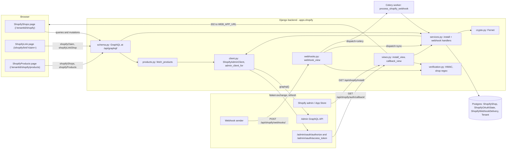

How it is wired in:

- [`config/settings.py`](../../../packages/backend/config/settings.py) lists `apps.shopify` in installed apps. `SHOPIFY_ENABLED` is true only when both `SHOPIFY_API_KEY` and `SHOPIFY_API_SECRET` are set.
- [`config/urls_api.py`](../../../packages/backend/config/urls_api.py) mounts [`apps/shopify/urls.py`](../../../packages/backend/apps/shopify/urls.py) at `/api/shopify/`.
- [`config/schema.py`](../../../packages/backend/config/schema.py) adds `shopify_schema.Query` and `shopify_schema.Mutation` to the root schema.
- [`apps/shopify/apps.py`](../../../packages/backend/apps/shopify/apps.py) imports `checks` in `ready()`. [`apps/multitenancy/permissions.py`](../../../packages/backend/apps/multitenancy/permissions.py) imports every app's `permissions` module.
- The Shopify side is configured in [`shopify.app.toml.example`](../../../packages/backend/apps/shopify/shopify.app.toml.example): App URL is `/api/shopify/install/`, redirect URL is `/api/shopify/auth/callback/`, all four topics go to `/api/shopify/webhooks/`, `embedded = false`.

## 3. Install and link flows

### 3a. Install started from Shopify

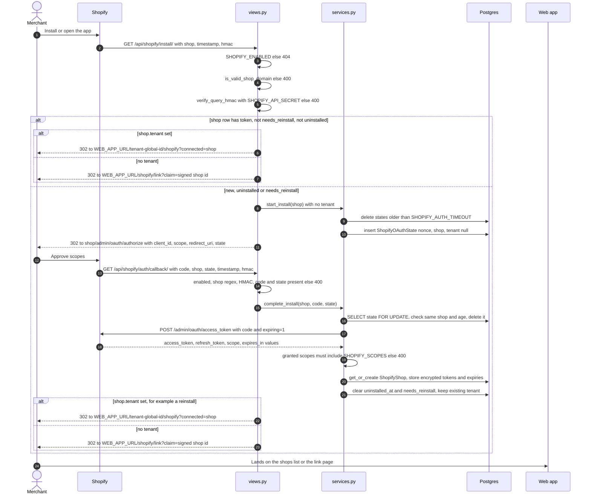

Both views are rate-limited to 30 requests per minute per IP (`django_ratelimit`). Every failed check
returns `400` with a short message, except the disabled case (`404`). The redirect to the shops list uses
`_redirect_to_shops_list`, which builds the tenant part of the path with `to_global_id("TenantType", ...)`.

### 3b. Install started from the web app ("Connect a store")

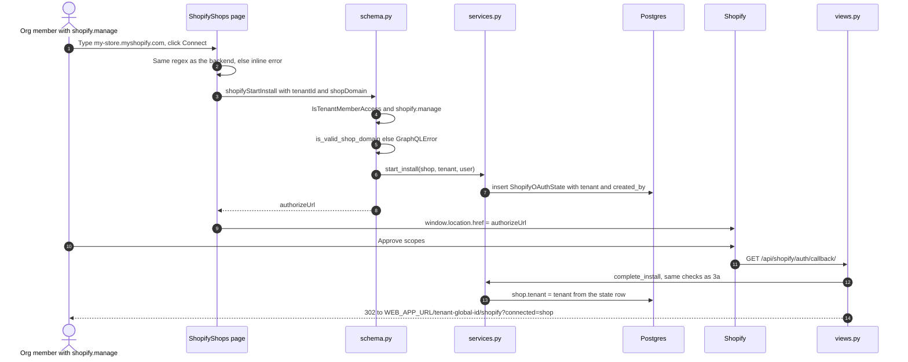

The tenant travels in the `ShopifyOAuthState` row, not in the URL. If the state row has a tenant,
`complete_install` overwrites the shop's tenant with it.

### 3c. Linking a store to an organization (claim flow)

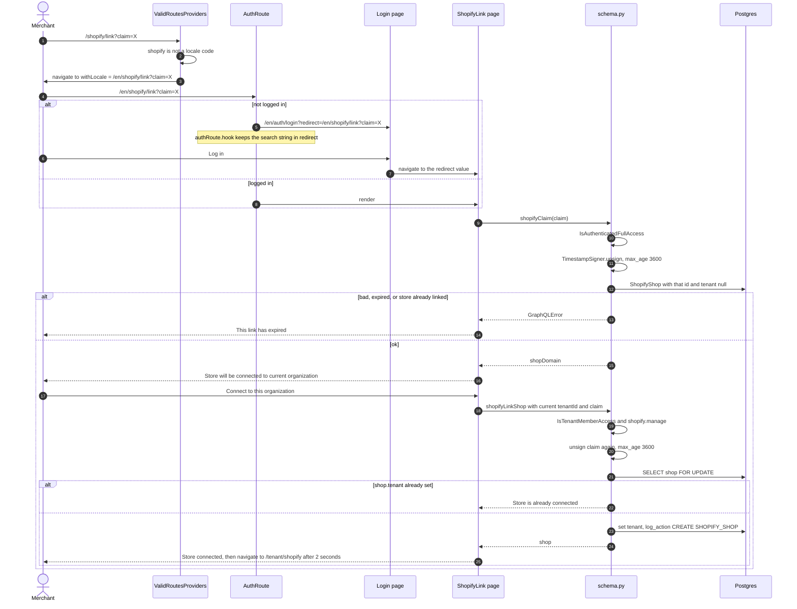

The page links to the organization that is current in the web app. To use another one, the merchant
switches organization first and reopens the link. A missing permission comes back as `permission_denied`,
which the page turns into a plain sentence.

### 3d. Disconnect

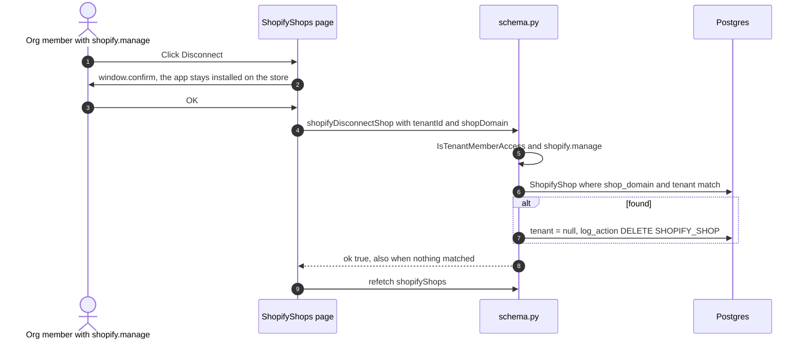

Disconnect only unlinks. Tokens stay, the app stays installed (decision D4). The next open from Shopify
goes through 3a and gets a fresh claim.

## 4. Token refresh, webhooks and the products page

### 4a. Token refresh in `admin_client_for`

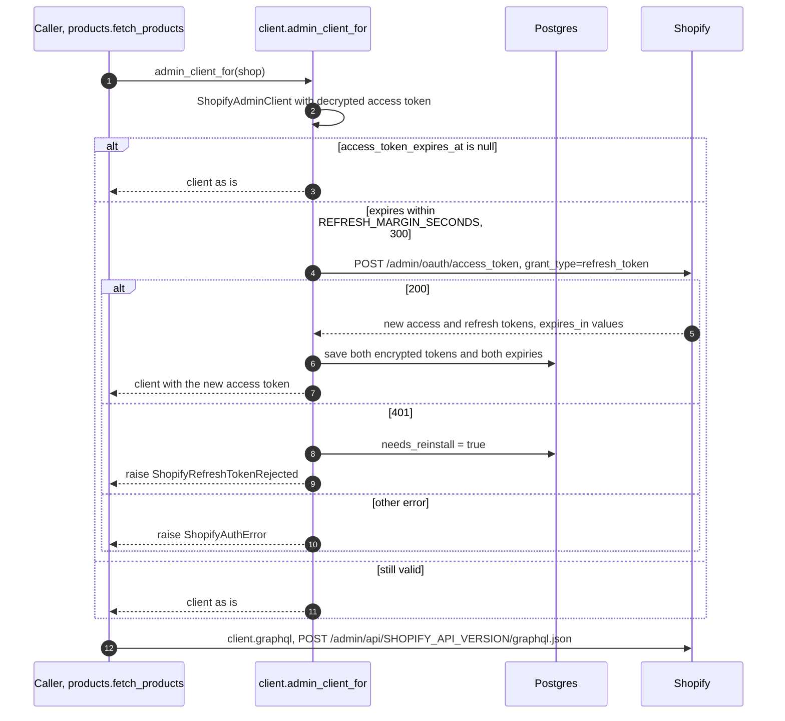

A `401` means only a reinstall can recover, so `admin_client_for` sets `needs_reinstall` before raising
again. There is no row lock around the refresh (section 12). The products page is the only caller.
`graphql()` raises `ShopifyThrottledError` when an error in the response has `extensions.code`
`THROTTLED`, and `ShopifyAPIError` on any other error or an HTTP error.

### 4b. Webhook receipt

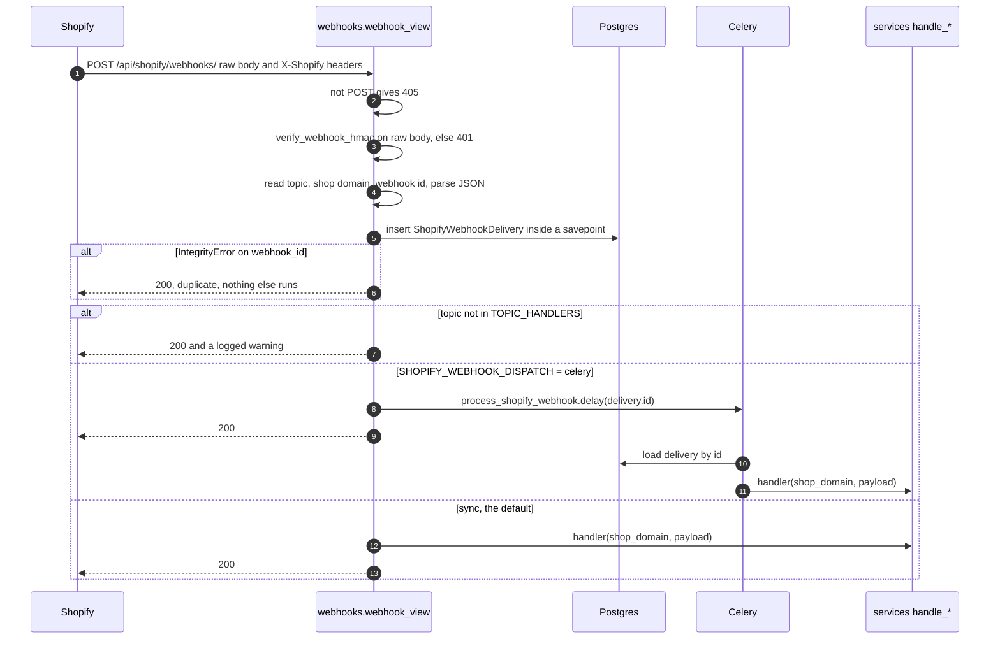

The view is `csrf_exempt` and not rate-limited. The Celery task retries at most 3 times, 60 seconds apart.

What each handler does:

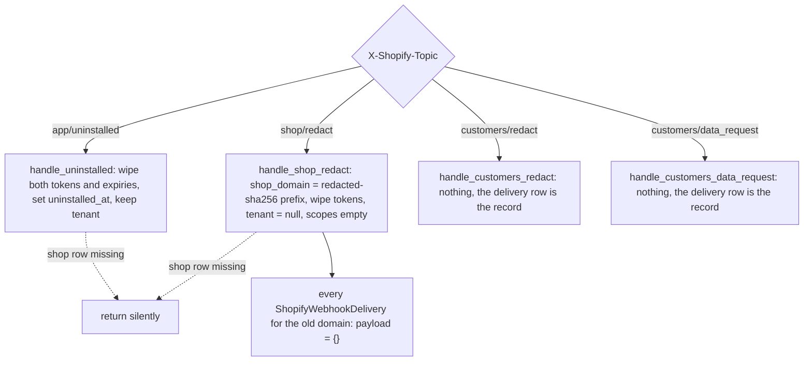

### 4c. The products page

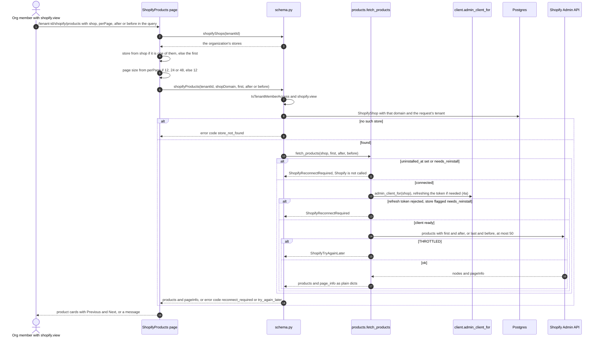

- **The URL holds the state.** The store (`shop`), the page size (`perPage`) and one cursor (`after` or
  `before`) are query parameters, so a refresh or the back button keeps the page. Next sets `after` to
  the page's end cursor; Previous sets `before` to its start cursor. Changing the store or the page size
  drops the cursor and goes back to the first page: a cursor from one page size doesn't line up with
  another. The store picker appears when the organization has two or more stores.
- **Products are never stored.** Every page is read live from Shopify. `products.py` keeps Shopify's
  field names (`featuredMedia` and `priceRangeV2`, current in API 2026-10) to itself and returns our own
  keys. Prices are the decimal strings Shopify sends, shown as `USD 600.0`; formatting them as money is
  on the roadmap ([`0-production-readiness-roadmap.md`](../plans/0-production-readiness-roadmap.md), P1).
- **Errors the page can explain.** A store problem comes back as a `GraphQlValidationError` with a code in
  `extensions.non_field_errors`, the shape the PayFast pages use. `SanitizeErrorsMiddleware` lets that
  type through in production, so the code reaches the page there too. The page reads it (`problemCode`):
  `reconnect_required` and `try_again_later` get their own messages, anything else shows "Couldn't load
  the products". The messages are fixed texts, never Shopify's reply.
- **Wiring.** The route `shopify/products` sits inside the same `PermissionAuthRoute` with `shopify.view`
  as the shops list, and the sidebar gets a "Shopify products" item. On this page the sidebar highlights
  "Shopify" too: upstream marks an item active when the address contains its path (roadmap, P1).

## 5. A store's lifecycle

Derived from the fields of `ShopifyShop` in [`models.py`](../../../packages/backend/apps/shopify/models.py):
`tenant`, `access_token_encrypted`, `uninstalled_at`, `needs_reinstall`, `shop_domain`.

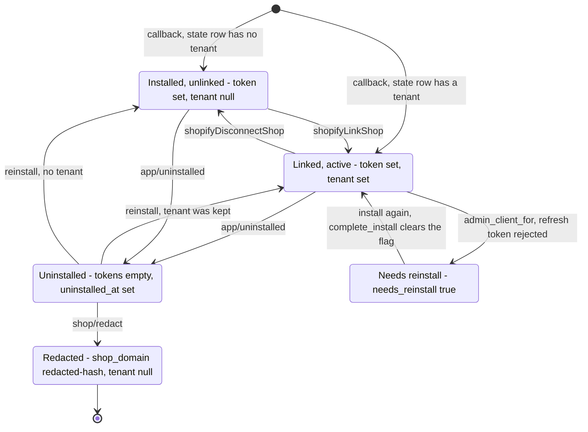

- The badge on the shops page reads the same fields: `needsReinstall` first, then `uninstalledAt`, else Active.
- `admin_client_for` sets `needs_reinstall` when Shopify rejects the refresh token (section 4a); the seed command also sets it on one demo store. The products page then asks to reconnect the store without calling Shopify.
- `shop/redact` acts on whatever row has that domain, whatever its state. A later install of the same domain creates a new row, since the old one was renamed.

## 6. Data model

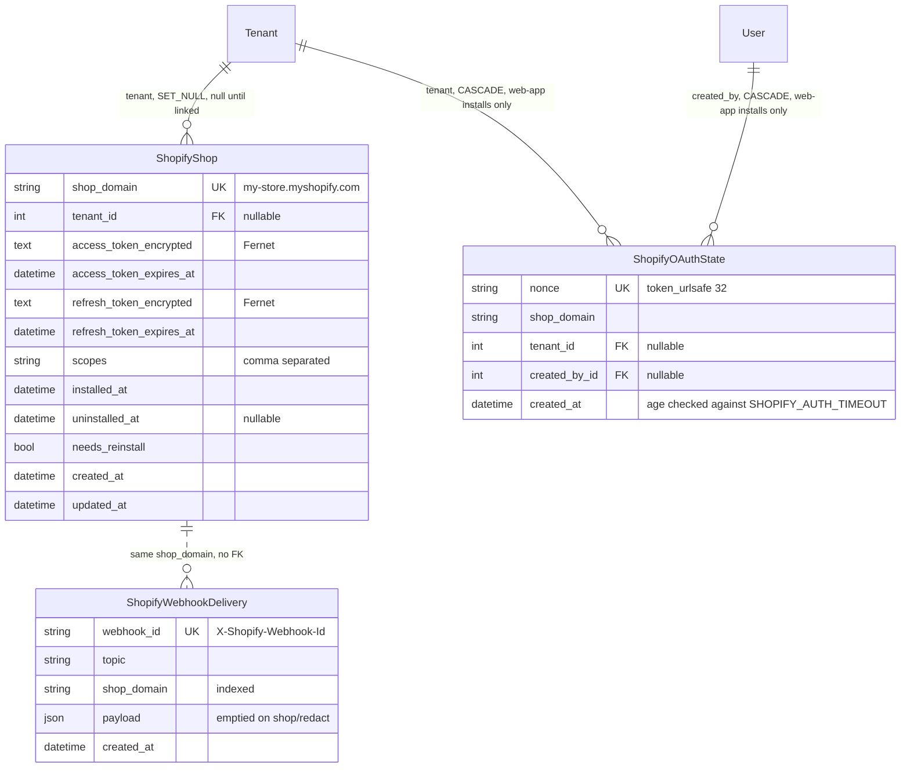

`ShopifyShop.access_token` and `refresh_token` are Python properties, not columns. Reading decrypts and
returns `None` on any error. Writing encrypts, and an empty value stores `""`. Migrations:
[`0001_initial.py`](../../../packages/backend/apps/shopify/migrations/0001_initial.py) created an earlier
`ShopifyStore` and `ShopifyToken`;
[`0002_...`](../../../packages/backend/apps/shopify/migrations/0002_shopifywebhookdelivery_remove_shopifytoken_store_and_more.py)
replaced them with the three models above;
[`0003_seed_shopify_permissions.py`](../../../packages/backend/apps/shopify/migrations/0003_seed_shopify_permissions.py)
writes the permissions.

## 7. File by file

### 7a. Backend

| File                                                                                                                                | What it does                                                 | Key names                                                                                               |
| ----------------------------------------------------------------------------------------------------------------------------------- | ------------------------------------------------------------ | ------------------------------------------------------------------------------------------------------- |
| [`config/settings.py`](../../../packages/backend/config/settings.py)                                                                | `SHOPIFY_*` settings, adds `apps.shopify`                    | `SHOPIFY_ENABLED`                                                                                       |
| [`config/urls_api.py`](../../../packages/backend/config/urls_api.py)                                                                | Mounts the app at `/api/shopify/`                            |                                                                                                         |
| [`config/schema.py`](../../../packages/backend/config/schema.py)                                                                    | Adds the Shopify Query and Mutation                          | `shopify_schema`                                                                                        |
| [`apps/shopify/apps.py`](../../../packages/backend/apps/shopify/apps.py)                                                            | Registers system checks on startup                           | `ShopifyConfig.ready`                                                                                   |
| [`apps/shopify/checks.py`](../../../packages/backend/apps/shopify/checks.py)                                                        | Startup errors `shopify.E001` to `E005`, only when enabled   | `check_shopify_settings`                                                                                |
| [`apps/shopify/constants.py`](../../../packages/backend/apps/shopify/constants.py)                                                  | Topic names, refresh margin                                  | `TOPIC_*`, `REFRESH_MARGIN_SECONDS`                                                                     |
| [`apps/shopify/crypto.py`](../../../packages/backend/apps/shopify/crypto.py)                                                        | Fernet with `SHOPIFY_TOKEN_ENCRYPTION_KEY`                   | `encrypt_token`, `decrypt_token`                                                                        |
| [`apps/shopify/models.py`](../../../packages/backend/apps/shopify/models.py)                                                        | Three tables, token properties                               | `ShopifyShop`, `ShopifyOAuthState`, `ShopifyWebhookDelivery`                                            |
| [`apps/shopify/verification.py`](../../../packages/backend/apps/shopify/verification.py)                                            | Anchored shop regex, query HMAC (hex), webhook HMAC (base64) | `is_valid_shop_domain`, `verify_query_hmac`, `verify_webhook_hmac`                                      |
| [`apps/shopify/client.py`](../../../packages/backend/apps/shopify/client.py)                                                        | HTTP to Shopify, token refresh, throttle detection           | `ShopifyAdminClient`, `admin_client_for`, the `Shopify*Error` classes                                   |
| [`apps/shopify/products.py`](../../../packages/backend/apps/shopify/products.py)                                                    | One page of a store's products, read live                    | `fetch_products`, `MAX_PAGE_SIZE`, `ShopifyReconnectRequired`, `ShopifyTryAgainLater`                   |
| [`apps/shopify/services.py`](../../../packages/backend/apps/shopify/services.py)                                                    | OAuth start and finish, webhook handlers                     | `start_install`, `complete_install`, `handle_uninstalled`, `handle_shop_redact`, `handle_customers_*`   |
| [`apps/shopify/views.py`](../../../packages/backend/apps/shopify/views.py)                                                          | Install and callback endpoints, rate-limited                 | `install_view`, `callback_view`, `_redirect_to_shops_list`                                              |
| [`apps/shopify/urls.py`](../../../packages/backend/apps/shopify/urls.py)                                                            | `install/`, `auth/callback/`, `webhooks/`                    |                                                                                                         |
| [`apps/shopify/webhooks.py`](../../../packages/backend/apps/shopify/webhooks.py)                                                    | One webhook endpoint, dedup, dispatch                        | `webhook_view`, `TOPIC_HANDLERS`                                                                        |
| [`apps/shopify/tasks.py`](../../../packages/backend/apps/shopify/tasks.py)                                                          | Celery path for webhooks                                     | `process_shopify_webhook`                                                                               |
| [`apps/shopify/schema.py`](../../../packages/backend/apps/shopify/schema.py)                                                        | GraphQL types, 4 queries, 3 mutations                        | `shopifyConfig`, `shopifyShops`, `shopifyClaim`, `shopifyProducts`, three mutations (sections 3b to 3d) |
| [`apps/shopify/permissions.py`](../../../packages/backend/apps/shopify/permissions.py)                                              | Registers category and codes in code                         | `SHOPIFY_PERMISSIONS`                                                                                   |
| [`migrations/0003_seed_shopify_permissions.py`](../../../packages/backend/apps/shopify/migrations/0003_seed_shopify_permissions.py) | Writes permission rows, grants them to existing roles        | `add_shopify_permissions`, `assign_shopify_permissions_to_system_roles`                                 |
| [`apps/shopify/admin.py`](../../../packages/backend/apps/shopify/admin.py)                                                          | Django admin for the three models, token columns read-only   | `ShopifyShopAdmin.has_access_token`                                                                     |
| [`management/commands/shopify_seed_demo.py`](../../../packages/backend/apps/shopify/management/commands/shopify_seed_demo.py)       | Four demo stores and a Member user; refuses in production    | `--email`, `--organization`                                                                             |
| [`management/commands/shopify_signed_query.py`](../../../packages/backend/apps/shopify/management/commands/shopify_signed_query.py) | Prints a signed install or callback query for testing        | `--shop`, `--code`, `--state`                                                                           |
| [`shopify.app.toml.example`](../../../packages/backend/apps/shopify/shopify.app.toml.example)                                       | Shopify CLI config: URLs, scopes, webhook subscriptions      |                                                                                                         |
| [`apps/multitenancy/constants.py`](../../../packages/backend/apps/multitenancy/constants.py)                                        | Adds `ActionEntityType.SHOPIFY_SHOP` for activity logs       |                                                                                                         |

### 7b. Frontend

| File                                                                                                                                                                                                             | What it does                                                                                                                                      | Key names                                                                                                  |
| ---------------------------------------------------------------------------------------------------------------------------------------------------------------------------------------------------------------- | ------------------------------------------------------------------------------------------------------------------------------------------------- | ---------------------------------------------------------------------------------------------------------- |
| [`webapp-shopify/src/config/routes.ts`](../../../packages/webapp-libs/webapp-shopify/src/config/routes.ts)                                                                                                       | `shopify/*`, `shopify/`, `shopify/link`, `shopify/products`                                                                                       | `RoutesConfig.shopify`                                                                                     |
| [`webapp-shopify/src/graphql/shopify.graphql.ts`](../../../packages/webapp-libs/webapp-shopify/src/graphql/shopify.graphql.ts)                                                                                   | Seven GraphQL documents                                                                                                                           | `shopifyConfigQuery`, `shopifyShopsQuery`, `shopifyClaimQuery`, `shopifyProductsQuery`, `shopify*Mutation` |
| [`webapp-shopify/src/routes/index.ts`](../../../packages/webapp-libs/webapp-shopify/src/routes/index.ts)                                                                                                         | Lazy page exports                                                                                                                                 | `ShopifyShops`, `ShopifyLink`, `ShopifyProducts`                                                           |
| [`shopifyShops/index.ts`](../../../packages/webapp-libs/webapp-shopify/src/routes/shopifyShops/index.ts), [`shopifyLink/index.ts`](../../../packages/webapp-libs/webapp-shopify/src/routes/shopifyLink/index.ts) | Default exports that `asyncComponent` needs                                                                                                       |                                                                                                            |
| [`shopifyShops.component.tsx`](../../../packages/webapp-libs/webapp-shopify/src/routes/shopifyShops/shopifyShops.component.tsx)                                                                                  | Disabled notice, Connect form, store list, badges, Disconnect, load error                                                                         | `handleStartInstall`, `handleDisconnect`, `getBadge`                                                       |
| [`shopifyLink.component.tsx`](../../../packages/webapp-libs/webapp-shopify/src/routes/shopifyLink/shopifyLink.component.tsx)                                                                                     | No claim, expired, confirm, success screens                                                                                                       | `handleLink`                                                                                               |
| [`shopifyProducts.component.tsx`](../../../packages/webapp-libs/webapp-shopify/src/routes/shopifyProducts/shopifyProducts.component.tsx)                                                                         | Store and page-size pickers, product cards, Previous and Next, empty, reconnect, try-again and error states                                       | `PAGE_SIZES`, `pageSizeFrom`, `problemCode`                                                                |
| [`webapp-shopify/src/index.ts`](../../../packages/webapp-libs/webapp-shopify/src/index.ts)                                                                                                                       | Library exports                                                                                                                                   | `ShopifyRoutesConfig`                                                                                      |
| [`webapp/src/app/config/routes.ts`](../../../packages/webapp/src/app/config/routes.ts)                                                                                                                           | Merges `ShopifyRoutesConfig` into the app routes                                                                                                  |                                                                                                            |
| [`webapp/src/app/app.component.tsx`](../../../packages/webapp/src/app/app.component.tsx)                                                                                                                         | Shops list and products page under the tenant prefix behind `PermissionAuthRoute permissions="shopify.view"`; link page under a plain `AuthRoute` |                                                                                                            |
| [`sidebar.component.tsx`](../../../packages/webapp/src/shared/components/layout/sidebar/sidebar.component.tsx)                                                                                                   | Sidebar items "Shopify" and "Shopify products", both need `shopify.view`                                                                          |                                                                                                            |
| [`authRoute.hook.tsx`](../../../packages/webapp/src/shared/components/routes/authRoute/authRoute.hook.tsx)                                                                                                       | Login `redirect` keeps the query string, so `?claim=` survives                                                                                    | `useGenerateRedirectSearchParams`                                                                          |
| [`validRoutesProviders.tsx`](../../../packages/webapp/src/app/providers/validRoutesProvider/validRoutesProviders.tsx)                                                                                            | Accepts only real locale codes as `:lang`                                                                                                         | `ValidRoutesProviders`                                                                                     |
| [`withLocale.ts`](../../../packages/webapp/src/app/providers/validRoutesProvider/withLocale.ts)                                                                                                                  | Prefixes the full pathname and query with the locale                                                                                              | `withLocale`                                                                                               |
| [`usePermissionCheck.hook.ts`](../../../packages/webapp-libs/webapp-tenants/src/hooks/usePermissionCheck/usePermissionCheck.hook.ts)                                                                             | `PermissionCode` union includes the two Shopify codes                                                                                             |                                                                                                            |

## 8. Permissions and security mechanics

```mermaid
flowchart TD
  subgraph FromShopify["Requests from Shopify"]
    I["install/ and auth/callback/"] --> H1["verify_query_hmac: drop hmac and signature, sort, escape, HMAC-SHA256 hex, compare_digest"]
    I --> RX["is_valid_shop_domain: anchored .myshopify.com regex"]
    I --> RL["ratelimit 30/m per IP"]
    WB["webhooks/"] --> H2["verify_webhook_hmac: base64 HMAC-SHA256 of raw body, else 401"]
    WB --> DD["unique webhook_id: duplicate returns 200"]
  end
  subgraph OAuthState["OAuth state"]
    N1["nonce: secrets.token_urlsafe(32), unique"] --> N2["callback: SELECT FOR UPDATE, same shop, age under SHOPIFY_AUTH_TIMEOUT, then deleted"]
    N2 --> N3["granted scopes must include SHOPIFY_SCOPES"]
  end
  subgraph Claim["Link claim"]
    C1["TimestampSigner signs shop.id with DJANGO_SECRET_KEY"] --> C2["unsign max_age 3600"]
    C2 --> C3["only while shop.tenant is null, checked under a row lock"]
  end
  subgraph AtRest["Tokens at rest"]
    T1["Fernet key SHOPIFY_TOKEN_ENCRYPTION_KEY"] --> T2["access and refresh tokens stored encrypted"]
    T2 --> T3["ShopifyShopType exposes no token field, admin shows them read-only"]
  end
  subgraph GraphQL["GraphQL access"]
    G1["middleware sets request.tenant from input.tenantId only for accepted members"] --> G2["IsTenantMemberAccess"]
    G2 --> G3["requires shopify.view for shopifyShops and shopifyProducts"]
    G2 --> G4["requires shopify.manage for the three mutations"]
    G5["shopifyClaim: any logged-in user"]
    G6["shopifyConfig: anyone"]
  end
```

Tenant isolation:

- `shopifyShops` filters by `tenant_id`. `shopifyDisconnectShop` matches on `shop_domain` and `tenant`, so it cannot touch another organization's store.
- `shopifyProducts` looks the store up by `shop_domain` and the request's tenant, so another organization's store gets `store_not_found`, the same answer as a store that doesn't exist. Without a tenant it never matches the unlinked stores, whose tenant is null.
- Store problems on the products page are `GraphQlValidationError`s with a fixed message and a code. That type is on `SanitizeErrorsMiddleware`'s safe list, so production shows the same message; nothing from Shopify's reply reaches the browser.
- The tenant id in each input is checked by [`TenantUserRoleMiddleware`](../../../packages/backend/apps/multitenancy/middleware.py): it sets the request's tenant only when the user has an accepted membership.
- The claim is not tied to a user or tenant. It works for any logged-in user with `shopify.manage` in their current organization, for one hour, while the store has no tenant. Disconnecting a store makes an unexpired claim valid again.

Roles ([`permissions.py`](../../../packages/backend/apps/shopify/permissions.py)):

| Role   | `shopify.view`        | `shopify.manage` |
| ------ | --------------------- | ---------------- |
| OWNER  | yes (all permissions) | yes              |
| ADMIN  | yes                   | yes              |
| MEMBER | yes                   | no               |

Registering codes in `permissions.py` only fills an in-code registry. Permission checks read database rows,
so [`0003_seed_shopify_permissions.py`](../../../packages/backend/apps/shopify/migrations/0003_seed_shopify_permissions.py)
creates the rows and grants them to the system roles of existing organizations. New organizations get them
from `create_system_roles_for_tenant` in [`apps/multitenancy/permissions.py`](../../../packages/backend/apps/multitenancy/permissions.py).

## 9. Settings

All in [`config/settings.py`](../../../packages/backend/config/settings.py). Checks are in
[`checks.py`](../../../packages/backend/apps/shopify/checks.py) and run only when `SHOPIFY_ENABLED`.

| Setting                        | Default                          | Read by                                                         | Check                                   |
| ------------------------------ | -------------------------------- | --------------------------------------------------------------- | --------------------------------------- |
| `SHOPIFY_API_KEY`              | `""`                             | `start_install`, `exchange_code`, `refresh`                     | Part of `SHOPIFY_ENABLED`               |
| `SHOPIFY_API_SECRET`           | `""`                             | Same, plus both HMAC checks in views and webhooks               | Part of `SHOPIFY_ENABLED`               |
| `SHOPIFY_SCOPES`               | `["read_products"]`              | `start_install`, `complete_install`, seed command               | E003: not empty                         |
| `SHOPIFY_API_VERSION`          | `"2026-10"`                      | `ShopifyAdminClient.graphql` URL                                | E004: `YYYY-01/04/07/10`                |
| `SHOPIFY_TOKEN_ENCRYPTION_KEY` | `""`                             | [`crypto.py`](../../../packages/backend/apps/shopify/crypto.py) | E001 set, E002 valid 32-byte Fernet key |
| `SHOPIFY_AUTH_TIMEOUT`         | `600` seconds                    | `start_install` cleanup, `complete_install` age check           |                                         |
| `SHOPIFY_WEBHOOK_DISPATCH`     | `"sync"`                         | `webhook_view`                                                  | E005: `sync` or `celery`                |
| `SHOPIFY_ENABLED`              | derived: key and secret both set | views (404 when off), `shopifyConfig`, checks                   |                                         |
| `API_URL` (existing)           | `http://localhost:5001`          | `get_redirect_uri` builds the OAuth `redirect_uri`              |                                         |
| `WEB_APP_URL` (existing)       | `http://localhost:3000`          | Redirects after install, seed command link                      |                                         |
| `DJANGO_SECRET_KEY` (existing) | none                             | `TimestampSigner` for claims                                    |                                         |

## 10. Pitfalls from the live install (plan section 5.1)

| #   | Symptom                                         | Cause                                                          | Fix                                                                                                                                                                                                                                                                                                    |
| --- | ----------------------------------------------- | -------------------------------------------------------------- | ------------------------------------------------------------------------------------------------------------------------------------------------------------------------------------------------------------------------------------------------------------------------------------------------------ |
| 1   | Blank page at `/shopify/link?claim=`            | `:lang` read `shopify` as a locale, redirect dropped the query | [`validRoutesProviders.tsx`](../../../packages/webapp/src/app/providers/validRoutesProvider/validRoutesProviders.tsx), [`withLocale.ts`](../../../packages/webapp/src/app/providers/validRoutesProvider/withLocale.ts)                                                                                 |
| 2   | `@apollo/client` has no `useMutation`           | Apollo Client 4 moved the hooks                                | Import from `@apollo/client/react` in [`shopifyShops.component.tsx`](../../../packages/webapp-libs/webapp-shopify/src/routes/shopifyShops/shopifyShops.component.tsx) and [`shopifyLink.component.tsx`](../../../packages/webapp-libs/webapp-shopify/src/routes/shopifyLink/shopifyLink.component.tsx) |
| 3   | Blank page after that                           | `asyncComponent` needs a default export                        | [`shopifyShops/index.ts`](../../../packages/webapp-libs/webapp-shopify/src/routes/shopifyShops/index.ts), [`shopifyLink/index.ts`](../../../packages/webapp-libs/webapp-shopify/src/routes/shopifyLink/index.ts)                                                                                       |
| 4   | `lucide-react` not found, lint and types broken | Bad lockfile path, wrong lint config, missing `@types/gtag.js` | [`eslint.config.js`](../../../packages/webapp-libs/webapp-shopify/eslint.config.js), [`tsconfig.lib.json`](../../../packages/webapp-libs/webapp-shopify/tsconfig.lib.json)                                                                                                                             |
| 5   | `permission_denied` on Connect                  | Permissions only in code, not in the database                  | [`0003_seed_shopify_permissions.py`](../../../packages/backend/apps/shopify/migrations/0003_seed_shopify_permissions.py), [`test_permissions.py`](../../../packages/backend/apps/shopify/tests/test_permissions.py)                                                                                    |
| 6   | Blank page after linking or reopening           | Redirect to `/shopify` without tenant id                       | `useGenerateTenantPath` in [`shopifyLink.component.tsx`](../../../packages/webapp-libs/webapp-shopify/src/routes/shopifyLink/shopifyLink.component.tsx), `_redirect_to_shops_list` in [`views.py`](../../../packages/backend/apps/shopify/views.py)                                                    |
| 7   | Reopening the app landed on the dashboard       | Locale redirect rebuilt the path from route params             | [`withLocale.ts`](../../../packages/webapp/src/app/providers/validRoutesProvider/withLocale.ts)                                                                                                                                                                                                        |
| 8   | Type errors for `shopify.view`                  | `PermissionCode` union lacked the codes                        | [`usePermissionCheck.hook.ts`](../../../packages/webapp-libs/webapp-tenants/src/hooks/usePermissionCheck/usePermissionCheck.hook.ts)                                                                                                                                                                   |

## 11. Where the tests are

Backend, in [`apps/shopify/tests/`](../../../packages/backend/apps/shopify/tests/):

| File                                                                                                  | Covers                                                                                                                       |
| ----------------------------------------------------------------------------------------------------- | ---------------------------------------------------------------------------------------------------------------------------- |
| [`conftest.py`](../../../packages/backend/apps/shopify/tests/conftest.py)                             | Autouse fixture: enables Shopify with test keys and a fresh Fernet key                                                       |
| [`utils.py`](../../../packages/backend/apps/shopify/tests/utils.py)                                   | `read_settings`: imports settings in a subprocess with chosen env vars                                                       |
| [`test_settings.py`](../../../packages/backend/apps/shopify/tests/test_settings.py)                   | Settings read env vars and have safe defaults                                                                                |
| [`test_checks.py`](../../../packages/backend/apps/shopify/tests/test_checks.py)                       | Each system check error, and none when disabled                                                                              |
| [`test_crypto.py`](../../../packages/backend/apps/shopify/tests/test_crypto.py)                       | Round trip, empty token, missing key, wrong key                                                                              |
| [`test_models.py`](../../../packages/backend/apps/shopify/tests/test_models.py)                       | Token properties encrypt, decrypt and fail softly                                                                            |
| [`test_verification.py`](../../../packages/backend/apps/shopify/tests/test_verification.py)           | Shop regex, query HMAC, webhook HMAC                                                                                         |
| [`test_client.py`](../../../packages/backend/apps/shopify/tests/test_client.py)                       | Exchange, refresh (401 terminal, 5xx transient), GraphQL errors and throttling, `admin_client_for` setting `needs_reinstall` |
| [`test_products.py`](../../../packages/backend/apps/shopify/tests/test_products.py)                   | Mapping to plain data, current fields, cursors both ways, the cap of 50, reconnect and busy errors, fixed messages           |
| [`test_schema_products.py`](../../../packages/backend/apps/shopify/tests/test_schema_products.py)     | `shopify.view` gate, another organization's store, error codes surviving the production sanitizer, no token sent             |
| [`test_services_install.py`](../../../packages/backend/apps/shopify/tests/test_services_install.py)   | `start_install`, `complete_install`: nonce, shop mismatch, expiry, scopes, reinstall keeps tenant                            |
| [`test_views.py`](../../../packages/backend/apps/shopify/tests/test_views.py)                         | Install and callback redirects, 400 and 404 cases                                                                            |
| [`test_schema.py`](../../../packages/backend/apps/shopify/tests/test_schema.py)                       | Permission gates, claim tampered, used and expired, authorize URL                                                            |
| [`test_permissions.py`](../../../packages/backend/apps/shopify/tests/test_permissions.py)             | Migration seeds rows, roles get the right codes                                                                              |
| [`test_webhooks.py`](../../../packages/backend/apps/shopify/tests/test_webhooks.py)                   | HMAC 401, 405, dedup, uninstall, redact, customers topics, unknown topic                                                     |
| [`test_webhooks_dispatch.py`](../../../packages/backend/apps/shopify/tests/test_webhooks_dispatch.py) | Sync calls the handler inline, celery enqueues                                                                               |
| [`test_tasks.py`](../../../packages/backend/apps/shopify/tests/test_tasks.py)                         | Task runs handler, skips missing delivery and unknown topic                                                                  |

Frontend:

| File                                                                                                                                                         | Covers                                                                                                                                       |
| ------------------------------------------------------------------------------------------------------------------------------------------------------------ | -------------------------------------------------------------------------------------------------------------------------------------------- |
| [`shopifyShops.component.spec.tsx`](../../../packages/webapp-libs/webapp-shopify/src/routes/shopifyShops/__tests__/shopifyShops.component.spec.tsx)          | Disabled notice, empty state, badges, load error, Connect redirect, invalid domain, Disconnect                                               |
| [`shopifyLink.component.spec.tsx`](../../../packages/webapp-libs/webapp-shopify/src/routes/shopifyLink/__tests__/shopifyLink.component.spec.tsx)             | No claim, expired claim, link success, already connected, target organization, permission message                                            |
| [`shopifyProducts.component.spec.tsx`](../../../packages/webapp-libs/webapp-shopify/src/routes/shopifyProducts/__tests__/shopifyProducts.component.spec.tsx) | Cards, one price or a range, paging both ways, page in the URL, empty, no-stores, reconnect and busy states, store picker, products per page |
| [`authRoute.component.spec.tsx`](../../../packages/webapp/src/shared/components/routes/authRoute/__tests__/authRoute.component.spec.tsx)                     | Login redirect keeps `?claim=`                                                                                                               |
| [`withLocale.spec.ts`](../../../packages/webapp/src/app/providers/validRoutesProvider/__tests__/withLocale.spec.ts)                                          | Locale prefix keeps every segment and the query                                                                                              |

## 12. Where the plan and the code differ

| Topic                                | Plan says                                                                                                                           | Code does                                                                                                                                                          |
| ------------------------------------ | ----------------------------------------------------------------------------------------------------------------------------------- | ------------------------------------------------------------------------------------------------------------------------------------------------------------------ |
| Token refresh (plan 2.6, 3.3)        | In `services`, under `SELECT FOR UPDATE` with a re-read; a `401` sets `needs_reinstall` and raises `ShopifyReauthorizationRequired` | In [`client.py`](../../../packages/backend/apps/shopify/client.py), no lock; a `401` sets `needs_reinstall` (since 6.2.0) and raises `ShopifyRefreshTokenRejected` |
| `shop/redact` (plan 2.5, 2.8)        | Deletes the row                                                                                                                     | Tombstone: renames the domain, wipes tokens and tenant, empties delivery payloads (plan section 8 agrees with the code)                                            |
| Choosing the organization (plan 2.3) | Merchant picks from organizations where they have `shopify.manage`                                                                  | Links to the current organization; the page says to switch first                                                                                                   |
| Webhook deliveries (plan 2.7)        | Relation from `ShopifyShop`                                                                                                         | No foreign key; matched by `shop_domain`                                                                                                                           |
| `.env.shared` (plan section 7)       | Gets a commented `SHOPIFY_*` block                                                                                                  | [`.env.shared`](../../../packages/backend/.env.shared) has no Shopify lines                                                                                        |
